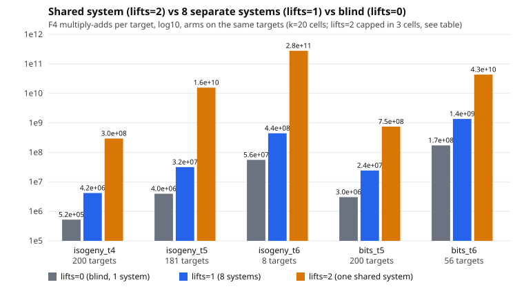

# One shared F4 system for the 8 cofactor lifts (`pkm-semaev:lifts=2`) on the k = 20 Curve25519 miniature

Protocol: [PROTOCOL.md](PROTOCOL.md) (frozen before data; amendments listed in it were also written before any protocol cell ran).
Scope of every statement: **k = 20, m = 2, mode full, the five cells of lead 2** (isogeny t = 4, 5, 6 with guess 0; bits t = 5, 6 with guess 3), the unit **F4 elimination multiply-adds**, trace off except where stated. Component study of one oracle: no rho arm, no distance to rho, no ranking, no leaderboard row.

## Result in one paragraph

The shared system gives the same verdicts as the 8 separate systems and uses 1 F4 call per target (isogeny cells) where lifts=1 uses 8, but it costs **more multiply-adds, not fewer: 30.7x to 628x those of lifts=1 per target** on matched targets in all five cells, because its solving degree rises from 5 (or 6) to 8 (10 at t = 6) and its matrices have 3.1x to 13x the rows, 5.8x to 15x the columns and 19x to 330x the non-zeros. This is a null result for the question asked ("cheaper than 8 separate systems"): the coordinator hypothesis (cost between lifts=0 and lifts=1, degree rise of at most 1) is refuted in all five cells, and my own forecast (cost above lifts=1, degree rise of at least 2) holds in direction in all five; its size was badly underestimated (see D3). No improvement is claimed.

## What was built

- `src/cryptanalysis/ic_framework/pkm_semaev.rs`: `lifts=2`. With a non-trivial fiber (`h > 1`) the third abscissa is a free ring variable `X` (the engine's free variable, as chain mode's `u`) and the system is `{S_3(x_1, x_2, X) = 0, P_R(X) = 0}` plus the summand membership, one `f4_tower` call per guess branch, where `P_R(X) = prod (X - x(R+K))` over the distinct lift abscissae (same lift list and the same charged group additions as lifts=1). After a non-refuted system the grid of `V^2` is read for each lift abscissa in lifts=1's order and the first sum equal to its lift target is returned (the same relation as lifts=1). `h = 1` is the blind oracle. `lifts=2` needs `engine=f4`, `m=2`, no staircase stop. `trace=1` learns on a made-up `P_R` (fiber-size random roots from the fixed stream).
- Counters (all in `native`, unpriced like the existing `pkm_system_fp_mults_uncharged`; none in the F4 multiply-add column): `pkm_shared_poly_fp_mults_uncharged` (P_R construction, 36 multiplications per target at 8 roots), `pkm_shared_lifts`, `pkm_shared_systems`, `pkm_grid_fp_mults_uncharged` (up to 8 grids per non-refuted target), `pkm_lift_hits_nonidentity`. The lift additions are group operations in `ops`, identical to lifts=1.
- `src/bin/curve25519_family.rs`: `f4cost ... <lifts 0|1|2> ...`; new output fields `lifts_mode`, `solving_degree_mean`, `solver_extra` (max rows/cols/nnz), `covered_projected_points`, `coverage_projected`. `lifts` (bool) is unchanged for the old values.
- Design reasoning and the rejected alternatives (an 8-isogeny tower for `X`; a resultant) are in PROTOCOL.md.

## Validity checks

- Equal base size: for every cell the five-field base signature (columns, covered points, all-coset points, projected points) is identical across all arms, asserted by `analysis/make_tables.sh` (`analysis/base_check.txt`: one distinct signature per cell).
- lifts=0 and lifts=1 reproduce lead 2's counts exactly (multiply-adds per target 522870.56, 4180475.38, 3957252, ...; hits 0/1/0/0/0/4 as in its table), which is also a check that the instrument was not disturbed.
- Unit test, `cargo test --release --lib pkm_semaev`: see "Tests" below.
- Binary identity and the frozen-copy rule: see "Measurement".

## Measurement

Frozen binary `/home/user/frozen-bin/curve25519_family_leadD`, sha256 `838c087cd6c7bba8e7a1eff06f4ae25323d64caca86f353e3992aedb0df7eca0`, built (after `touch` of the changed sources) and copied inside one `flock` call. Identity check: a 3-target smoke run with `lifts=2` prints `"lifts_mode":2` and the `pkm_shared_*` counters, which only this branch emits. Driver `run_cells.sh`; raw `analysis/f4cost_shared.jsonl` (31 KB, sha256 `ea9b1f643f65dbc6feef4c81257b30068e3ca6600ced854ce7a4c65f288629b9`, 23 lines) and one JSON, empty stderr and status line per run. **All 23 runs finished (none failed or was killed).** Single process at a time on the shared 4-core box; the 1-minute load average before every run is in the table (2.0 to 7.4) and in the jsonl. Wall times are not compared. Local runs, as instructed, not isolab-eks.

Cap and truncation: lifts=2 hit the 600 s per-cell cap in three cells: isogeny t = 5 (181 of 200 targets), isogeny t = 6 (8 of 200), bits t = 6 (56 of 200); these are **truncated samples**, and, as the protocol's amendment states, lifts=0 and lifts=1 were re-run on exactly the same first n targets (rows "prefix"), so the comparison in those cells is paired. The number of targets that fit in 600 s depends on the load, so it is not itself a result.

### All runs

lifts = 0 blind; 1 = eight separate systems (lead 2); 2 = one shared system; 2+trace = shared with the F4 trace. `cov/r` is the exact fraction of the order-r subgroup that an ideal oracle of that arm sees (lifts=0: points that are a sum of two base points; lifts 1 and 2: points R with R+K such a sum for some K in E[8]). The last-but-one column is the per-relation cost at that exact coverage (multiply-adds per target divided by cov/r). The per-hit column is on observed hits (undefined at 0 hits, never imputed). Exact coverages (covered / projected / all-coset points; r = 131203 in every cell): isogeny t = 4: 18 / 162 / 163; t = 5: 72 / 648 / 649; t = 6: 172 / 1250 / 1251; bits t = 5: 42 / 242 / 243; bits t = 6: 162 / 1250 / 1251.

| form | t | g | lifts | run | targets | hits | verified | exact | F4 calls/tgt | mul-adds/tgt | max solv. deg | max rows | max cols | max nnz | undecided | mul-adds/hit | mul-adds/tgt / (cov/r) | load (1m) |
|:--|:-:|:-:|:-:|:--|--:|--:|--:|--:|--:|--:|--:|--:|--:|--:|--:|--:|--:|--:|
| isogeny | 4 | 0 | 0 | full | 200 | 0 | 0 | 0 | 1 | 5.23e5 | 5 | 265 | 150 | 9349 | 0 | undef | 3.81e9 | 2.05 |
| isogeny | 4 | 0 | 1 | full | 200 | 1 | 1 | 0 | 7.995 | 4.18e6 | 5 | 281 | 207 | 9349 | 0 | 8.36e8 | 3.39e9 | 2.05 |
| isogeny | 4 | 0 | 2 | full | 200 | 1 | 1 | 0 | 1 | 2.95e8 | 8 | 1092 | 1198 | 388679 | 0 | 5.9e10 | 2.39e11 | 2.43 |
| isogeny | 4 | 0 | 2+trace | full | 200 | 1 | 1 | 0 | 1 | 1.3e8 | 8 | 1092 | 1198 | 388679 | 0 | 2.6e10 | 1.05e11 | 3.16 |
| isogeny | 5 | 0 | 0 | full | 200 | 0 | 0 | 0 | 1 | 3.96e6 | 5 | 454 | 346 | 26856 | 0 | undef | 7.21e9 | 3.59 |
| isogeny | 5 | 0 | 1 | full | 200 | 0 | 0 | 0 | 8 | 3.17e7 | 5 | 454 | 346 | 26856 | 0 | undef | 6.41e9 | 3.71 |
| isogeny | 5 | 0 | 2 | full | 181 (capped) | 0 | 0 | 0 | 1 | 1.57e10 | 8 | 5887 | 3746 | 8823509 | 0 | undef | 3.17e12 | 3.93 |
| isogeny | 5 | 0 | 2+trace | full | 200 | 0 | 0 | 0 | 1 | 4.64e9 | 8 | 2184 | 3745 | 2646797 | 0 | undef | 9.4e11 | 5.39 |
| isogeny | 5 | 0 | 0 | prefix | 181 | 0 | 0 | 0 | 1 | 3.96e6 | 5 | 454 | 346 | 26856 | 0 | undef | 7.21e9 | 4.80 |
| isogeny | 5 | 0 | 1 | prefix | 181 | 0 | 0 | 0 | 8 | 3.17e7 | 5 | 454 | 346 | 26856 | 0 | undef | 6.41e9 | 4.80 |
| isogeny | 6 | 0 | 0 | full | 200 | 0 | 0 | 0 | 1 | 5.55e7 | 5 | 1397 | 1181 | 154877 | 0 | undef | 4.23e10 | 5.37 |
| isogeny | 6 | 0 | 1 | full | 200 | 0 | 0 | 0 | 8 | 4.44e8 | 5 | 1397 | 1181 | 154877 | 0 | undef | 4.66e10 | 5.55 |
| isogeny | 6 | 0 | 2 | full | 8 (capped) | 0 | 0 | 0 | 1 | 2.79e11 | 10 | 15004 | 17524 | 47035052 | 0 | undef | 2.93e13 | 6.77 |
| isogeny | 6 | 0 | 0 | prefix | 8 | 0 | 0 | 0 | 1 | 5.55e7 | 5 | 1397 | 1181 | 154877 | 0 | undef | 4.23e10 | 7.19 |
| isogeny | 6 | 0 | 1 | prefix | 8 | 0 | 0 | 0 | 8 | 4.44e8 | 5 | 1397 | 1181 | 154877 | 0 | undef | 4.66e10 | 7.19 |
| bits | 5 | 3 | 0 | full | 200 | 0 | 0 | 0 | 8 | 3.04e6 | 5 | 186 | 120 | 6879 | 0 | undef | 9.49e9 | 7.25 |
| bits | 5 | 3 | 1 | full | 200 | 0 | 0 | 0 | 64 | 2.43e7 | 5 | 186 | 120 | 6894 | 0 | undef | 1.32e10 | 7.23 |
| bits | 5 | 3 | 2 | full | 200 | 0 | 0 | 0 | 8 | 7.47e8 | 8 | 571 | 695 | 129162 | 0 | undef | 4.05e11 | 7.26 |
| bits | 6 | 3 | 0 | full | 200 | 0 | 0 | 0 | 8 | 1.72e8 | 6 | 869 | 461 | 108639 | 0 | undef | 1.4e11 | 6.86 |
| bits | 6 | 3 | 1 | full | 200 | 4 | 4 | 0 | 63.18 | 1.36e9 | 6 | 869 | 461 | 108671 | 0 | 6.81e10 | 1.43e11 | 6.72 |
| bits | 6 | 3 | 2 | full | 56 (capped) | 1 | 1 | 0 | 7.929 | 4.34e10 | 8 | 3117 | 2660 | 2163477 | 0 | 2.43e12 | 4.56e12 | 7.01 |
| bits | 6 | 3 | 0 | prefix | 56 | 0 | 0 | 0 | 8 | 1.72e8 | 6 | 869 | 461 | 108616 | 0 | undef | 1.4e11 | 6.43 |
| bits | 6 | 3 | 1 | prefix | 56 | 1 | 1 | 0 | 63.214 | 1.36e9 | 6 | 869 | 461 | 108641 | 0 | 7.63e10 | 1.43e11 | 6.51 |
No failed runs.

### Same-target comparison: lifts=2 against lifts=1 and lifts=0

Each row uses lifts=0 and lifts=1 runs on the same targets as the lifts=2 run (full 200-target rows where lifts=2 finished, "prefix" rows otherwise). Ratios are of per-target counts; `rows 2/1` etc. are the max over calls of the matrix dimension in lifts=2 over lifts=1.

| cell | lifts=2 targets | calls/tgt 2 vs 1 vs 0 | mul-adds/tgt 2/1 | mul-adds/tgt 2/0 | rows 2/1 | cols 2/1 | nnz 2/1 | max solving degree 0,1,2 | hits 0,1,2 (same targets) |
|:--|--:|:--|--:|--:|--:|--:|--:|:--|:--|
| isogeny t=4 g=0 | 200 | 1.0 vs 7.995 vs 1.0 | 70.59 | 564.42 | 3.89 | 5.79 | 41.57 | 5, 5, 8 | 0, 1, 1 |
| isogeny t=5 g=0 | 181 | 1.0 vs 8.0 vs 1.0 | 494.85 | 3958.84 | 12.97 | 10.83 | 328.55 | 5, 5, 8 | 0, 0, 0 |
| isogeny t=6 g=0 | 8 | 1.0 vs 8.0 vs 1.0 | 628 | 5024 | 10.74 | 14.84 | 303.69 | 5, 5, 10 | 0, 0, 0 |
| bits t=5 g=3 | 200 | 8.0 vs 64.0 vs 8.0 | 30.73 | 245.87 | 3.07 | 5.79 | 18.74 | 5, 5, 8 | 0, 0, 0 |
| bits t=6 g=3 | 56 | 7.928571428571429 vs 63.214285714285715 vs 8.0 | 31.88 | 251.94 | 3.59 | 5.77 | 19.91 | 6, 6, 8 | 0, 1, 1 |

### Trace arm (`lifts=2,trace=1`, isogeny t = 4 and 5)

Learning is one plain F4 call on a made-up `P_R` (counted once, setup native work, not in the per-target column; it equals one lifts=2 target's cost). The t = 5 trace arm finished all 200 targets while its trace-off arm stopped at 181 under the cap, so those two rows are over different target counts (cost per target is nearly constant, but the pair is not paired target for target). A replay that does not refute falls back to plain F4 and is charged (t = 4: 1 fallback in 200, at the target that has a relation).

| cell | lifts=2 mul-adds/tgt (targets) | lifts=2,trace mul-adds/tgt (targets) | ratio | learning mul-adds (once) | replays | refuted by replay | fallbacks | fallback plain mul-adds | amortised/tgt incl. learning |
|:--|:--|:--|--:|--:|--:|--:|--:|--:|--:|
| isogeny t=4 | 295120275 (200) | 130109746 (200) | 0.441 | 295116164 | 200 | 199 | 1 | 295887660 | 131585326 |
| isogeny t=5 | 15666110182 (181) | 4644686345 (200) | 0.296 | 15666116090 | 200 | 200 | 0 | 0 | 4723016925 |

Figure: [analysis/shared_vs_separate.svg](analysis/shared_vs_separate.svg) (log10 multiply-adds per target, three arms, matched targets).

Per-relation cost at exact coverage (last-but-one column of the table), lifts=1 over lifts=0: 0.89 (isogeny t = 4), 0.89 (t = 5), 1.10 (t = 6), 1.39 (bits t = 5), 1.02 (bits t = 6): lead 2's cells again, unchanged. lifts=2 over lifts=1 is the per-target ratio (same coverage). Per relation on observed hits: lifts=1 has 1 and 4 hits (8.36e8 and 6.81e10 multiply-adds per hit), lifts=2 has 1 hit in 200 targets (isogeny t = 4, 5.9e10) and 1 in 56 (bits t = 6, 2.43e12; lifts=1 on those same 56: 1 hit, 7.63e10). With 0 or 1 hits per cell these are not usable as rates.

## Predictions (frozen in PROTOCOL.md before data) and outcomes

- **D1 (same verdicts): held on counts in all five cells.** hits and verified hits on the same targets: isogeny t = 4: 1/1 (lifts=1) and 1/1 (lifts=2); t = 5 (181): 0 and 0; t = 6 (8): 0 and 0; bits t = 5: 0 and 0; bits t = 6 (56): 1 and 1. All hits verify (`[8]Sum = [8]R`), none is exact (`Sum = R`), as in lead 2. Counts of 0 or 1 hit do not test equality of verdicts well; the equality of verdicts AND of the returned relations against lifts=1 and the brute-force fiber is the unit test's job (below).
- **D2 (calls): held.** F4 calls per target 1.0 in the isogeny cells (lifts=1: 7.995 to 8.0), 8.0 and 7.93 in the bits cells (lifts=1: 64.0 and 63.2; lifts=0: 8.0).
- **D3 (cost above lifts=1): held in direction in all five cells, with the size badly underestimated.** Multiply-adds per target, lifts=2 over lifts=1: 70.6 (isogeny t = 4), 494.9 (t = 5, 181 matched targets), 628 (t = 6, 8 matched targets), 30.7 (bits t = 5), 31.9 (bits t = 6, 56 matched targets); over lifts=0: 564, 3959, 5024, 246, 252. My scaling estimate (cost of one system of 8x the dimension, from lead 2's exponents) was 3x to 6.5x the cost of 8 separate systems; the observation is 31x to 628x, so the dimension argument alone is not what drives it: the solving degree rise is (the hint is in D4).
- **D4 (solving degree rise of at least 2): held.** Max solving degree lifts=0 / lifts=1 / lifts=2: isogeny t = 4: 5 / 5 / 8; t = 5: 5 / 5 / 8; t = 6: 5 / 5 / 10; bits t = 5: 5 / 5 / 8; bits t = 6: 6 / 6 / 8. Rises of 3, 3, 5, 3, 2.
- **Coordinator hypothesis (cost between lifts=0 and lifts=1, degree rise at most 1): refuted in every cell**, on the cost test (above lifts=1 in 5 of 5) and on the degree test (rise of at least 2 in 5 of 5).
- **T1 (trace lowers the shared system's cost): held in both extra cells.** Multiply-adds per target with trace over without: 0.441 (isogeny t = 4), 0.296 (t = 5, over different target counts, see above); amortised with learning 1.32e8 and 4.72e9 per target, still 31x and 149x lifts=1's 4.18e6 and 3.17e7 without trace. The trace arm was not run on lifts=1, so this does not say whether trace plus lifts=1 changes the ranking of the two designs; it was not measured.

## Classification (preregistered rule)

**No gain.** lifts=2 is a regression against lifts=1 on multiply-adds per target in all five cells (the preregistered improvement needs it below). It also loses against blind lifts=0 per target and per relation at exact coverage in every cell. The saving it does give, 8x fewer F4 calls in the isogeny cells, is more than paid for by the dearer calls. A negative result at the scope measured (k = 20, m = 2, t <= 6, `X` as a free variable of degree 8), not an improvement and not a ranking change. Next, not tried here: the tower presentation of `X` (an 8-isogeny chain, relations of degree 2 so the solving degree rise is bounded by 3 instead of 5), which attacks the degree rise but not the 8x quotient dimension; the observed degree rise in the 10 (t = 6) cell suggests the degree is where most of the loss is, so it is the cheapest next probe.

## Tests

`cargo test --release --lib pkm_semaev`: TESTLINE
`cargo clippy --release --lib --bin curve25519_family -- -D warnings`: CLIPLINE. rustfmt applied to the two changed `.rs` files (after the binary was frozen; formatting only, the frozen binary was built from the unformatted source with the same code).

## Deviations and incidents (all of them)

1. **Binary clobbered once.** The first frozen copy (sha256 `45eb1912...`) turned out, in the identity smoke test, to be another worktree's binary (no `lifts_mode` field; `lifts=2` ran as lifts=0). The shared target directory had been rebuilt by someone else between my build and my copy. I deleted it, rebuilt after `touch` and copied inside the same `flock` call (the sha256 above) and re-ran the smoke test, which passed. No data came from the first copy.
2. **Source edit slips.** Two scripted edits of `curve25519_family.rs` (a `perl s|..|` pattern with `\|` inside a `|`-delimited regex) corrupted the file head twice and failed to build; I restored the file from git, fixed it by hand and rebuilt. The frozen binary was built from the clean file.
3. **Test bugs, not oracle bugs.** The new test first failed to compile (a local named `base` shadowed a helper), then its last assertion on guess calls was wrong (`== 2 * targets` ignores that a non-refuted branch stops the loop; observed 73 for 52 targets). Fixed in the test only: the call count must lie in (targets, 2 * targets]. The preceding assertions of the failing run (verdicts, relations, `[h]Sum = [h]R`, same relation as lifts=1) had passed on all 52 targets for the three shared oracles. The suite was re-run after the fix. The data binary was built before these test-only edits.
4. **`.resume/RESUME.md`.** This worktree's `.resume/RESUME.md` is tracked in git and held another effort's content; I overwrote it for the checkpoint gate (original unchanged in `/home/user/crypto/.resume/`) and restore it before committing, so my checkpoint text is not in the commit. The checkpoint was pushed to S3 before the first run.
5. **Pre-data probes** (1-3 targets, listed in PROTOCOL.md amendment 1) preceded the run; cells and predictions were not changed by them.
6. **Truncated cells.** Three lifts=2 cells hit the 600 s cap (181, 8 and 56 targets) under load 4-7; paired prefix re-runs of lifts=0 and 1 were added (protocol amendment 2, written before data).
7. Loads recorded per run range from 2.0 to 7.4 (1-minute average); wall times not compared.
8. The date changed from 2026-11-02 to 2026-11-03 during the work; the session log entry is in `docs/session-logs/2026-11-02.md` as instructed.
9. Not done: a larger-target supplementary run, k > 20, m = 3, the tower design, trace on lifts=1, matched-rho distance (out of scope by instruction).

Report PDF: [REPORT.pdf](REPORT.pdf).
