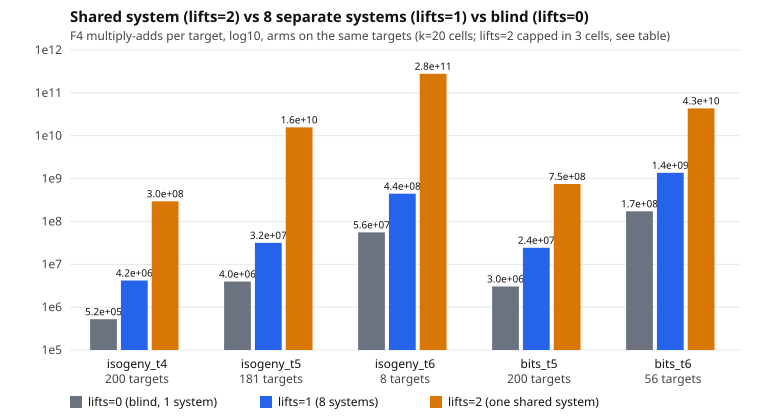

Figure: [analysis/shared_vs_separate.svg](analysis/shared_vs_separate.svg) (log10 multiply-adds per target, three arms, matched targets).

Per-relation cost at exact coverage (last-but-one column of the table), lifts=1 over lifts=0: 0.89 (isogeny t = 4), 0.89 (t = 5), 1.10 (t = 6), 1.39 (bits t = 5), 1.02 (bits t = 6): lead 2's cells again, unchanged. lifts=2 over lifts=1 is the per-target ratio (same coverage). Per relation on observed hits: lifts=1 has 1 and 4 hits (8.36e8 and 6.81e10 multiply-adds per hit), lifts=2 has 1 hit in 200 targets (isogeny t = 4, 5.9e10) and 1 in 56 (bits t = 6, 2.43e12; lifts=1 on those same 56: 1 hit, 7.63e10). With 0 or 1 hits per cell these are not usable as rates.

## Predictions (frozen in PROTOCOL.md before data) and outcomes

- **D1 (same verdicts): held on counts in all five cells.** hits and verified hits on the same targets: isogeny t = 4: 1/1 (lifts=1) and 1/1 (lifts=2); t = 5 (181): 0 and 0; t = 6 (8): 0 and 0; bits t = 5: 0 and 0; bits t = 6 (56): 1 and 1. All hits verify (`[8]Sum = [8]R`), none is exact (`Sum = R`), as in lead 2. Counts of 0 or 1 hit do not test equality of verdicts well; the equality of verdicts AND of the returned relations against lifts=1 and the brute-force fiber is the unit test's job (below).
- **D2 (calls): held.** F4 calls per target 1.0 in the isogeny cells (lifts=1: 7.995 to 8.0), 8.0 and 7.93 in the bits cells (lifts=1: 64.0 and 63.2; lifts=0: 8.0).
- **D3 (cost above lifts=1): held in direction in all five cells, with the size badly underestimated.** Multiply-adds per target, lifts=2 over lifts=1: 70.6 (isogeny t = 4), 494.9 (t = 5, 181 matched targets), 628 (t = 6, 8 matched targets), 30.7 (bits t = 5), 31.9 (bits t = 6, 56 matched targets); over lifts=0: 564, 3959, 5024, 246, 252. My scaling estimate (cost of one system of 8x the dimension, from lead 2's exponents) was 3x to 6.5x the cost of 8 separate systems; the observation is 31x to 628x, so the dimension argument alone is not what drives it: the solving degree rise is (the hint is in D4).
- **D4 (solving degree rise of at least 2): held.** Max solving degree lifts=0 / lifts=1 / lifts=2: isogeny t = 4: 5 / 5 / 8; t = 5: 5 / 5 / 8; t = 6: 5 / 5 / 10; bits t = 5: 5 / 5 / 8; bits t = 6: 6 / 6 / 8. Rises of 3, 3, 5, 3, 2.
- **Coordinator hypothesis (cost between lifts=0 and lifts=1, degree rise at most 1): refuted in every cell**, on the cost test (above lifts=1 in 5 of 5) and on the degree test (rise of at least 2 in 5 of 5).
- **T1 (trace lowers the shared system's cost): held in both extra cells.** Multiply-adds per target with trace over without: 0.441 (isogeny t = 4), 0.296 (t = 5, over different target counts, see above); amortised with learning 1.32e8 and 4.72e9 per target, still 31x and 149x lifts=1's 4.18e6 and 3.17e7 without trace. The trace arm was not run on lifts=1, so this does not say whether trace plus lifts=1 changes the ranking of the two designs; it was not measured.

## Classification (preregistered rule)

**No gain.** lifts=2 is a regression against lifts=1 on multiply-adds per target in all five cells (the preregistered improvement needs it below). It also loses against blind lifts=0 per target and per relation at exact coverage in every cell. The saving it does give, 8x fewer F4 calls in the isogeny cells, is more than paid for by the dearer calls. A negative result at the scope measured (k = 20, m = 2, t <= 6, `X` as a free variable of degree 8), not an improvement and not a ranking change. Next, not tried here: the tower presentation of `X` (an 8-isogeny chain, relations of degree 2 so the solving degree rise is bounded by 3 instead of 5), which attacks the degree rise but not the 8x quotient dimension; the observed degree rise in the 10 (t = 6) cell suggests the degree is where most of the loss is, so it is the cheapest next probe.

## Tests

`cargo test --release --lib pkm_semaev`: TESTLINE
`cargo clippy --release --lib --bin curve25519_family -- -D warnings`: CLIPLINE. rustfmt applied to the two changed `.rs` files (after the binary was frozen; formatting only, the frozen binary was built from the unformatted source with the same code).

## Deviations and incidents (all of them)

1. **Binary clobbered once.** The first frozen copy (sha256 `45eb1912...`) turned out, in the identity smoke test, to be another worktree's binary (no `lifts_mode` field; `lifts=2` ran as lifts=0). The shared target directory had been rebuilt by someone else between my build and my copy. I deleted it, rebuilt after `touch` and copied inside the same `flock` call (the sha256 above) and re-ran the smoke test, which passed. No data came from the first copy.
2. **Source edit slips.** Two scripted edits of `curve25519_family.rs` (a `perl s|..|` pattern with `\|` inside a `|`-delimited regex) corrupted the file head twice and failed to build; I restored the file from git, fixed it by hand and rebuilt. The frozen binary was built from the clean file.
3. **Test bugs, not oracle bugs.** The new test first failed to compile (a local named `base` shadowed a helper), then its last assertion on guess calls was wrong (`== 2 * targets` ignores that a non-refuted branch stops the loop; observed 73 for 52 targets). Fixed in the test only: the call count must lie in (targets, 2 * targets]. The preceding assertions of the failing run (verdicts, relations, `[h]Sum = [h]R`, same relation as lifts=1) had passed on all 52 targets for the three shared oracles. The suite was re-run after the fix. The data binary was built before these test-only edits.
4. **`.resume/RESUME.md`.** This worktree's `.resume/RESUME.md` is tracked in git and held another effort's content; I overwrote it for the checkpoint gate (original unchanged in `/home/user/crypto/.resume/`) and restore it before committing, so my checkpoint text is not in the commit. The checkpoint was pushed to S3 before the first run.
5. **Pre-data probes** (1-3 targets, listed in PROTOCOL.md amendment 1) preceded the run; cells and predictions were not changed by them.
6. **Truncated cells.** Three lifts=2 cells hit the 600 s cap (181, 8 and 56 targets) under load 4-7; paired prefix re-runs of lifts=0 and 1 were added (protocol amendment 2, written before data).
7. Loads recorded per run range from 2.05 to 7.26 (1-minute average); wall times not compared.
8. The date changed from 2026-11-02 to 2026-11-03 during the work; the session log entry is in `docs/session-logs/2026-11-02.md` as instructed.
9. Not done: a larger-target supplementary run, k > 20, m = 3, the tower design, trace on lifts=1, matched-rho distance (out of scope by instruction).

Report PDF: [REPORT.pdf](REPORT.pdf).
