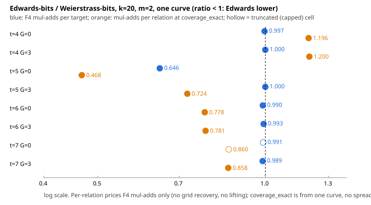

# Lead 5: Semaev S_3 in Ed25519's Edwards coordinate, F4 cost at m = 2

Date 2026-11-02. Branch `lead5-edwards-semaev`. Protocol: `PROTOCOL.md`
(written before data) plus its Amendment 1 (pre-data: new CLI argument positions only).

**Scope of every statement here:** k = 20 miniature, one curve (no spread across curves),
m = 2, t in {4,5,6,7}, hybrid guess G in {0,3}, intervals starting at 0, 100 targets
per cell (two cells were cut short, see below), one seed per t. Nothing is said about
m = 3, other offsets or sets, other k or curves, or the 255-bit setting. There is no
complete DLP in this run, so no rho comparison is made.

## What was built

- `PkmSemaevOracle::new_edwards_bits(m, t)` with `Membership::EdwardsBits`: the
  summands are Edwards y in [0, 2^t) written in bits, x_W = (1+y)/(1-y) + A/3, with S_3
  cleared of denominators (`s3_in_u_frac`). The shift A/3 is derived in `prepare`.
  `from_spec` accepts `edwards_bits=T`. `edwards_factor_base` builds the matching base
  in the harness.
- `curve25519_family f4cost` form `edwards-bits`, with `max_nnz` as the last argument
  (position 12 after `[m] [mode] [lifts]`).
- Rebased onto the main line, keeping lead 2 (lifts), lead 3 (m = 3) and lead 4 (isogeny
  guessing).

Tests: `cargo test --release --lib pkm_semaev` gives
`test result: ok. 14 passed; 0 failed; 0 ignored; 0 measured; 6075 filtered out`.
The Edwards tests are `edwards_bits_form_agrees_with_grid` (F4 verdict equals grid
verdict, with and without guessing, plus an explicit shift on a non-Montgomery curve),
`edwards_bits_m3_planted_decompositions`, and `edwards_shift_is_the_two_torsion_abscissa`.
`cargo clippy --release --lib --bin curve25519_family -- -D warnings` is clean (the only
output is an unknown-lint warning for `clippy::chunks_exact_to_as_chunks`, which comes
from the build flags).

## Run

Frozen binary `/home/user/frozen-bin/curve25519_family_lead5`, sha256 in
`analysis/binary.sha256` (`ec9cb40d...5f`). Command per cell (`run_cells.sh`):
`curve25519_family f4cost 20 <form> <t> <G> 100 <2026111500+t> 600 2 full 0 30000000`,
sequential, `ulimit -v 3500000`, `timeout 900`. Raw output: `cells/*.json`, `*.status`
(with `uptime` at start and end), `*.stderr` (all empty). All 16 cells exited 0. The host
was shared with other jobs; load average read 6.7 to 12.9 across the cell status files.

## Per-cell table

`mul-adds/target` = F4 multiply-adds per target; `calls/target` = F4 calls per target
(G = 3 makes 8 guess specialisations per target); `deg` = max solving degree;
`hits/ver` = relations returned / re-summed to the target; `cov_exact` = the cell's
`coverage_exact`; `per-rel` = mul-adds/target divided by `cov_exact`
(`muladds_per_relation_at_exact_coverage`); `terms` = polynomial terms per specialisation;
`wall` in seconds.

| form | t | G | cols | targets | mul-adds/target | calls/target | deg | hits/ver | cov_exact | per-rel | capped | undecided | terms | wall |
|---|---|---|---|---|---|---|---|---|---|---|---|---|---|---|
| bits | 4 | 0 | 7 | 100 | 4046085 | 1.0 | 6 | 0/0 | 9.1e-05 | 44238212441 | no | 0 | 121.0 | 1 |
| edwards-bits | 4 | 0 | 7 | 100 | 4033474 | 1.0 | 6 | 0/0 | 7.6e-05 | 52920398631 | no | 0 | 121.0 | 1 |
| bits | 4 | 3 | 7 | 100 | 88840 | 8.0 | 4 | 0/0 | 9.1e-05 | 971339543 | no | 0 | 22.0 | 0 |
| edwards-bits | 4 | 3 | 7 | 100 | 88839 | 8.0 | 4 | 0/0 | 7.6e-05 | 1165603122 | no | 0 | 22.0 | 0 |
| bits | 5 | 0 | 11 | 100 | 127284344 | 1.0 | 6 | 0/0 | 0.00032 | 397621138726 | no | 0 | 256.0 | 9 |
| edwards-bits | 5 | 0 | 14 | 100 | 82230218 | 1.0 | 6 | 0/0 | 0.000442 | 186014679579 | no | 0 | 256.0 | 7 |
| bits | 5 | 3 | 11 | 100 | 3036911 | 8.0 | 5 | 0/0 | 0.00032 | 9486950801 | no | 0 | 64.0 | 2 |
| edwards-bits | 5 | 3 | 14 | 100 | 3036922 | 8.0 | 5 | 0/0 | 0.000442 | 6869884812 | no | 0 | 64.0 | 1 |
| bits | 6 | 0 | 25 | 100 | 1753618663 | 1.0 | 7 | 0/0 | 0.001235 | 1420247095569 | no | 0 | 484.0 | 90 |
| edwards-bits | 6 | 0 | 29 | 100 | 1735358140 | 1.0 | 7 | 1/1 | 0.00157 | 1105263078493 | no | 0 | 484.0 | 84 |
| bits | 6 | 3 | 25 | 100 | 172425384 | 8.0 | 6 | 0/0 | 0.001235 | 139646467528 | no | 0 | 154.0 | 23 |
| edwards-bits | 6 | 3 | 29 | 100 | 171213569 | 7.99 | 6 | 1/1 | 0.00157 | 109047252082 | no | 0 | 154.0 | 26 |
| bits | 7 | 0 | 58 | 22 | 79397189460 | 1.0 | 7 | 0/0 | 0.00628 | 12642171661090 | CAPPED (truncated) | 0 | 841.0 | 601 |
| edwards-bits | 7 | 0 | 63 | 31 | 78692183259 | 1.0 | 7 | 0/0 | 0.007241 | 10868053179133 | CAPPED (truncated) | 0 | 841.0 | 616 |
| bits | 7 | 3 | 58 | 100 | 3484169705 | 8.0 | 6 | 0/0 | 0.00628 | 554773686790 | no | 0 | 319.0 | 204 |
| edwards-bits | 7 | 3 | 63 | 100 | 3445674737 | 7.93 | 6 | 0/0 | 0.007241 | 475876697388 | no | 0 | 319.0 | 201 |

The two t = 7, G = 0 cells hit the 600 s wall cap (22 targets for Weierstrass, 31 for
Edwards, 601 s and 616 s) on a loaded host. **They are truncated samples**: their
per-target means are over different, smaller target sets and are not comparable with
the 100-target cells or with each other at full strength. No other cell was capped and
no system was undecided.

## Edwards vs Weierstrass, paired by (t, G)

Ratio = Edwards / Weierstrass. Per-relation uses each form's own `coverage_exact`.

| t | G | mul-adds/target | per-relation (F4 mul-adds only) | note |
|---|---|---|---|---|
| 4 | 0 | 0.997 | 1.196 | |
| 4 | 3 | 1.000 | 1.200 | |
| 5 | 0 | 0.646 | 0.468 | Edwards base has 14 columns, Weierstrass 11 |
| 5 | 3 | 1.000 | 0.724 | |
| 6 | 0 | 0.990 | 0.778 | |
| 6 | 3 | 0.993 | 0.781 | |
| 7 | 0 | 0.991 | 0.860 | both cells truncated (capped) |
| 7 | 3 | 0.989 | 0.858 | |

What the measurements show, within the scope above:

- Solving degree is identical in every pair (6/6, 4/4, 6/6, 5/5, 7/7, 6/6, 7/7, 6/6),
  and so is the polynomial size per specialisation (121, 22, 256, 64, 484, 154, 841, 319).
- Mul-adds per target are within about 1.1 percent of each other in 7 of 8 pairs. The
  exception is t = 5, G = 0, where Edwards is 0.646 of Weierstrass; the same t with G = 3
  shows a ratio of 1.000. The polynomial sizes are equal there, so this run does not
  say why G = 0 differs. It is a single cell with one seed.
- The per-relation ratio is mostly the ratio of `coverage_exact`: Edwards covers more
  points than Weierstrass at t >= 5 and fewer at t = 4 (cols 7 vs 7, cov_exact 7.6e-5
  vs 9.1e-5). At t = 4 the per-relation figure is worse for Edwards, at t >= 5 it is better.
  The support figures behind this are single-curve counts (`analysis/support-cells.jsonl`,
  re-measured with the frozen binary), with no spread.
- Hits: 2 relations across the 16 cells, both from Edwards t = 6 cells (one at G = 0,
  one at G = 3, both re-summed to the target). Weierstrass returned none. With
  `coverage_exact` near 1e-3 and 100 targets, the expected number of hits per cell is
  about 0.1, so the hit counts do not discriminate between the forms.

## Predictions (PROTOCOL.md, "Preregistered expectation")

1. "Edwards S_3 has no lower solving degree at m = 2": **held** in all 8 pairs
   (equal degree).
2. "Any F4 difference is expected to be a constant factor from sparsity and the number
   of points": **inconclusive**. Seven pairs differ by at most about 1.1 percent in mul-adds
   per target, one pair (t = 5, G = 0) by a factor 0.646, with equal polynomial size, so
   sparsity of the cleared polynomial does not explain it here. The cause was not
   investigated. Different numbers of points show up in `coverage_exact`, which
   changes the per-relation figure.
3. The per-relation ordering (Edwards lower at t >= 5, higher at t = 4) was not
   predicted either way.

## Deviations from the protocol

1. Amendment 1 (pre-data): CLI argument positions; cells run strictly sequentially
   instead of two at a time.
2. The test `edwards_bits_form_agrees_with_grid` was changed from t in {3,4,5} to {4,5}:
   on the Montgomery toy the t = 3 Edwards base has one column, which tripped the test's own
   `columns >= 3` guard. The F4-versus-grid comparison is unchanged.
3. Per-relation cost uses each cell's own `coverage_exact` field, not the `lambda`
   of the `support` subcommand. The two differ (for example t = 4: 9.1e-5 against 7.5e-4)
   and were not reconciled; `analysis/support-cells.jsonl` holds the support output as
   re-measured.
4. Two cells were truncated by the 600 s cap under load (above). Host load was not
   controlled; no repeat of any cell was run.
5. A first frozen-binary copy was another agent's build from the shared target
   directory and was discarded before any cell ran; the binary used was rebuilt
   (forced recompile) and checked to contain this tree's strings and to run `edwards-bits`.
6. A one-target smoke run of `edwards-bits` t = 4 was made to check the binary; it is not
   part of the data.

## Not measured

Offsets or other windows, sets structured in y, m = 3 cost, other k, other curves,
repeat seeds, spread between runs, the cost of grid recovery or lifting.

## Coordinator review (main session, 2026-11-02)

- **The arms are paired at equal t, not at equal base size.** The Edwards-y
  interval [0, 2^t) holds a different number of base points from the
  Weierstrass interval: 7/7, 14/11, 29/25 and 63/58 columns at t = 4, 5, 6, 7.
  The per-relation ratios mostly follow `coverage_exact`, which follows the
  base size. A ratio below 1 here is therefore not evidence that the Edwards
  algebra is cheaper. An equal-columns comparison (choose the Edwards window or
  offset so the columns match) was not run.
- **The one per-target difference is unexplained.** At t = 5, G = 0 Edwards
  costs 0.646x as much per target, with more columns (14 vs 11), the same
  solving degree and the same polynomial size. Without a mechanism it is a
  single-seed observation, and it needs a repeat over seeds before it is read
  as an effect.
- **Scope of the conclusions.** At k = 20, m = 2, one curve, one seed per t:
  the solving degree is the same in every pair; F4 cost per target is the same
  to within about 1% in 7 of 8 pairs; and per-relation differences come from
  base composition. Nothing here says Edwards coordinates give or do not give
  an advantage beyond these cells.
