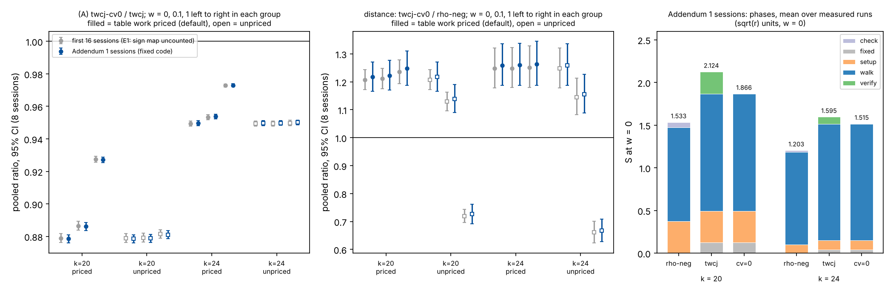

# Two engine items on the Curve25519-family miniatures, single-target ecbench (2026-11-10)

**Class.** Measured, single-target ecbench sessions under a protocol written before data
([PROTOCOL.md](PROTOCOL.md)). The protocol text was written by the session that was interrupted
by a container restart; at the restart no session, plan output or measured record of this study
existed (the study directory held only the protocol, the specs, the scripts and the pre-data
model `data/model.json`). The resumed session committed that state unchanged (commit
`resume state after restart`), recorded the protocol's SHA-256 in `data/frozen.sha256` (freeze
commit `545749ac7d`), and only then ran any session, so the predictions below count as
preregistered from that commit. Counted units only (ecbench GAE, S = cost/sqrt(r)); every
comparison at w = 0, 0.1 and 1 under both band readings (table work priced, the default since
2026-11-08, and `--no-price-table-work`). Public synthetic Curve25519-family miniatures; no
security claim. No pcc claim has been filed; every number is an unverified assertion until it is
reviewed [pcc:unverified].

**Scope.** Both items are constant-factor changes on the generic track. The F = 1 target-in-walk
arm (`twcj`) is one unknown away from rho and is not decomposition-based index calculus. Item (B)
changes the rho reference the programme is measured against, not any arm; a cheaper reference
would raise every arm's distance to rho, and a dearer one is not adopted as the reference.

**Validation.** An independent validator passed the study with errata (`validator-report.json`,
status `pass_with_errata`). The major erratum E1 (the measured cv=0 code kept the sign bit in a
second, uncounted hash map) was fixed and the (A) predictions were re-decided on 16 fresh sessions
under a protocol addendum (section 10); every erratum and how it was applied is in section 11.

**Answer.**
(A) Dropping the per-collision recomputation (`wwalk ... cv=0`) saves exactly the collision
verification ledger in counted group operations: the cv=0 arm costs 0.879x [0.876, 0.882] the current arm at
k = 20 and 0.949x [0.948, 0.951] at k = 24 (w = 0), matching the frozen model points 0.880 and
0.950, and every one of 1,024 paired runs walks the same steps, rows and rank, recovers the same
logarithm and differs in total by exactly the default run's `tw_verify_adds` [pcc:unverified].
A1, A1b, A2 and A3 pass; A4 passes on the counted work of these records, which left out the
cv=0 sign-map work of erratum E1, so it was re-decided by Addendum 1 (section 10) [pcc:unverified].
(B) The chained jump set-up for rho-neg saves the set-up as modelled (61.2 GAE against the
model's 61.5 at k = 20; 68.4 against 68.1 at k = 24), but the dependent jump table more than
doubles the walk: rho-neg-chained costs 1.532x [1.402, 1.673] rho-neg at k = 20 and 2.738x
[2.583, 2.903] at k = 24 (w = 0) [pcc:unverified]. B1, B2 and B3 fail; only B4 (set-up within
10 % of the model) passes [pcc:unverified]. The chained reference is therefore rejected: it is not
a stronger rho, and the distance to rho stays measured against `rho.negation` [pcc:unverified].
Distance remaining for the improved arm: twcj-cv0 / rho-neg is 1.207 [1.172, 1.243] at k = 20 and
1.248 [1.179, 1.320] at k = 24 at w = 0, down from 1.373 and 1.314 for the current arm in the same
sessions [pcc:unverified].
(A, re-measured after the E1 fix, Addendum 1.) On the fixed code, which keeps the sign bit inside
the table entry and makes no extra hash operation, cv0 / twcj is 0.879 [0.876, 0.881] at k = 20 and
0.950 [0.948, 0.951] at k = 24 at w = 0, and 0.927 [0.925, 0.929] and 0.973 [0.972, 0.974] at w = 1
with table work priced; A1, A1b, A2, A3 and A4 all pass on 16 new sessions [pcc:unverified]. The
distance remaining, twcj-cv0 / rho-neg, is 1.217 [1.166, 1.271] at k = 20 and 1.259 [1.187, 1.336]
at k = 24 at w = 0; with table work priced rho-neg ranks ahead at every weight, and with it unpriced
the order flips at w = 1 (0.726 and 0.667), so the pair is unresolved across the band under that
reading [pcc:unverified].

The figure of the first 16 sessions (both items, against the frozen model) is
`figures/engine_items.png`.

## 1. Implementation (as committed before data)

- (A) `wwalk` parameter `cv` (default 1, unchanged; `cv=0` needs `tw=1`). With `cv=0`,
  `TargetWalk::build_cv` keeps each stored entry's key sign bit and turns a key collision (an exact
  abscissa match on these curves, so `E_t = ±E_s`) into a row without recomputing either entry. The
  final `[d]G = Q` check of the relation loop is kept and charged; a failed check is a failed solve
  (`verification_failures`), never a retry. Correction (erratum E1): in the measured code of the first
  16 sessions the sign bit was not stored beside the coefficients, as PROTOCOL.md section 2 says, but
  in a separate hash map (`signs`, uncounted): one extra hash insert per stored entry and one extra
  lookup per collision. Addendum 1 fixes this (the bit rides in bit 63 of the entry's `u` word) and
  re-measures (section 10). Correction (erratum E9): the guard refuses a group unless negation flips
  the key's low bit at one point (the seed `P1`). That refuses every hashed key in the codebase
  (Curve25519Wide and Genus2 always, the mix64 keys except with probability about 2^-64). It does not
  check that `key >> 1` is injective: a key `(f(x) << 1) | sign` with a non-injective `f` would pass,
  and there a false collision would emit a wrong row. Correctness on such keys rests on the charged
  final check, which fails the solve without a retry. On the curves measured here (`PrimeCurve`,
  p < 2^62) `key >> 1` is the exact abscissa plus one.
- (B) method `rho.negation_chained`: the first two jumps by joint scalar multiplication with
  9-bit coefficients, every later jump `M_j = M_{j-1} + M_{j-2}` by one charged addition; walk,
  starts, distinguished points, look-ahead, cycle window and charged final check are those of
  `rho.negation`, which is untouched. Erratum E3: the `bitop/v1` work block of every rho-neg-chained
  record of the first 16 sessions is invalid (search and verification group operations missing,
  `chained_setup` unrecognised, so `work.ratio_to_floor` of 0.316 and 0.199 on average, below the
  floor); this study does not cite bitops. The method is now in `gae_carries_group_ops`,
  `chained_setup` is a shape counter, and it is registered `DiagnosticOnly`. That is a pricing change: committed records are not rewritten; it touches the work block only,
  not the counted GAE (the fixed binary's `--replay-all` of first-study session k20-s3 reproduced its
  64 chained records, section 10) [pcc:unverified].
- Files: `src/cryptanalysis/ic_boundary.rs`, `src/cryptanalysis/ecbench/methods.rs`,
  `src/cryptanalysis/ic_framework/plugins.rs`, `src/cryptanalysis/ecbench/optimization.rs`.

## 2. Unit tests

`cargo test --release --lib -- engine_items_tests target_walk wwalk rho_negation negation plan_refuses`
(`data/unit-tests.txt`): 47 passed, 0 failed, 1 ignored [pcc:unverified]. The first run had one
failure, `wwalk_cv0_recovers_and_saves_exactly_the_verification`, caused by the test's own helper
reading `tw_verify_adds` only from the report counters while the pipeline reports it as a native of
the `relations` phase; the helper was fixed (test code only, commit `2fb33b08c2`) and the rerun
passed [pcc:unverified]. The ecbench binary was built before that test-only edit; the edit is
inside a `#[cfg(test)]` module, so the binary's code is unchanged by it.
Erratum E2: that filter left out the existing registry audit
`every_registered_method_is_run_skipped_or_exempt_and_its_phases_sum`, which failed on the new id
(`rho.negation_chained: registered but neither a case nor a skip`). The id is now a case
(`("rho.negation_chained", Fx::Prime18, &[])`) and the audit passes; see section 10 for the
amendment's test run (`amendment1/data/unit-tests.txt`) [pcc:unverified].

## 3. Design (as frozen)

8 sessions per size (k = 20: p = 1,048,573, r = 131,203; k = 24: p = 16,777,213, r = 2,097,349),
`targets_per_curve = 1`, 64 measured rounds plus 1 warm-up per arm, `order = alternate`; arms
`rho-neg` (`rho.negation`), `rho-neg-chained`, `twcj`
(`wwalk:x=1.5,g=1,grow=2,tw=1,cj=1,jumps=16,seed=run` on `prime-projected-abscissa:size=1,scan_cap=32`)
and `twcj-cv0` (the same with `cv=0`). Audit: `ecbench verify --replay 1` per session. Pooling:
ratio of per-session sums over measured rounds, log-scale linearised t interval
`R·exp(±t·se/R)` (`scripts/pooled_compare.py`), df = 7, warm-ups excluded; a plain linear interval
differs only in the third decimal for the wide (B) intervals.
Binary `/home/user/ctarget-f1/release/ecbench`, SHA-256 `af8d10db...` (`data/binary-k{20,24}.sha256`).
Runtime: 43 s at k = 20 and 43 s at k = 24 (`data/run.log`).

## 4. Results (measured)

All 16 sessions completed with 260 of 260 records verified each (warm-ups included), and every
audit reproduced its replay with 0 problems (`data/verify-k*-s*.txt`) [pcc:unverified]. No session
was interrupted, so none was rerun [pcc:unverified]. Pooled figures use 2,048 measured records per
size (`data/pooled_measured.json`) [pcc:unverified].

Mean S per arm (priced = table work priced at w, the default; unpriced = `--no-price-table-work`):

| k | arm | S w=0 | w=0.1 priced | w=1 priced | w=0.1 unpriced | w=1 unpriced |
|--:|:--|--:|--:|--:|--:|--:|
| 20 | rho-neg | 1.553 | 1.665 | 2.669 | 1.665 | 2.669 |
| 20 | rho-neg-chained | 2.379 | 2.594 | 4.527 | 2.594 | 4.527 |
| 20 | twcj | 2.133 | 2.275 | 3.556 | 2.137 | 2.178 |
| 20 | twcj-cv0 | 1.875 | 2.017 | 3.298 | 1.879 | 1.920 |
| 24 | rho-neg | 1.212 | 1.322 | 2.306 | 1.322 | 2.306 |
| 24 | rho-neg-chained | 3.319 | 3.645 | 6.572 | 3.645 | 6.572 |
| 24 | twcj | 1.593 | 1.730 | 2.967 | 1.594 | 1.604 |
| 24 | twcj-cv0 | 1.512 | 1.650 | 2.886 | 1.513 | 1.523 |

The table above is measured [pcc:unverified].

Pooled ratios, 95 % interval, 8 sessions (one target each):

| k | ratio | reading | w = 0 | w = 0.1 | w = 1 |
|--:|:--|:--|:--|:--|:--|
| 20 | (A) twcj-cv0 / twcj | priced | 0.879 [0.876, 0.882] | 0.887 [0.884, 0.889] | 0.927 [0.926, 0.929] |
| 20 | (A) twcj-cv0 / twcj | unpriced | 0.879 [0.876, 0.882] | 0.879 [0.876, 0.882] | 0.881 [0.879, 0.884] |
| 24 | (A) twcj-cv0 / twcj | priced | 0.949 [0.948, 0.951] | 0.953 [0.952, 0.955] | 0.973 [0.972, 0.974] |
| 24 | (A) twcj-cv0 / twcj | unpriced | 0.949 [0.948, 0.951] | 0.949 [0.948, 0.951] | 0.950 [0.948, 0.951] |
| 20 | (B) rho-neg-chained / rho-neg | both | 1.532 [1.402, 1.673] | 1.558 [1.425, 1.703] | 1.696 [1.542, 1.865] |
| 24 | (B) rho-neg-chained / rho-neg | both | 2.738 [2.583, 2.903] | 2.758 [2.600, 2.925] | 2.850 [2.681, 3.029] |

The table above is measured; the rho arms carry no table work, so both readings coincide for (B)
[pcc:unverified].

## 5. Predictions (frozen) and verdicts

| id | prediction | measured | verdict |
|:--|:--|:--|:--|
| A1 | k=20, w=0: point ≤ 0.95, upper < 1 | 0.879 [0.876, 0.882] | pass |
| A1b | k=20, w=0: point in [0.86, 0.90] | 0.879 | pass |
| A2 | k=24, w=0: point in [0.93, 0.97], upper < 1 | 0.949 [0.948, 0.951] | pass |
| A3 | identity of paired runs; difference = `tw_verify_adds` exactly | 512 + 512 pairs, 0 mismatches | pass |
| A4 | both sizes, priced, w=1: upper < 1 | 0.929 (k=20), 0.974 (k=24) | pass on counted work; a lower bound for cv0 (E1); re-decided in section 10 |
| B1 | k=20, w=0: point in [0.91, 0.95] (assigned) | 1.532 | fail |
| B2 | k=20 point in [0.84, 0.90]; k=24 in [0.93, 0.99] | 1.532; 2.738 | fail |
| B3 | search-phase ratio in [0.95, 1.05], both sizes | 1.927 [1.737, 2.138]; 2.974 [2.790, 3.170] | fail |
| B4 | mean set-up within 10 % of 61.5 / 68.1 GAE | 61.16 / 68.41 GAE | pass |
| C | every record verified, no failed final check | 4,160 of 4,160 verified | pass |

Verdicts are scored from the measured values in the table [pcc:unverified].

## 6. Phase breakdown (mean, sqrt(r) units, w = 0)

| k | arm | fixed (base, LA, check) | set-up | walk / search | collision verify | final check | total |
|--:|:--|--:|--:|--:|--:|--:|--:|
| 20 | rho-neg | — | 0.375 | 1.113 | — | 0.065 | 1.553 |
| 20 | rho-neg-chained | — | 0.169 | 2.145 | — | 0.065 | 2.379 |
| 20 | twcj | 0.129 | 0.368 | 1.378 | 0.258 | (in fixed) | 2.133 |
| 20 | twcj-cv0 | 0.129 | 0.368 | 1.378 | 0.000 | (in fixed) | 1.875 |
| 24 | rho-neg | — | 0.099 | 1.093 | — | 0.020 | 1.212 |
| 24 | rho-neg-chained | — | 0.047 | 3.252 | — | 0.020 | 3.319 |
| 24 | twcj | 0.040 | 0.110 | 1.363 | 0.081 | (in fixed) | 1.593 |
| 24 | twcj-cv0 | 0.040 | 0.110 | 1.363 | 0.000 | (in fixed) | 1.512 |

The phase table is measured [pcc:unverified].

Why (B) fails: every chained jump is `F_{j-1} M_0 + F_j M_1`, so the jumps satisfy short integer
relations, and the counters are consistent with these relations opening fruitless cycles under the
negation map (walk merging was not measured). At k = 20 the
chained walk meets 17.8 cycles of other lengths per run against 0.42 for rho-neg, spends 22.3
escape doublings against 1.6, caps 0.42 walks per run against 0.025 and wastes 0.80 useless
collisions against 0.008; at k = 24 the same counters are 90.9 against 1.6 cycles, 112.6 against
7.2 doublings, 2.96 against 0.06 capped walks and 2.82 against 0.03 useless collisions
[pcc:unverified]. The walk operations per run rise from 382 to 745 at k = 20 and from 1,540 to
4,635 at k = 24, and the penalty grows with k [pcc:unverified]. The frozen model expected this
effect to be a few tenths of a percent of steps; it is the dominant cost, and the saved set-up
(about 0.21 and 0.05 sqrt(r)) is small beside it [pcc:unverified]. Walks lost to the cap
(`walk_cap = 20·2^dp_bits + 64`, 384 steps at k = 20 and 704 at k = 24) account for at least about
48 % (k = 20) and 73 % (k = 24) of the chained walk's extra steps, estimated as
`walks_capped × (walk_cap + 1)`; runs with at least one capped walk are 159 of 512 against 12 of 512
at k = 20 and 434 of 512 against 29 of 512 at k = 24 [pcc:unverified]. The legacy policy
(`brent = false`) does not detect cycles longer than its 16-point window, so the window-caught
cycles and escapes the model assumed are only part of the penalty; a causal split would need an
ablation with the Brent policy's counters (`steps_in_walks_capped`, `cycles_longer_than_window`),
which was not run [pcc:unverified].

## 7. Distance to rho

The matched reference is the cheaper rho. Under the old reference (`rho.negation`), measured in the
same sessions [pcc:unverified]:

| k | arm / rho-neg | priced w=0 | priced w=0.1 | priced w=1 | unpriced w=0.1 | unpriced w=1 |
|--:|:--|:--|:--|:--|:--|:--|
| 20 | twcj | 1.373 [1.335, 1.412] | 1.366 [1.328, 1.406] | 1.332 [1.288, 1.377] | 1.284 [1.247, 1.321] | 0.816 [0.790, 0.842] |
| 20 | twcj-cv0 | 1.207 [1.172, 1.243] | 1.211 [1.176, 1.248] | 1.235 [1.194, 1.278] | 1.129 [1.095, 1.163] | 0.719 [0.696, 0.743] |
| 24 | twcj | 1.314 [1.242, 1.390] | 1.309 [1.237, 1.385] | 1.286 [1.213, 1.365] | 1.206 [1.140, 1.276] | 0.696 [0.656, 0.737] |
| 24 | twcj-cv0 | 1.248 [1.179, 1.320] | 1.248 [1.179, 1.322] | 1.251 [1.179, 1.328] | 1.145 [1.082, 1.212] | 0.661 [0.623, 0.701] |

The distance table is measured [pcc:unverified].

Unpriced and table counters per measured run (AGENTS.md section 5a; these are what w prices; the
default reading adds `table_insert_attempts`, the `--no-price-table-work` reading prices only the
`cost.unpriced` list):

| arm | counter | k = 20 | k = 24 |
|:--|:--|--:|--:|
| rho-neg | `canonicalisations_uncharged` | 404.2 | 1,584.4 |
| rho-neg-chained | `canonicalisations_uncharged` | 778.0 | 4,710.3 |
| twcj, twcj-cv0 | `sqrt_solves_uncharged` | 1 | 1 |
| twcj, twcj-cv0 | `row_ops_uncharged` | 10.25 | 10.26 |
| twcj, twcj-cv0 | `legendre_symbols_uncharged` | 1 | 1 |
| twcj, twcj-cv0 | `projected_base_column_map_entries_uncharged` | 2 | 2 |
| twcj, twcj-cv0 | `projected_base_dedup_probes_uncharged` | 1 | 1 |
| twcj, twcj-cv0 | `projected_base_membership_checks_uncharged` | 1 | 1 |
| twcj, twcj-cv0 | `table_insert_attempts` (counted; default reading only) | 499.2 | 1,973.6 |
| twcj-cv0 (first 16 sessions only) | sign-map inserts and lookups (uncounted, erratum E1) | about 499.2 | about 1,973.6 |

The listing is measured from the records [pcc:unverified]. Priced like the counted inserts, the E1
sign-map work makes cv0/twcj 0.947 and 1.315 at k = 20 and 1.032 and 1.432 at k = 24 (w = 0.1, 1,
default reading), the validator's recomputation [pcc:unverified]. The rows for twcj-cv0 at w > 0 in
sections 4, 5 (A4) and 7 are therefore lower bounds for the code as first measured; section 10
gives the re-measurement of the fixed code.

With table work priced (the default), rho-neg is
ahead of both arms at every weight; with table work unpriced the order flips at w = 1, so the
pair is unresolved across the band under that reading [pcc:unverified].

Under the chained reference (`rho.negation_chained`), at w = 0: twcj / chained 0.896
[0.840, 0.957] and twcj-cv0 / chained 0.788 [0.739, 0.840] at k = 20; 0.480 [0.461, 0.500] and
0.456 [0.437, 0.475] at k = 24 [pcc:unverified]. These ratios are below 1 only because the chained
rho is a weaker rho; they are not a distance to rho and must not be read as the arm beating rho
[pcc:unverified]. The distance remaining is the one against `rho.negation` above.

## 8. Reading

(A) is a real work reduction rather than a relabelling: the cv=0 arm performs no recomputation at
all and relies on the exact abscissa key, and the charged final check still guards every solve
[pcc:unverified]. Its gain is the verification share of the arm, which shrinks with k (12.1 % at
k = 20, 5.1 % at k = 24), so it lowers the arm's constant, not its scaling [pcc:unverified]. The
mechanism: collisions per run stay about constant (2.08 at both sizes), the recomputation adds per
collision grow only with log r (44.9 to 56.0, ×1.25, against a bit-length ratio of 21/17 = 1.24),
and the walk grows as sqrt(r) (499 to 1,974 adds, ×3.95), so the verification share falls roughly
as log r / sqrt(r) [pcc:unverified]. Any figure for larger k is an extrapolation of these exponents,
not a measurement. Change class (AGENTS.md section 3): (A) is an engineering change (S fell, the
floor and the algorithm's scaling did not move); (B) is a rejected reference variant, not an arm
change. (B) is
a negative result for the reference: the independent jump table of `rho.negation` stays the
reference [pcc:unverified].

## 9. Files

`PROTOCOL.md` (frozen), `data/frozen.sha256`, `specs/`, `scripts/` (`run_sessions.sh`,
`pooled_compare.py`, `analyse.py`, `make_figure.py`, `render_pdf.py`, `model.py`),
`sessions/k{20,24}-s{0..7}/`, `data/` (`run.log`, `run-*.log`, `plan-*.txt`, `band-*.{txt,json}`,
`band-np-*.{txt,json}`, `verify-*.{txt,json}`, `pooled_measured.json`, `model.json`,
`unit-tests.txt`, `binary-k*.sha256`), `figures/engine_items.{svg,png}`, `REPORT.pdf`. Benchmark
records: `benchmarks/records/20261110T0357Z-curve25519-engine-items-k{20,24}.json`.
Addendum 1: `amendment1/` (`specs/`, `scripts/` with `make_specs.py`, `run_sessions.sh`,
`analyse.py`, `make_figure.py`; `sessions/`, `data/` with the same file kinds plus `unit-tests.txt`
and `replay-all-first-k20-s3-fixed-binary.json`; `figures/engine_items_validated.{svg,png}`);
records `benchmarks/records/20261110T0542Z-curve25519-engine-items-a1-k{20,24}.json`;
`validator-report.json`.

Storage disclosure (erratum E4): `data/sessions-k{20,24}-records.tar.gz` (1,453,116 and 1,477,446
bytes) and `amendment1/data/sessions-k{20,24}-records.tar.gz` (810,333 and 814,103 bytes) are
committed in Git without a `data/.artifacts.json` artifact-store manifest, against AGENTS.md
section 13 (`.gz` data over 64 KiB belongs in the store), and every benchrec raw entry of the four
records has `uploaded: false`: this session did not push to the artifact store or S3, as earlier
studies on this branch did not. Before the branch is pushed, the tarballs should move to the store
(`tools/artifacts/artifacts.py push`) and be dropped from the branch history, and the raw entries
uploaded (`tools/benchrec.py upload`).

The benchmark entry `benchmarks/20261110-curve25519-engine-items/` keeps the record-pinned
`report.pdf`, `engine_items.png` and `engine_items.svg` unchanged; the corrected copies are
`report-validated.pdf`, `engine_items-validated.png` and `engine_items-validated.svg`.

## 10. Addendum 1: (A) re-measured on the fixed code

Protocol: PROTOCOL.md, "Addendum 1" (appended below the unchanged frozen text; its SHA-256
`96819ed4...25b0` is the second line of `data/frozen.sha256`, committed in `9a51217560` with the fix,
the specs and the scripts before any amendment session ran). Same design with target seed
3026125000 + 100k + s and measurement seed 3026121000 + 100k + s; arms rho-neg, twcj, twcj-cv0
(rho-neg-chained dropped: (B) is rejected and its code is unchanged). Binary
`/home/user/ctarget-f1/release/ecbench`, SHA-256 `63ea21a4...8fcf` (`amendment1/data/binary-k*.sha256`),
built from `9a51217560`. Wall time 64 s (k = 20) and 51 s (k = 24) for all eight sessions per size
(benchrec records `20261110T0542Z-curve25519-engine-items-a1-k{20,24}`).

The fix: `TargetWalk::build_cv` packs the stored key's sign bit into bit 63 of the entry's `u` word
(`TW_SIGN_BIT`; every coefficient is below 2^32 by `wwalk_plan_check`) and the `signs` map is gone.
The walk makes one table access per non-identity step in both modes, which the extended unit test
checks (`table_probes == insert_attempts`, equal in cv=0 and cv=1, the masked cv=0 table equal to
the cv=1 table, `probe` equal in both). `cv=1` never sets the bit. A `--replay-all` of the committed
first-study session k20-s3 with the fixed binary reproduced 256 of 256 records, the 64 twcj-cv0
ones included (`amendment1/data/replay-all-first-k20-s3-fixed-binary.json`), so the counted work of
the first sessions is that of the fixed code; only the uncounted sign-map work is gone
[pcc:unverified].

Unit tests (`amendment1/data/unit-tests.txt`, from the test binary built from `9a51217560`): the
targeted filter of section 2 plus the registry audit, 48 passed, 0 failed, 1 ignored; the
`ecbench::work`, `ecbench::optimization` and registry-audit filters, 43 passed, 0 failed
[pcc:unverified].

Results: all 16 sessions completed, 195 of 195 records verified each (warm-ups included), every
`verify --replay 1` audit reproduced with 0 problems; 1,536 measured records per size
[pcc:unverified].

Mean S per arm:

| k | arm | S w=0 | w=0.1 priced | w=1 priced | w=0.1 unpriced | w=1 unpriced |
|--:|:--|--:|--:|--:|--:|--:|
| 20 | rho-neg | 1.533 | 1.643 | 2.632 | 1.643 | 2.632 |
| 20 | twcj | 2.124 | 2.266 | 3.542 | 2.129 | 2.169 |
| 20 | twcj-cv0 | 1.866 | 2.008 | 3.284 | 1.871 | 1.911 |
| 24 | rho-neg | 1.203 | 1.312 | 2.289 | 1.312 | 2.289 |
| 24 | twcj | 1.595 | 1.733 | 2.972 | 1.596 | 1.606 |
| 24 | twcj-cv0 | 1.515 | 1.653 | 2.892 | 1.516 | 1.526 |

The table above is measured [pcc:unverified].

Pooled ratios, 95 % interval, 8 sessions:

| k | ratio | reading | w = 0 | w = 0.1 | w = 1 |
|--:|:--|:--|:--|:--|:--|
| 20 | (A) twcj-cv0 / twcj | priced | 0.879 [0.876, 0.881] | 0.886 [0.884, 0.889] | 0.927 [0.925, 0.929] |
| 20 | (A) twcj-cv0 / twcj | unpriced | 0.879 [0.876, 0.881] | 0.879 [0.876, 0.881] | 0.881 [0.879, 0.884] |
| 24 | (A) twcj-cv0 / twcj | priced | 0.950 [0.948, 0.951] | 0.954 [0.952, 0.955] | 0.973 [0.972, 0.974] |
| 24 | (A) twcj-cv0 / twcj | unpriced | 0.950 [0.948, 0.951] | 0.950 [0.948, 0.951] | 0.950 [0.949, 0.952] |
| 20 | twcj / rho-neg | priced | 1.386 [1.328, 1.446] | 1.379 [1.320, 1.441] | 1.346 [1.281, 1.414] |
| 20 | twcj / rho-neg | unpriced | 1.386 [1.328, 1.446] | 1.296 [1.241, 1.354] | 0.824 [0.786, 0.864] |
| 20 | twcj-cv0 / rho-neg | priced | 1.217 [1.166, 1.271] | 1.222 [1.170, 1.277] | 1.247 [1.187, 1.311] |
| 20 | twcj-cv0 / rho-neg | unpriced | 1.217 [1.166, 1.271] | 1.139 [1.090, 1.189] | 0.726 [0.692, 0.761] |
| 24 | twcj / rho-neg | priced | 1.326 [1.251, 1.405] | 1.321 [1.246, 1.400] | 1.298 [1.221, 1.381] |
| 24 | twcj / rho-neg | unpriced | 1.326 [1.251, 1.405] | 1.217 [1.148, 1.290] | 0.702 [0.661, 0.745] |
| 24 | twcj-cv0 / rho-neg | priced | 1.259 [1.187, 1.336] | 1.260 [1.187, 1.337] | 1.263 [1.187, 1.345] |
| 24 | twcj-cv0 / rho-neg | unpriced | 1.259 [1.187, 1.336] | 1.156 [1.089, 1.227] | 0.667 [0.627, 0.709] |

The table above is measured [pcc:unverified]. The ecbench band files agree: in all 16 default-reading
files twcj-cv0 < twcj and rho-neg < twcj-cv0; in all 16 `--no-price-table-work` files twcj-cv0 < twcj
and rho-neg against either arm is "unresolved inside the band" [pcc:unverified].

Verdicts (thresholds of PROTOCOL.md section 5, unchanged):

| id | prediction | measured (Addendum 1) | verdict |
|:--|:--|:--|:--|
| A1 | k=20, w=0: point ≤ 0.95, upper < 1 | 0.879 [0.876, 0.881] | pass |
| A1b | k=20, w=0: point in [0.86, 0.90] | 0.879 | pass |
| A2 | k=24, w=0: point in [0.93, 0.97], upper < 1 | 0.950 [0.948, 0.951] | pass |
| A3 | identity of paired runs; difference = `tw_verify_adds` exactly | 512 + 512 pairs, 0 mismatches | pass |
| A4 | both sizes, priced, w=1: upper < 1 | 0.929 (k=20), 0.974 (k=24) | pass |
| C (A arms) | every record verified | 3,120 of 3,120 verified | pass |

Verdicts are scored from the measured values [pcc:unverified]. Per measured run the walk is
unchanged between the arms (k = 20: 1.373 sqrt(r) walk adds, 2.088 collisions, 93.5 verification adds
saved; k = 24: 1.365, 2.078, 116.1), and the unpriced and table counters are those of section 7
(twcj and twcj-cv0 `table_insert_attempts` 497.2 and 1,977.4; rho-neg
`canonicalisations_uncharged` 398.2 and 1,572.0), now with no uncounted sign-map work
[pcc:unverified].

## 11. Validation

The independent validator's report (`validator-report.json`, 2026-11-10) passed the study with
errata. Each erratum and how it was applied:

| id | severity | erratum | applied |
|:--|:--|:--|:--|
| E1 | major | cv=0 kept the sign bit in a second hash map (`signs`), one uncounted hash operation per stored entry and per collision | Fixed in `ic_boundary.rs` (sign in bit 63 of `u`, no second map, `probe` masks it); unit test extended; PROTOCOL.md Addendum 1 frozen (hash in `data/frozen.sha256`) before 16 fresh sessions; (A) re-decided in section 10; first-session rows labelled lower bounds (section 7) |
| E2 | major (blocks merge) | registry audit failed: `rho.negation_chained` neither a case nor a skip | Added to `CASES` in `registry_audit_tests.rs`; the audit passes (section 2, section 10) |
| E3 | moderate | chained arm's bitop block invalid; method `FrontierEligible`; recurrence test did not check the recurrence | `gae_carries_group_ops` includes the method, `chained_setup` is a shape counter, the policy is `DiagnosticOnly`, and the test asserts `M_j = M_{j-1} + M_{j-2}`, the coefficient recurrence mod r and `M_j = [a_j]G + [b_j]Q` on `chained_jumps` directly; committed records are not rewritten (section 1) |
| E4 | moderate | two record tarballs over 64 KiB committed in Git without an artifact-store manifest; raw entries not uploaded | Disclosed, not fixed (section 9); the amendment's two tarballs are committed the same way |
| E5 | minor | (B) mechanism stated as fact; capped walks not quantified | Reworded as "consistent with"; capped-walk share at least about 48 % and 73 % of the extra steps added (section 6) |
| E6 | minor | shrinking cv=0 gain not explained | Mechanism with numbers added (section 8) |
| E7 | minor | no listing of each arm's unpriced counters | Table added (section 7) |
| E8 | minor | "all four A predictions"; "linearised t interval"; change class not named | "A1, A1b, A2 and A3 pass; A4 on counted work (E1)"; log-symmetric interval named (section 3); engineering class named (section 8) |
| E9 | minor | key guard described more strongly than the code checks | Restated precisely (section 1) |

The validator's other findings (freeze order, the 4,160 records and certificates, every printed
number, the (A) identity and the (B) negative result) are in its report and are not repeated here.
Not addressed: the validator's `not_checked` items (byte identity of the first binary, the full lib
test suite, the target derivation law, novelty) remain open; this session ran targeted test filters
only and made no novelty claim.
