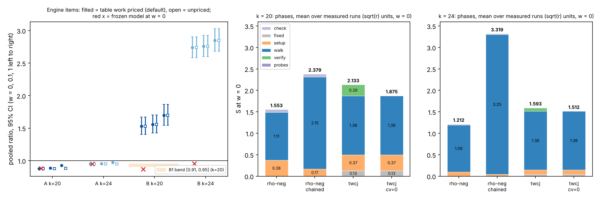

# Two engine items on the Curve25519-family miniatures, single-target ecbench (2026-11-10)

**Class.** Measured, single-target ecbench sessions under a protocol written before data
([PROTOCOL.md](PROTOCOL.md)). The protocol text was written by the session that was interrupted
by a container restart; at the restart no session, plan output or measured record of this study
existed (the study directory held only the protocol, the specs, the scripts and the pre-data
model `data/model.json`). The resumed session committed that state unchanged (commit
`resume state after restart`), recorded the protocol's SHA-256 in `data/frozen.sha256` (freeze
commit `545749ac7d`), and only then ran any session, so the predictions below count as
preregistered from that commit. Counted units only (ecbench GAE, S = cost/sqrt(r)); every
comparison at w = 0, 0.1 and 1 under both band readings (table work priced, the default since
2026-11-08, and `--no-price-table-work`). Public synthetic Curve25519-family miniatures; no
security claim. No pcc claim has been filed; every number is an unverified assertion until it is
reviewed [pcc:unverified].

**Scope.** Both items are constant-factor changes on the generic track. The F = 1 target-in-walk
arm (`twcj`) is one unknown away from rho and is not decomposition-based index calculus. Item (B)
changes the rho reference the programme is measured against, not any arm; a cheaper reference
would raise every arm's distance to rho, and a dearer one is not adopted as the reference.

**Answer.**
(A) Dropping the per-collision recomputation (`wwalk ... cv=0`) saves exactly the collision
verification ledger and nothing else: the cv=0 arm costs 0.879x [0.876, 0.882] the current arm at
k = 20 and 0.949x [0.948, 0.951] at k = 24 (w = 0), matching the frozen model points 0.880 and
0.950, and every one of 1,024 paired runs walks the same steps, rows and rank, recovers the same
logarithm and differs in total by exactly the default run's `tw_verify_adds` [pcc:unverified].
All four A predictions pass [pcc:unverified].
(B) The chained jump set-up for rho-neg saves the set-up as modelled (61.2 GAE against the
model's 61.5 at k = 20; 68.4 against 68.1 at k = 24), but the dependent jump table more than
doubles the walk: rho-neg-chained costs 1.532x [1.402, 1.673] rho-neg at k = 20 and 2.738x
[2.583, 2.903] at k = 24 (w = 0) [pcc:unverified]. B1, B2 and B3 fail; only B4 (set-up within
10 % of the model) passes [pcc:unverified]. The chained reference is therefore rejected: it is not
a stronger rho, and the distance to rho stays measured against `rho.negation` [pcc:unverified].
Distance remaining for the improved arm: twcj-cv0 / rho-neg is 1.207 [1.172, 1.243] at k = 20 and
1.248 [1.179, 1.320] at k = 24 at w = 0, down from 1.373 and 1.314 for the current arm in the same
sessions [pcc:unverified].

## 1. Implementation (as committed before data)

- (A) `wwalk` parameter `cv` (default 1, unchanged; `cv=0` needs `tw=1`). With `cv=0`,
  `TargetWalk::build_cv` keeps each stored entry's key sign bit and turns a key collision (an exact
  abscissa match, so `E_t = ±E_s`) into a row without recomputing either entry. The final `[d]G = Q`
  check of the relation loop is kept and charged; a failed check is a failed solve
  (`verification_failures`), never a retry. A group whose key is not `abscissa·2 + sign` is refused.
- (B) method `rho.negation_chained`: the first two jumps by joint scalar multiplication with
  9-bit coefficients, every later jump `M_j = M_{j-1} + M_{j-2}` by one charged addition; walk,
  starts, distinguished points, look-ahead, cycle window and charged final check are those of
  `rho.negation`, which is untouched.
- Files: `src/cryptanalysis/ic_boundary.rs`, `src/cryptanalysis/ecbench/methods.rs`,
  `src/cryptanalysis/ic_framework/plugins.rs`, `src/cryptanalysis/ecbench/optimization.rs`.

## 2. Unit tests

`cargo test --release --lib -- engine_items_tests target_walk wwalk rho_negation negation plan_refuses`
(`data/unit-tests.txt`): 47 passed, 0 failed, 1 ignored [pcc:unverified]. The first run had one
failure, `wwalk_cv0_recovers_and_saves_exactly_the_verification`, caused by the test's own helper
reading `tw_verify_adds` only from the report counters while the pipeline reports it as a native of
the `relations` phase; the helper was fixed (test code only, commit `2fb33b08c2`) and the rerun
passed [pcc:unverified]. The ecbench binary was built before that test-only edit; the edit is
inside a `#[cfg(test)]` module, so the binary's code is unchanged by it.

## 3. Design (as frozen)

8 sessions per size (k = 20: p = 1,048,573, r = 131,203; k = 24: p = 16,777,213, r = 2,097,349),
`targets_per_curve = 1`, 64 measured rounds plus 1 warm-up per arm, `order = alternate`; arms
`rho-neg` (`rho.negation`), `rho-neg-chained`, `twcj`
(`wwalk:x=1.5,g=1,grow=2,tw=1,cj=1,jumps=16,seed=run` on `prime-projected-abscissa:size=1,scan_cap=32`)
and `twcj-cv0` (the same with `cv=0`). Audit: `ecbench verify --replay 1` per session. Pooling:
ratio of per-session sums over measured rounds, linearised t interval, df = 7, warm-ups excluded.
Binary `/home/user/ctarget-f1/release/ecbench`, SHA-256 `af8d10db...` (`data/binary-k{20,24}.sha256`).
Runtime: 43 s at k = 20 and 43 s at k = 24 (`data/run.log`).

## 4. Results (measured)

All 16 sessions completed with 260 of 260 records verified each (warm-ups included), and every
audit reproduced its replay with 0 problems (`data/verify-k*-s*.txt`) [pcc:unverified]. No session
was interrupted, so none was rerun [pcc:unverified]. Pooled figures use 2,048 measured records per
size (`data/pooled_measured.json`) [pcc:unverified].

Mean S per arm (priced = table work priced at w, the default; unpriced = `--no-price-table-work`):

| k | arm | S w=0 | w=0.1 priced | w=1 priced | w=0.1 unpriced | w=1 unpriced |
|--:|:--|--:|--:|--:|--:|--:|
| 20 | rho-neg | 1.553 | 1.665 | 2.669 | 1.665 | 2.669 |
| 20 | rho-neg-chained | 2.379 | 2.594 | 4.527 | 2.594 | 4.527 |
| 20 | twcj | 2.133 | 2.275 | 3.556 | 2.137 | 2.178 |
| 20 | twcj-cv0 | 1.875 | 2.017 | 3.298 | 1.879 | 1.920 |
| 24 | rho-neg | 1.212 | 1.322 | 2.306 | 1.322 | 2.306 |
| 24 | rho-neg-chained | 3.319 | 3.645 | 6.572 | 3.645 | 6.572 |
| 24 | twcj | 1.593 | 1.730 | 2.967 | 1.594 | 1.604 |
| 24 | twcj-cv0 | 1.512 | 1.650 | 2.886 | 1.513 | 1.523 |

The table above is measured [pcc:unverified].

Pooled ratios, 95 % interval, 8 sessions (one target each):

| k | ratio | reading | w = 0 | w = 0.1 | w = 1 |
|--:|:--|:--|:--|:--|:--|
| 20 | (A) twcj-cv0 / twcj | priced | 0.879 [0.876, 0.882] | 0.887 [0.884, 0.889] | 0.927 [0.926, 0.929] |
| 20 | (A) twcj-cv0 / twcj | unpriced | 0.879 [0.876, 0.882] | 0.879 [0.876, 0.882] | 0.881 [0.879, 0.884] |
| 24 | (A) twcj-cv0 / twcj | priced | 0.949 [0.948, 0.951] | 0.953 [0.952, 0.955] | 0.973 [0.972, 0.974] |
| 24 | (A) twcj-cv0 / twcj | unpriced | 0.949 [0.948, 0.951] | 0.949 [0.948, 0.951] | 0.950 [0.948, 0.951] |
| 20 | (B) rho-neg-chained / rho-neg | both | 1.532 [1.402, 1.673] | 1.558 [1.425, 1.703] | 1.696 [1.542, 1.865] |
| 24 | (B) rho-neg-chained / rho-neg | both | 2.738 [2.583, 2.903] | 2.758 [2.600, 2.925] | 2.850 [2.681, 3.029] |

The table above is measured; the rho arms carry no table work, so both readings coincide for (B)
[pcc:unverified].

## 5. Predictions (frozen) and verdicts

| id | prediction | measured | verdict |
|:--|:--|:--|:--|
| A1 | k=20, w=0: point ≤ 0.95, upper < 1 | 0.879 [0.876, 0.882] | pass |
| A1b | k=20, w=0: point in [0.86, 0.90] | 0.879 | pass |
| A2 | k=24, w=0: point in [0.93, 0.97], upper < 1 | 0.949 [0.948, 0.951] | pass |
| A3 | identity of paired runs; difference = `tw_verify_adds` exactly | 512 + 512 pairs, 0 mismatches | pass |
| A4 | both sizes, priced, w=1: upper < 1 | 0.929 (k=20), 0.974 (k=24) | pass |
| B1 | k=20, w=0: point in [0.91, 0.95] (assigned) | 1.532 | fail |
| B2 | k=20 point in [0.84, 0.90]; k=24 in [0.93, 0.99] | 1.532; 2.738 | fail |
| B3 | search-phase ratio in [0.95, 1.05], both sizes | 1.927 [1.737, 2.138]; 2.974 [2.790, 3.170] | fail |
| B4 | mean set-up within 10 % of 61.5 / 68.1 GAE | 61.16 / 68.41 GAE | pass |
| C | every record verified, no failed final check | 4,160 of 4,160 verified | pass |

Verdicts are scored from the measured values in the table [pcc:unverified].

## 6. Phase breakdown (mean, sqrt(r) units, w = 0)

| k | arm | fixed (base, LA, check) | set-up | walk / search | collision verify | final check | total |
|--:|:--|--:|--:|--:|--:|--:|--:|
| 20 | rho-neg | — | 0.375 | 1.113 | — | 0.065 | 1.553 |
| 20 | rho-neg-chained | — | 0.169 | 2.145 | — | 0.065 | 2.379 |
| 20 | twcj | 0.129 | 0.368 | 1.378 | 0.258 | (in fixed) | 2.133 |
| 20 | twcj-cv0 | 0.129 | 0.368 | 1.378 | 0.000 | (in fixed) | 1.875 |
| 24 | rho-neg | — | 0.099 | 1.093 | — | 0.020 | 1.212 |
| 24 | rho-neg-chained | — | 0.047 | 3.252 | — | 0.020 | 3.319 |
| 24 | twcj | 0.040 | 0.110 | 1.363 | 0.081 | (in fixed) | 1.593 |
| 24 | twcj-cv0 | 0.040 | 0.110 | 1.363 | 0.000 | (in fixed) | 1.512 |

The phase table is measured [pcc:unverified].

Why (B) fails: every chained jump is `F_{j-1} M_0 + F_j M_1`, so the jumps satisfy short integer
relations, and with the negation map these open fruitless cycles and merge walks. At k = 20 the
chained walk meets 17.8 cycles of other lengths per run against 0.42 for rho-neg, spends 22.3
escape doublings against 1.6, caps 0.42 walks per run against 0.025 and wastes 0.80 useless
collisions against 0.008; at k = 24 the same counters are 90.9 against 1.6 cycles, 112.6 against
7.2 doublings, 2.96 against 0.06 capped walks and 2.82 against 0.03 useless collisions
[pcc:unverified]. The walk operations per run rise from 382 to 745 at k = 20 and from 1,540 to
4,635 at k = 24, and the penalty grows with k [pcc:unverified]. The frozen model expected this
effect to be a few tenths of a percent of steps; it is the dominant cost, and the saved set-up
(about 0.21 and 0.05 sqrt(r)) is small beside it [pcc:unverified].

## 7. Distance to rho

The matched reference is the cheaper rho. Under the old reference (`rho.negation`), measured in the
same sessions [pcc:unverified]:

| k | arm / rho-neg | priced w=0 | priced w=0.1 | priced w=1 | unpriced w=0.1 | unpriced w=1 |
|--:|:--|:--|:--|:--|:--|:--|
| 20 | twcj | 1.373 [1.335, 1.412] | 1.366 [1.328, 1.406] | 1.332 [1.288, 1.377] | 1.284 [1.247, 1.321] | 0.816 [0.790, 0.842] |
| 20 | twcj-cv0 | 1.207 [1.172, 1.243] | 1.211 [1.176, 1.248] | 1.235 [1.194, 1.278] | 1.129 [1.095, 1.163] | 0.719 [0.696, 0.743] |
| 24 | twcj | 1.314 [1.242, 1.390] | 1.309 [1.237, 1.385] | 1.286 [1.213, 1.365] | 1.206 [1.140, 1.276] | 0.696 [0.656, 0.737] |
| 24 | twcj-cv0 | 1.248 [1.179, 1.320] | 1.248 [1.179, 1.322] | 1.251 [1.179, 1.328] | 1.145 [1.082, 1.212] | 0.661 [0.623, 0.701] |

The distance table is measured [pcc:unverified]. With table work priced (the default), rho-neg is
ahead of both arms at every weight; with table work unpriced the order flips at w = 1, so the
pair is unresolved across the band under that reading [pcc:unverified].

Under the chained reference (`rho.negation_chained`), at w = 0: twcj / chained 0.896
[0.840, 0.957] and twcj-cv0 / chained 0.788 [0.739, 0.840] at k = 20; 0.480 [0.461, 0.500] and
0.456 [0.437, 0.475] at k = 24 [pcc:unverified]. These ratios are below 1 only because the chained
rho is a weaker rho; they are not a distance to rho and must not be read as the arm beating rho
[pcc:unverified]. The distance remaining is the one against `rho.negation` above.

## 8. Reading

(A) is a real work reduction rather than a relabelling: the cv=0 arm performs no recomputation at
all and relies on the exact abscissa key, and the charged final check still guards every solve
[pcc:unverified]. Its gain is the verification share of the arm, which shrinks with k (12.1 % at
k = 20, 5.1 % at k = 24), so it lowers the arm's constant, not its scaling [pcc:unverified]. (B) is
a negative result for the reference: the independent jump table of `rho.negation` stays the
reference [pcc:unverified].

## 9. Files

`PROTOCOL.md` (frozen), `data/frozen.sha256`, `specs/`, `scripts/` (`run_sessions.sh`,
`pooled_compare.py`, `analyse.py`, `make_figure.py`, `render_pdf.py`, `model.py`),
`sessions/k{20,24}-s{0..7}/`, `data/` (`run.log`, `run-*.log`, `plan-*.txt`, `band-*.{txt,json}`,
`band-np-*.{txt,json}`, `verify-*.{txt,json}`, `pooled_measured.json`, `model.json`,
`unit-tests.txt`, `binary-k*.sha256`), `figures/engine_items.{svg,png}`, `REPORT.pdf`. Benchmark
records: `benchmarks/records/20261110T0357Z-curve25519-engine-items-k{20,24}.json`.
