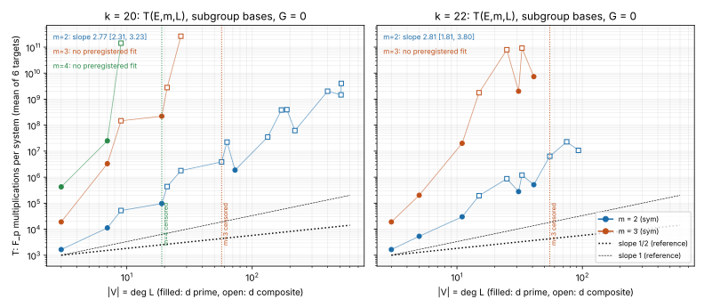

# Exponent study: does the subgroup-base algebraic route have an exponent lever? (2026-11-10)

**Class.** An engine measurement in counted units: F_p multiplications of the F4 row reduction,
`F4Report.field_ops`, from `curve25519_family f4sub`. It measures the cost of one decomposition
system against the base size. It is not an end-to-end solve, not an ecbench session, and not a
leaderboard or `benchmarks/` row. No pcc claim was registered, so every measured number below is
an unverified assertion. Rho remains ahead on every track [pcc:unverified].

**Question (owner preregistration, 2026-11-08).** The question concerns Algorithm 1 of the
algebraic ECDLP attack on prime curves (Petit, Kosters, Messeng, PKC 2016) and the cost model of
its section 3.2. The total cost is about P(p,m) + (m! p / (deg L)^(m-1)) T(E,m,L) + (deg L)^omega,
with deg L = |V|. With omega = 2 and |V| = p^a, m = 3 balances at a = 1/4 and m = 4 at a = 1/5.
An exponent lever exists at m = 4 only if T(E,4,L) grows more slowly than |V|^(1/2). At m = 3 it
exists only if T stays flat in |V|. This study fits the exponent s of T against |V|. It uses the
symmetrised system over multiplicative-subgroup bases of the Curve25519-family miniatures.

**Answer.** No lever was found [pcc:unverified].

- **m = 2.** The preregistered fit gives s = 2.77 [2.31, 3.23] at k = 20, 2.81 [1.81, 3.80] at
  k = 22 and 2.57 [0.91, 4.24] at k = 24 [pcc:unverified].
- **m = 3 and m = 4: the preregistered estimator could not be applied.** Before the first censored
  cell, the complete cells with d >= 9 span 3.0x in |V| at k = 20 and 3.7x at k = 22, below the
  required 4x. At m = 4 only one such cell is complete. The preregistered verdict is therefore
  "undetermined" for both [pcc:unverified].
- **Other readings.** Every other reading of the same cells puts s far above both thresholds. The
  m = 3 sensitivity fits that include d = 3 and 7 give 6.44 [3.49, 9.39] at k = 20 and
  5.76 [3.77, 7.75] at k = 22 [pcc:unverified]. From |V| = 3 to |V| = 9, the m = 4 cost rises
  3.4e5-fold [pcc:unverified]. No reading comes near the m = 3 threshold (s < 0) or the m = 4
  threshold (s < 0.5) [pcc:unverified].

**Protocol and companion files.** [`PROTOCOL.md`](PROTOCOL.md) was frozen on 2026-11-08, before
any measurement. Its sha256 is in [`data/frozen.sha256`](data/frozen.sha256). On 2026-11-10 the
hashes of the protocol, `scripts/run_grid.py`, `scripts/analyse.py` and the engine binary were
recomputed, and all four equal the frozen values [pcc:unverified].
[`PRIOR_STUDIES.md`](PRIOR_STUDIES.md) is an addendum written after the grid had run. The report
is [`REPORT.pdf`](REPORT.pdf) and the figure is [`exponent_fit.svg`](exponent_fit.svg).

**Resume after a container restart (2026-11-10).** A container restart killed the grid runner while
it was measuring `k20_m3_sym_d27_g0`. The runner writes a cell file only when all six targets of the
cell are done, so no partial data from that cell exists or was used. All other cell files were
complete or censored before the restart, and none was redone. The interrupted cell was rerun from
scratch with the frozen binary. The binary was a copy of `/home/user/ctarget-f1/release/curve25519_family`,
with sha256 `dc2c30a4242d80281622b2cb42cbaf9cb457d041ffbc9a4d35794bb893bf3faf` (equal to the frozen
hash). The binary is newer than `subgroup_semaev.rs`, `pkm_semaev.rs` and
`src/bin/curve25519_family.rs`, so it was not rebuilt. The rerun completed: 6 of 6 targets, each
under the 1200 s cap. Under the chain rule the runner then ran d = 57, whose first target hit the
1200 s cap, so that cell is censored. The k = 22 m = 3 cell at d = 55 had ended in an
out-of-memory exit before the restart (`data/run.log`) [pcc:unverified].

## 1. System and engine

- **Module.** [`src/cryptanalysis/ic_framework/subgroup_semaev.rs`](../../src/cryptanalysis/ic_framework/subgroup_semaev.rs),
  commands `curve25519_family f4sub` and `subcensus`. It is a separate module rather than a new
  `Membership` variant of `pkm_semaev.rs`: the tower engine's bit-mask monomials hold exponents 0
  or 1 only, so they cannot hold the odd-degree chain rules y^3 = y'. No path of `pkm_semaev` or
  `f4_fp_tower` changed.
- **Base.** V = lo + g mu_d, d | p - 1 odd, d = e_0 e_1 ... e_{L-1} (primes ascending, with
  multiplicity), lo = A/3 (the Montgomery frame), g = w^gidx with w the smallest primitive root.
- **Per-summand constraint.** This is the power-map chain of the paper: x_i = lo + g y_{i,0},
  y_{i,j}^{e_j} = y_{i,j+1} for j < L - 1, and the closing relation y_{i,L-1}^{e_{L-1}} = 1. The
  paper's closing map is 1 - x^{p_n'}; this is the same relation.
- **Target and form.** The target X = x(aG) is a constant, with a uniform in [1, r - 1]. The form
  `sym` (primary) adds e_k - sigma_k(x_1..x_m) for k = 1..m and the Semaev polynomial
  S_{m+1}(x_1..x_m, X), written in e_1..e_m by interpolation. The interpolation is checked on 12
  extra points. The form `plain` substitutes sigma_k(x) for e_k (ablation).
- **Engine.** `f4_fp::f4`, grevlex, max degree 400. There is no guessing (G = 0): T is the cost of
  one complete system.
- **Unit tests.** Six tests in the module pass. They cover: the summation polynomials vanish on
  sums (m = 2, 3, 4); S~ equals S (m = 2, 3, 4); the m = 2 and m = 3 systems are consistent exactly
  when the target is a sum of m base points, brute-forced on p = 1013 with small subgroups; the
  bit-interval base matches brute force. They were run from the release test binary built at the
  module's commit (6 passed, 0 failed) [pcc:unverified].

## 2. Grid and census

The grid is as frozen in section 4 of the protocol:

- 6 targets per cell, with seed 20261108 + 1000 m + d;
- a cap of 1200 s per target and 3.5 GB of memory per process;
- each (k, m, form) chain runs d ascending and stops at its first censored cell. Larger d are not
  attempted.

Every chain in the protocol has now ended, at its last d or at a censored cell. The census
(`data/census.json`, from `scripts/census.py`) is exact. Its columns are defined as follows:

- **columns:** the number of abscissae of V on the curve;
- **base points:** the number of signed base points;
- **covered:** the number of distinct points of the order-r subgroup that are sums of exactly m
  base points.

Almost every target lies outside the covered set, so almost every system is inconsistent, as in
the real attack. T is therefore mostly the cost of proving that a system has no solution.

The four curves are measured from `data/census.json`:

| k | p | r |
|--:|--:|--:|
| 18 | 262,133 | 32,887 |
| 20 | 1,048,573 | 131,203 |
| 22 | 4,194,301 | 524,731 |
| 24 | 16,777,213 | 2,097,349 |

The full per-cell table is in [`data/tables.md`](data/tables.md), with the census, T, the solving
degree and the largest matrix width. The primary series are below. T is the mean `field_ops` per
system and L is the number of chain levels. All values are measured, from `cells/*.json` and
`data/census.json`.

| k | m | d = \|V\| | L | columns | covered (m) | T | solving degree | status |
|--:|--:|--:|--:|--:|--:|--:|--:|:--|
| 20 | 2 | 3 | 1 | 2 | 2 | 1,648 | 4 | complete |
| 20 | 2 | 7 | 1 | 2 | 2 | 11,225 | 8 | complete |
| 20 | 2 | 9 | 2 | 4 | 8 | 52,244 | 5 | complete |
| 20 | 2 | 19 | 1 | 12 | 40 | 96,745 | 20 | complete |
| 20 | 2 | 21 | 2 | 8 | 20 | 434,893 | 9 | complete |
| 20 | 2 | 27 | 3 | 16 | 68 | 1,789,928 | 5 | complete |
| 20 | 2 | 57 | 2 | 34 | 314 | 3,876,409 | 21 | complete |
| 20 | 2 | 63 | 3 | 28 | 200 | 22,317,287 | 9 | complete |
| 20 | 2 | 73 | 1 | 36 | 328 | 1,869,761 | 74 | complete |
| 20 | 2 | 133 | 2 | 76 | 1,452 | 35,142,880 | 22 | complete |
| 20 | 2 | 171 | 3 | 108 | 3,024 | 383,236,931 | 21 | complete |
| 20 | 2 | 189 | 4 | 96 | 2,288 | 393,654,078 | 10 | complete |
| 20 | 2 | 219 | 2 | 120 | 3,552 | 61,803,451 | 75 | complete |
| 20 | 2 | 399 | 3 | 216 | 11,254 | 2,016,013,118 | 22 | complete |
| 20 | 2 | 511 | 2 | 274 | 17,640 | 1,463,328,780 | 76 | complete |
| 20 | 2 | 513 | 4 | 278 | 18,564 | 4,027,107,095 | 22 | complete |
| 20 | 3 | 3 | 1 | 2 | 0 | 19,010 | 4 | complete |
| 20 | 3 | 7 | 1 | 2 | 4 | 3,303,793 | 8 | complete |
| 20 | 3 | 9 | 2 | 4 | 0 | 147,635,021 | 7 | complete |
| 20 | 3 | 19 | 1 | 12 | 144 | 220,436,708 | 20 | complete |
| 20 | 3 | 21 | 2 | 8 | 56 | 2,787,948,088 | 11 | complete |
| 20 | 3 | 27 | 3 | 16 | 344 | 263,459,825,507 | 8 | complete (rerun after restart) |
| 20 | 3 | 57 | 2 | 34 | 3,124 | - | - | censored (1200 s cap, first target) |
| 20 | 4 | 3 | 1 | 2 | 4 | 423,322 | 8 | complete |
| 20 | 4 | 7 | 1 | 2 | 4 | 24,975,907 | 8 | complete |
| 20 | 4 | 9 | 2 | 4 | 24 | 142,058,000,763 | 9 | complete |
| 20 | 4 | 19 | 1 | 12 | 504 | - | - | censored (out of memory) |
| 22 | 3 | 3 | 1 | 3 | 0 | 19,010 | 4 | complete |
| 22 | 3 | 5 | 1 | 3 | 4 | 201,745 | 6 | complete |
| 22 | 3 | 11 | 1 | 7 | 32 | 20,063,347 | 12 | complete |
| 22 | 3 | 15 | 2 | 9 | 52 | 1,759,715,051 | 9 | complete |
| 22 | 3 | 25 | 2 | 19 | 576 | 79,458,456,936 | 10 | complete |
| 22 | 3 | 31 | 1 | 11 | 84 | 2,016,009,937 | 32 | complete |
| 22 | 3 | 33 | 2 | 17 | 420 | 91,887,410,934 | 15 | complete |
| 22 | 3 | 41 | 1 | 23 | 1,020 | 7,342,801,721 | 42 | complete |
| 22 | 3 | 55 | 2 | 29 | 2,076 | - | - | censored (out of memory) |

The censored k = 20, m = 3, d = 57 target had spent 8.3e10 field operations when it was stopped
at degree 23 with an 777,369 x 798,826 matrix (`cells/k20_m3_sym_d57_g0.json`). That partial count
is not a T value and is not fitted [pcc:unverified]. The m = 2 series at k = 22, 24 and 18, the
plain-form ablations and the coset cells are in `data/tables.md`.

**Figure.** The figure plots T against |V| on log-log axes, with k = 20 on the left and k = 22 on
the right (`exponent_fit.svg`, from `scripts/figure.py`). Filled markers are prime d and open
markers are composite d. The dotted vertical lines mark censored cells, and two reference slopes
(1/2 and 1) are drawn.

## 3. Fitted exponents

The preregistered estimator is the OLS fit of ln T on ln |V| over the complete cells with d >= 9,
with a two-sided 95% t-interval. It requires at least 4 cells spanning at least 4x in |V|. Its
results are in `data/analysis.json`, written by the frozen `scripts/analyse.py`. All values in the
table are derived from the cells by that script.

| series | cells in the fit | s | 95% interval | sensitivity fit (all d) |
|:--|--:|--:|:--|:--|
| k = 20, m = 2, sym | 14 | 2.77 | [2.31, 3.23] | 2.80 [2.47, 3.12] (16 cells) |
| k = 22, m = 2, sym | 9 | 2.81 | [1.81, 3.80] | 2.72 [2.23, 3.21] (11) |
| k = 24, m = 2, sym | 4 | 2.57 | [0.91, 4.24] | 2.43 [1.89, 2.97] (5) |
| k = 20, m = 2, plain | 6 | 3.20 | [1.67, 4.72] | 3.31 [2.65, 3.97] (8) |
| k = 18, m = 2, sym | 3 cells in all | no fit | - | local slopes 2.19, 3.91 |
| k = 20, m = 3, sym | 4 (d = 9 to 27, span 3.0x) | no fit (span < 4x) | - | 6.44 [3.49, 9.39] (6) |
| k = 22, m = 3, sym | 6 (d = 11 to 41, span 3.7x) | no fit (span < 4x) | - | 5.76 [3.77, 7.75] (8) |
| k = 20, m = 3, plain | 3 before censoring | no fit | - | 6.48 [2.45, 10.52] (5) |
| k = 20, m = 4, sym | 1 (d = 9) | no fit | - | local slopes 4.81 (3 to 7), 34.4 (7 to 9) |

The fits in this table are derived from measured cells [pcc:unverified]. The local slopes of the
k = 20, m = 3 series are 6.09, 15.1, 0.54, 25.4 and 18.1, in order of d (`data/analysis.json`)
[pcc:unverified].

**Exploratory, not preregistered: the chain length matters.** T depends strongly on how d factors,
not only on |V|. At equal |V|, a composite d (more chain levels) costs more than a prime d. For
example, at k = 20 and m = 2, T is 1.87e6 at d = 73 (L = 1) and 2.23e7 at d = 63 (L = 3)
[pcc:unverified]. This explains some negative local slopes in the preregistered series. Fits
restricted to one chain length are tighter. They come from `scripts/tables.py` and are stored in
`data/exploratory_fits.json`.

- m = 2, L = 1 gives 2.20 [2.15, 2.25] at k = 20 (d = 3, 7, 19, 73), 2.19 [2.14, 2.23] at k = 22
  (5 cells) and 2.21 [2.13, 2.28] at k = 24 (3 cells) [pcc:unverified].
- m = 2, L = 2 gives 2.43 [2.10, 2.77] at k = 20 (6 cells) [pcc:unverified].
- m = 3, L = 1 gives 4.95 [4.51, 5.40] at k = 22 (d = 3, 5, 11, 31, 41) and 5.04 [-1.79, 11.88]
  at k = 20 (d = 3, 7, 19) [pcc:unverified].

For prime d the solving degree is d + 1. The cost is then that of one dense equation of degree
about d in each chain variable [pcc:unverified].

**Comparison with the tower base (L10).** L10 measured m = 2 on the tower base with guessing
G = t - 1. There T grows as about |V|^1.5: mpt 17,592, 52,816 and 146,464 at t = 4, 5, 6.
For a G = 0 comparison, the tower engine's `f4cost` was run on the same curve (k = 20) and the
bit-interval base. It gives 87,013, 4,046,086 and 127,284,443 mul-adds per target at t = 3, 4, 5
(`data/calib_tower_bits_t*.json`) [pcc:unverified]. These are local slopes of 5.5 and 5.0 in
|V| = 2^t (derived) [pcc:unverified]. Without guessing, the subgroup base (s about 2.8) therefore
grows more slowly than the bit-interval base (s about 5) [pcc:unverified]. Both are far above the
1/2 that a lever at m = 4 needs [pcc:unverified].

## 4. Balanced totals under the paper's model (derived)

The relation phase costs p^(1 - (m-1)a) T(p^a) = p^(1 - (m-1)a + s a), and linear algebra costs
p^(2a). The protocol's balance point is a = 1/(m + 1 - s), with total exponent 2/(m + 1 - s). When
s >= m - 1, the relation-phase exponent 1 + (s - (m - 1)) a does not decrease as a grows. No base
size then gives a total below p^1, and the balance either lands above 1 or has no positive solution.

| m | s used | 2/(m + 1 - s) | best total exponent under the model |
|--:|:--|:--|:--|
| 2 | 2.77 (k = 20 fit) | 2/0.23 = 8.7 | 1 (no base size helps; s >= m - 1 = 1) |
| 2 | 2.81 / 2.57 (k = 22 / 24) | 10.5 / 4.7 | 1 |
| 3 | 6.44 / 5.76 (sensitivity fits) | no positive solution (m + 1 - s < 0) | 1 (s >= m - 1 = 2) |
| 3 | 4.95 (k = 22, L = 1) | no positive solution | 1 |
| 4 | 4.81 (local slope, 3 to 7) | 2/0.19 = 10.5 | 1 (s >= m - 1 = 3) |
| 4 | 34.4 (local slope, 7 to 9) | no positive solution | 1 |

All values in this table are derived from fixed small p and are extrapolations, not measurements
[pcc:unverified]. A total below p^(1/2) at m = 4 would need s < 0.5 at the paper's a = 1/5, or
s < 1 at the re-balanced a. A total below p^1 would need s < 3 [pcc:unverified].

## 5. Verdicts on the preregistered thresholds and predictions

| item | preregistered rule | outcome |
|:--|:--|:--|
| lever at m = 4 | s < 0.5 with upper 95% bound < 0.5 | **undetermined** by the estimator: one complete cell with d >= 9, and d = 19 censored. Not met on any reading (local slopes 4.81, 34.4) |
| lever at m = 3 | s < 0 with upper bound < 0 | **undetermined** by the estimator: span 3.0x at k = 20 and 3.7x at k = 22, both below 4x. Not met on any reading (sensitivity fits 6.44 and 5.76, lower bounds 3.49 and 3.77) |
| looser derived m = 4 break-even | s < 1 | not met on any reading |
| prediction m = 2: s = 1.5 (range 1.0 to 2.3) | | **failed**: 2.77 [2.31, 3.23] at k = 20, outside the range |
| prediction m = 3: s = 3.5 (range 2.5 to 5) | | not evaluable by the estimator. The readings 6.44 and 5.76 are above the range; the L = 1 fits, 4.95 and 5.04, are inside it |
| prediction m = 4: s >= 4.5 or capped beyond d = 9 or 21 | | **held**: censored at d = 19 |
| plain vs sym: \|s_plain - s_sym\| < 0.5 | | **held**: 3.20 vs 2.77, a difference of 0.43 |
| coset dependence: T within 1.5x across gidx | | **held**: at d = 27, T is 1,789,928 / 1,789,919 / 1,789,928 for gidx = 0, 1, 2; at d = 63 it is 22,317,287 / 22,317,373 / 22,317,372 |
| calibration: field_ops / f4_muladds within 5x | | **held**: 3.39, 2.58 and 1.41 at t = 3, 4, 5 |
| calibration: that ratio constant to 30% | | **failed**: it falls from 3.39 to 1.41 |
| owner's expectation: no lever | | consistent: no reading comes near a threshold |

The outcomes in this table come from measured cells and the fits derived from them
[pcc:unverified]. Failed predictions stay failed.

## 6. What a lever would need

Under the paper's model, a lever at m = 4 needs a decomposition system whose cost grows more slowly
than |V|^(1/2). At m = 3 it needs one whose cost does not grow at all. Measured here, the cost grows
as |V|^2 or more steeply at m = 2 on every series [pcc:unverified].

Trivial enumeration of V^(m-1), with a root test for the last summand, costs |V|^(m-1). At m = 4
that is already |V|^3, six times the exponent a lever needs. A lever would therefore need a solver
that neither enumerates nor reduces over the |V|^m quotient of the chain ideal. This study found no
such solver [pcc:unverified].

The m = 2 slope of the prime-d cells, about 2.2, is above even the enumeration exponent 1. This
suggests that the F4 route over the chain ideal costs more than enumeration on this base (derived)
[pcc:unverified].

## 7. Prior exponent studies

[`PRIOR_STUDIES.md`](PRIOR_STUDIES.md) lists five earlier studies.

- `ic_exponent_20260926` fits the ratio to batch rho on binary Koblitz curves.
- `ic_m4_exponent_audit_20260928` measures c = 0.985 bits per unit n for the m = 4 decomposition
  over an F_2-subspace base of binary fields.
- `ic_exponent_top_20260930` was withdrawn before anything ran.
- `ic_exponent_falsifiers_20261013` studies the exponent sum of base abscissae, not a cost.
- `ecdlp_exponent_assessment_20261018` has PDFs that could not be retrieved on this machine.

None of the readable four measures T(E, m, L) against the size of a prime-field multiplicative-subgroup
base, so none gives a number to compare directly with s here. The closest is the m = 4 audit, on a binary
field with an F_2-subspace base. It measured c = 0.985 bits per unit n [0.983, 1.018] for the m = 4
decomposition and recorded that route as "closed for this engine at these sizes" (as summarised
in `PRIOR_STUDIES.md`). Its verdict points the same way as this study's [pcc:unverified]. The m = 2 tower-base
values of L10 are compared in section 3.

## 8. Distance to rho

This study does not produce an end-to-end cost. As an illustration only, the modelled cost is
E = columns · r · T / covered. At k = 20 and m = 2, E ranges from 3.98e5 times the 1.5 sqrt(r) rho
reference (d = 3) to 1.46e10 times it (d = 513). These ratios are derived and in field_ops units.
Native operations are unpriced, so the w band of AGENTS.md section 5a is not applied
[pcc:unverified]. The ratios are not comparable with L10's mul-add figures beyond the calibration
ratio of 1.4 to 3.4. Rho remains ahead [pcc:unverified].

## 9. Not done and open issues

- **m = 3 and m = 4 exponents.** Neither could be fitted under the frozen rule. A wider span at
  m = 3 needs more than the frozen 3.5 GB and 1200 s per target. At k = 22, d = 55 exited out of
  memory. At k = 20, d = 57 hit the time cap at degree 23, with a matrix of about 8e5 columns. A
  sparser linear-algebra back end would also help. This is a resource limit, not a result.
- **m = 4 stays open.** It has three complete cells (d = 3, 7, 9) and is censored at d = 19.
- **Chain length.** The protocol did not anticipate that prime d and composite d behave
  differently. A follow-up should fix L, or regress on L, in its preregistration.
- **Inconsistent systems.** Most targets give an inconsistent system, so T measures refutation
  cost. Consistent and inconsistent systems were not split, because the protocol does not ask for it.
- **Unretrieved prior study.** The `ecdlp_exponent_assessment_20261018` PDFs live in the artifact
  store and were not retrievable on this machine.
- **Unavailable tools.** research-kb, ecdb and Conductor were unavailable in this session: there was
  no MCP server and no token, and Conductor is not installed. The sources checked were the
  repository files named in `PROTOCOL.md` and `PRIOR_STUDIES.md`.
- **No pcc claims.** None were registered, so every result is an unverified assertion until checked.

## Files

| file | what |
|:--|:--|
| `PROTOCOL.md`, `data/frozen.sha256` | the frozen protocol and the hashes of the protocol, the scripts and the binary |
| `PRIOR_STUDIES.md` | the addendum on the five earlier exponent studies |
| `scripts/run_grid.py` | the grid runner (resumable per cell) |
| `scripts/analyse.py` | the preregistered estimator; writes `data/analysis.json` |
| `scripts/census.py` | the exact census; writes `data/census.json` |
| `scripts/tables.py` | `data/tables.md` and the exploratory fits at fixed L (`data/exploratory_fits.json`) |
| `scripts/figure.py` | `exponent_fit.svg` and `.png` |
| `cells/*.json` | one file per cell, with per-target field_ops, solving degree, rows and columns |
| `data/calib_*.json` | the calibration cells (bit-interval base, both engines) |
| `data/run.log` | the runner's log, with the resume note of 2026-11-10 |
| `REPORT.typ`, `REPORT.pdf` | the report (pandoc to Typst, compiled with the typst Python module) |

Reproduce: `cargo build --release --bin curve25519_family`, then run from this directory, in order:

1. `python3 scripts/run_grid.py`
2. `python3 scripts/census.py`
3. `python3 scripts/analyse.py`
4. `python3 scripts/tables.py`
5. `python3 scripts/figure.py`
