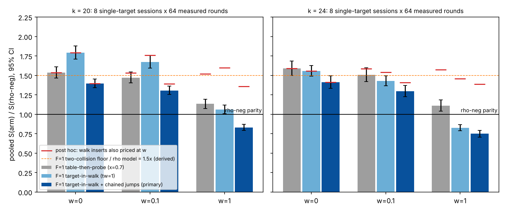
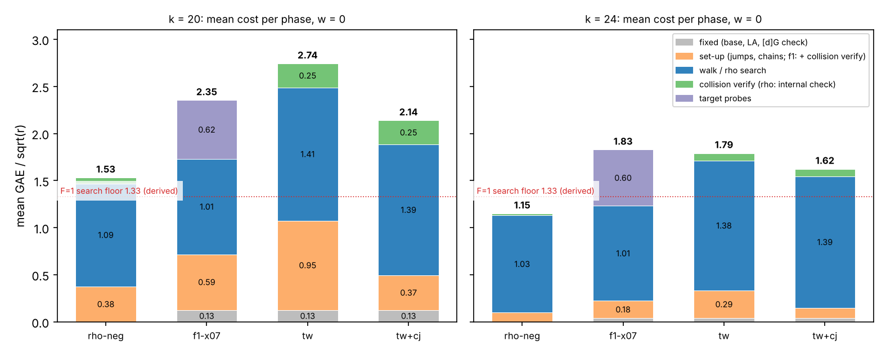

# F = 1 walk with the target inside it, single-target ecbench (2026-11-07)

**Class.** Measured, single-target ecbench sessions under a protocol frozen before data
([PROTOCOL.md](PROTOCOL.md); hashes in `data/frozen.sha256`). Counted units only (ecbench GAE,
S = cost/sqrt(r)), and every comparison at w = 0, 0.1 and 1 (AGENTS.md section 5a). The curves are
public synthetic Curve25519-family miniatures; no security claim is made. No pcc claim has been
filed for these numbers, so each one is an unverified assertion until it is reviewed
[pcc:unverified].

**Question.** The current F = 1 arm (`wwalk:x=0.7,g=1,grow=2` on a one-abscissa base) walks a table
until its first self-collision, which pins `log P1`. It then probes target combinations `Q + kG`
until one hits the table. Does putting the target inside the walk lower the end-to-end cost? In
that design every collision of `E_t = u P1 + z G + b Q` carries `log Q`, and the walk stops at two
independent rows [pcc:unverified].

**Answer.** Yes, when the jumps are built cheaply. The primary arm (`twcj-x15`: target in the walk,
chained jumps) costs 0.909x the current F = 1 arm at k = 20 and w = 0, with 95 % interval
[0.885, 0.934]. At k = 24 it costs 0.888x [0.846, 0.932]. It won in 8 of 8 sessions at each size
[pcc:unverified].

Built with three independent scalar multiplications per jump (`tw-x15`), the same walk costs more
than the current arm at k = 20 (1.166x [1.132, 1.200]) and is unresolved at k = 24 (0.980x
[0.939, 1.023]) [pcc:unverified]. The search phase fell from about 1.6 sqrt(r) (walk plus probes)
to 1.38-1.41 sqrt(r), which is 4-6 % above the two-collision floor of 1.329 sqrt(r)
[pcc:unverified].

Rho-neg is still ahead. At w = 0 the primary arm is 1.40x rho-neg at k = 20 and 1.41x at k = 24
[pcc:unverified]. The frozen w-band puts it below rho-neg at w = 1, but that ordering is an
artifact of what each arm lists as unpriced work (section 5). ecbench's own band verdict for
rho-neg against twcj-x15 is "unresolved inside the band" in 16 of 16 sessions, and AGENTS.md section
5a allows no win for either side on that verdict [pcc:unverified]. "Rho-neg is still ahead" at
w > 0 rests on the post hoc insert pricing, not on the frozen band. With the walk's per-step hash
inserts priced like rho's per-step canonicalisation, rho-neg stays ahead at every weight: 1.36x at
k = 20 and 1.39x at k = 24, at w = 1 (post hoc, derived) [pcc:unverified]. The progress report's
headline series `s_twcj_w1` (0.83 of rho at k = 20, 0.75 at k = 24) is an artifact of the unpriced
table inserts and is not a result against rho; the closed benchrec records cannot be edited, so
this caveat stands in their place [pcc:unverified].

**Scope (read this first).** An F = 1 method with the target in the walk is **one unknown away
from rho**. Its only unknown besides `log Q` is `log P1`. Set P1 := G (a point of known
logarithm) and the method becomes a plain random walk on `[c]G + [b]Q` whose first collision
gives `log Q`, which is rho with a stored walk (F = 0, model 0.886 sqrt(r)). The extra unknown
costs it a second collision (1.329 sqrt(r)), so in this design it cannot reach rho. Its model
floor is 1.5x model rho. It does no decomposition work. It is a generic collision walk that
carries one superfluous base logarithm. It is not a decomposition-based index-calculus
improvement, and it does not belong on the IC leaderboard [pcc:unverified]. It is also single-target only: the
`tw` walk is built from the target, so there is no reusable, target-independent table as in
`f1-x07`, whose table can be amortised over many targets. The gain over `f1-x07` does not carry to
a multi-target setting [pcc:unverified].

## 1. What changed in the code

- `TargetWalk` (new, `src/cryptanalysis/ic_boundary.rs`, after `WalkTable`). Jumps are
  `J_j = [a_j]P1 + [c_j]G + [b_j]Q`, with `a_j` in `[1, w]` and `c_j, b_j` in `[1, r)`. Entries
  are `E_t = u_t P1 + z_t G + b_t Q`, with `z` and `b` mod r. Steps are drawn independently of the
  point, and one key is stored per negation orbit. Every key collision is recomputed from its
  coefficients (charged). It is then kept as the row
  `Relation::Row { columns: du*coef, a: -dz, b: -db }`, read by the loop as
  `du*coef*x = h*(-dz - db*log Q)`. The walk stops at the first two rows independent over
  (s1, log Q), or at the cap 3T. Probes (`probe`, `hit_row`, which carry the entry's
  Q-coefficient) run only below rank 2. The ledgers (`setup_ops`, `walk_ops`, `verify_ops`) sum
  to `build_ops`. `breakdown_counters` reports them as `tw_*` relation counters.
- `cj=1`: the G/Q parts come from two base combinations `K_0 = [c_0]G + [b_0]Q` and `K_1`, with
  `K_j = K_(j-1) + K_(j-2)` (one addition each). The jump is `J_j = [a_j]P1 + K_j`, the P1 part
  taken from the doubled multiples plus one addition.
- `WWalkOracle` (`src/cryptanalysis/ic_framework/plugins.rs`) accepts `tw=1`, which needs `g=1`,
  `grow=2` and a one-seed base, and `cj=1`, which needs `tw=1`. It builds the walk from
  `ctx.target`, hands the rows to the loop with the first trial, and skips the probe once rank 2
  is reached. With `tw=0`, the default, it runs the previous code unchanged. `ecbench plan`
  refuses `tw` without `g=1`/`grow=2` and `cj` without `tw`
  (`src/cryptanalysis/ecbench/methods.rs`), and the help text says so. These plan-level refusals
  were checked by hand with `ecbench plan` and have no test of their own [pcc:unverified].
- **Existing paths are unchanged.** `rho-neg` and `f1-x07` keep their method ids
  (`ECM1hefea4e0ebe79`, `ECM1h45f5f937a79c`). The new binary replays all 384 measured runs of
  the earlier study's sessions k20-s0 and k24-s0 identically, with 0 problems
  (`data/replay-earlier-study-k{20,24}-s0.txt`). Those runs cover every arm of that study: rho,
  F = 2 and F = 1 [pcc:unverified].
- Tests. `data/cargo-test-wwalk.txt` has 9 passed and 0 failed: the 7 existing wwalk tests
  unchanged, plus two new ones. `data/cargo-test-plan-refuses.txt` has 6 passed, but those six tests pre-date the change and do not
  cover `tw` or `cj` (validator erratum E6) [pcc:unverified]. The oracle-level refusals are covered by
  the second new test below. The new
  `target_walk_rows_are_affine_stop_at_rank_two_and_solve` (12-bit curve, plain and chained
  jumps, 48 walks) checks the following. Every row holds under brute-force logs. The walk stops
  exactly at rank 2, in 48 of 48 walks. The loop's `IncrementalGauss` solves `log Q` from the rows.
  Probe hit rows hold, the ledgers sum, and the chained jumps satisfy their recurrence. The new
  `wwalk_target_in_walk_recovers_on_the_first_trial` (train-k32, end to end through
  `run_pipeline`) checks recovery in 12 of 12 runs per option, one trial and no probe at rank 2,
  ledger sums equal to the oracle set-up GAE, chained set-up below half of plain, and the four
  refusals. After `rustfmt`, the same tests plus the plan refusals rerun on the final source:
  15 passed, 0 failed (`data/cargo-test-final-source.txt`).

## 2. Design (as frozen)

- Binary: release build of this tree in `/home/user/ctarget-f1`, SHA-256 `b2d6c799...9bd8b`, the
  same for both sizes (`data/binary-k{20,24}.sha256`). That measuring binary was overwritten by the
  rebuild and is not retained. The session files carry no git commit, and the benchrec records bind
  to the dirty `origin/main` commit `40c27ab7`, which does not contain the code. The source is
  commit `3a383ad4a5` (or its descendant in the PR). Behavioural identity with the measuring binary
  is established by the replays below, not byte identity [pcc:unverified]. After the runs, `rustfmt` reformatted only
  the new test code. The rebuild from the final source has a different hash (`9086392a...fc007`),
  because line numbers shifted. Under it, `ecbench verify --replay-all` reproduces all 4,096
  measured runs of the 16 sessions identically, with 0 problems
  (`data/replay-all-rebuilt-binary.txt`) [pcc:unverified].
- 8 sessions per size, each with `targets_per_curve = 1` and new target and measurement seeds.
  Each arm ran 64 measured rounds plus 1 warm-up, in alternate order. The warm-up records are
  excluded from every pooled figure.
- Arms. `rho-neg` (reference). `f1-x07` (current F = 1: `wwalk:x=0.7,g=1,grow=2,seed=run`).
  `tw-x15` (`wwalk:x=1.5,g=1,grow=2,tw=1,seed=run`). `twcj-x15` (primary, the same with `cj=1`).
  Every pipeline arm uses `prime-projected-abscissa:size=1,scan_cap=32` and `stride-generator`.
  There is no A/A arm, because ecbench seeds runs by workload and round, so it would replicate
  rho-neg exactly (as in the earlier study).
- Audit: `ecbench verify --replay 1` per session. Pooling: `scripts/pooled_compare.py` (ratio of
  per-session sums, linearised t interval, df = 7). Analysis: `scripts/analyse.py`, which writes
  `data/pooled_measured.json`.
- Runtime: 47 s of sessions at k = 20 and 49 s at k = 24.

## 3. Results (measured)

Every session completed with 260 of 260 records verified, and every audit reproduced its replay
with 0 problems (`data/verify-*.txt`) [pcc:unverified]. Pooled figures use the 256 measured records
per session (4 arms x 64 rounds), 2,048 per size [pcc:unverified].

Mean S per arm (source `data/pooled_measured.json`):

| k | arm | S w=0 | S w=0.1 | S w=1 |
|--:|:--|--:|--:|--:|
| 20 | rho-neg | 1.531 | 1.641 | 2.626 |
| 20 | f1-x07 (current F = 1) | 2.353 | 2.415 | 2.976 |
| 20 | tw-x15 | 2.742 | 2.747 | 2.787 |
| 20 | **twcj-x15** | 2.138 | 2.143 | 2.183 |
| 24 | rho-neg | 1.150 | 1.253 | 2.181 |
| 24 | f1-x07 (current F = 1) | 1.827 | 1.887 | 2.421 |
| 24 | tw-x15 | 1.791 | 1.792 | 1.802 |
| 24 | **twcj-x15** | 1.623 | 1.624 | 1.634 |

The baseline and the reference replicate the earlier study on new seeds. That study measured
f1-x07 at 2.321 and 1.828, and rho-neg at 1.552 and 1.164 [pcc:unverified].

Pooled ratios with 95 % intervals over 8 single-target sessions:

| k | ratio | w = 0 | w = 0.1 | w = 1 |
|--:|:--|:--|:--|:--|
| 20 | twcj / f1-x07 | **0.909** [0.885, 0.934] | 0.887 [0.863, 0.912] | 0.734 [0.712, 0.755] |
| 20 | tw / f1-x07 | 1.166 [1.132, 1.200] | 1.137 [1.104, 1.171] | 0.936 [0.906, 0.968] |
| 20 | twcj / tw | 0.780 [0.748, 0.812] | 0.780 [0.749, 0.813] | 0.783 [0.752, 0.815] |
| 20 | twcj / rho-neg | 1.396 [1.341, 1.454] | 1.306 [1.253, 1.361] | 0.831 [0.793, 0.871] * |
| 20 | tw / rho-neg | 1.791 [1.708, 1.877] | 1.674 [1.595, 1.757] | 1.061 [1.005, 1.120] * |
| 20 | f1-x07 / rho-neg | 1.536 [1.465, 1.611] | 1.472 [1.402, 1.545] | 1.133 [1.075, 1.195] * |
| 24 | twcj / f1-x07 | **0.888** [0.846, 0.932] | 0.861 [0.820, 0.904] | 0.675 [0.642, 0.709] |
| 24 | tw / f1-x07 | 0.980 [0.939, 1.023] | 0.950 [0.909, 0.992] | 0.744 [0.709, 0.782] |
| 24 | twcj / tw | 0.906 [0.881, 0.932] | 0.906 [0.881, 0.932] | 0.907 [0.882, 0.933] |
| 24 | twcj / rho-neg | 1.411 [1.334, 1.494] | 1.296 [1.225, 1.372] | 0.749 [0.707, 0.794] * |
| 24 | tw / rho-neg | 1.557 [1.489, 1.629] | 1.430 [1.367, 1.496] | 0.826 [0.789, 0.866] * |
| 24 | f1-x07 / rho-neg | 1.589 [1.498, 1.685] | 1.506 [1.418, 1.598] | 1.110 [1.041, 1.184] * |

\* The unpriced work is not like-for-like across these arms at w > 0; see section 5. The rows
against f1-x07 are affected too: with inserts priced, the w = 1 value of twcj / f1-x07 moves from
0.734 to 0.896 at k = 20 and from 0.675 to 0.883 at k = 24, and tw / f1-x07 at k = 20 flips from
0.936 (below 1) to 1.053 (above 1), so that w = 1 sign is an artifact of the same asymmetry
[pcc:unverified].

### Phase breakdown (mean GAE / sqrt(r), w = 0)

| k | arm | fixed (base, LA, [d]G) | set-up | walk / search | collision verify | probes | total |
|--:|:--|--:|--:|--:|--:|--:|--:|
| 20 | rho-neg | - | 0.376 | 1.092 | 0.063 (internal check) | - | 1.531 |
| 20 | f1-x07 | 0.126 | 0.591 (incl. verify) | 1.012 | (in set-up) | 0.624 | 2.353 |
| 20 | tw-x15 | 0.126 | 0.949 | 1.412 | 0.255 | 0 | 2.742 |
| 20 | twcj-x15 | 0.126 | 0.368 | 1.390 | 0.255 | 0 | 2.138 |
| 24 | rho-neg | - | 0.099 | 1.031 | 0.020 (internal check) | - | 1.150 |
| 24 | f1-x07 | 0.040 | 0.184 (incl. verify) | 1.008 | (in set-up) | 0.596 | 1.827 |
| 24 | tw-x15 | 0.040 | 0.294 | 1.378 | 0.079 | 0 | 1.791 |
| 24 | twcj-x15 | 0.040 | 0.110 | 1.394 | 0.079 | 0 | 1.623 |

At k = 20 the search phase drops from 1.636 sqrt(r) (f1-x07 walk plus probes) to 1.390 for
twcj-x15. At k = 24 it drops from 1.604 to 1.394 [pcc:unverified]. Chained jumps cut the set-up
from 0.949 to 0.368 sqrt(r) at k = 20 (344 GAE down to 133, derived), and from 0.294 to 0.110
at k = 24 [pcc:unverified]. The per-collision verification costs 0.255 sqrt(r) at k = 20, about
two collisions x two recomputations of `u P1 + z G + b Q` [pcc:unverified].

### Diagnostics of the tw arms (`data/pooled_measured.json`, `tw_diagnostics`)

| k | arm | walk steps / sqrt(r) (mean, sd) | first row at | runs solved at rank 2, no probe, trial 1 |
|--:|:--|:--|--:|--:|
| 20 | tw-x15 | 1.412 (0.495) | 0.950 | 512 / 512 |
| 20 | twcj-x15 | 1.390 (0.503) | 0.924 | 512 / 512 |
| 24 | tw-x15 | 1.378 (0.508) | 0.955 | 512 / 512 |
| 24 | twcj-x15 | 1.394 (0.474) | 0.938 | 512 / 512 |

The uniform model gives 1.329 (mean) and 0.4825 (sd) for the second collision and 0.886 for the
first (derived) [pcc:unverified]. The measured walk runs 1.037-1.063x the model
[pcc:unverified]. In 59 of 1,024 tw runs at k = 20 and 56 of 1,024 at k = 24, one extra,
dependent row appeared [pcc:unverified]. Mechanism (derived): steps are drawn independently of
the point, so after a same-sign collision `E_t = E_s` the next step reuses `E_s`'s jump index
with probability 1/16. The walk then retraces the earlier path for a step, which repeats the row
and wastes the step. The expected count, about 0.067 per run, matches the observed 0.055-0.058.

## 4. Predictions (PROTOCOL.md section 5)

| id | prediction | outcome | status |
|:--|:--|:--|:--|
| P1 | k=20 twcj/f1-x07 upper end < 1 at w = 0, 0.1, 1 | 0.934, 0.912, 0.755 | **held** [pcc:unverified] |
| P1b | k=20 twcj/f1-x07 point in [0.80, 0.97] at w = 0 | 0.909 (model 0.907) | **held** [pcc:unverified] |
| P2 | k=20 tw/f1-x07 lower end > 1 at w = 0 | 1.132 | **held** [pcc:unverified] |
| P3 | k=24 twcj/f1-x07 upper end < 1 at w = 0 | 0.932 | **held** [pcc:unverified] |
| P4 | tw arms' mean walk / sqrt(r) in [1.26, 1.45], both sizes | 1.412, 1.390, 1.378, 1.394 | **held** [pcc:unverified] |
| P5 | twcj/tw upper end < 1 at w = 0, both sizes | 0.812, 0.932 | **held** [pcc:unverified] |
| P6 | twcj/rho-neg lower end > 1 at w = 0, 0.1, 1, both sizes | k=20: 1.341, 1.253, **0.793**; k=24: 1.334, 1.225, **0.707** | **failed** (at w = 1) [pcc:unverified] |
| P6b | twcj/rho-neg point in [1.20, 1.55] at w = 0 | 1.396, 1.411 | **held** [pcc:unverified] |
| P7 | >= 99.9 % of tw records solve at rank 2, no probe, trial 1 | 2,048 / 2,048 | **held** [pcc:unverified] |

P6 failed as frozen and stays failed [pcc:unverified]. Its failure is not evidence that the arm
beats rho at w = 1. It reflects an accounting asymmetry in what the frozen band prices
(section 5). The protocol did not anticipate this, and it is reported here instead of being
re-scored.

## 5. Distance to matched rho, and the w-band asymmetry

| k | weight | twcj / rho-neg (frozen band) | twcj / rho-neg, inserts priced (post hoc) |
|--:|:--|:--|:--|
| 20 | w = 0 | 1.396 [1.341, 1.454] | 1.396 [1.341, 1.454] |
| 20 | w = 0.1 | 1.306 [1.253, 1.361] | 1.391 [1.334, 1.449] |
| 20 | w = 1 | 0.831 [0.793, 0.871] | 1.360 [1.298, 1.426] |
| 24 | w = 0 | 1.411 [1.334, 1.494] | 1.411 [1.334, 1.494] |
| 24 | w = 0.1 | 1.296 [1.225, 1.372] | 1.407 [1.329, 1.490] |
| 24 | w = 1 | 0.749 [0.707, 0.794] | 1.388 [1.307, 1.474] |

The frozen band adds w times each record's `cost.unpriced` counters. Rho-neg lists its per-step
negation canonicalisation there (`canonicalisations_uncharged`, 727 in a sampled k = 20 run of
628 steps). The walk-table arms log their per-step hash-table inserts as
`work_native.table_insert_attempts` with a `counted:` (bitop/v1) marker, so the band never charges
them [pcc:unverified]. Each arm does one native operation per step beside its group addition, so
at w > 0 the frozen band charges rho-neg for its operation and not the tw arms for theirs.
`scripts/sensitivity_inserts.py` (post hoc, not frozen, `data/sensitivity_inserts.json`) also
charges w per insert. Under that pricing rho-neg stays ahead at every weight, at 1.36-1.41x
[pcc:unverified]. The primary comparison against the current F = 1 arm stays below 1 at every weight, but its
w = 1 value moves a lot: from 0.734 to 0.896 [0.867, 0.926] at k = 20 and from 0.675 to
0.883 [0.838, 0.931] at k = 24 [pcc:unverified]. The same pricing flips tw / f1-x07 at k = 20 and
w = 1 from 0.936 [0.906, 0.968] to 1.053 [1.017, 1.091], and moves it at k = 24 from 0.744 to
0.928 [pcc:unverified]. The cause is that f1-x07's probe lookups (0.59 sqrt(r)) are priced while its
walk inserts are not [pcc:unverified]. At w = 0.1 the change is small (0.887 to 0.907, and 0.861
to 0.887) [pcc:unverified]. The verdict twcj < f1-x07 at every weight survives, with upper ends
0.926 and 0.931 [pcc:unverified]. The
earlier study's w = 1 distances (1.08x and 1.10x for F = 1) carry the same asymmetry. Its walk
inserts were not priced either.

Unpriced work of every arm (AGENTS.md section 5a), mean per run in units of sqrt(r) over the
measured rounds (validator's recomputation from the records) [pcc:unverified]. "Band-priced" is
`cost.unpriced`, which the frozen band charges at w. "Not priced" is
`work_native.table_insert_attempts`, which the frozen band never charges [pcc:unverified].

| k | arm | band-priced (`cost.unpriced`) | not priced (table inserts) |
|--:|:--|:--|--:|
| 20 | rho-neg | 1.095 (`canonicalisations_uncharged`) | none |
| 20 | f1-x07 | 0.623 (`lookups_uncharged` 0.589, `row_ops` 0.018, `sqrt_solves`/Legendre/`projected_base_*` 0.014) | 1.012 |
| 20 | tw-x15 | 0.045 | 1.413 |
| 20 | twcj-x15 | 0.045 (`row_ops` 0.028 plus the same projected-base items) | 1.390 |
| 24 | rho-neg | 1.031 (`canonicalisations_uncharged`) | none |
| 24 | f1-x07 | 0.594 | 1.008 |
| 24 | tw-x15 | 0.011 | 1.378 |
| 24 | twcj-x15 | 0.011 | 1.394 |

Even the insert-priced comparison is a simplification. Each walk step of `TargetWalk` also does a
sign canonicalisation (inside `PrimeCurve::key`), an RNG draw and two mod-r additions plus an integer
addition, and none of these is counted or listed; `WalkTable` has the same gap. Rho-neg's partition
hash is unlisted too. The walk arms therefore leave more unlisted work per step than rho, so the
insert-priced ratios (1.36x and 1.39x at w = 1) are a lower bound on the walk arms' distance to
rho. The direction is conservative for the "rho-neg is ahead" reading [pcc:unverified].

**Distance remaining (w = 0):** 1.40x at k = 20 and 1.41x at k = 24. The current F = 1 arm was at
1.54x and 1.59x in the same sessions [pcc:unverified]. The primary arm closes 26 % of the current
F = 1 arm's w = 0 gap to rho at k = 20, ((1.536 - 1.396) / 0.536, derived), and 30 % at k = 24
(derived) [pcc:unverified].

## 6. Reading and limits

- **What the gain is.** Two things changed. The probes are gone: every collision is useful, so the
  search phase is the two-collision walk. The fixed set-up is smaller with chained jumps. Without
  chained jumps the extra `[b]Q` per jump costs more set-up than the shorter search saves at
  k = 20 (P2) [pcc:unverified].
- **Scope.** See the scope paragraph at the top. The method is rho with one superfluous unknown
  and a stored walk. With P1 := G it is F = 0 and needs one collision. Nothing here is index
  calculus in the decomposition sense. No leaderboard or `benchmarks/README.md` row is proposed,
  and none could be added without the validation gate (no VALIDATION.json, no replay certificate,
  no validator report yet) [pcc:unverified].
- **The rho reference has an unoptimised set-up too.** The chained-jump trick applies unchanged to
  rho's r-adding jumps `[a_j]G + [b_j]Q`. Rho-neg's set-up is 0.376 sqrt(r) at k = 20 and 0.099 at
  k = 24, against 1.092 and 1.031 of search. A chained rho set-up would lower the reference, so
  the k = 20 distance above is if anything flattering to the F = 1 arm (derived)
  [pcc:unverified].
- **Remaining overheads of the F = 1 arm (open).** (a) The per-collision recomputation costs
  0.255 sqrt(r) at k = 20 and 0.079 at k = 24. Keys are exact abscissae with a sign bit, and the
  final [d]G = Q check is charged anyway, so the recomputation may be redundant. Dropping it would
  be a separate option with its own measurement; it was not done here. (b) The three doubling
  chains (P1, G, Q) cost 49 doublings at k = 20, about 0.135 sqrt(r). (c) The repeated-path
  collisions in section 3 cost about 0.06 extra verified collisions per run. (d) The walk runs
  4-6 % above the uniform model. None of these closes the 1.5x model floor against rho.
- Memory: the walk stores every entry (about 1.4 sqrt(r) of them) with three coefficients. Rho
  stores only distinguished points.

## Validation

An independent validator (`validator-report.json`, status `pass_with_errata`) recomputed the
pooled ratios, the phase breakdown and the predictions, re-verified all 4,160 recovered scalars
(`recovered * G == target`), and found no refuted claim. All numbers remain unverified assertions
[pcc:unverified]. The errata E1-E10 were applied to this README, to `REPORT.typ`/`REPORT.pdf` and to
the benchmark-directory README as follows.

- **E1** (insert-priced sensitivity changes the w = 1 picture against f1-x07). Section 5 and the
  footnote under the section 3 ratio table now give 0.734 to 0.896 (k = 20), 0.675 to 0.883
  (k = 24) and the tw / f1-x07 flip at k = 20 (0.936 to 1.053). "Barely moves" and "less affected"
  are removed. The verdict twcj < f1-x07 at every weight is kept.
- **E2** (5a table of unpriced counters). Added to section 5 with the counts from
  `validator-report.json`.
- **E3** (frozen-band verdict and the progress headline). The Answer paragraph states that ecbench's
  band verdict is "unresolved inside the band" in 16 of 16 sessions and that "rho-neg is still
  ahead" at w > 0 rests on the post hoc insert pricing. The `s_twcj_w1` caveat (0.83 and 0.75 of
  rho) is stated in this README and in `benchmarks/20261108-curve25519-f1-targetwalk/README.md`. The
  closed records and the generated progress report were not edited.
- **E4** (model sd). 0.484 corrected to 0.4825.
- **E5** (provenance). Section 2 states that the measuring binary `b2d6c799` is not retained, that
  the records bind to a dirty `origin/main` commit, and that behavioural identity rests on the
  replays.
- **E6** (plan-refusal tests). Section 1 says the six plan-refusal tests pre-date the change and do
  not cover `tw` or `cj`, and that the plan refusals were checked by hand. No test was added.
- **E7** (record hygiene). The k = 24 benchrec record was re-closed after an incomplete first close,
  before any commit (the committed files carry no note of it, and the first commit with either record
  is the WIP commit `3a383ad4a5`). The raw archives `data/sessions-k{20,24}-records.tar.gz` are
  committed in Git and not uploaded to the artifact store (both records say `uploaded: false`).
  Pushing them with `tools/artifacts` and the session-log entry are still open [pcc:unverified].
- **E8** (unlisted per-step native work). Stated in section 5, in the conservative direction. No
  counter was added.
- **E9** (single-target only). Added to the Scope paragraph.
- **E10** (earlier study's correction). The earlier study's README carries a "Correction
  (2026-11-08)" note (commit `56238fbb40`) that prices its table inserts: F = 1 (x = 0.7) over
  rho-neg is 1.492 and 1.471 at w = 0.1 and 1 (k = 20), 1.567 and 1.551 (k = 24), against 1.429 and
  1.083, and 1.488 and 1.098, under the frozen band. The w = 0 values 1.496 and 1.570 are unchanged.
  The earlier study's own `validator-report.json` predates the note and was not edited
  [pcc:unverified].

## Files

- `PROTOCOL.md`, `specs/`, `data/frozen.sha256`, `data/frozen-at.txt`.
- `scripts/`: `model.py` (pre-data model → `data/model.json`), `make_specs.py`,
  `run_sessions.sh`, `pooled_compare.py` (copied unchanged, warm-up fix included), `analyse.py`,
  `sensitivity_inserts.py` (post hoc), `make_figure.py`.
- `sessions/k*-s*/{session,spec,plan,host}.json`. The raw `records.jsonl` files are in
  `data/sessions-k{20,24}-records.tar.gz`, hashed in the benchrec records.
- `data/`: plans, run logs, bands, verify reports, `pooled_measured.json`,
  `sensitivity_inserts.json`, binary hashes, test logs, and earlier-study replays.
- `figures/{ratio_to_rho,phases}.{svg,png}`, `REPORT.pdf`.
- Benchmark records: `benchmarks/records/20261107T2153Z-curve25519-f1-targetwalk-k{20,24}.json`;
  copies of the figures and report are in `benchmarks/20261108-curve25519-f1-targetwalk/`.
