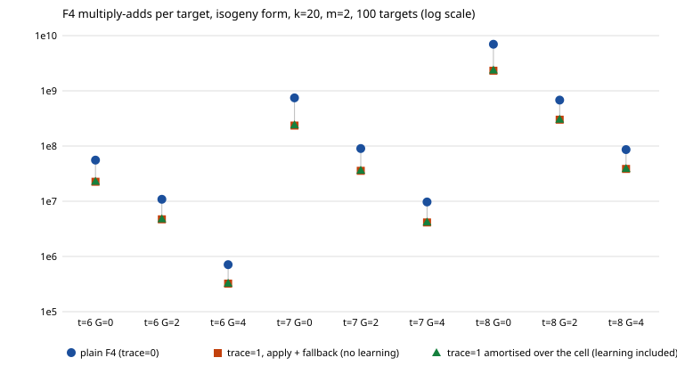

# F4 trace for `pkm-semaev`: learn once per branch system, replay per target

Protocol: [PROTOCOL.md](PROTOCOL.md) (frozen before data, unchanged since).
Scope of every statement below: **k = 20 miniature, isogeny form, m = 2, mode
full, t in {6, 7, 8}, G in {0, 2, 4}, 100 subgroup targets per cell, seeds
2026111400 + t**, in the unit **F4 elimination multiply-adds** (the oracle's
unit). Nothing is claimed for other k, m, t, G, the bits form, wall time, or
against rho (distance to rho is lead A's, a different unit).

## What was built

`pkm-semaev:...,trace=1` (and `curve25519_family f4cost ... <lifts> <trace>`,
argument 12; `trace=0` is byte for byte lead 4's code path).

- `f4_fp_tower.rs`: `TowerF4Options::record_trace` / `replay`, `F4Trace`.
  A recording run keeps, per F4 step, the S-rows `(multiplier, element)` whose
  residue gave a new pivot, the S-rows promoted to reducers, and the sorted
  leads of the new elements. A replay forms only those S-rows, forms the
  reduced reducer block `B'` only for the reducers those rows reach, and
  stops at the first step whose new leads differ from the trace's (unless it
  already holds `1`). Only a refutation is a result of a replay: every row
  lies in the ideal, so `1` is a sound certificate whatever the trace was
  learned on; the result is never "this is a Groebner basis".
- `pkm_semaev.rs`: at `prepare`, one trace per branch system (`2^G` of them),
  learned by plain F4 with recording on `x_R` from a fixed splitmix stream
  (at most 8 tries, until one refutes; in every cell the first try did).
  Per target and branch: replay; if it does not refute, plain F4 on the same
  system (the fallback), as before. The grid reading, lift and verdict code
  after F4 is unchanged.
- Ledger: learning is setup native work (`pkm_trace_learn_muladds`), charged
  once per branch shape, not in `f4_muladds`. `f4_muladds` = replay work
  (every attempt, including the ones that fail) + plain work after a failed
  replay; the test asserts the identity.
- Design choice, with the alternative rejected, is in PROTOCOL.md.

## Validity checks

- `cargo test --release --lib pkm_semaev`: `test result: ok. 12 passed; 0 failed; 0 ignored; 0 measured; 6075 filtered out; finished in 471.89s` (11 existing plus the new test, listed in the output).
  New test `trace_agrees_with_plain_f4_and_grid` (isogeny t = 4 at G = 0, 1, 2
  and the bit form at G = 1, 32 random and planted targets each): trace verdict
  == plain-F4 verdict == grid verdict == exact decomposable set, relations sum
  to the target, zero crosscheck disagreements, replays refute, the fallback
  is exercised (planted targets are consistent systems) and charged, ledger
  identity holds. All pre-existing tests pass.
- `cargo clippy --release --lib --bin curve25519_family -- -D warnings`: exit
  0, only the environmental unknown-lint warning (`chunks_exact_to_as_chunks`).
  rustfmt applied to the three changed `.rs` files.
- Self-check (uncharged diagnostic in `prepare`, counter
  `pkm_trace_selfcheck_refuted`): each learned trace replayed on its own `x_R`
  must refute. It equals the number of branches in all 9 trace cells
  (1, 4, 16). It is what exposed the one bug found (below).
- Binary identity: frozen copy `/home/user/frozen-bin/curve25519_family_leadC`,
  sha256 `621055521e98edb4f1cb0685b5f2e072bc3b8da1cc2216d4f132799c82c149c1`
  (`analysis/binary.sha256`), built after `touch` of the changed sources
  inside the `flock` call (the shared-target hazard), and checked before the
  data with a 3-target smoke run whose JSON contains `"trace":true` and the
  `pkm_trace_*` counters, which only this branch's code emits.
- The `trace=0` cells reproduce lead 4's numbers: multiply-adds per target
  7.1e5 (t = 6, G = 4), 9.7e6 (t = 7, G = 4), 8.64e7 (t = 8, G = 4), 6.98e9
  (t = 8, G = 0), identical to its README; hits 4/4 at t = 8, else 0.

## Measurement

Driver `analysis/run_cells.sh` (shell + jq), 18 cells, sequential, trace 0
then trace 1 per (t, G), each under `ulimit -v 3500000` and `timeout 900`,
cap 600 s. Raw: `analysis/f4trace.jsonl` (sha256
`7fa5d4a040c7293377a52f3efa8738761a85333f66dffca1071c85a4973acd6e`, 18 lines,
18 ok, 0 failed, all stderr files empty), status with the load average before
each cell in `analysis/f4trace.jsonl.status`. **No cell hit the cap**, so every
pair is paired target for target (same 100 targets). Run locally on a shared
4-core box; `elapsed_s` and the load are recorded in the JSON but **wall
times are not compared** (other agents' load). Tables: `analysis/make_tables.sh`
(jq + awk), figure `analysis/make_svg.sh`.

Columns (all multiply-adds): plain /tgt = `trace=0` per target; apply /tgt =
replay work per target (all attempts); fallback /tgt = plain work after failed
replays; trace /tgt = apply + fallback (learning excluded); L = learning cost
(once); amortised = (L + trace total) / 100; n\* = L / (plain - trace /tgt),
the target count at which learning has paid back; fallbacks/replays at branch
level (hits p/t = plain/trace arm); PR(cov) = per-relation cost on the
harness's `coverage_exact` (per target / cov).

| t | G | targets plain/trace | plain /tgt | apply /tgt | fallback /tgt | trace /tgt (no learn) | apply/plain | trace/plain | learn L | amortised /tgt | break-even n* | fallbacks/replays | hits p/t | verified p/t | cov | PR(cov) plain | PR(cov) trace amort. | learn runs/branches |
|---|---|---|---|---|---|---|---|---|---|---|---|---|---|---|---|---|---|---|
| 6 | 0 | 100/100 | 5.55e+07 | 2.25e+07 | 0 | 2.25e+07 | 0.406 | 0.406 | 5.55e+07 | 2.31e+07 | 1.683 | 0/100 (0.0%) | 0/0 | 0/0 | 0.00131 | 4.23e+10 | 1.76e+10 | 1/1 |
| 6 | 2 | 100/100 | 1.08e+07 | 4.7e+06 | 0 | 4.7e+06 | 0.434 | 0.434 | 1.08e+07 | 4.81e+06 | 1.766 | 0/400 (0.0%) | 0/0 | 0/0 | 0.00131 | 8.27e+09 | 3.67e+09 | 4/4 |
| 6 | 4 | 100/100 | 7.1e+05 | 3.23e+05 | 0 | 3.23e+05 | 0.454 | 0.454 | 7.1e+05 | 3.3e+05 | 1.833 | 0/1600 (0.0%) | 0/0 | 0/0 | 0.00131 | 5.42e+08 | 2.52e+08 | 16/16 |
| 7 | 0 | 100/100 | 7.46e+08 | 2.28e+08 | 7.46e+06 | 2.35e+08 | 0.305 | 0.315 | 7.46e+08 | 2.43e+08 | 1.461 | 1/100 (1.0%) | 0/0 | 0/0 | 0.00905 | 8.23e+10 | 2.68e+10 | 1/1 |
| 7 | 2 | 100/100 | 9.03e+07 | 3.56e+07 | 0 | 3.56e+07 | 0.395 | 0.395 | 9.03e+07 | 3.65e+07 | 1.652 | 0/400 (0.0%) | 0/0 | 0/0 | 0.00905 | 9.97e+09 | 4.04e+09 | 4/4 |
| 7 | 4 | 100/100 | 9.7e+06 | 4.13e+06 | 0 | 4.13e+06 | 0.426 | 0.426 | 9.7e+06 | 4.23e+06 | 1.742 | 0/1600 (0.0%) | 0/0 | 0/0 | 0.00905 | 1.07e+09 | 4.67e+08 | 16/16 |
| 8 | 0 | 100/100 | 6.98e+09 | 2.04e+09 | 2.79e+08 | 2.32e+09 | 0.292 | 0.332 | 6.98e+09 | 2.39e+09 | 1.497 | 4/100 (4.0%) | 4/4 | 4/4 | 0.035 | 1.99e+11 | 6.79e+10 | 1/1 |
| 8 | 2 | 100/100 | 6.8e+08 | 2.92e+08 | 8.76e+06 | 3.01e+08 | 0.429 | 0.442 | 6.96e+08 | 3.08e+08 | 1.833 | 5/391 (1.3%) | 4/4 | 4/4 | 0.035 | 1.94e+10 | 8.76e+09 | 4/4 |
| 8 | 4 | 100/100 | 8.64e+07 | 3.81e+07 | 3.34e+05 | 3.85e+07 | 0.442 | 0.445 | 8.89e+07 | 3.94e+07 | 1.857 | 6/1554 (0.4%) | 4/4 | 4/4 | 0.035 | 2.46e+09 | 1.12e+09 | 16/16 |

`analysis/trace.svg`: multiply-adds per target, log scale, per (t, G): plain F4
(circle), trace arm apply + fallback (square), trace arm amortised over the
cell's 100 targets with learning (triangle).

### Compact view

| t | G | plain /tgt | trace /tgt | trace / plain | n\* | fallbacks / replays |
|---|---|---|---|---|---|---|
| 6 | 0 | 5.55e7 | 2.25e7 | 0.41 | 1.68 | 0 / 100 |
| 6 | 2 | 1.08e7 | 4.70e6 | 0.43 | 1.77 | 0 / 400 |
| 6 | 4 | 7.10e5 | 3.23e5 | 0.45 | 1.83 | 0 / 1600 |
| 7 | 0 | 7.46e8 | 2.35e8 | 0.32 | 1.46 | 1 / 100 |
| 7 | 2 | 9.03e7 | 3.56e7 | 0.39 | 1.65 | 0 / 400 |
| 7 | 4 | 9.70e6 | 4.13e6 | 0.43 | 1.74 | 0 / 1600 |
| 8 | 0 | 6.98e9 | 2.32e9 | 0.33 | 1.50 | 4 / 100 |
| 8 | 2 | 6.80e8 | 3.01e8 | 0.44 | 1.83 | 5 / 391 |
| 8 | 4 | 8.64e7 | 3.85e7 | 0.45 | 1.86 | 6 / 1554 |

Learning cost L equals the plain per-target cost of the cell almost exactly
(one plain run per branch system, the first try refuted in every case), so
n\* = L / (P - T) = 1 / (1 - trace/plain) is between 1.5 and 1.9 in all nine
cells: the learning has paid back after two targets.

## Predictions (frozen in PROTOCOL.md)

- **P1 (apply cost at G = 0 at most 0.25 x plain at t = 6, 7, 8): false.**
  Measured apply / plain at G = 0: 0.406 (t = 6), 0.305 (t = 7), 0.292
  (t = 8). All three exceed 0.25. The replay still costs 29 % to 41 % of
  plain F4 at G = 0. Where the remaining work sits (initial echelon, the
  reducer block the kept rows reach, the unit-producing last steps) was not
  measured and is not claimed.
- **P2 (the ratio is larger at G = 4 than at G = 0): true at all three t.**
  apply / plain at G = 0 -> G = 4: 0.406 -> 0.454 (t = 6), 0.305 -> 0.426
  (t = 7), 0.292 -> 0.442 (t = 8); G = 2 lies between at t = 7 (0.395) and
  t = 8 (0.429), and at t = 6 (0.434). The mechanism stated in the protocol
  (smaller branch systems leave less to drop) is not tested by this data; only
  the ordering is.
- **P3 (fallbacks / replays at most 10 % in every cell): true.** Largest is
  4.0 % (t = 8, G = 0, 4 / 100). Fallbacks are the 4 consistent systems (the 4
  hits of t = 8, `pkm_consistent_systems` = 4 in every t = 8 cell) plus
  degenerate specialisations of systems that plain F4 refutes: 1 at t = 7,
  G = 0 (0 hits in that cell; leads 242 vs 243 at step 17), 1 at t = 8, G = 2,
  2 at t = 8, G = 4. At t = 6, no fallbacks. The fallback is therefore
  exercised on real data, and charged (it is the "fallback /tgt" column).
- **P4 (hits and verified hits equal between arms): true in all 9 pairs**
  (0 / 0 at t = 6 and 7, 4 / 4 at t = 8, verified equal to hits).
- **P5 (learning pays back within 5 targets where apply < plain): true.**
  Largest n\* is 1.86 (t = 8, G = 4).

## Per relation on `coverage_exact` (F4 multiply-adds per target / coverage)

Plain -> trace amortised over 100 targets (columns PR(cov) above): t = 6:
4.23e10 -> 1.76e10 (G = 0), 8.27e9 -> 3.67e9 (G = 2), 5.42e8 -> 2.52e8 (G = 4);
t = 7: 8.23e10 -> 2.68e10, 9.97e9 -> 4.04e9, 1.07e9 -> 4.67e8; t = 8:
1.99e11 -> 6.79e10, 1.94e10 -> 8.76e9, 2.46e9 -> 1.12e9. The best cell of the
grid is still isogeny t = 6, G = 4: 5.42e8 plain (lead 4's best) -> 2.52e8
with the trace (2.15 x lower) in this unit. This is a measured reduction of F4
multiply-adds per relation on the same oracle, same targets, same verdicts;
it is not a wall-time claim, and the unpriced native work (specialisation,
row formation, grid reading) is not counted for either arm (AGENTS.md §5a
would price it at 0 / 0.1 / 1 GAE in a cross-method comparison; none is made).
With more targets the amortised cost tends to the trace column (trace/plain
0.32 to 0.45 here); with fewer than two it does not pay.

## Failures, deviations, and what was not done

- **A bug in my first replay**, found by the self-check before any cell data:
  the replay rebuilt the set of lcm columns from the kept halves of critical
  pairs only. A column whose promoted row is a tower product then fell out of
  the set, was sent to the reducer search, and the matrix changed (every
  replay at G = 2 failed with "new leads differ", 99 of 99; the self-replay
  failed 4 of 4). Fix: the replay keeps the original lcm columns. The test
  and all 18 cells use the fixed code; no cell data came from the buggy one.
- The self-check diagnostic and the failure-reason counters
  (`pkm_trace_failure_*`, `pkm_trace_mismatch_*`) were added after PROTOCOL.md
  was frozen; they change no cost and no verdict. The protocol text was not
  edited.
- Reducer pruning (`B'` only for reached reducers) is applied only in
  replays, as the protocol says. It is therefore part of what the "apply"
  column measures; a plain-F4 arm with the same pruning is not measured, so
  how much of the saving comes from dropping rows and how much from pruning is
  not separated.
- The learning `x_R` are drawn from a fixed stream, not from the targets;
  in all 9 cells the first draw per branch refuted (learn runs = branches).
  Sensitivity to the draw was not measured.
- The replay never certifies a Groebner basis, only a refutation. Targets
  whose system is consistent (hits) always go to plain F4, so the trace saves
  nothing on them and costs the failed replay (the "apply" share of the
  fallback rows): at t = 8, G = 0, the 4 hits cost an extra 4 failed replays
  in the apply column.
- Wall time was not measured as a claim: row formation, specialisation and the
  elimination of the replay run on a shared box. Not compared.
- 100 targets per cell, 0 to 4 hits per cell; the hit counts say nothing about
  yield beyond consistency with `coverage_exact`.
- Run locally (a development measurement inside the lead), not on EKS, as the
  task specified; no L2 or cross-method claim.
