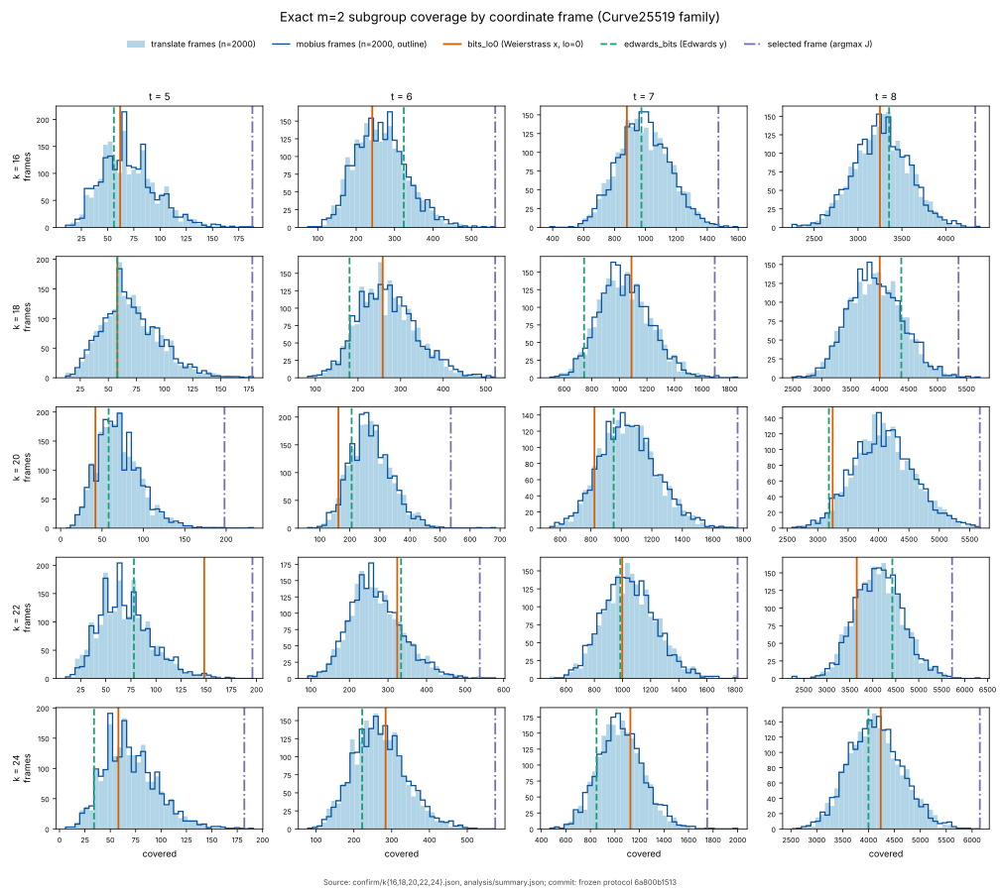
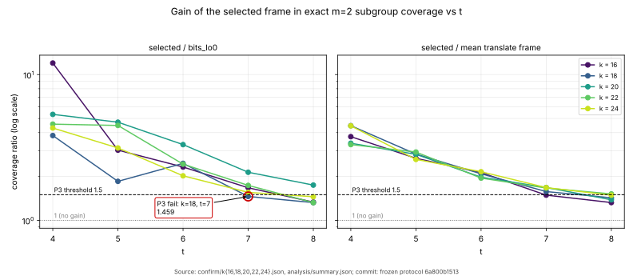

# Coordinate frames for the Curve25519-family factor base (2026-11-03)

**Class:** a mechanism measurement with exact counts and a component result on
the algebraic track. It is not a leaderboard table A–C row, and it does not
change the order against the generic baseline or rho.
Protocol: [PROTOCOL.md](PROTOCOL.md), frozen in `6a800b1513` before any
confirmation count. PDF: [REPORT.pdf](REPORT.pdf).

## Question (owner)

Do coordinate systems other than the current one (other Montgomery forms,
projective, Edwards, …) yield more relations for Curve25519 index calculus?

## Answer

1. **Which model you use does not matter. Which frame you pick does.**
   - Every degree-2 coordinate on E is a Möbius frame of x. Weierstrass x,
     Montgomery u, Edwards y and the Jacobi quartic coordinate are all frames
     of this kind. Projective coordinates change arithmetic, not the factor base.
   - Hessian, twisted Hessian, Jacobi intersection and Huff models are not
     defined over F_p for this family, since #E = 8r with cyclic Z/8.
   - Over 2,000 + 2,000 random frames per (curve, t), Weierstrass `bits lo=0`
     and Edwards y are typical draws. All 50/50 cells are inside the central
     98% (P1).
   - Translation and Möbius frames have the same distribution (P2).
   - Edwards "beat" Weierstrass in `curve25519_edwards_semaev_20261102` only
     because `lo = 0` was a below-average draw on that curve.
2. **On the generic track (the baseline) there is no lever.** For any N-column
   base, P(target = ±P_i ± P_j) ≤ #signed pairs / r. The projected base
   already sits at that ceiling (`curve25519_algebraic_ladder_20261102`, Q-A).
3. **On the algebraic track (`pkm-semaev`), choosing the frame is a real gain.**
   - The F4 system has the same degree and size in every frame.
   - Exact coverage depends on how many points the frame holds and on how their
     cofactor cosets pair up, and both fluctuate from frame to frame.
   - Choosing the frame per (curve, t) without discrete logs (argmax over
     coset-cancelling pairs, read from [r]P) raises coverage at an unchanged
     per-target F4 cost. In the engine, at k = 20, the F4 mul-adds per relation
     fall **4.71× (t = 5)** and **3.33× (t = 6)** (P5).

## Results



### Census (exact, five family miniatures; k = 16, 18, 22, 24 held out)

Selected frame ÷ `bits lo=0` (and ÷ the mean frame):

| k | A | t = 4 | t = 5 | t = 6 | t = 7 | t = 8 |
|--:|--:|:--|:--|:--|:--|:--|
| 16 | 1058 | 12.00 (3.75) | 3.03 (2.66) | 2.32 (2.13) | 1.67 (1.49) | 1.33 (1.32) |
| 18 | 78 | 5.38 (4.53) | 3.07 (2.53) | 2.02 (1.95) | 1.56 (1.63) | 1.34 (1.36) |
| 20 | 926 | 5.33 (3.38) | 4.71 (2.84) | 3.31 (1.98) | 2.14 (1.68) | 1.75 (1.38) |
| 22 | 43186 | 4.78 (4.62) | **1.32** (2.81) | 1.66 (1.98) | 1.82 (1.72) | 1.57 (1.38) |
| 24 | 318 | 4.30 (4.45) | 3.14 (2.62) | 2.02 (2.16) | 1.56 (1.68) | 1.45 (1.49) |

These are the curves of the family rule (`curve25519_family family`). k = 18 and
22 were first run on off-rule curves; see Deviations.

Source: `analysis/summary.json` (`scripts/analyse.py` over `confirm/k*.json`).
The confirm data files are in the artifact store, with the sha256 values in
`confirm/SHA256SUMS` and `confirm/.artifacts.json`.



The gain over the mean frame barely depends on the curve (right panel above). It
falls with t, as the extreme-value model predicts: the fluctuation is about
2^{t/2} against a mean of 2^{t−1}.

### Engine (P5): `curve25519_family f4cost 20 …`, 100 targets, seed 2026111500+t

The binary is `0459a725…b4c5` (`engine/binary.sha256`), built from this
branch.

"F4 mul-adds / relation" is derived, not measured: it is mul-adds/target ÷ `coverage_exact`, the engine's `muladds_per_relation_at_exact_coverage`. Only one relation was actually returned.

| cell | cols | covered | max degree | terms | mul-adds/target | F4 mul-adds / relation (derived) |
|:--|--:|--:|--:|--:|--:|--:|
| bits t=5 G=3 | 11 | 42 | 5 | 64 | 3,036,911.76 | 9.487·10⁹ |
| bits@976503 t=5 G=3 | 24 | 198 | 5 | 64 | 3,036,916.11 | **2.012·10⁹** (0.212×) |
| bits t=6 G=3 | 25 | 162 | 6 | 154 | 172,425,384.63 | 1.396·10¹¹ |
| bits@908172 t=6 G=3 | 42 | 536 | 6 | 154 | 171,133,755.53 | **4.189·10¹⁰** (0.300×) |
| bits t=5 G=0 (extra) | 11 | 42 | 6 | 256 | 127,284,344.31 | 3.976·10¹¹ |
| bits@976503 t=5 G=0 (extra) | 24 | 198 | 6 | 256 | 127,284,307.74 | **8.434·10¹⁰** (0.212×) |

- `coverage_exact` equals the census exactly.
- The `bits` arm reproduces the published cells of
  `curve25519_edwards_semaev_20261102` exactly.
- One relation was found and re-summed in the frame t = 6 cell.

## Predictions

| | outcome |
|:--|:--|
| P1 no model effect | **held**, 50/50 cells inside 1–99% (the k = 22, t = 5 `bits lo=0` sits at the 99th percentile, still inside) |
| P2 translation ≡ Möbius | **held**, 0.986–1.012 over the cells in scope (mean covered ≥ 50) |
| P3 ≥ 1.5× vs `bits lo=0` at t = 5–7, held-out curves | **failed** in 1 of 12 cells: k = 22, t = 5 gives 1.32×. There `lo = 0` was itself a lucky draw (99th percentile). Against the mean frame the gain is 2.81×. The other 11 cells give 1.56–3.14×. P3 was mis-specified: it compares against one random draw, which is sometimes lucky. The gain over the mean frame is the curve-independent statistic. |
| P4 log-free selector suffices | **held**: equal to the oracle-best frame in 23/25 cells, ≥ 0.99 in all |
| P5 engine agrees | **held**: same coverage, degree and terms; mul-adds/target ratio 1.000, 0.993, 1.000 |

## Costs and scope (distance remaining)

- **Frame search is priced.** K = 2000 frames cost 2000·2^t Legendre symbols
  plus [r]P on every column found, about 1.5·log2 r group operations each. At
  k = 20, t = 6 that is about 1.6·10⁶ group operations. This is small against
  one relation's F4 work (4·10¹⁰ mul-adds), but large against a whole rho
  solve at k = 20, which takes 547–936 group operations (S 1.51–2.59 × √r).
  On the algebraic track it is noise. It is not free against rho.
- **The algebraic track is still far behind.** The best algebraic arm was
  2.6× (w = 0) to 1.4·10⁵× (w = 0.1) behind the generic baseline
  (`curve25519_algebraic_ecbench_20261102`). The generic baseline itself is
  7.8× rho at k = 20. The best algebraic arm against rho-neg measured 18×
  (w = 0), 9.6·10⁵× (w = 0.1) and 5.9·10⁶× (w = 1).
- **Projection, not measured:** if the 3.3–4.7× cut carried over unchanged to
  that arm, it would be about 2·10⁵× (w = 0.1) to 1.5·10⁶× (w = 1) behind
  rho-neg. That arm is the PKM isogeny tower, not bits, so the carry-over is
  untested. A 3–5× cut does not change any order across the §5a band.
- **The gain shrinks with t**: 1.3–1.5× against the mean frame at t = 8. Nothing
  is extrapolated to 255 bits.
- **Not explained:** the single-seed Edwards t = 5, G = 0 per-target ratio of
  0.646 from the earlier study. A translation frame at the same cell costs
  exactly the same as `bits` (127,284,307 against 127,284,344), so that ratio
  is not a generic frame effect.

## Next

- Use the frame selector as the default for `pkm-semaev` bits bases, and
  re-price `curve25519_algebraic_ecbench` with it.
- Search frames jointly with the guess split G, and on the PKM isogeny tower
  (the best algebraic arm), where the same coset argument applies.

## Reproduce

```bash
scripts/run_confirm.sh          # census, ~1 min (python3 + numpy)
python3 scripts/analyse.py      # P1–P4
cargo build --release --bin curve25519_family
BIN=target/release/curve25519_family scripts/run_engine.sh   # P5, ~1 min
python3 scripts/figures.py      # needs matplotlib
```

## Deviations and validator errata

- **E1, the curves.** The first confirmation run used k = 18, A = 54 and
  k = 22, A = 894 from a reimplementation of the family rule that dropped two
  clauses: A² − 4 non-square, and r > 2^(k−3). Those curves are
  curve25519-shaped (cyclic Z/8, #E' = 4r') but are not the curves the
  protocol names. The independent validator caught this.
  - The same frozen instrument and seeds were then run on the rule's curves
    (A = 78 and A = 43186, `scripts/run_confirm_rulefix.sh`). P1–P4 are decided
    on those.
  - The off-rule runs are kept in `confirm_offrule/`. Their verdicts had the
    same shape: P1, P2 and P4 held, and P3 failed in one cell (k = 18, t = 7,
    1.459×, again a lucky `lo = 0` draw).
- **E3:** P2's range was restated over the cells in its scope.
- **E4:** the J selector counts a 2-torsion summand twice. No selected frame
  or verdict changes.
- **E5:** the per-relation column is labelled as derived.
- **E6:** the selection rule's tie-break is "highest J, then highest cols, then
  lowest L" (`scripts/analyse.py`). The protocol did not state its direction.
- **E8:** the rho operation count was corrected.
- **Validation gate: not passed** (`VALIDATION.json`, verdict
  insufficient_evidence, given before the E1 fix). There is no same-unit rho
  row for a component result. So no leaderboard or `benchmarks/` row is made,
  as the claim scope already said.

- Conductor and the AWS CLI were absent in this container. There was no
  Conductor task, no S3 resume push and no EKS route.
- Every measurement is a deterministic exact count (census) or a counted F4
  mul-add, never a timing, and they were run locally.
