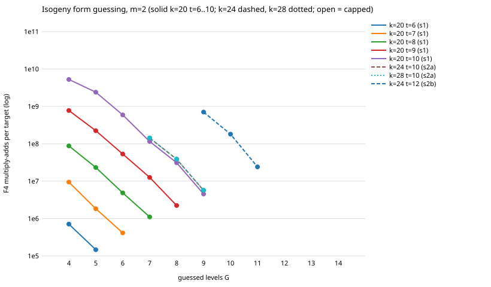

# Isogeny-form guessing optimum (lead B)

Protocol: [PROTOCOL.md](PROTOCOL.md) (frozen before data, commit f9e1f3855a). Scope of every statement:
**isogeny form, m = 2, mode full, lifts 0, k in {20, 24, 28}, only the (t, G) cells listed, 100 random subgroup targets
per cell** (fewer where stated). No claim for other k, t, G, m or form, and no distance to Pollard rho (lead A, different unit).

## Answer in one paragraph

Within the measured range the guessing cost does **not** turn up. At k = 20, for every t from 6 to 10, F4 multiply-adds per target fall
at every step from G = 4 to G = t-1, and the argmin is the largest G allowed (G = t-1) in all five series, so no minimum is bracketed.
The steps do not flatten as G approaches t: the final step is the largest ratio in the series for t = 9 and 10 (t = 10: 2.2, 4.1, 5.1, 3.7, 6.9 per step; t = 8 is the exception, 3.8, 4.8, 4.4).
The same holds at k = 24 and 28 for t = 10 (G = 7..9) and at k = 24 for t = 12 (G = 9..11). The frozen U-shape prediction P1 is false and the
falsifier P3 occurred. Where the optimum lies beyond G = t-1 cannot be asked: `pkm-semaev` refuses G >= t, and also G > 12 (found here). The k = 28, t = 14
coverage-matched series produced no data (OOM, wall-limit, and the G <= 12 refusal; see Failures).

## Method

- Binary `/home/user/frozen-bin/curve25519_family_leadB`, sha256 `fc72092faa52e34f6fa1fb5eeea459b466b4b780416c6724724134374e057311`, built from the
  unmodified source of main 56c3e282ee (no code change in this lead). After the coordinator's warning about the shared target dir, the binary was rebuilt
  inside the cargo flock after `touch` of `src/bin/curve25519_family.rs` and `src/cryptanalysis/ic_framework/pkm_semaev.rs`: the sha256 was identical
  (`fc72092f...`), and `git diff 56c3e282ee..HEAD -- src` is empty. So the measured binary is from this worktree's source (done after stage 1 and 2 had started, before the report).
- Cell command: `( ulimit -v 3500000; timeout 1000 <bin> f4cost <k> isogeny <t> <G> 100 <seed> <cap_s> 2 full 0 )`, sequential, driver `analysis/run_cells.sh`
  (stage 1: `analysis/stage1.sh`, cap 600 s; stage 2: `analysis/stage2.sh`, cap 900 s). Raw: `analysis/cells.jsonl` (27 ok cells, 27 KB,
  sha256 `315ce49a8d9a18eb3422836f6ebee44b24a6acf0b6108579bbb7e9ee8400de98`), `analysis/cells.jsonl.status` (30 lines: 30 cells attempted, 27 ok,
  3 failed; sha256 `93fac7f58171fc61347457b346c936b6a4e3be56740313eeeea08861347c9b11`), `analysis/stderr/` (empty for every ok cell; the two
  non-empty files are the failed cells), `analysis/support.jsonl` (lambda). Tables and figure: `analysis/make_tables.sh` (jq + awk). Run locally, not on EKS.
- Seeds: stage 1 `2026111600+t`; reproduction `2026111400+t` (lead 4's seeds); stage 2 `2026111700+t` (k = 24), `2026111800+t` (k = 28).
- Stage-2 rule applied mechanically: the lowest PR(cov) among uncapped stage-1 cells is t = 10, G = 9 (1.18e7), an edge cell, so the window is {7, 8, 9}
  (2a, fixed t = 10), and the coverage-matched t' = 12 (k = 24), 14 (k = 28) with G' = round(0.9 t') = 11 (k = 24), 13 (k = 28), edge, window {9,10,11} and {11,12,13} (2b).
- Load: `uptime` 1-minute load at each cell start is the last column and in the JSON (`load_at_start`); the box was shared (load 2 to 12). No cell
  hit the wall cap; wall times are not compared.

## Full table

Columns: stage (s1, repro, s2a fixed t = 10, s2b coverage-matched t); k; t; G; targets done/requested; CAP = cap hit (none did); mul/tgt = F4 multiply-adds per
target; calls/tgt = F4 calls per target (below 2^G because a target stops at its first hit); deg = max solving degree; und = undecided; h/v = hits/verified hits;
lam = lambda from `support`; PR(lam) = mul/tgt / lam (modelled, cofactor-aware yield, lower figure); cov = `coverage_exact`; PR(cov) = mul/tgt / cov (modelled); obs = total muladds / hits
(observed, only where hits >= 1; at most 34 hits, not a ranking basis); unch = uncharged native field mults (system + grid reading) as share of charged muladds; load = 1-min load at start.

| stage | k | t | G | targets | cap | mul/tgt | calls/tgt | deg | und | h/v | lam | PR(lam) | cov | PR(cov) | obs | unch | load |
|---|---|---|---|---|---|---|---|---|---|---|---|---|---|---|---|---|---|
| s1 | 20 | 6 | 4 | 100/100 | - | 7.1e5 | 16 | 5 | 0 | 0/0 | 0.00953 | 7.45e7 | 0.00131 | 5.42e8 | - | 0.041% | 3.16 |
| s1 | 20 | 6 | 5 | 100/100 | - | 1.46e5 | 32 | 4 | 0 | 0/0 | 0.00953 | 1.54e7 | 0.00131 | 1.12e8 | - | 0.306% | 3.39 |
| s1 | 20 | 7 | 4 | 100/100 | - | 9.43e6 | 15.55 | 5 | 0 | 4/4 | 0.06265 | 1.51e8 | 0.00905 | 1.04e9 | 2.36e8 | 0.01% | 3.52 |
| s1 | 20 | 7 | 5 | 100/100 | - | 1.83e6 | 31.47 | 5 | 0 | 4/4 | 0.06265 | 2.92e7 | 0.00905 | 2.02e8 | 4.57e7 | 0.069% | 3.74 |
| s1 | 20 | 7 | 6 | 100/100 | - | 4.13e5 | 61.99 | 4 | 0 | 4/4 | 0.06265 | 6.6e6 | 0.00905 | 4.57e7 | 1.03e7 | 0.377% | 3.85 |
| s1 | 20 | 8 | 4 | 100/100 | - | 8.77e7 | 15.79 | 5 | 0 | 2/2 | 0.24609 | 3.57e8 | 0.03512 | 2.5e9 | 4.39e9 | 0.002% | 4.11 |
| s1 | 20 | 8 | 5 | 100/100 | - | 2.32e7 | 31.61 | 5 | 0 | 2/2 | 0.24609 | 9.42e7 | 0.03512 | 6.6e8 | 1.16e9 | 0.008% | 3.54 |
| s1 | 20 | 8 | 6 | 100/100 | - | 4.84e6 | 63.1 | 5 | 0 | 2/2 | 0.24609 | 1.97e7 | 0.03512 | 1.38e8 | 2.42e8 | 0.051% | 3.97 |
| s1 | 20 | 8 | 7 | 100/100 | - | 1.1e6 | 127.24 | 4 | 0 | 2/2 | 0.24609 | 4.49e6 | 0.03512 | 3.14e7 | 5.52e7 | 0.283% | 4.13 |
| s1 | 20 | 9 | 4 | 100/100 | - | 7.75e8 | 14.24 | 5 | 0 | 17/17 | 0.62774 | 1.23e9 | 0.11834 | 6.55e9 | 4.56e9 | 0.006% | 5.32 |
| s1 | 20 | 9 | 5 | 100/100 | - | 2.23e8 | 28.58 | 5 | 0 | 17/17 | 0.62774 | 3.56e8 | 0.11834 | 1.89e9 | 1.31e9 | 0.02% | 6.35 |
| s1 | 20 | 9 | 6 | 100/100 | - | 5.3e7 | 56.68 | 5 | 0 | 17/17 | 0.62774 | 8.45e7 | 0.11834 | 4.48e8 | 3.12e8 | 0.087% | 6.73 |
| s1 | 20 | 9 | 7 | 100/100 | - | 1.26e7 | 111.87 | 5 | 0 | 17/17 | 0.62774 | 2e7 | 0.11834 | 1.06e8 | 7.39e7 | 0.376% | 7.68 |
| s1 | 20 | 9 | 8 | 100/100 | - | 2.23e6 | 226.36 | 4 | 0 | 17/17 | 0.62774 | 3.56e6 | 0.11834 | 1.89e7 | 1.31e7 | 2.166% | 7.22 |
| s1 | 20 | 10 | 4 | 100/100 | - | 5.24e9 | 12.93 | 5 | 0 | 29/29 | 0.97761 | 5.36e9 | 0.38229 | 1.37e10 | 1.81e10 | 0.006% | 7.72 |
| s1 | 20 | 10 | 5 | 100/100 | - | 2.39e9 | 25.57 | 5 | 0 | 29/29 | 0.97761 | 2.45e9 | 0.38229 | 6.26e9 | 8.25e9 | 0.013% | 8.79 |
| s1 | 20 | 10 | 6 | 100/100 | - | 5.89e8 | 51.36 | 5 | 0 | 29/29 | 0.97761 | 6.03e8 | 0.38229 | 1.54e9 | 2.03e9 | 0.052% | 11.93 |
| s1 | 20 | 10 | 7 | 100/100 | - | 1.15e8 | 103.23 | 5 | 0 | 29/29 | 0.97761 | 1.18e8 | 0.38229 | 3.01e8 | 3.97e8 | 0.267% | 11.48 |
| s1 | 20 | 10 | 8 | 100/100 | - | 3.1e7 | 204.58 | 5 | 0 | 29/29 | 0.97761 | 3.17e7 | 0.38229 | 8.1e7 | 1.07e8 | 1% | 12.29 |
| s1 | 20 | 10 | 9 | 100/100 | - | 4.52e6 | 405.69 | 4 | 0 | 29/29 | 0.97761 | 4.62e6 | 0.38229 | 1.18e7 | 1.56e7 | 6.902% | 11.87 |
| repro | 20 | 6 | 4 | 100/100 | - | 7.1e5 | 16 | 5 | 0 | 0/0 | 0.00953 | 7.45e7 | 0.00131 | 5.42e8 | - | 0.041% | 12.02 |
| repro | 20 | 7 | 4 | 100/100 | - | 9.7e6 | 16 | 5 | 0 | 0/0 | 0.06265 | 1.55e8 | 0.00905 | 1.07e9 | - | 0.003% | 12.02 |
| repro | 20 | 8 | 4 | 100/100 | - | 8.64e7 | 15.54 | 5 | 0 | 4/4 | 0.24609 | 3.51e8 | 0.03512 | 2.46e9 | 2.16e9 | 0.003% | 12.01 |
| s2a | 24 | 10 | 7 | 100/100 | - | 1.42e8 | 127.07 | 5 | 0 | 1/1 | 0.22957 | 6.17e8 | 0.03246 | 4.37e9 | 1.42e10 | 0.009% | 4.29 |
| s2a | 24 | 10 | 8 | 100/100 | - | 3.85e7 | 254.11 | 5 | 0 | 1/1 | 0.22957 | 1.68e8 | 0.03246 | 1.19e9 | 3.85e9 | 0.039% | 6.70 |
| s2a | 24 | 10 | 9 | 100/100 | - | 5.65e6 | 507.52 | 4 | 0 | 1/1 | 0.22957 | 2.46e7 | 0.03246 | 1.74e8 | 5.65e8 | 0.312% | 7.41 |
| s2a | 28 | 10 | 7 | 100/100 | - | 1.43e8 | 128 | 5 | 0 | 0/0 | 0.01533 | 9.32e9 | 0.00193 | 7.4e10 | - | 0.002% | 7.71 |
| s2a | 28 | 10 | 8 | 100/100 | - | 3.88e7 | 256 | 5 | 0 | 0/0 | 0.01533 | 2.53e9 | 0.00193 | 2.01e10 | - | 0.012% | 6.97 |
| s2a | 28 | 10 | 9 | 100/100 | - | 5.7e6 | 512 | 4 | 0 | 0/0 | 0.01533 | 3.72e8 | 0.00193 | 2.96e9 | - | 0.126% | 8.32 |
| s2b | 24 | 12 | 9 | 100/100 | - | 7.03e8 | 402.65 | 5 | 0 | 34/34 | 0.98012 | 7.17e8 | 0.38711 | 1.82e9 | 2.07e9 | 0.814% | 8.43 |
| s2b | 24 | 12 | 10 | 100/100 | - | 1.81e8 | 793.74 | 5 | 0 | 34/34 | 0.98012 | 1.84e8 | 0.38711 | 4.66e8 | 5.31e8 | 3.173% | 11.05 |
| s2b | 24 | 12 | 11 | 100/100 | - | 2.4e7 | 1576.71 | 4 | 0 | 34/34 | 0.98012 | 2.45e7 | 0.38711 | 6.21e7 | 7.07e7 | 23.871% | 8.18 |

Not in the table (failed, no data): s2b k = 28, t = 14, G = 11, 12, 13 (see Failures).

`analysis/guess_optimum.svg`: log-scale F4 multiply-adds per target against G, one line per (k, t) series; all points are uncapped.

## Argmin per series, bracketing

Argmin = lowest multiply-adds per target (coverage is constant inside a (k, t), so the PR(cov) argmin is the same cell). "Bracketed" needs a measured smaller-G and a measured larger-G neighbour, both higher.

| stage | k | t | G measured | argmin G | mul/tgt at argmin | bracketed? | cap |
|---|---|---|---|---|---|---|---|
| s1 | 20 | 6 | 4..5 | 5 | 1.465e+05 | edge (largest G measured) | no cap |
| s1 | 20 | 7 | 4..6 | 6 | 4.134e+05 | edge (largest G measured) | no cap |
| s1 | 20 | 8 | 4..7 | 7 | 1.104e+06 | edge (largest G measured) | no cap |
| s1 | 20 | 9 | 4..8 | 8 | 2.232e+06 | edge (largest G measured) | no cap |
| s1 | 20 | 10 | 4..9 | 9 | 4.519e+06 | edge (largest G measured) | no cap |
| s2a | 24 | 10 | 7..9 | 9 | 5.653e+06 | edge (largest G measured) | no cap |
| s2a | 28 | 10 | 7..9 | 9 | 5.703e+06 | edge (largest G measured) | no cap |
| s2b | 24 | 12 | 9..11 | 11 | 2.403e+07 | edge (largest G measured) | no cap |

**No series is bracketed.** Every argmin is the largest G measured, and for t = 6..10 (k = 20), t = 10 (k = 24, 28) and t = 12 (k = 24) that is G = t-1,
the largest the code permits. The argmin ratio G/t is therefore (t-1)/t: 0.83, 0.86, 0.88, 0.89, 0.90 for t = 6..10 at k = 20; 0.90 at k = 24 and 28 (t = 10);
0.92 at k = 24 (t = 12). That is the boundary of the allowed range, not a measured optimum, and it says nothing about stability of an interior optimum.

## Step ratios (cost at G divided by cost at G+1)

All ratios are above 1.25 (resolved by the frozen criterion; every cell uncapped); the smallest is 2.19.

| series | step | ratio | cap |
|---|---|---|---|
| s1 k=20 t=6 | G=4 to 5 | 4.85 | - |
| s1 k=20 t=7 | G=4 to 5 | 5.16 | - |
| s1 k=20 t=7 | G=5 to 6 | 4.42 | - |
| s1 k=20 t=8 | G=4 to 5 | 3.78 | - |
| s1 k=20 t=8 | G=5 to 6 | 4.79 | - |
| s1 k=20 t=8 | G=6 to 7 | 4.39 | - |
| s1 k=20 t=9 | G=4 to 5 | 3.47 | - |
| s1 k=20 t=9 | G=5 to 6 | 4.21 | - |
| s1 k=20 t=9 | G=6 to 7 | 4.22 | - |
| s1 k=20 t=9 | G=7 to 8 | 5.63 | - |
| s1 k=20 t=10 | G=4 to 5 | 2.19 | - |
| s1 k=20 t=10 | G=5 to 6 | 4.06 | - |
| s1 k=20 t=10 | G=6 to 7 | 5.12 | - |
| s1 k=20 t=10 | G=7 to 8 | 3.72 | - |
| s1 k=20 t=10 | G=8 to 9 | 6.86 | - |
| s2a k=24 t=10 | G=7 to 8 | 3.68 | - |
| s2a k=24 t=10 | G=8 to 9 | 6.81 | - |
| s2a k=28 t=10 | G=7 to 8 | 3.68 | - |
| s2a k=28 t=10 | G=8 to 9 | 6.80 | - |
| s2b k=24 t=12 | G=9 to 10 | 3.89 | - |
| s2b k=24 t=12 | G=10 to 11 | 7.51 | - |

Pairing: within a (k, t) all G share the same 100 targets, so the ratios compare like with like, but the tool emits no per-target costs and no interval is given.
The last step is the largest in the series at t = 9, 10 (k = 20), at k = 24, 28 (t = 10) and at k = 24 (t = 12); not at t = 6, 7, 8: the max solving degree drops 5 to 4 at G = t-1
in every series (the `deg` column), which is where the extra gain over the nominal 2x-per-level comes from; that attribution is a reading of the `deg` column, not tested.

## Predictions (frozen in PROTOCOL.md)

- **P1 (U-shape, argmin at t-3 or t-2 for t = 8, 9, 10, with G = t-1 resolved worse): false.** Argmin is t-1 for all of t = 8, 9, 10 (G = 7, 8, 9), and cost at
  t-1 is lower than at t-2 by 4.4, 5.6, 6.9.
- **P3 (falsifier, strictly resolved fall from G = 4 to t-1 for t = 8, 9, 10): occurred.** All 3 + 4 + 5 = 12 steps of those series are resolved falls (ratio 2.19 to 6.86).
- **P2 (argmin G/t stable across k): not judgeable.** The frozen condition applies to bracketed uncapped series; there are none. Reported ratios are in the argmin section.
- **P4 (reproduction, G = 4 at t = 6, 7, 8 with seeds 2026111400+t equal to lead 4): true, exact.** F4 multiply-adds, F4 calls and hits are identical to lead 4's
  `f4cost_guess.jsonl` cells: t = 6: 71009645 / 1600 / 0; t = 7: 970300397 / 1600 / 0; t = 8: 8635143755 / 1554 / 4. The fresh-seed G = 4 cells
  (seed 2026111600+t) are 7.10e5, 9.43e6, 8.77e7 per target (t = 7 differs by 3% from the lead-4 target set, t = 8 by 2%): the target-set spread.

## k-scaling

Compare equal (t, G) across k = 20, 24, 28 at t = 10, G = 7..9 (k = 20 rows come from stage 1, seed differs by k, so the target sets differ):

| G | mul/tgt k=20 | k=24 | k=28 | cov k=20 | k=24 | k=28 |
|---|---|---|---|---|---|---|
| 7 | 1.15e8 | 1.42e8 | 1.43e8 | 0.3823 | 0.03246 | 0.00193 |
| 8 | 3.10e7 | 3.85e7 | 3.88e7 | 0.3823 | 0.03246 | 0.00193 |
| 9 | 4.52e6 | 5.65e6 | 5.70e6 | 0.3823 | 0.03246 | 0.00193 |

F4 cost per target at fixed (t, G) is nearly independent of k (k = 20 is lower by about 20%, plausibly because at k = 20 coverage is 0.38 and 29 of 100 targets stop at a
hit, saving the remaining branches; this attribution is not tested). Per-relation cost therefore rises with k at fixed t through the yield alone: PR(cov) at t = 10, G = 9 is 1.18e7 (k = 20),
1.74e8 (k = 24), 2.96e9 (k = 28), and PR(lam) 4.62e6, 2.46e7, 3.72e8. The coverage-matched series (t = 12 at k = 24, coverage 0.387, similar to k = 20, t = 10's 0.382):
G = 11 gives 2.40e7 per target and PR(cov) 6.21e7, i.e. 5.3x the k = 20, t = 10, G = 9 value (1.18e7) at +2 in t, +2 in k. One matched point gives no scaling exponent; the
k = 28 coverage-matched point was not obtained.

## Uncharged native work

The uncharged field multiplications (system specialisation and grid reading) are a small fraction of charged work at low G but grow toward G = t-1: for example 0.041% to 6.9% over G = 4..9 at
k = 20, t = 10, and 0.81% to 23.9% over G = 9..11 at k = 24, t = 12 (the `unch` column; the units differ, field multiplications against F4 multiply-adds, and
grid reading is a fixed cost per cell). Pricing these at weight 1 against the charged unit (the harsh end of the section 5a band) leaves every step ratio above 2.19 and the
argmins unchanged (checked on all steps; smallest 2.19 at k = 20, t = 10, G = 4 to 5). The 0 and 0.1 weights lie between. No cross-method comparison is made.

## Failures and caps (all of them)

- **No cell hit the wall cap** (largest elapsed 588 s for a cell with cap 900; stage 1 largest 435 s with cap 600). Nothing is a truncated sample.
- **s2b k = 28, t = 14, G = 11: failed, rc 134** after 968 s: `memory allocation of 1207959568 bytes failed` in `pkm_semaev::decomposable` (hash set of u64) under `ulimit -v 3500000`.
- **s2b k = 28, t = 14, G = 12: failed, rc 124**: killed by `timeout 1000` (elapsed 1001 s) before the first target finished; no JSON.
- **s2b k = 28, t = 14, G = 13: failed, rc 101** after 1 s: `pkm-semaev: guess = 13 must be below the tower height 14 and at most 12`. The code caps G at 12.
  The smoke test before freezing used only t <= 10, so this limit was not seen; PROTOCOL says G up to t-1 is accepted, which is true only for t <= 13.
- No code change, no rerun, no cell removed or added after seeing data. The stage-2 rule produced these three cells and they stay failed. Fixing the OOM or the cap would need
  more memory or time than the box rule allows (3.5 GB, shared machine) and was not attempted.

## Deviations and caveats

- Stage 2b was specified with an expected-cap note for t' > 12; k = 28, t = 14 failed instead of capping (above). Stage-2b k = 24, t = 12 succeeded.
- The per-relation figures PR(lam), PR(cov) are modelled (cost / frozen yield). The observed hit counts (0 to 34 in 100 targets) agree with coverage in magnitude but do not rank cells.
  At high coverage (k = 20, t = 9, 10; k = 24, t = 12) the target stops at its first hit, so mul/tgt is below the full-refutation cost and PR(cov) is slightly optimistic there; `obs` is
  the corresponding observed figure and differs from PR(cov) by 0.2x to 3.3x in rows with 1 to 4 hits, and by 0.7x to 1.4x in the rows with 17 to 34 hits (k = 20, t = 9, 10; k = 24, t = 12).
- Within a (k, t), cells use the same target set (same seed); across t or k they do not.
- Lowest per-relation cost among the measured cells, on both modelled bases: k = 20, t = 10, G = 9, with PR(cov) 1.18e7 and PR(lam) 4.62e6 (the stage-2 selection); for comparison the
  best cell of lead 4 (k = 20, t = 6, G = 4) is 5.42e8 and 7.45e7 on the same bases, and the best cell here at t = 6 (G = 5) is 1.12e8 and 1.54e7. These are different (t, G) points of one
  oracle at k = 20 with the yield differing across t; this is a measured improvement of the modelled F4 cost per relation at that cell, not a result at larger k, where the same cell
  costs 1.74e8 (k = 24) and 2.96e9 (k = 28) on PR(cov), and it is an edge cell. No distance to rho is claimed.
- No replay certificate, validator report or matched rho reference: under the validation gate nothing here is a leaderboard or `benchmarks/` row.
- Statements hold for the measured cells on these curves only; "no turn-up" is a statement about G <= t-1 <= 12, the range the code allows.

## Files

`PROTOCOL.md`, `README.md`, `REPORT.pdf`, `analysis/` (scripts, `cells.jsonl`, status, `support.jsonl`, `binary.sha256`, `table_rows.md`, `argmin_rows.md`, `ratio_rows.md`, `guess_optimum.svg`).

## Coordinator review (main session, 2026-11-02)

- **What the falsifier means.** Cost falls at every step all the way to
  G = t − 1, where each branch system leaves 2^(t−G) = 2 candidate base
  elements per summand. At m = 2 on the isogeny form, then, the cheapest point
  measured is the end where the oracle has almost become enumeration of the base
  by guessing. Gröbner-basis work is cheapest when there is least of it. That is
  evidence the algebraic step does not pay for itself at m = 2 in these cells. It
  is not evidence that an algebraic method beats enumeration.
- **The relevant comparison is not inside this table.** The question is whether
  G = t − 1 beats a direct enumeration or pair-table oracle on the same base, in
  one unit. That is lead A's ecbench comparison, with native work priced across
  the §5a band. Until then the 1.18e7 per relation (k = 20, t = 10, G = 9) is a
  modelled F4 figure, not a solve cost.
- **Uncharged native work** reaches about 7% (k = 20, t = 10, G = 9) and about
  24% (k = 24, t = 12, G = 11) of the charged work, and grows towards G = t − 1.
  Pricing it at weight 1 leaves every argmin unchanged, but any extension of the
  grid must keep it priced.
- **Binary identity.** The frozen binary's sha256 fc72092f… is the build of main
  56c3e282ee. It is the same binary lead 5 first picked up by mistake from the
  shared target directory; for this lead it is the correct one, since lead B
  made no code change.
