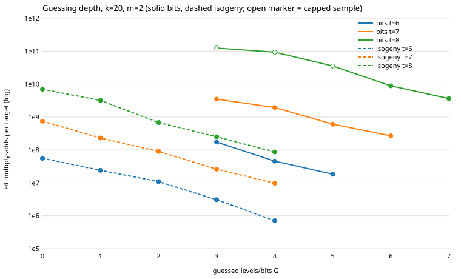

# Curve25519 miniature: hybrid guessing depth (bits and isogeny forms)

Protocol: [PROTOCOL.md](PROTOCOL.md) (frozen, with Amendment 1). Scope of every
statement below: **k = 20, m = 2, mode full, lifts 0, 100 random subgroup
targets per cell, only the G values in the frozen grid**. Nothing here is
claimed for other k, m, or G outside the grid.

## What was built

`pkm-semaev` `guess=G` now also applies to the isogeny membership form (code in
`src/cryptanalysis/ic_framework/pkm_semaev.rs`): the first `t-G` Velu maps are
applied to every element of `V`, `V` is grouped into `2^G` groups of
`2^(t-G)` by the value reached at level `t-G`, and one branch system per group
is solved (summand 1 on the sub-tower, the other unchanged). `G >= t` is refused.
Bits guessing is unchanged. The code compiled on the first try; no bug was
found in it.

Test `isogeny_guessing_agrees_with_grid` (new, in the WIP commit): isogeny form,
t = 4, `G in {1, 2}`, through the shared helper `agrees_with_grid`: F4 verdict ==
grid verdict == exact decomposable set on 32 random/planted targets, relation
sums to the target, zero crosscheck disagreements, F4 work counted; the `2^G`
groups have `2^(t-G)` elements each (checked for G = 2); `guess=t` is refused.

Summary line of `cargo test --release --lib pkm_semaev`:

    test result: ok. 11 passed; 0 failed; 0 ignored; 0 measured; 6075 filtered out; finished in 536.14s

(10 pre-existing tests matching the filter plus the new one.)
`cargo clippy --release --lib --bin curve25519_family -- -D warnings` exits 0
(only the environmental unknown-lint warning). rustfmt was applied afterwards
(whitespace only, 10 lines); the tests ran on the pre-rustfmt source, the
frozen binary was built from the formatted source.

## Measurement

Binary `/home/user/frozen-bin/curve25519_family_lead4`, sha256
`55f44f48dcac5b54792aab59eda5edd7bae8a45ff27df9f0714322245224b0af`
(`analysis/binary.sha256`). Driver `analysis/run_cells.sh` (shell + jq), each
cell under `ulimit -v 3500000` and `timeout 900`, sequential, seed
`2026111400+t`, cap 600 s. Raw: `analysis/f4cost_guess.jsonl`, status
`analysis/f4cost_guess.jsonl.status` (27 cells, 27 ok, 0 failed, all stderr
files empty and not committed), tables by `analysis/make_tables.sh` (jq + awk). Total wall 56 min
of F4 time; the whole grid ran. Run locally, not on EKS (a development
measurement inside the lead; no L2 or cross-method claim).

Columns: mul/tgt = F4 multiply-adds per target (all branches charged);
calls/tgt; C_solve = multiply-adds per F4 call; C(G) = 2^G x C_solve; deg =
max solving degree; und = undecided systems; h/v = hits / verified hits;
PR(lam) = mul/tgt / lambda (frozen lambda from the protocol); cov = harness
`coverage_exact`; PR(cov) = mul/tgt / cov (Amendment 1). CAP = wall cap hit,
only the first n targets done (sample truncated).

| form | t | G | targets | cap | mul/tgt | calls/tgt | C_solve | C(G) | deg | und | h/v | PR(lam) | cov | PR(cov) |
|---|---|---|---|---|---|---|---|---|---|---|---|---|---|---|
| bits | 6 | 3 | 100/100 | - | 1.72e8 | 8.0 | 2.16e7 | 1.72e8 | 6 | 0 | 0/0 | 1.81e10 | 0.001234 | 1.4e11 |
| bits | 6 | 4 | 100/100 | - | 4.55e7 | 16.0 | 2.85e6 | 4.55e7 | 5 | 0 | 0/0 | 4.78e9 | 0.001234 | 3.69e10 |
| bits | 6 | 5 | 100/100 | - | 1.82e7 | 32.0 | 5.69e5 | 1.82e7 | 5 | 0 | 0/0 | 1.91e9 | 0.001234 | 1.47e10 |
| bits | 7 | 3 | 100/100 | - | 3.48e9 | 8.0 | 4.36e8 | 3.48e9 | 6 | 0 | 0/0 | 6.98e10 | 0.006280 | 5.55e11 |
| bits | 7 | 4 | 100/100 | - | 1.93e9 | 16.0 | 1.21e8 | 1.93e9 | 6 | 0 | 0/0 | 3.88e10 | 0.006280 | 3.08e11 |
| bits | 7 | 5 | 100/100 | - | 6.04e8 | 32.0 | 1.89e7 | 6.04e8 | 6 | 0 | 0/0 | 1.21e10 | 0.006280 | 9.62e10 |
| bits | 7 | 6 | 100/100 | - | 2.67e8 | 64.0 | 4.18e6 | 2.67e8 | 6 | 0 | 0/0 | 5.36e9 | 0.006280 | 4.26e10 |
| bits | 8 | 3 | 32/100 | CAP | 1.24e11 | 7.875 | 1.58e10 | 1.26e11 | 7 | 0 | 1/1 | 6.91e11 | 0.024740 | 5.02e12 |
| bits | 8 | 4 | 40/100 | CAP | 9.31e10 | 15.8 | 5.89e9 | 9.43e10 | 7 | 0 | 1/1 | 5.19e11 | 0.024740 | 3.76e12 |
| bits | 8 | 5 | 75/100 | CAP | 3.54e10 | 31.453333333333333 | 1.12e9 | 3.6e10 | 7 | 0 | 2/2 | 1.97e11 | 0.024740 | 1.43e12 |
| bits | 8 | 6 | 100/100 | - | 8.82e9 | 62.73 | 1.41e8 | 9e9 | 6 | 0 | 3/3 | 4.92e10 | 0.024740 | 3.57e11 |
| bits | 8 | 7 | 100/100 | - | 3.63e9 | 125.45 | 2.89e7 | 3.7e9 | 6 | 0 | 3/3 | 2.02e10 | 0.024740 | 1.47e11 |
| isogeny | 6 | 0 | 100/100 | - | 5.55e7 | 1.0 | 5.55e7 | 5.55e7 | 5 | 0 | 0/0 | 5.83e9 | 0.001310 | 4.23e10 |
| isogeny | 6 | 1 | 100/100 | - | 2.4e7 | 2.0 | 1.2e7 | 2.4e7 | 5 | 0 | 0/0 | 2.52e9 | 0.001310 | 1.83e10 |
| isogeny | 6 | 2 | 100/100 | - | 1.08e7 | 4.0 | 2.71e6 | 1.08e7 | 5 | 0 | 0/0 | 1.14e9 | 0.001310 | 8.27e9 |
| isogeny | 6 | 3 | 100/100 | - | 3.07e6 | 8.0 | 3.83e5 | 3.07e6 | 5 | 0 | 0/0 | 3.22e8 | 0.001310 | 2.34e9 |
| isogeny | 6 | 4 | 100/100 | - | 7.1e5 | 16.0 | 4.44e4 | 7.1e5 | 5 | 0 | 0/0 | 7.45e7 | 0.001310 | 5.42e8 |
| isogeny | 7 | 0 | 100/100 | - | 7.46e8 | 1.0 | 7.46e8 | 7.46e8 | 5 | 0 | 0/0 | 1.19e10 | 0.009054 | 8.23e10 |
| isogeny | 7 | 1 | 100/100 | - | 2.3e8 | 2.0 | 1.15e8 | 2.3e8 | 5 | 0 | 0/0 | 3.67e9 | 0.009054 | 2.54e10 |
| isogeny | 7 | 2 | 100/100 | - | 9.03e7 | 4.0 | 2.26e7 | 9.03e7 | 5 | 0 | 0/0 | 1.44e9 | 0.009054 | 9.97e9 |
| isogeny | 7 | 3 | 100/100 | - | 2.6e7 | 8.0 | 3.24e6 | 2.6e7 | 5 | 0 | 0/0 | 4.14e8 | 0.009054 | 2.87e9 |
| isogeny | 7 | 4 | 100/100 | - | 9.7e6 | 16.0 | 6.06e5 | 9.7e6 | 5 | 0 | 0/0 | 1.55e8 | 0.009054 | 1.07e9 |
| isogeny | 8 | 0 | 100/100 | - | 6.98e9 | 1.0 | 6.98e9 | 6.98e9 | 5 | 0 | 4/4 | 2.83e10 | 0.035121 | 1.99e11 |
| isogeny | 8 | 1 | 100/100 | - | 3.18e9 | 1.98 | 1.6e9 | 3.21e9 | 5 | 0 | 4/4 | 1.29e10 | 0.035121 | 9.04e10 |
| isogeny | 8 | 2 | 100/100 | - | 6.8e8 | 3.91 | 1.74e8 | 6.96e8 | 5 | 0 | 4/4 | 2.76e9 | 0.035121 | 1.94e10 |
| isogeny | 8 | 3 | 100/100 | - | 2.5e8 | 7.8 | 3.2e7 | 2.56e8 | 5 | 0 | 4/4 | 1.02e9 | 0.035121 | 7.12e9 |
| isogeny | 8 | 4 | 100/100 | - | 8.64e7 | 15.54 | 5.56e6 | 8.89e7 | 5 | 0 | 4/4 | 3.51e8 | 0.035121 | 2.46e9 |

(`C(G)` differs from mul/tgt only where branches did not all run to a full
`2^G` per target: the capped bits t = 8 cells and isogeny t = 8, G = 1..4, where
a target that hits stops before running all 2^G branches; this is the reading consistent with calls/tgt < 2^G, not separately verified.)

`analysis/guess.svg`: multiply-adds per target vs G, log scale, per (form, t);
open markers are capped samples.

## Argmin G per (form, t) (muladds per target, ties to smaller G)

| form | t | argmin G | grid range | at the grid edge? |
|---|---|---|---|---|
| bits | 6 | 5 | 3..5 | yes (G = t-1) |
| bits | 7 | 6 | 3..6 | yes (G = t-1) |
| bits | 8 | 7 | 3..7 | yes (G = t-1) |
| isogeny | 6 | 4 | 0..4 | yes (grid max) |
| isogeny | 7 | 4 | 0..4 | yes (grid max) |
| isogeny | 8 | 4 | 0..4 | yes (grid max) |

Every cost series is strictly decreasing over the whole measured G range; no
minimum is bracketed. The "argmin" is therefore the edge of the grid, not an
optimum: the true optimum is at or beyond it for isogeny, and for bits it is at
the largest allowed G (G < t) as far as measured.

## Predictions

- **P1 (bits G* = 3, 4, 5 for t = 6, 7, 8): false.** Measured argmin 5, 6, 7
  (edge). Cost falls at every step: t = 6: 1.72e8, 4.55e7, 1.82e7; t = 7: 3.48e9,
  1.93e9, 6.04e8, 2.67e8; t = 8: 1.24e11 (capped), 9.31e10 (capped), 3.54e10
  (capped), 8.82e9, 3.63e9. The t = 8 G = 3..5 cells are truncated samples
  (32/40/75 targets) and are only inconclusive as to their own level; the
  ordering of the uncapped G = 6 and 7 cells, and the large gaps to G = 3..5, do
  not depend on it. The "optimum rises by about one per unit of t" shape is not
  seen; the optimum is not below G = t-1.
- **P2 (isogeny G* = 1, 2, 3): false.** Measured argmin 4, 4, 4 (grid max) at
  all three t. The optimum is not bracketed; it is at least 4.
- **P3 (isogeny + guessing beats bits + guessing per relation at equal t): true
  on both bases.** Best isogeny vs best bits cell, PR(lam): t = 6: 7.45e7 vs
  1.91e9; t = 7: 1.55e8 vs 5.36e9; t = 8: 3.51e8 vs 2.02e10. PR(cov): t = 6:
  5.42e8 vs 1.47e10; t = 7: 1.07e9 vs 4.26e10; t = 8: 2.46e9 vs 1.47e11.
  Ratios 26x to 58x (lam) and 27x to 60x (cov). It also holds at equal G (G = 3, 4
  where both forms have cells) at every t.
- **P4 (best per-relation cost is isogeny at t = 7 or 8 with its optimum G,
  below the previous best): false as stated, on both bases (they agree).** The
  lowest per-relation cost in the grid is isogeny t = 6, G = 4: 7.45e7 (lam) /
  5.42e8 (cov), against the t = 7 and t = 8 isogeny minima (G = 4) of 1.55e8 /
  1.07e9 and 3.51e8 / 2.46e9. All three are below the previous best (isogeny
  t = 6, G = 0: measured here 5.83e9 (lam) / 4.23e10 (cov), consistent with the
  protocol's 5.9e9 and 4.2e10): the t = 6 cell is 78x (lam) and 78x (cov) lower.
  Per-relation cost rises with t at the grid-max G for isogeny. Since the
  t = 6 optimum is itself at the grid edge, "best overall" is the best measured
  cell, not a proven minimum.
- **P5 (C(G) is U-shaped): not observed in the grid.** C(G) falls monotonically
  in all six series (for the uncapped series, e.g. isogeny t = 7: 7.46e8,
  2.30e8, 9.03e7, 2.60e7, 9.70e6). The solving degree is flat or falling
  (bits 7 -> 6 at t = 8 as G rises, 6/5/5 at t = 6; isogeny 5 throughout), so no
  point where the 2^G factor dominates was reached. The right side of a U, if
  it exists, lies beyond the measured G.

Verified hits equal hits in every cell (bits t = 8: 1, 1, 2, 3, 3; isogeny t = 8:
4 in every cell; all other cells 0 hits of 100 targets, as expected from
coverage 0.001 to 0.009). Undecided = 0 in every cell. At 0-4 hits per cell the
hit counts say nothing about yield beyond consistency with `coverage_exact`
(bits t = 8: 0.025, isogeny t = 8: 0.035, i.e. 2.5 and 3.5 expected per 100).

Reading: the lam and cov columns differ by a constant factor per (form, t) (the
Amendment 1 cofactor effect); this does not change any ordering above.

## Deviations and caveats

- None in cells, seeds, or rules; no data-dependent change after the first cell.
- Three bits t = 8 cells (G = 3, 4, 5) hit the 600 s cap (615 s, 604 s, 602 s
  wall) and report 32, 40, 75 of 100 targets. Their per-target means are on
  truncated samples. Protocol classification: inconclusive as to their own
  absolute level.
- The grid ends before any minimum: the stated protocol grid (isogeny G <= 4,
  bits G < t) is too shallow to locate an optimum. Extending the grid (isogeny
  G >= 5, which the code allows for G < t; bits is capped at G = t-1 by the
  `G < t` rule) would be a new protocol, not done here.
- The protocol's hybrid `guess2` (second summand) is not implemented.
- Per-relation figures rest on frozen lambda (from the ladder's cofactor-aware
  count) and on `coverage_exact`; no replay certificate, validator report or
  matched rho reference is attached, so under the validation gate nothing here
  is a leaderboard or `benchmarks/` row. The distance to the matched rho was not
  computed: this experiment compares arms of one oracle only (PROTOCOL.md), and
  native uncharged work (system specialisation, grid reading) is listed in the
  `native` field of each JSON line, not priced.
- Executed on the agent host, sequentially, not on EKS (see Measurement).

## Coordinator review (main session, 2026-11-02)

- **Per-relation figures are modelled, not observed.** PR(λ) and PR(cov) divide
  measured F4 work per target by a frozen yield (λ or `coverage_exact`). The grid
  observed 30 hits in 2,700 targets in total, all verified. That count matches
  coverage and cannot itself rank cells.
- **The fall in F4 cost is not moved into uncharged work.** The uncharged native
  counters (`pkm_system_fp_mults_uncharged`, `pkm_grid_fp_mults_uncharged`) are
  below 0.05% of the charged F4 multiply-adds per target in every cell (largest
  share: isogeny t = 6, G = 4, 288 vs 7.1e5 per target). Pricing them at
  w = 0 / 0.1 / 1 does not change any ordering in this README.
- **What deep guessing approaches.** As G → t each branch system covers a
  sub-tower of 2^(t−G) elements, so the oracle tends towards enumeration of the
  base. The measured best cell (isogeny t = 6, G = 4) is 78× below the previous
  algebraic best in F4 multiply-adds per modelled relation. That is the
  improvement this lead measures. It is **not** compared with the generic
  pair-table baseline (`../curve25519_ic_baseline_20261102`) in a common unit, so
  no distance to rho is claimed. Converting multiply-adds to counted GAE and
  running both through ecbench is the next step.
