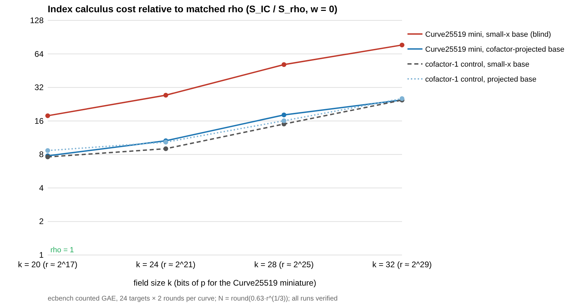

# Curve25519-family index calculus: first baseline (2026-11-02)

**Class:** first baseline for a new curve family (not an improvement claim,
not a security claim about Curve25519). Protocol: [PROTOCOL.md](PROTOCOL.md),
frozen before data. Structure analysis: [STRUCTURE.md](STRUCTURE.md).
Report PDF: [REPORT.pdf](REPORT.pdf).

## What was built

- `src/bin/curve25519_family.rs` (native Rust):
  - `audit`: re-derives Curve25519's facts at 255 bits from first principles
    (primality, `[ℓ](9) = O` by the x-only ladder, `#E = 8ℓ` by Hasse
    uniqueness, twist `4ℓ'` with a twist point, cyclic `Z/8` 2-Sylow, 4-torsion
    at `x = 1`, trace, `j`, embedding degree `> 10⁴`) →
    [`analysis/audit-255.json`](analysis/audit-255.json).
  - `family`: miniatures built by **Curve25519's own selection rule** (largest
    `p < 2^k`, `p ≡ 5 mod 8`; smallest `A ≡ 2 mod 4` with `#E = 8r`,
    `#E' = 4r'`, cyclic 2-part; base point the smallest `u` of order `r`),
    with BSGS point counting on curve and twist and the Montgomery summation
    polynomial `S₃` checked on 200 triples each →
    [`analysis/family.json`](analysis/family.json).
  - `spec`: emits the frozen `ecbench.spec/v1` panels in `specs/`.
  - `summarise`: per-phase cost, trials per relation, prediction checks and the
    figure, from the session records.
  - Unit tests: BSGS order vs Legendre-sum count (curve and twist, every
    `A < 200` on three primes); `S₃` vanishes exactly on `x(P ± Q)`; the `T₀`
    symmetry `S₃(1/x₁, 1/x₂, x₃) = S₃(x₁, x₂, x₃)/(x₁x₂)²`.
- The index calculus itself is the lab's `ic.pipeline` (factor base → pair
  table oracle → relations → linear algebra → verified log), run unchanged on
  the miniatures in short Weierstrass form. Every solve is verified against
  the target.

| k | p | A | #E = 8·r | #E' = 4·r' | base u |
|--:|--:|--:|--:|--:|--:|
| 20 | 1048573 | 926 | 8·131203 | 4·261881 | 4 |
| 24 | 16777213 | 318 | 8·2097349 | 4·4193909 | 3 |
| 28 | 268435157 | 5330 | 8·33557809 | 4·67101961 | 23 |
| 32 | 4294967197 | 27842 | 8·536884639 | 4·1073714321 | 4 |

(At `k = 255` the same rule is the one that produced `A = 486662`, `u = 9`;
the 255-bit search itself was not rerun, as it needs SEA point counting.)

## Result

ecbench, counted GAE, `S` = cost / `√r`; 24 public targets × 2 rounds per
curve; 4,032 records, **all verified**; `ecbench verify --replay 12` audit OK
on all four sessions (receipts below). Each session also measures a
cofactor-1 control curve with a subgroup of the same size.

**The Curve25519-family baseline** (lowest `S` at `w = 0` among the four
existing recipes, chosen in-sample as the protocol states) is
`prime-projected-abscissa:size=N_a` + `mitm:negation_folded=1` at every size:

| k | log₂ r | N | S baseline (w = 0 / 0.1 / 1) | S rho-neg (w = 0 / 0.1 / 1) | **distance to rho** (w = 0 / 0.1 / 1) |
|--:|--:|--:|:--|:--|:--|
| 20 | 17.0 | 32 | 11.76 / 12.64 / 20.49 | 1.511 / 1.619 / 2.585 | **7.8× / 7.8× / 7.9×** |
| 24 | 21.0 | 81 | 12.57 / 13.69 / 23.79 | 1.184 / 1.290 / 2.251 | **10.6× / 10.6× / 10.6×** |
| 28 | 25.0 | 203 | 16.38 / 17.95 / 32.10 | 0.903 / 0.987 / 1.742 | **18.1× / 18.2× / 18.4×** |
| 32 | 29.0 | 512 | 23.31 / 25.52 / 45.41 | 0.944 / 1.037 / 1.871 | **24.7× / 24.6× / 24.3×** |

Rho is ahead at every size and weight (`ecbench band`: rho < every IC arm
across the band). The gap grows with size, as expected of an `m = 2` generic
decomposition whose cost scales as `r^{2/3}` against rho's `r^{1/2}`.



### The Curve25519-specific effect: the cofactor costs blind IC a factor 8 in yield

| k | trials / relation, small-x base | trials / relation, projected base | ratio (cofactor 8) | ratio (cofactor-1 control) | S small-x ÷ S projected (w = 0 / 0.1 / 1) |
|--:|--:|--:|--:|--:|:--|
| 20 | 495 | 62 | **7.95** | 1.00 | 2.29 / 2.44 / 3.25 |
| 24 | 1362 | 163 | **8.38** | 1.00 | 2.57 / 2.74 / 3.57 |
| 28 | 3068 | 401 | **7.66** | 1.00 | 2.83 / 3.02 / 3.86 |
| 32 | 8224 | 1025 | **8.02** | 1.00 | 3.11 / 3.32 / 4.29 |

(`N = N_a`; at `N = 2N_a` the ratios are 7.88, 7.97, 7.94, 8.05.)

A small-abscissa base on a Curve25519-shaped curve is spread over all of
`E(F_p) ≅ Z/8 × Z/r`; only one pair sum in eight lands in the subgroup holding
the target, so the relation phase pays the cofactor in full while rho never
does. Projecting the base by the cofactor removes exactly that factor (7.66–8.38
measured, 8 predicted) and leaves the control untouched (1.00). With the
projection, the miniature behaves like a prime-order curve of the same `r`
(IC ÷ rho 7.8 / 10.6 / 18.1 / 24.7 vs control 7.6 / 9.0 / 15.0 / 24.6).

### Preregistered predictions

| | prediction | outcome |
|:--|:--|:--|
| P1 | small-x ÷ projected trials ≈ 8 on the miniature (fail if < 4), ≈ 1 on the control (fail outside [0.67, 1.5]) | **holds** at all 8 (k, N) cells |
| P2 | miniature projected IC ÷ rho within 1.5× of control small-x IC ÷ rho | **holds**: 1.02, 1.18, 1.21, 1.00 |
| P3 | rho ahead at every size and weight | **holds** |

Per-arm, per-curve detail with phase shares: [`analysis/summary.md`](analysis/summary.md)
([JSON](analysis/summary.json)); ecbench tables `analysis/table-k*.md`; band
`analysis/band-k*.{txt,json}`.

## Reading

- **What is measured:** the cost of the lab's best existing prime-field IC on
  curves with Curve25519's structure, and the size of the one structural
  effect that matters (cofactor 8). The baseline is now named for the ratchet.
- **What is not measured:** anything at 255 bits; any algebraic (Semaev
  system / PKM tower) decomposition; wall time (L0/L1/L2 mixed, local host,
  counts only).
- **Track:** generic decomposition (the pair-table oracle runs identically on
  a random base). The projected base is an existing lab method, so using it is
  the baseline, not an improvement.
- **The structure, in one line:** Curve25519's only IC-relevant special
  features are its cofactor 8 (handled: projection or fiber oracles) and the
  `x ↦ 1/x` symmetry of `T₀` on the Kummer line (a factor `2^{m−1}` in `S_{m+1}`
  degree, unexploited so far). It has no small-norm endomorphism and a prime
  field with no subfield, so no known IC structure changes its exponent. See
  [STRUCTURE.md](STRUCTURE.md).

## Next improvements to try (ratchet candidates)

1. **Base size retune on the projected base.** The lab's prime-order optimum
   `N_a` was reused; `2N_a` is worse at every size, so the optimum may sit
   below `N_a`. A frozen holdout with a fresh `target_seed` decides it.
2. **Closed cofactor fiber for prime curves.** Port `ic_framework::fiber`'s
   `closed` mode (pair table holding `P_i + P_j + K`, `K ∈ E[8]`) to the prime
   pair-table oracle: at fixed unknowns it covers 8× the targets for 8× the
   table, which moves the balanced optimum by `8^{1/3} ≈ 2` in theory; it
   must beat `proj-a` on fresh targets across the band.
3. **`T₀`-closed base** (`{x} ∪ {1/x}` in Montgomery coordinates): the
   2-element sub-case of 2, cheaper to build; measures whether the Kummer-line
   symmetry gives anything beyond projection.
4. **Algebraic track:** `pkm-semaev` on the miniatures, with `S₃`/`S₄`
   symmetrised under the `T₀` action.

## Evidence

| session | dir | records | audit receipt (`analysis/verify-k*.json`) SHA-256 |
|:--|:--|--:|:--|
| ECBS1hd6199244a727 | `sessions/k20` | 1008 | `e01a1a20bf443635a7b45ca0aef36906c5dd82f1447db503521c1bcd8bf43703` |
| ECBS1h6e348fb5e3ea | `sessions/k24` | 1008 | `bb04487d899d697781cebfcf3d252f350e9ddc560b5972c942c62a9f6de05722` |
| ECBS1hae69d3dfdd4d | `sessions/k28` | 1008 | `da7dbd3c9435d3eafb8d84cbd4a51fa1282663b23935d5e74e246908459bb3e3` |
| ECBS1h1c4978d3e652 | `sessions/k32` | 1008 | `7818db19246f2d1ea69e90d28ce891620ae1e9c201d5796674b9db89ddf0ff90` |

`records.jsonl` files live in the artifact store (`.artifacts.json` per
session; `python3 tools/artifacts/artifacts.py pull research/curve25519_ic_baseline_20261102`).

Reproduce:

```bash
cargo build --release --bin ecbench --bin curve25519_family
for k in 20 24 28 32; do
  ./target/release/curve25519_family spec $k 24 $((2026110200+k)) | diff - research/curve25519_ic_baseline_20261102/specs/c25519-k$k.json
  ./target/release/ecbench run --wait --spec research/curve25519_ic_baseline_20261102/specs/c25519-k$k.json --out /tmp/k$k
done
./target/release/curve25519_family summarise /tmp/summary /tmp/k20 /tmp/k24 /tmp/k28 /tmp/k32
```

## Deviations and open items (stated, not hidden)

- **Route.** CLAUDE.md's default is Iso Lab on EKS via a director/executor
  task card. These sessions ran locally (one host, `ecbench host` in each
  `host.json`), without the card relay. Counted GAE is deterministic and
  host-independent and the replays reproduced, but no wall-time figure is
  claimed and **a second-host replay (isolab-eks) is required before any
  leaderboard or `benchmarks/` row** (validation gate). No such row is added
  here.
- **Curve registry.** The miniature and control slugs are not yet in
  `docs/curves/registry.json`; curves are identified by parameters above.
- **Conductor** was not installed in this container; no file reservation was
  taken.
- The baseline arm was chosen in-sample among four recipes; later candidates
  must be compared on fresh targets.
