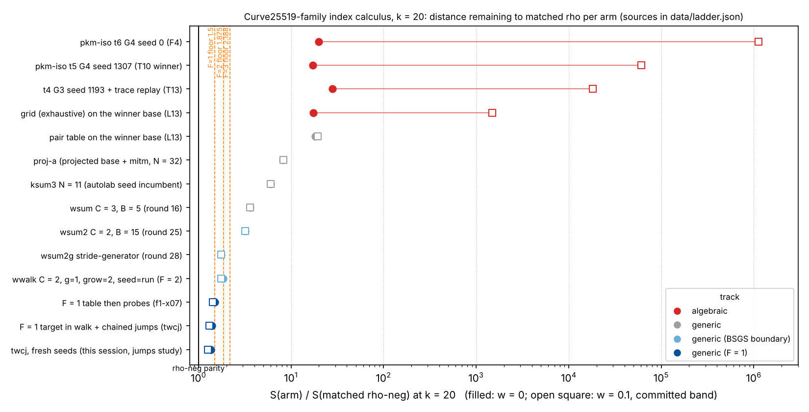

# Index calculus on the Curve25519-family miniatures: coverage of what has been tried (2026-11-08)

**Class.** A coverage report: a synthesis of the lab's measured studies, designs and screens on
this family, with a ranked list of untried or under-tried directions and the two single-target
studies this session ran from that list. Nothing here is a leaderboard or `benchmarks/README.md`
row. Every number is copied from the named file (measured) or marked derived; every result
sentence is an unverified assertion [pcc:unverified]. Written in the worktree
`claude/ic-coverage-20261108`; no push, no PR.

**Curves.** y² = x³ + A x² + x over F_p, p ≡ 5 (mod 8), #E = 8r cyclic; k = 20: p = 1,048,573,
A = 926, r = 131,203, sqrt(r) = 362.2; sizes k = 16..32 exist (`curve25519_family family`).
**Goal of the programme.** S(IC) ≤ S(matched rho-neg) across the AGENTS.md §5a band (w = 0, 0.1,
1); every verified measured improvement over the current IC baseline counts [pcc:unverified].

## 0. Bottom line

- **The generic track is at its collision floor.** Every table or walk design with F unknown
  base logarithms needs F + 1 collisions and costs at least Γ(F + 3/2)/(Γ(F + 1)Γ(3/2)) times the
  rho model: 1.5x (F = 1), 1.875x (F = 2), 2.19x (F = 3) (`curve25519_rho_parity_bound_20261104`,
  derived, Monte Carlo within 1 %). The measured ladder matches: F = 3 boxes 3.2x to 3.6x, F = 2
  walks 1.8x to 1.9x, F = 1 walks 1.36x to 1.50x rho-neg at w = 0 [pcc:unverified]. The best arm,
  the F = 1 target-in-walk walk with chained jumps (`twcj`), is 1.36x to 1.40x at k = 20 and 1.37x at
  k = 32, with its walk 3 % above the 1.329 sqrt(r) second-collision floor [pcc:unverified]. It is
  one unknown away from rho (P1 := G makes it rho with a stored walk) and is not
  decomposition-based index calculus; the owner ruled the C = 2 and walk arms count under the
  autolab decision rule, and the F = 1 arms are reported as boundary results outside the ratchet.
- **The algebraic track is 1.8·10⁴x behind at w = 0.1 and scales as r^1.03** against rho's
  r^0.5 (atlas L10, T13); every coordinate, model, symmetry and base family has been measured or
  closed by a degree argument, and the only lever that worked was selection (frame, seed, t, G),
  which moved the track 16x in two days and then stalled 42x above its own brute-force grid
  [pcc:unverified].
- **Structure levers are exhausted on this family**: Aut = ±1, End(E) = Z[π] with least non-scalar
  degree 772,948, one rational 2-torsion point whose x-action maps ⟨G⟩ off itself, no 3-torsion, no
  Frobenius, twist in a different group (`curve25519_structure_vs_rho_20261107`,
  `ideas/STRUCTURE-R4.md`) [pcc:unverified].
- **What remains untried with existing tools is small-constant work on the F = 1 arm and
  accounting rulings**; what might change the picture needs engine work (an oracle finding
  relations below about 14 native operations per trial at w = 0.1 without forming R ± P_i, which
  `curve25519_algebraic_oracle_search_20261107` found no design for) [pcc:unverified]. This
  session ran the two cheapest untried knob tests; the first (fewer jumps) was falsified, the
  second (scaling to k = 28, 32) confirmed the flat 1.37x to 1.40x distance [pcc:unverified].

## 1. Sources read, and what could not be reached

Read in this order: `research/curve25519_ic_atlas_20261104/REPORT.md` (sections 1 to 11),
`research/curve25519_autolab_20261104/README.md` and `ideas/{PROPOSALS,PROPOSALS-R3,STRUCTURE-R4,
SYNTHESIS,OBSTRUCTION}.md`, `r4-i2/README.md`, `families.json`;
`research/curve25519_rho_parity_bound_20261104/{README,ALGEBRAIC_SCREEN}.md`;
`research/curve25519_structure_vs_rho_20261107/README.md`;
`research/curve25519_algebraic_oracle_search_20261107/README.md`;
`research/curve25519_f1_walk_20261107/README.md`; `research/curve25519_f1_targetwalk_20261108/README.md`
and `PROTOCOL.md`; `src/cryptanalysis/ecbench/methods.rs` (IC_PIPELINE_PARAMS help),
`src/cryptanalysis/ic_framework/plugins.rs` (wwalk options), `src/cryptanalysis/ic_boundary.rs`
(`TargetWalk`), and `ecbench methods`.

Not reachable from this machine, so no novelty claim is made anywhere below: the sibling lead
atlas (`/home/user/crypto-autoresearcher/knowledge/leads/ecdlp/` does not exist on this machine;
`tools/lead_atlas.py` is in the sibling checkout), the `research-kb` MCP server (not among the
session's MCP servers) and its CLI fallback (`scripts/research-kb` needs the sibling checkout's
executable and catalog, neither present), and `ecdb` (no `ECDB_TOKEN`). Conductor is not
installed; no task was attached. Disk was at 97 % with 1.5 GB free, so the worktree is a sparse
checkout and no binary was built; the measuring binary is `/home/user/ctarget-f1/release/ecbench`
(SHA-256 `d23fab99…`), which already carries PR #3700's `band --price-table-work` opt-in.

## 2. Coverage table

Status: **done** (measured; headline number and file), **designed** (protocol or screen only, no
run), **never tried**, **n/a** (does not exist on this family). All values are measured unless
marked derived; the distance is S(arm)/S(rho-neg) at w = 0 unless stated. Each row's number is an
unverified assertion [pcc:unverified].

### 2a. Factor-base families (ecbench prime-curve bases and engine forms)

| technique | status on this family | headline, file |
|:--|:--|:--|
| `prime-projected-abscissa` (smallest x, projected by 8) + `mitm` = `proj-a` | done (baseline) | S 12.05 (T5), 12.63 (T12), 8.2x rho-neg; atlas §6 |
| `prime-abscissa` unprojected, blind / T₀-keyed / projected | done | projection ÷ T₀ 3.3 to 4.0, T₀ ÷ blind 1.94 to 2.02 yield; `curve25519_t0_symmetry_20261102` via atlas §2 |
| `prime-interval:t,lo` (x-interval `bits`, lo = 0) | done | per relation 9.71·10⁸ (t = 4), 9.49·10⁹ (t = 5) mul-adds; atlas §4 |
| `prime-interval` selected frame `bits@L` (argmax J) | done, validated | 0.437 [0.300, 0.637] vs lo = 0 end to end (T11); 4.7 to 6.5x per relation; atlas §4 |
| `prime-isogeny:t,seed` (PKM isogeny tower) | done, validated (T4 to T13) | best F4 arm: t = 4, G = 3, seed 1193 + trace, 1.83·10⁴x rho at w = 0.1, 27.9x at w = 0 (T13); atlas §6, §11.6 |
| `prime-kummer:t` (2-power Kummer tower) | n/a (p ≡ 5 mod 8: t ≤ 2) | atlas §1, §4 |
| `glv-orbit` | n/a (j ≠ 0, 1728, Aut = ±1) | atlas §1; structure_vs_rho C8 |
| `cm-multiplier` | n/a (End = Z[π], least non-scalar degree 772,948 = 2134 sqrt(r)) | structure_vs_rho C6b |
| `explicit-x`, `known-log` | instrumentation only | atlas §4 |
| Edwards-y interval (`Membership::EdwardsBits`) | done | equal to `bits` except a t = 5, G = 0 anomaly (0.6386x) useless at the best cells (T6); atlas §2 |
| twisted-Edwards-x, Jacobi quartic, DIK, Tate normal, Kohel μ₄, Kummer line | done by census (frames) | all Möbius-translation frames of x, one draw of the frame distribution (P1, P2 of `curve25519_frame_search_20261103`); atlas §2 |
| T₀-invariant `t0-bits@L` (w = u + 1/u) | done, closed | 0.93 to 0.95x best bits frame per relation at t = 4, 5, 1.25x at t = 6 (T7); atlas §4 |
| 2-descent `square-bits@L` | done, closed | degree 4 → 6; 1.28x / 1.71x dearer (T2); atlas §4 |
| y-coordinate or degree-3 coordinates | closed by argument (degree) | atlas §2 |
| Hessian, twisted Hessian, Jacobi intersection, Huff | n/a (no 3-torsion; E[2] = Z/2) | atlas §1 |
| digit-set frames `digits@LO:…` (engine `Membership::Digits`) | done in the engine (L14/L15, validated); **never run in ecbench** (no ecbench base spells it; `explicit-x` could list the points) | coverage 2.1 to 2.2x the best translation frame; F4 per relation 0.48x / 0.44x; still 10.5x behind the isogeny winner at matched (t, G); atlas §11.4 |
| odd Kummer base x ∈ g·μ_d, d \| (p − 1)/4 | designed (L11); decision cost screened | counted decision Ω(d), 4.3·10⁵x at w = 0.1 for d = 1022 (oracle search D2); atlas §11.5 |
| E[8]-closed base (one representative per orbit) | screened (counted Python) | same per-unknown cost as E[r]-only (D3, by construction); oracle search |
| two towers with complementary cosets | considered, not run | bounded by 1/0.75 ≈ 1.33x, below session noise; atlas §9 |
| full-coverage m = 2 base (F ≈ 256) | screened | the "root-find per base point" is a group addition (2,000/2,000), so it is BSGS with an unknown base: 251x at w = 0.1 (D1); oracle search |
| isogenous curve E′ = E/⟨T₀⟩ (Z/2 × Z/4) as the working curve | screened (R4-I2 arm B) | quotient dimension divides by 2^(m−1) not 4^(m−1); D equal to arm A; Stage 1 not recommended; `autolab/r4-i2` |

### 2b. Oracles and solvers

| technique | status | headline, file |
|:--|:--|:--|
| `subtract` (plain subtract-and-test) | done | dominated by ≥ 10x in autolab rounds 1 to 8; disabled after round 9; `families.json` |
| `mitm:m=2` negation-folded pair table | done (baseline, `mitm2`) | proj-a above; autolab incumbents at k = 28, 32 before round 4/5 |
| `mitm:m=3` | done | worse than the incumbent at every N (round 1); disabled |
| `mitm-prime-batch`, `mitm-prime-blocked` (batched / blocked inversions) | done | equal S to `mitm2` (round 5): an accounting change, not an improvement; `PROPOSALS-R3` §8 |
| `rootfind-mitm:m=2`, `rootfind-subtract:m=2`, `rootfind-pairs:m=3` | done | 11.25 vs 8.70 (k = 20, round 3); pairs m = 3 70x and 320x the incumbent (rounds 3); disabled after round 9 |
| `ksum:m=3,4,5` (signed m-sum table) | done, ratcheted | k = 24: `ksum4-n12` 0.917 [0.879, 0.957] (round 2); k = 28 0.654 (round 4); k = 32 0.352 (round 5) |
| `ksum … free=1` (table self-collisions as rows) | done | nulls (rounds 13 to 15): colliding 4-sums share summands, rows have low rank |
| `wsum:coef=B,free=1` (coefficient box, C = 3) | done, ratcheted | k = 20 0.605 [0.575, 0.637] (round 16), distance 3.6x; rounds 17 to 21 |
| `wsum` with C = 2 (`wsum2`, BSGS boundary) | done, ratcheted; owner ruled it counts | k = 20 0.895 (round 25), distance 3.2x; B ≈ 0.47 r^(1/4), S within 3 % of 2 sqrt(3r/2) (round 26) |
| `targets=stride`, `stride-generator`, `stride-renew` probes | done | stride-generator ratcheted k = 20, 24, 28 (rounds 27, 28; k = 20 0.515 [0.474, 0.559], distance 1.76x fixed-table); fixed and renewed strides lose (rounds 29, 30: hits cluster on short seed relations) |
| `wwalk` (walk-built C = 2 table, target-free rows) | done, ratcheted | round 31; `g=1,grow=2` round 33; `seed=run` re-baseline 1.94x / 1.81x / 1.82x at k = 24 / 28 / 32 (R4-I1 correction of the fixed-draw 1.43x to 1.55x) |
| `wwalk … interleave=1` (growth and probes in one map) | done, falsified in a unit trend | S 2.10 to 2.15 vs 1.77 static (PROPOSALS-R3 outcomes); not merged |
| `wwalk` x and jump grids on F = 2 | done | S flat in x (rounds 32, 35); 8 / 32 jumps nulls against the fixed-table incumbent (round 34) |
| F = 1 `wwalk` (one-abscissa base, `g=1,grow=2`) | done | 0.809 [0.776, 0.842] of F = 2 at k = 20; 1.50x rho-neg at w = 0; `curve25519_f1_walk_20261107` |
| F = 1 target in walk (`tw=1`) and chained jumps (`cj=1`) | done | twcj 0.909 [0.885, 0.934] of F = 1 at k = 20; 1.40x rho-neg; `curve25519_f1_targetwalk_20261108` |
| F = 1 target-in-walk jump count 2 / 4 / 8 / 32 | **done this session** | 4 jumps 1.22x / 1.27x the 16-jump arm; 2 jumps 3.3x; 8 null; 32 1.05x / 1.01x; `curve25519_tw_jumps_20261108` |
| F = 1 target-in-walk at k = 28, 32 (and 32 / 64 jumps there) | **done this session** | 1.40x [1.35, 1.45] and 1.37x [1.27, 1.47] rho-neg; 32 / 64 jumps nulls; `curve25519_tw_scaling_20261108` |
| `pkm-semaev:m=2,engine=f4` on the isogeny base | done, validated | T12 winner 0.0578 [0.047, 0.072] vs seed 0 at w ≥ 0.1; atlas §6 |
| `pkm-semaev:m=3` | done, closed | 2,300 to 6,600x costlier per relation than selected m = 2 (T3); atlas §3 |
| F4 trace replay (learned refutation traces) | done, validated | 0.4742 [0.47418, 0.47425] end to end (L12); T13 0.2837 [0.2413, 0.3335] vs the T12 winner at w ≥ 0.1 |
| `pkm-semaev … engine=exhaustive` (grid) | done, validated | grid ÷ F4 0.0238 at w = 0.1 (L13); grid still 2.3x / 194x / 1,181x behind proj-a |
| `mitm-fiber:fiber=closed\|lifts\|blind`, torsion-shifted targets | done | lifts add 1.00 to 1.12x after selection (T1, failed 1.10x rule in 19 of 20 cells); atlas §3.2, §5 |
| `descent-algebraic` (+ f4-f2, buchberger-f2, sat-cdcl, exhaustive solvers) | n/a | binary-field (F₂) solvers; help text in `methods.rs` |
| `gaudry-x-bin`, `pdp3-koblitz`, `mitm-frobenius*` | n/a | binary / Koblitz curves only |
| the 2-torsion quotient of #3408 carried to the family (R4-I2 arm A, Singular / msolve) | done (Stage 0), not passed | D drops by one at m = 3, 4 where cells finish; the m = 2 line fails; k = 20 base cells hit the cap; `autolab/r4-i2` |
| eliminant Φ with batched multipoint evaluation, LLL on the S₃ monomials, norm-resultant on g·μ_d | screened (counted Python) | 821x, no recovery (0 of 40), 4.3·10⁵x at w = 0.1 (D4, D7, D2); oracle search |
| `ic.residual_batch`, `rho.multitarget_pooled` (Kuhn–Struik batches) | never tried on this family | single-target scope; `ecbench methods` |
| `ic.large_prime`, `ic.shared_rank`, `ic.trace_line_2lp`, `ic.k4_gaudry`, `ic.prime_orbit_relations_v1`, `ic.cm_folded_*`, `ic.aps_v1/v2`, `ic.tensor_contraction_*` | never tried on this family | prime-field orbit / CM / APS instruments need an orbit, a CM endomorphism or an extension field this family lacks; `ecbench methods` |

### 2c. Relation-collection strategies, linear algebra, structure, accounting

| technique | status | headline, file |
|:--|:--|:--|
| target stream: `walk`, `random`, `walk-prime-fast`, strides | done (walk, strides); `walk-prime-fast` is an accounting relabel (native Montgomery additions) | rounds 12, 27 to 30 |
| probe-probe collisions (store probes) | not run: the rho guard (`is_guarded`) refuses it as rho with extra steps | PROPOSALS-R3 §8 |
| multi-target amortisation (P4; `ecbench amortize`) | designed, not run; a reporting convention | atlas §9; PROPOSALS-R3 §5 |
| seed selection by J, J/columns, joint (t, G, seed) | done, validated | T4/T5 0.641, T9 0.5605 [0.421, 0.747], T10/T12 0.0578 at w ≥ 0.1 |
| frame selection by J (log-free) | done, validated | coverage 2.5 to 2.8x (t = 5); atlas §2 |
| coset-pure filtering | closed by count | atlas §5 |
| `linalg`: `incremental-gauss` (default) | done | every pipeline arm |
| `linalg`: `incremental-gauss-full-rank(-checked)`, `echelon`, `structured-gauss`, `sparse-cado`, `wiedemann`, `lanczos` | never tried on this family; not expected to matter (F ≤ 32 columns; LA charged N² is negligible against the walk) | `methods.rs`; SYNTHESIS Table 2 (LA binds only at N ≈ sqrt(r/2) for m = 2) |
| automorphisms, Frobenius, T₀ keys, E[8] keys, twist, 2-isogenous E′, endomorphism-orbit folds, GLV, x-only ladders, DPs, tag tracing, special prime, pairings | done (exact checks and counted Monte Carlo, 7 of 8 frozen checks passed) | no lever below rho-neg across the band; folds below 1 only at w = 0 and ≥ 16.7x at w = 0.1; `curve25519_structure_vs_rho_20261107` §3 |
| walk-table draw resampling (`seed=run`) | done (accounting correction R4-I1) | 15 to 22 % of S; fixed-draw figures retired |
| C = 1 boundary (one-seed `wwalk`) | done | 1.40 / 1.60 / 1.74 / 1.69 of rho at k = 20 / 24 / 28 / 32; `autolab/c1` |
| table-insert pricing in the band (PR #3700, opt-in) | accounting ruling open | committed band: twcj/rho 0.80x at w = 1 is an artifact; inserts priced: 1.32x to 1.41x at every weight; `f1_targetwalk` §5, `tw_scaling` §2 |
| rho-neg reference set-up (0.376 sqrt(r) at k = 20) and search 9 to 13 % above 0.886 | observed, not acted on (a rho-implementation matter inherited by matched rho) | `structure_vs_rho` §6; `tw_scaling` §4 |
| Weil restriction, isogeny-class transport to j = 0 / 1728, Bernstein–Lange precomputation | closed by argument | atlas §9; SYNTHESIS §2, §3 |

## 3. Ranked untried or under-tried directions

Ranking by expected information per hour with existing tools. For each: mechanism, the cheapest
discriminating single-target test, the preregistered prediction, and why it might beat the current
best (twcj at 1.40x rho-neg at w = 0) or the generic floor Γ(F + 3/2)/(Γ(F + 1)Γ(3/2)) [pcc:unverified].

1. **Jump count of the target-in-walk arm** (ran this session as `curve25519_tw_jumps_20261108`).
   Mechanism: jump indices are drawn independently of the point, so the set-up (17 % of the k = 20
   cost, about 3.5 GAE per jump) looked removable without a walk penalty. Test: `jumps=2,4,8,32` vs
   16 on `twcj`, 8 single-target sessions × 64 rounds at k = 20 and 24. Prediction (frozen):
   j4/j16 upper end < 1 at k = 20 (point 0.946), j2 fails (> 1.5x). Why it could beat the current
   best: a pure set-up saving of 0.12 sqrt(r) (6 %) at k = 20. **Outcome: falsified.** j4 costs
   1.220x [1.186, 1.256]; the walk lengthens 34 % and needs 2.93 collisions for two independent
   rows (dependent re-collisions along the stored path); j2 3.25x as predicted; 16 is the optimum
   at k ≤ 24 [pcc:unverified].
2. **Scaling of the target-in-walk arm to k = 28, 32, with 32 and 64 jumps** (ran this session as
   `curve25519_tw_scaling_20261108`). Mechanism: rho-neg's set-up overhead (0.38 sqrt(r) at
   k = 20) vanishes with size while twcj's set-up and verification also shrink; and the shorter
   walk of more jumps (−2.5 % at k = 20) costs nothing once the set-up is ≤ 0.01 sqrt(r). Test:
   rho-neg, f1-x07, twcj-j16/j32/j64, 8 sessions × 64 rounds at k = 28, 32. Prediction (frozen):
   twcj/rho-neg point in [1.30, 1.50], j32/j16 in [0.95, 1.00]. **Outcome: 5 of 7 held**; 1.395x
   [1.345, 1.446] and 1.366x [1.267, 1.473]; j32 0.997 and 0.985 (nulls); the distance is flat in k
   and sits at the ratio of the two measured walks (1.37) rather than the floors' 1.5 because
   rho-neg's search runs 9 to 13 % above 0.886 while twcj's walk runs 3 % above 1.329
   [pcc:unverified].
3. **Drop the per-collision recomputation in `TargetWalk`** (needs engine work: an option in
   `ic_boundary.rs`). Mechanism: each collision is verified by recomputing both entries
   (0.255 sqrt(r) at k = 20, 12 % of the cost; 0.007 sqrt(r) at k = 32); keys are exact abscissae
   with a sign bit and the final [d]G = Q check is charged anyway, so a false key collision would
   only fail that check. Test: `tw=1,cj=1,verify=0` vs the current arm, 8 sessions × 64 rounds at
   k = 20. Prediction: ratio 0.88 to 0.90 at k = 20 (point 0.885, derived from the phase table),
   0.99 at k = 32; distance to rho 1.24x at k = 20. Why: it is the largest remaining non-walk term
   at small k; it does not change the walk or the floor, so it cannot reach parity. Not run: no
   build (disk), and it is a code change.
4. **Chained set-up for the rho-neg reference** (engine work on `rho.negation`). Mechanism: the
   `cj` trick applies unchanged to rho's r-adding jumps [a_j]G + [b_j]Q; rho-neg's set-up is
   0.376 sqrt(r) at k = 20. Prediction: rho-neg S 1.53 → about 1.25 at k = 20, so every k = 20
   distance in this report grows by about 1.2x; no change at k = 32. Why it matters: it is the
   honest reference, not an IC gain; it would retire the k = 20 "1.4x" figure in favour of the
   k = 32 one.
5. **Digit-set base in ecbench via `explicit-x` with the `mitm` pair table or the exhaustive
   grid** (existing tools; the greedy digit sets of L14 at t = 5, 6 are on disk in
   `curve25519_leads_wave4_20261104`). Mechanism: 2.3 to 2.5x the covered points per column of the
   best translation frame at equal column count. Test: `explicit-x` (22 columns, 522 covered) +
   `mitm` vs proj-a (32 columns) at k = 20, 8 sessions. Prediction (derived): trials per relation
   251 vs 124, F + 1 = 23 vs 33 rows → 1.4x proj-a at w = 0, i.e. about 11x rho-neg; it loses to
   proj-a and is 8x behind the walk arms. Why listed: it is the only algebraic-track base never
   run end to end; it cannot approach rho, so it is ranked below the F = 1 knobs.
6. **Odd Kummer base μ_d with a half-gcd decision** (engine work). Mechanism: the D2 norm-resultant
   decision is Ω(d) per trial; the validator estimated a quasi-linear implementation at "tens"
   rather than 1,717x the per-point decision. Prediction (derived from the screen): even at 10x the
   per-point cost the design stays ≥ 10³x behind at w = 0.1, because coverage d ≈ 2,394 needs
   1,208 unknowns. Why listed: it is the last named algebraic family without an engine; the screen
   says it cannot reach parity.
7. **Multi-target amortisation of the F = 1 table (`f1-x07`, not `tw`) against
   `rho.multitarget_pooled` on its own gauge** (existing tools; outside the single-target question).
   Mechanism: the F = 1 table is target-independent and reusable; rho's batch grows like sqrt(L).
   Prediction (derived, Kuhn–Struik): the table arm wins a window of L only if its per-target probe
   cost (0.58 sqrt(r)) is below rho's marginal cost at that L, which is about 0.886 sqrt(r)/(2 sqrt(L))
   for large L, so no window for L ≥ 1 at these constants. Why listed: it is the one setting in
   which an IC-shaped table beats a rho-shaped walk in the literature; here the constants say no.
8. **Linear-algebra variants (`structured-gauss`, `wiedemann`, `lanczos`) on the proj-a or
   ksum arms.** Never run on this family; prediction: no change in S (LA is < 0.1 % of the cost at
   F ≤ 32). Listed only for completeness of the coverage table; not worth a session.

Ideas checked and dropped because they were already tried (with where): more or fewer jumps on the
F = 2 walk (round 34), interleaving (PROPOSALS-R3 P3), stride probes of every kind (rounds 12, 27
to 30), free rows (rounds 13 to 15), the C = 1 boundary (`autolab/c1`), lifts and torsion-shifted
targets (T1), coset-pure bases (atlas §5), the Edwards G = 0 anomaly (T6), m = 3 (T3), 2-descent
(T2), T₀ frames (T7), the 2-torsion quotient (R4-I2), every structure lever
(`structure_vs_rho`), and the BSGS-shaped full-coverage designs (oracle search D1, D4, D5).

## 4. What the two studies add to the ladder

| arm (k) | distance to rho-neg, w = 0 | w = 0.1 (committed / inserts priced) | w = 1 (committed / inserts priced) | source |
|:--|--:|:--|:--|:--|
| twcj j16 (20) | 1.358 [1.232, 1.497] | 1.269 / 1.351 | 0.804 (artifact) / 1.316 | `tw_jumps` |
| twcj j16 (24) | 1.343 [1.219, 1.479] | 1.233 / 1.338 | 0.712 (artifact) / 1.317 | `tw_jumps` |
| twcj j16 (28) | 1.395 [1.345, 1.446] | 1.275 / 1.397 | 0.722 (artifact) / 1.407 | `tw_scaling` |
| twcj j16 (32) | 1.366 [1.267, 1.473] | 1.244 / 1.367 | 0.689 (artifact) / 1.368 | `tw_scaling` |
| twcj j4 (20) | 1.657 [1.522, 1.805] | 1.548 / 1.659 | 0.981 / 1.667 | `tw_jumps` |

Neither study moves the distance remaining; the current best stays the 16-jump target-in-walk arm
at 1.34x to 1.40x rho-neg at w = 0 from k = 20 to 32 [pcc:unverified]. Under the committed band
ecbench's own verdict for rho-neg against every walk arm is "unresolved inside the band" (the
w = 1 order flips because the walk arms' per-step table inserts are not priced while rho's
canonicalisations are); with inserts priced, rho-neg is ahead at every weight, by 1.32x to 1.41x
[pcc:unverified]. How the band should price table inserts is an open owner ruling (PR #3700 made
it opt-in).

## 5. Files

`REPORT.md`, `REPORT.pdf` (pandoc -t typst + the typst module, `scripts/render_pdf.py`),
`data/ladder.json` (every ladder value with its source), `scripts/make_figure.py`,
`figures/ladder.{svg,png}`. Studies: `research/curve25519_tw_jumps_20261108/`,
`research/curve25519_tw_scaling_20261108/` (protocols frozen at commits `a1ce0db2f9` and
`e6a759cc72` before any run; benchmark records
`benchmarks/records/20261108T20{45,47,51}Z-curve25519-tw-*.json`, closed).
