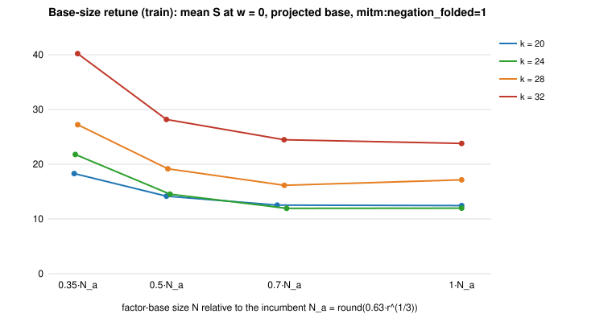

# Curve25519-family IC ratchet round 1: four leads (2026-11-02)

The incumbent is the projected small-x base with `mitm:negation_folded=1`
(see [`../curve25519_ic_baseline_20261102`](../curve25519_ic_baseline_20261102/README.md)).
Protocol: [PROTOCOL.md](PROTOCOL.md), frozen before data. PDF:
[REPORT.pdf](REPORT.pdf).

**Outcome: no lead improves the baseline, so the incumbent stays.** Each lead
was measured or settled exactly, and each null has a named reason.

| lead | track | result | class |
|:--|:--|:--|:--|
| 1. Retune N | generic, ecbench end-to-end S | train picked N_a at k = 20, 32 and 0.7·N_a at k = 24, 28. Holdout sel/inc = 0.996 [0.944, 1.051] (k = 24) and 0.977 [0.941, 1.015] (k = 28) at w = 0, reversing to 1.21 at w = 1 | **null** (band unresolved); incumbent kept |
| 2. Closed cofactor fiber | generic, exact counts | covers exactly the projected base's targets (D equal at all 4 sizes) with **8.0×** the table entries | **dominated** by the incumbent (F1, F2 hold); no ecbench arm |
| 3. Base closed under x ↦ 1/x | generic, exact counts ([T₀ study](../curve25519_t0_symmetry_20261102/README.md)) | 2.0× over the blind base, 4× below projection; on a projected base, closure is a no-op because `[8](P+T₀) = [8]P` | **dominated**; useful only on the algebraic track |
| 4. Algebraic (summation polynomial + F4) | algebraic, ecbench smoke | `pkm-semaev` needs `2^t ∣ p − 1`; Curve25519 primes have `p ≡ 5 (mod 8)`, so t ≤ 2 and the base has 3 columns at k = 20. One verified solve: S = 1027 (m = 2) / 211 (m = 3) at w = 0, and 4.9·10⁴ / 6.2·10⁶ at w = 0.1, against 9.05 / 9.46 for the incumbent | **blocked**: [problem record](../../problems/curve25519-family-algebraic-ic-tower.md) |

## 1. Base-size retune

Train (16 targets, 1 round, fresh seeds). Mean S at w = 0 for N =
0.35 / 0.5 / 0.7 / 1.0 · N_a:

| k | N grid | mean S |
|--:|:--|:--|
| 20 | 11 / 16 / 22 / 32 | 18.30 / 14.16 / 12.53 / **12.44** |
| 24 | 28 / 41 / 57 / 81 | 21.79 / 14.53 / **11.94** / 11.98 |
| 28 | 71 / 102 / 142 / 203 | 27.22 / 19.17 / **16.15** / 17.14 |
| 32 | 179 / 256 / 358 / 512 | 40.21 / 28.18 / 24.48 / **23.79** |

Holdout (32 fresh targets × 2 rounds; inc = N_a, sel = N*):

| k | N_a → N* | S inc → sel (w = 0 / 0.1 / 1) | sel/inc, paired [95%] at w = 0 | band verdict |
|--:|:--|:--|:--|:--|
| 24 | 81 → 57 | 12.52 → 12.47 / 13.64 → 14.08 / 23.68 → 28.58 | 0.996 [0.944, 1.051] | unresolved |
| 28 | 203 → 142 | 16.60 → 16.22 / 18.21 → 18.54 / 32.74 → 39.46 | 0.977 [0.941, 1.015] | unresolved |

At k = 20 and 32 the train step selected N_a itself, and the holdouts record
the A/A null. The guess that the borrowed size was too large is not
supported. S is flat from 0.7·N_a to N_a and rises steeply below. A smaller
N trades table work for more probes, whose unpriced lookups lose at w = 1.

## 2. Closed cofactor fiber (`curve25519_family fiber`)

| k | N | D blind | D closed fiber | D projected | table entries fiber / projected |
|--:|--:|--:|--:|--:|--:|
| 20 | 32 | 154 | 1003 | 1003 | 8192 / 1024 = 8.0 |
| 24 | 81 | 851 | 6552 | 6552 | 52488 / 6561 = 8.0 |
| 28 | 203 | 5101 | 41158 | 41158 | 329672 / 41209 = 8.0 |
| 32 | 512 | 32755 | 262030 | 262030 | 2097152 / 262144 = 8.0 |

`S ↦ S − t(S)` (removing the sum's own torsion component) and `S ↦ [8]S`
put the same targets in reach, so the two counts are equal by construction.
The difference is cost: the fiber table has 8× the entries. The "about 2×"
quoted earlier for this lead was against the blind base. Against the
incumbent it loses.

## 4. Why the algebraic track is blocked on Curve25519

PKM's multiplicative base `x ∈ g·μ_n` needs a large, smooth `n | p − 1` that
is a tower of low-degree maps. For `p = 2^255 − 19`,
`p − 1 = 2²·3·65147·q` (q a 236-bit prime), so the only such tower has order
12. For the miniatures, `p ≡ 5 (mod 8)` by construction, so `2^t | p − 1`
stops at t = 2. Curve25519's choice of prime closes PKM's Kummer route. Only
the isogeny form remains, and the lab has its base but no Semaev oracle for
it. The T₀-closed algebraic base would want `μ_{2^t}` in Montgomery
coordinates (closed under inversion), which is the object this same
congruence forbids. The unblock conditions are in the problem record.

## Distance to rho (unchanged)

The incumbent's distance to matched rho stays 7.8× / 10.6× / 18.1× / 24.7×
(baseline study). The holdout's own rho arms agree: k = 24 inc ÷ rho =
10.5×; k = 28 15.1×.

## Evidence

All sessions verified. Audits: `analysis/verify-{train,holdout}-k*.json`
(8 and 12 replays) and `verify-pkm-smoke-k20.json`, all OK. Comparisons:
`analysis/compare-holdout-k{24,28}.txt` and `sessions/holdout-k*/comparisons/`.
Exact counts: `analysis/fiber.jsonl`. Records ≥ 64 KiB are in the artifact
store (`.artifacts.json`). The route deviation is as in the baseline study:
local host, counted units, no wall-time claim.

## Next

- The generic track is saturated at m = 2 on this family. Known remaining
  levers apply to any prime curve, not to Curve25519's structure: m = 3
  (`mitm:m=3` and `rootfind-mitm:m=3`), and large primes on the pair table.
- The algebraic track needs the isogeny-tower oracle (problem record).
