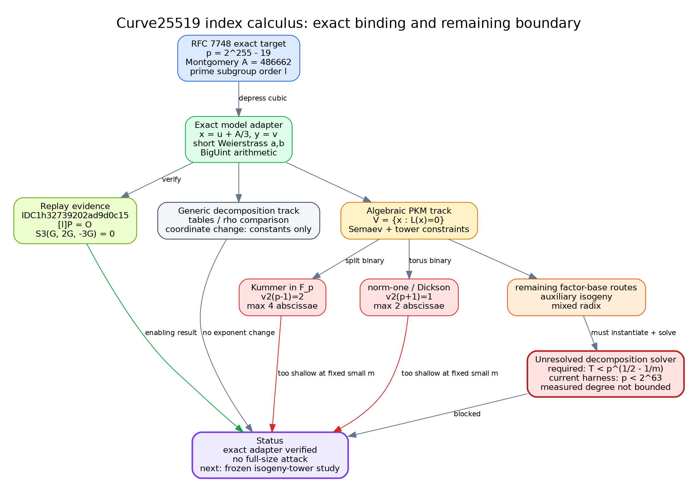

# Result

Curve25519 can now be fed **exactly** into this repository's
short-Weierstrass Semaev machinery. The new Rust adapter carries RFC 7748's
full 255-bit field, prime-order subgroup, base point, and a reversible
Montgomery-to-short-Weierstrass translation; it also evaluates the exact third
Semaev polynomial $S_3$. Six focused tests verify the map, the subgroup order,
an $S_3$ zero-sum witness, the committed manifest, and a replayable identity
certificate.

This does **not** produce a practical Curve25519 discrete-log attack. It makes
the representation boundary exact and identifies the next real obstruction:
constructing and solving a prime-field algebraic point-decomposition system at
the required factor-base scale. In particular,

- $v_2(p-1)=2$, so a binary Kummer base $g\mu_{2^t}\subset\mathbb F_p$
  has at most $2^2=4$ abscissae;
- $v_2(p+1)=1$, so the analogous binary norm-one/Dickson tower has at most
  $2$ abscissae;
- auxiliary-isogeny and mixed-radix PKM constructions are not ruled out by
  those two facts, but the repository's end-to-end PKM harness is currently
  single-word ($p<2^{63}$) and its measured solver degree is not bounded.

The correct status is therefore **exact adapter verified; full-size algebraic
index calculus blocked at factor-base/solver integration**.



The editable source is [`mechanism.dot`](mechanism.dot), and the vector render
is [`mechanism.svg`](mechanism.svg).

# Question and scope

The question was: *what concrete index-calculus work can be completed for
Curve25519 without presenting a toy curve or a coordinate change as an attack
on the deployed curve?*

The exact target is the prime-order subgroup specified by RFC 7748:

$$
  E/\mathbb F_p: v^2=u^3+486662u^2+u,\qquad p=2^{255}-19,
$$

with prime subgroup order

$$
  \ell=2^{252}+\mathtt{0x14def9dea2f79cd65812631a5cf5d3ed},
$$

cofactor $8$, and RFC base point $P=(u,v)$ with $u=9$. This is an
ECDLP model on $\langle P\rangle$, not an X25519 protocol transcript. X25519
uses only a $u$-coordinate and a clamped scalar; conflating that interface
with an ECDLP instance would obscure the subgroup and sign information needed
by relation collection.

No timing or scaling experiment was launched. The work consists of literature
review, exact arithmetic, executable identities, and unit/property checks.

# Literature boundary

The literature was reviewed before choosing the implementation.

1. **Semaev (2004)** introduced summation polynomials and the point-decomposition
   formulation. The local literature record was used for the foundational
   mechanism; its full PDF was not accessible in this session, so this report
   does not rest a new complexity claim on uninspected details.
2. **Petit, Kosters, and Messeng (PKC 2016)** give the primary prime-field
   algebraic factor-base construction used here as the serious lane. Their
   factor base is $F=\{P:x(P)\in V\}$, with $V=\{x:L(x)=0\}$ and $L$ a
   composition of low-degree maps. Keeping one auxiliary variable per map
   level avoids replacing the tower by one dense high-degree equation.
3. **Amadori, Pintore, and Sala (2018)** reduce their variant to one polynomial
   system, but explicitly do not claim a sub-$p^{1/2}$ algorithm; their
   experiments cover only 11--22-bit prime fields and leave the system-solving
   cost unresolved.
4. The repository's existing PKM tower study measures a growing solving degree:
   $m=2$ reaches degree 6, $m=3$ reaches 7, and the $m=4,N=16$ systems
   require roughly an hour and up to 8.1 GiB in the recorded round. Those are
   scaled systems, not Curve25519 measurements, but they directly reject the
   optimistic assumption that the current solver degree is already known to be
   bounded.

PKM's partial cost analysis makes the missing condition explicit. With
$(\deg L)^m\approx m!p$, the decomposition solver $T(E,m,L)$ must beat
$p^{1/2-1/m}$ (up to the paper's other terms) before the construction can
beat a generic square-root method. An exact model conversion changes constants
and representation; it does not establish that solver bound.

# Exact model adapter

For a Montgomery cubic

$$
  v^2=u^3+Au^2+u,
$$

set

$$
  x=u+A/3,\quad y=v,
$$

over a field of characteristic other than $3$. Substitution gives

$$
  y^2=x^3+ax+b,
  \quad a=1-A^2/3,
  \quad b=2A^3/27-A/3.
$$

The implementation computes every division as a modular inverse in
$\mathbb F_p$. It does not round or truncate the 255-bit values. The native
manifest [`model.json`](model.json) records the resulting $a,b$, translated
base point, subgroup, and implementation boundary.

The integer identity behind the substitution is

$$
\begin{aligned}
27(u^3+Au^2+u)={}&(3u+A)^3\\
 &+3(3-A^2)(3u+A)+2A^3-9A.
\end{aligned}
$$

Certificate [`IDC1h32739202ad9d0c15`](montgomery-translation.identity.json)
checks this degree-3 identity at 32 points derived from the sealed statement
and at 32 additional domain-separated replay points. The checker reports an
accept verdict and a Schwartz--Zippel false-accept bound below $2^{-3802}$
for that replay. This is an evaluated certificate, not a formal proof pointer;
the displayed expansion is also directly inspectable.

# Exact $S_3$ binding

For the translated curve $y^2=x^3+ax+b$, the implementation evaluates

$$
\begin{aligned}
S_3(x_1,x_2,x_3)={}&(x_1-x_2)^2x_3^2 \\
&-2\big((x_1+x_2)(x_1x_2+a)+2b\big)x_3\\
&+(x_1x_2-a)^2-4b(x_1+x_2)
\pmod p.
\end{aligned}
$$

The focused test constructs $G,2G,-3G$ on the exact translated curve and
checks $S_3(x(G),x(2G),x(-3G))=0$, including a permuted evaluation. A separate
test checks $[\ell]G=\mathcal O$. Together these checks bind the RFC point,
the coordinate translation, the short-Weierstrass group law, and $S_3$ on
the full-size field.

# Curve25519-specific factor-base audit

For the binary Kummer construction used by the existing `prime-kummer` plug-in,
$2^t\mid p-1$ is required. Since

$$
 p-1=2^2(2^{253}-5),
$$

the exact maximum is $t=2$, hence four candidate abscissae before testing
which ones lift to curve points. The binary norm-one/Dickson analogue uses the
two-primary part of $p+1$; here $v_2(p+1)=1$, hence two candidates.

For comparison, the PKM balance $|V|^m\approx m!p$ asks for approximately
$2^{128}$, $2^{85.9}$, or $2^{64.9}$ abscissae at $m=2,3,4$,
respectively. Four is therefore not a factor base for the usual small,
fixed-$m$ Curve25519 attack model.

This audit is deliberately narrow:

- it does not rule out a mixed-radix composition using odd factors;
- it does not rule out PKM's auxiliary-curve/isogeny construction, which does
  not require $2^t\mid p\pm1$;
- it does not show that either remaining construction has an affordable
  precomputation or solver at Curve25519 scale.

# Evidence and status

| Requirement | Evidence | Status |
|---|---|---|
| Exact standard curve and subgroup | RFC 7748 parameters in `model.json` | Verified against source and native constants |
| Montgomery/short equivalence | inverse-map tests plus `IDC1h32739202ad9d0c15` | Verified |
| Correct subgroup generator | full-size test $[\ell]G=\mathcal O$ | Verified |
| Semaev binding on the exact curve | $G,2G,-3G$ zero-sum test | Verified |
| Binary PKM capacity | exact $v_2(p-1)=2,v_2(p+1)=1$ tests | Verified, narrow scope |
| Full relation collection and linear algebra | no full-size harness | Blocked |
| Solver beats rho | no such evidence | Not established |
| Performance claim | no experiment run | Not claimed |

The exact replay commands are:

```sh
cargo check --example curve25519_ic_artifact
cargo test --lib curve25519_ic::tests -- --nocapture
cargo run --quiet --example curve25519_ic_artifact -- \
  replay research/curve25519_index_calculus_20261102/montgomery-translation.identity.json
```

Observed focused result: 6 passed, 0 failed; certificate replay accepted with
32 original and 32 extra points. The initial monolithic test link took 4m46s in
this cloud environment; the tests themselves completed in 0.02s. That build
time is environment context, not an algorithm measurement.

# Next research step

The next useful step is not another coordinate model. It is a frozen,
bounded **exact-versus-scaled isogeny-tower integration study**:

1. define an exact Curve25519 auxiliary-isogeny factor-base descriptor without
   enumerating its full set;
2. bind it to a scaled family whose tower equations have the same degrees and
   variable ordering;
3. pre-register (m,t), solver caps, null controls, and exact extrapolation
   rules;
4. measure solving degree and memory on the scaled family;
5. promote nothing to Curve25519 unless the exact descriptor and the scaling
   law both survive review.

This preserves the repository's separation between exact-curve facts, scaled
measurements, and extrapolation. It also targets the one route not closed by
the $p\pm1$ audit.

# Sources and local evidence

- A. Langley, M. Hamburg, and S. Turner, [RFC 7748: Elliptic Curves for
  Security](https://www.rfc-editor.org/rfc/rfc7748), Section 4.1. Exact
  Curve25519 parameters and base point.
- I. Semaev, [Summation polynomials and the discrete logarithm problem on
  elliptic curves](https://eprint.iacr.org/2004/031), 2004. Foundational
  summation-polynomial mechanism; full text was not retrieved in this session.
- C. Petit, M. Kosters, and A. Messeng,
  [Algebraic approaches for the elliptic curve discrete logarithm problem over
  prime fields](https://doi.org/10.1007/978-3-662-49387-8_1), PKC 2016;
  [author PDF](https://people.maths.ox.ac.uk/petit/files/16pkc_primeecdlp.pdf).
  Primary factor-base construction and partial cost analysis; full text read.
- A. Amadori, F. Pintore, and M. Sala,
  [On the discrete logarithm problem for prime-field elliptic
  curves](https://doi.org/10.1016/j.ffa.2018.01.009), *Finite Fields and Their
  Applications* 51 (2018), 168--182. Accepted manuscript read from the TU/e
  repository.
- K. Yokoyama, M. Yasuda, Y. Takahashi, and J. Kogure,
  [Complexity bounds on Semaev's naive index calculus method for
  ECDLP](https://doi.org/10.1515/jmc-2019-0029), *Journal of Mathematical
  Cryptology* 14 (2020), 460--485. Bibliographic record/abstract only in this
  session; no detailed theorem from it is newly asserted here.
- Local measured context:
  [`RESEARCH_PKM_TOWER_ORACLE.md`](../notes/index-calculus/RESEARCH_PKM_TOWER_ORACLE.md),
  [`DERIVED.md`](../prime_fall_degree_20261027/DERIVED.md), and
  [`DECISIONS.md`](../prime_ic_program_20261029/DECISIONS.md).

`ecdb` was not exposed in this environment, so standard parameters were taken
from RFC 7748 and new values were labelled as native derivations. The canonical
mechanism graph was checked conceptually and left unchanged: this study binds an
existing PKM/Semaev mechanism to one standard curve; it does not introduce a
new graph node or a measured edge.
