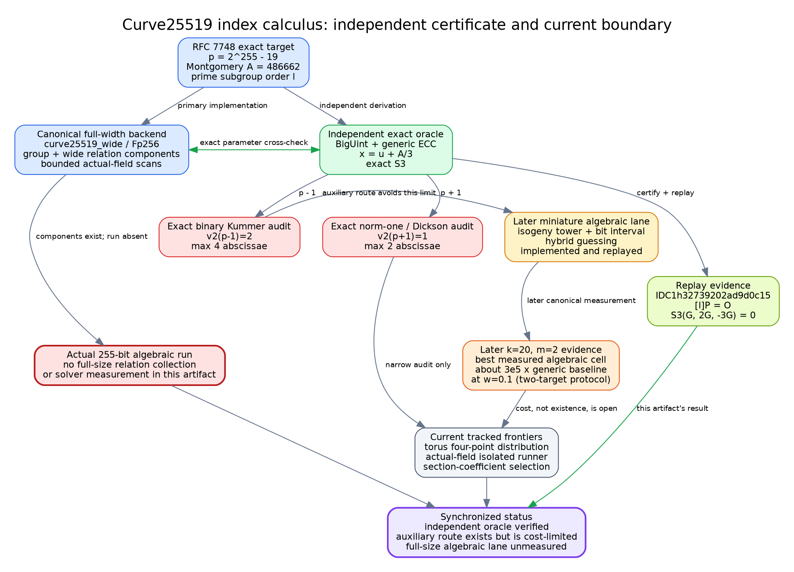

# Result

This study supplies an **independent exact oracle** for the repository's
current full-width [`curve25519_wide`](../../src/cryptanalysis/curve25519_wide.rs)
backend. The Rust oracle re-derives RFC 7748's 255-bit field, prime-order
subgroup, base point, and reversible Montgomery-to-short-Weierstrass
translation through a separate `BigUint`/generic-ECC path. It also evaluates
the exact third Semaev polynomial $S_3$ and carries a replayable certificate
for the integer identity behind the translation. A seventh focused test added
during the 2026-11-17 synchronization requires both implementations to agree
on every curve and subgroup parameter.

This is correctness evidence, not a second primary backend and not a practical
Curve25519 discrete-log attack. The exact Curve25519 facts are:

- $v_2(p-1)=2$, so a binary Kummer base $g\mu_{2^t}\subset\mathbb F_p$
  has at most $2^2=4$ abscissae;
- $v_2(p+1)=1$, so the analogous binary norm-one/Dickson tower has at most
  $2$ abscissae;
- those two obstructions do not apply to auxiliary-isogeny or mixed-radix
  constructions. Since the original 2026-11-02 draft, PRs #3284/#3287 have
  implemented isogeny-tower, bit-interval, and hybrid-guessing forms on
  Curve25519-family miniatures;
- the later canonical $k=20,m=2$ study verified those forms end to end, but
  its best measured algebraic configuration remained about $3\cdot10^5$ times
  the generic-decomposition baseline at $w=0.1$ for that two-target protocol;
- the actual 255-bit module now supplies group arithmetic, wide linear
  algebra/relation components, and bounded scans, but this artifact performs
  no full-size relation collection or solver measurement.

The synchronized status is therefore **independent exact oracle and certificate
verified; the miniature auxiliary-isogeny lane exists but is cost-limited;
full-size algebraic relation collection remains unmeasured**.



The editable source is [`mechanism.dot`](mechanism.dot), and the vector render
is [`mechanism.svg`](mechanism.svg).

# Question and scope

The original question was: *what concrete index-calculus work can be completed
for Curve25519 without presenting a toy curve or a coordinate change as an
attack on the deployed curve?* The 2026-11-17 synchronization adds a second
requirement: preserve only the part that remains independent of the later
full-width implementation and later miniature experiments.

The exact target is the prime-order subgroup specified by RFC 7748:

$$
  E/\mathbb F_p: v^2=u^3+486662u^2+u,\qquad p=2^{255}-19,
$$

with prime subgroup order

$$
  \ell=2^{252}+\mathtt{0x14def9dea2f79cd65812631a5cf5d3ed},
$$

cofactor $8$, and RFC base point $P=(u,v)$ with $u=9$. This is an
ECDLP model on $\langle P\rangle$, not an X25519 protocol transcript. X25519
uses only a $u$-coordinate and a clamped scalar; conflating that interface
with an ECDLP instance would obscure the subgroup and sign information needed
by relation collection.

No timing or scaling experiment was launched by this artifact. The work
consists of literature review, exact arithmetic, executable identities, and
unit/property checks. Later repository measurements are cited as later
evidence and are not re-labelled as results of this study.

# Literature boundary

The literature was reviewed before choosing the implementation.

1. **Semaev (2004)** introduced summation polynomials and the point-decomposition
   formulation. The local literature record was used for the foundational
   mechanism; its full PDF was not accessible in this session, so this report
   does not rest a new complexity claim on uninspected details.
2. **Petit, Kosters, and Messeng (PKC 2016)** give the primary prime-field
   algebraic factor-base construction used here as the serious lane. Their
   factor base is $F=\{P:x(P)\in V\}$, with $V=\{x:L(x)=0\}$ and $L$ a
   composition of low-degree maps. Keeping one auxiliary variable per map
   level avoids replacing the tower by one dense high-degree equation.
3. **Amadori, Pintore, and Sala (2018)** reduce their variant to one polynomial
   system, but explicitly do not claim a sub-$p^{1/2}$ algorithm; their
   experiments cover only 11--22-bit prime fields and leave the system-solving
   cost unresolved.
4. At the time of the original study, the repository's PKM tower evidence
   measured a growing solving degree:
   $m=2$ reaches degree 6, $m=3$ reaches 7, and the $m=4,N=16$ systems
   require roughly an hour and up to 8.1 GiB in the recorded round. Those are
   scaled systems, not Curve25519 measurements, but they directly reject the
   optimistic assumption that the current solver degree is already known to be
   bounded.
5. The later canonical Curve25519-family algebraic ladder implemented
   isogeny-tower and bit-interval membership plus hybrid guessing. Its verified
   $k=20,m=2$ end-to-end checks move the obstruction from construction
   existence to measured cost. See
   [`curve25519_algebraic_ladder_20261102`](../curve25519_algebraic_ladder_20261102/README.md)
   and the updated
   [`curve25519-family-algebraic-ic-tower` problem record](../../problems/curve25519-family-algebraic-ic-tower.md).

PKM's partial cost analysis makes the missing condition explicit. With
$(\deg L)^m\approx m!p$, the decomposition solver $T(E,m,L)$ must beat
$p^{1/2-1/m}$ (up to the paper's other terms) before the construction can
beat a generic square-root method. An exact model conversion changes constants
and representation; it does not establish that solver bound.

# Independent exact model oracle

The primary full-width implementation now lives in
[`curve25519_wide.rs`](../../src/cryptanalysis/curve25519_wide.rs) and uses the
repository's `Fp256` backend. The implementation in this study deliberately
uses a separate `BigUint` and generic-ECC path. Agreement between them is a
cross-backend check rather than duplicated authority.

For a Montgomery cubic

$$
  v^2=u^3+Au^2+u,
$$

set

$$
  x=u+A/3,\quad y=v,
$$

over a field of characteristic other than $3$. Substitution gives

$$
  y^2=x^3+ax+b,
  \quad a=1-A^2/3,
  \quad b=2A^3/27-A/3.
$$

The implementation computes every division as a modular inverse in
$\mathbb F_p$. It does not round or truncate the 255-bit values. The native
manifest [`model.json`](model.json) records the resulting $a,b$, translated
base point, subgroup, and implementation boundary.

The integer identity behind the substitution is

$$
\begin{aligned}
27(u^3+Au^2+u)={}&(3u+A)^3\\
 &+3(3-A^2)(3u+A)+2A^3-9A.
\end{aligned}
$$

Certificate [`IDC1h32739202ad9d0c15`](montgomery-translation.identity.json)
checks this degree-3 identity at 32 points derived from the sealed statement
and at 32 additional domain-separated replay points. The checker reports an
accept verdict and a Schwartz--Zippel false-accept bound below $2^{-3802}$
for that replay. This is an evaluated certificate, not a formal proof pointer;
the displayed expansion is also directly inspectable.

## Lean proof map

[`lean/Curve25519Model.lean`](lean/Curve25519Model.lean) supplies the
kernel-checked algebraic layer. It deliberately does not certify the Rust
implementation, factor-base construction, solver cost, or an ECDLP result.

| Report claim | Lean declaration(s) | Exact scope |
|---|---|---|
| Montgomery translation identity | `Curve25519Model.montgomery_translation_identity` | all commutative rings; no division assumption |
| $v_2(p-1)=2$ | `p_minus_one_factorization`, `p_minus_one_cofactor_odd` | exact integer factorization with odd residual factor |
| $v_2(p+1)=1$ | `p_plus_one_factorization`, `p_plus_one_cofactor_odd` | exact integer factorization with odd residual factor |
| Exact $S_3$ zero-sum witness | no Lean theorem in this artifact | executable full-field Rust check only |

# Exact $S_3$ binding

For the translated curve $y^2=x^3+ax+b$, the implementation evaluates

$$
\begin{aligned}
S_3(x_1,x_2,x_3)={}&(x_1-x_2)^2x_3^2 \\
&-2\big((x_1+x_2)(x_1x_2+a)+2b\big)x_3\\
&+(x_1x_2-a)^2-4b(x_1+x_2)
\pmod p.
\end{aligned}
$$

The focused test constructs $G,2G,-3G$ on the exact translated curve and
checks $S_3(x(G),x(2G),x(-3G))=0$, including a permuted evaluation. A separate
test checks $[\ell]G=\mathcal O$. Together these checks bind the RFC point,
the coordinate translation, the short-Weierstrass group law, and $S_3$ on
the full-size field.

# Curve25519-specific factor-base audit

For the binary Kummer construction used by the existing `prime-kummer` plug-in,
$2^t\mid p-1$ is required. Since

$$
 p-1=2^2(2^{253}-5),
$$

the exact maximum is $t=2$, hence four candidate abscissae before testing
which ones lift to curve points. The binary norm-one/Dickson analogue uses the
two-primary part of $p+1$; here $v_2(p+1)=1$, hence two candidates.

For comparison, the PKM balance $|V|^m\approx m!p$ asks for approximately
$2^{128}$, $2^{85.9}$, or $2^{64.9}$ abscissae at $m=2,3,4$,
respectively. Four is therefore not a factor base for the usual small,
fixed-$m$ Curve25519 attack model.

This audit is deliberately narrow:

- it does not rule out a mixed-radix composition using odd factors;
- it does not rule out PKM's auxiliary-curve/isogeny construction, which does
  not require $2^t\mid p\pm1$ and was implemented later on miniatures;
- the later implementation establishes existence and measured miniature cost,
  not an affordable precomputation or solver at Curve25519 scale.

# Evidence and status

| Requirement | Evidence | Status |
|---|---|---|
| Exact standard curve and subgroup | RFC 7748 parameters in `model.json` | Verified against source and cross-checked against `curve25519_wide` |
| Montgomery/short equivalence | inverse-map tests plus `IDC1h32739202ad9d0c15` | Verified |
| Correct subgroup generator | full-size test $[\ell]G=\mathcal O$ | Verified |
| Semaev binding on the exact curve | $G,2G,-3G$ zero-sum test | Verified |
| Binary PKM capacity | exact $v_2(p-1)=2,v_2(p+1)=1$ tests | Verified, narrow scope |
| Auxiliary-isogeny/bit-interval PKM | later canonical miniature ladder | Implemented and verified later; cost-limited at measured sizes |
| Full relation collection and solver | no full-size run in this artifact | Not measured |
| Performance claim by this artifact | no experiment run | Not claimed |

The exact replay commands are:

```sh
cargo build --release --example curve25519_ic_artifact
cargo test --release --lib curve25519_ic::tests -- --nocapture
cargo run --release --quiet --example curve25519_ic_artifact -- \
  replay research/curve25519_index_calculus_20261102/montgomery-translation.identity.json
tools/lean/proof-gate.sh research/curve25519_index_calculus_20261102/lean
```

The original focused result was 6 passed, 0 failed. On the feature merged with
repair head `dc955125b1`, all seven optimized artifact tests pass and the
certificate accepts 32 original plus 32 extra points with reported
`false_accept_log2 = -3802.562399953846`.

A complete `cargo test --release --lib` pass on preceding repair head
`f437c1e21b` finished with 7,428 passed, 73 failed, and 142 ignored in 2,451.88
seconds. All seven artifact tests passed; none of the failures was in
`curve25519_ic`. The next repair fixed 12 APS parser failures and its 14 APS
tests pass. Remaining failures record unrelated fixture, registry, pricing,
and frozen-configuration drift. The artifact is validated, but this is not an
all-green repository-suite claim. Build time is environment context, not an
algorithm measurement.

# Current research frontier

The exact-versus-scaled isogeny-tower study proposed by the original draft was
subsequently implemented and measured. Repeating it is not the next step. The
current discriminating work is tracked in repository problem records:

1. freeze and qualify the public-input four-point torus decomposition protocol
   and connect its bounded solver evidence to full-base distribution;
2. qualify a maintained isolated runner for the actual-field native workload;
3. test target-conditioned section coefficients under a frozen cold-search
   budget without relabelling a bounded search as a general solver.

See the tracked problems for
[four-point torus decomposition](../../problems/curve25519-torus-four-point-decomposition.md),
the [isolated actual-field runner](../../problems/curve25519-singular-isolated-runner.md),
and [section-coefficient selection](../../problems/curve25519-section-coefficient-selection.md).
This artifact supplies the independent model oracle those lanes can reuse; it
does not claim to resolve them.

# Sources and local evidence

- A. Langley, M. Hamburg, and S. Turner, [RFC 7748: Elliptic Curves for
  Security](https://www.rfc-editor.org/rfc/rfc7748), Section 4.1. Exact
  Curve25519 parameters and base point.
- I. Semaev, [Summation polynomials and the discrete logarithm problem on
  elliptic curves](https://eprint.iacr.org/2004/031), 2004. Foundational
  summation-polynomial mechanism; full text was not retrieved in this session.
- C. Petit, M. Kosters, and A. Messeng,
  [Algebraic approaches for the elliptic curve discrete logarithm problem over
  prime fields](https://doi.org/10.1007/978-3-662-49387-8_1), PKC 2016;
  [author PDF](https://people.maths.ox.ac.uk/petit/files/16pkc_primeecdlp.pdf).
  Primary factor-base construction and partial cost analysis; full text read.
- A. Amadori, F. Pintore, and M. Sala,
  [On the discrete logarithm problem for prime-field elliptic
  curves](https://doi.org/10.1016/j.ffa.2018.01.009), *Finite Fields and Their
  Applications* 51 (2018), 168--182. Accepted manuscript read from the TU/e
  repository.
- K. Yokoyama, M. Yasuda, Y. Takahashi, and J. Kogure,
  [Complexity bounds on Semaev's naive index calculus method for
  ECDLP](https://doi.org/10.1515/jmc-2019-0029), *Journal of Mathematical
  Cryptology* 14 (2020), 460--485. Bibliographic record/abstract only in this
  session; no detailed theorem from it is newly asserted here.
- Local measured context:
  [`RESEARCH_PKM_TOWER_ORACLE.md`](../notes/index-calculus/RESEARCH_PKM_TOWER_ORACLE.md),
  [`DERIVED.md`](../prime_fall_degree_20261027/DERIVED.md), and
  [`DECISIONS.md`](../prime_ic_program_20261029/DECISIONS.md).
- Later canonical Curve25519 context:
  [`curve25519_wide.rs`](../../src/cryptanalysis/curve25519_wide.rs),
  [`curve25519_ic_baseline_20261102`](../curve25519_ic_baseline_20261102/README.md),
  and
  [`curve25519_algebraic_ladder_20261102`](../curve25519_algebraic_ladder_20261102/README.md).
