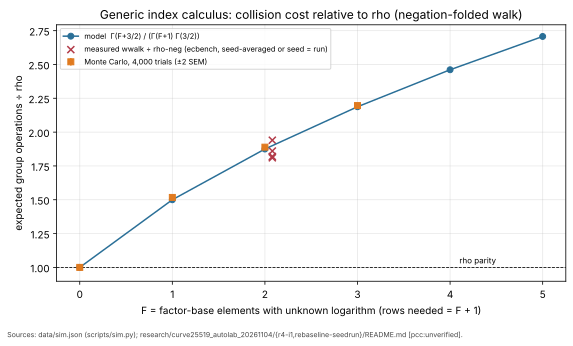

# Rho parity for index calculus on the Curve25519 family: the collision floor (2026-11-04)

**Class.** A derived bound, checked by Monte Carlo and against existing ecbench measurements. No new
ecbench run: the user asked for single-target runs only, and the bound needs none. Not a leaderboard
or `benchmarks/` row. Every measured number cited here is an unverified assertion [pcc:unverified].

**Question.** Can index calculus reach rho parity on this curve family: S(IC) ÷ S(matched rho) ≤ 1
across the w = 0, 0.1, 1 band, for a single target?

**Answer.** Not with a factor base. In the generic group model, an index-calculus solve with F
factor-base elements of unknown logarithm costs at least Γ(F + 3/2) / (Γ(F + 1)·Γ(3/2)) times rho:
1.5× for F = 1 and 1.875× for F = 2. Parity holds only at F = 0, which is rho itself under another
name. The algebraic track, the only one that leaves the generic model, is 1.83·10⁴× behind rho at
w = 0.1 and scales as r^1.03 (atlas §6, §11). Rho remains ahead on every track.

## 1. The bound

- A factor-base element obtained by a non-group operation, such as decoding an x-coordinate, has an
  unknown logarithm. In the generic group model it is a fresh element.
- The algorithm learns only from equalities between computed elements. Each equality is one linear
  equation over Z/r in the unknowns: the F base logarithms and log Q.
- An equality that involves no base element already gives log Q; that is rho. An index-calculus solve
  that uses its base needs F + 1 independent equalities.
- Equalities come from collisions. With n walk points in r/2 negation-folded classes, colliding pairs
  arrive as a Poisson process of mean n²/r. The k-th collision therefore appears at
  E[n_k] = √r · Γ(k + ½) / Γ(k).
- Rho needs k = 1, giving √(πr/4), the standard negation-map constant. An index-calculus solve needs
  k = F + 1:

| F (unknown base logs) | rows needed | cost ÷ rho (model) | Monte Carlo (4,000 trials) |
|--:|--:|--:|--:|
| 0 (rho) | 1 | 1.000 | 1.000 |
| 1 | 2 | 1.500 | 1.517 |
| 2 | 3 | 1.875 | 1.889 |
| 3 | 4 | 2.188 | 2.196 |

The Monte Carlo (`scripts/sim.py`, seed 20261104, r = 131,203) draws uniform classes and records the
draw at which the k-th colliding pair appears; `data/sim.json` holds the means and standard errors.
It agrees with the model to within about 1 %, and the excess is the discreteness of pair counts.

## 2. The measurements already agree

The lab's generic incumbent, `wwalk` (a walk table on a base of exactly two abscissae, so F = 2),
measured against rho-neg in ecbench:

| source | k | wwalk ÷ rho-neg |
|:--|--:|--:|
| `curve25519_autolab_20261104/r4-i1` (16 walk seeds) | 32 | 1.82× |
| same | 28 | 1.86× |
| `curve25519_autolab_20261104/rebaseline-seedrun` (seed = run) | 24 / 28 / 32 | 1.94× / 1.81× / 1.82× |

The model gives 1.875× for F = 2. The earlier fixed-table records of 1.43–1.55× were single draws
of the walk table, as the autolab's own I1 correction found. This explains the autolab's
convergence near 1.8× rho: it is the F = 2 collision floor, not an implementation constant.

## 3. What would be needed for parity

- **F = 0.** A base whose every logarithm is known, for example multiples of G, needs one collision
  and reaches rho's constant. It is rho or BSGS relabelled, which the repository's success rule
  excludes as a relabelling.
- **Rows without collisions.** An oracle that yields relations among base elements without group
  operations escapes the generic model. Its native work is priced at w = 0.1 and w = 1, and parity
  must hold across the band (AGENTS.md §5a). The best such oracle measured here, F4 with trace replay
  on the t = 4 isogeny base (T13), is 1.83·10⁴× behind rho at w = 0.1. Its modelled cost scales as
  r^1.03 against rho's r^0.5 (L10), so the gap widens with curve size.
- **Structure.** The autolab's structure search (`curve25519_autolab_20261104/ideas/STRUCTURE-R4.md`)
  found that every structure of these curves either helps rho equally, acts outside the order-r
  subgroup, or is priced as native work.

## 4. Assumptions and limits

- The generic group model, with uniform walk points. Real walks (adding walks, distinguished points)
  carry an overhead factor; measured rho-neg sits at 0.98–1.08 √r here against the model's 0.886 √r,
  and the ratio compares like with like only when both arms carry the same factor.
- Linear algebra is not charged, which favours index calculus. Dependent rows would only raise the
  count.
- This is a derived bound, not a formal theorem in the repository's proof system. It holds for one
  target and for many; amortising base logarithms over many targets on one curve is outside the
  single-target question asked.

## Files

`scripts/sim.py` (Monte Carlo), `data/sim.json`, `scripts/make_figure.py`,
`figures/parity_floor.{svg,png}`, `REPORT.pdf`.
