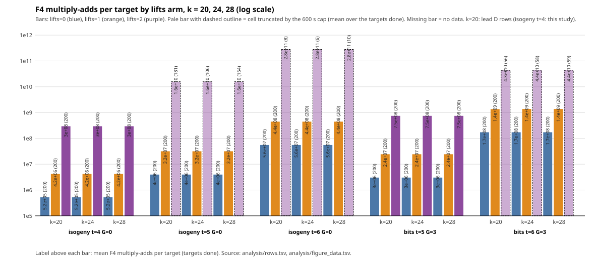

# Scale-up S3: cofactor lifts (lead 2) and the shared lift system (lead D) at k = 24 and 28

Protocol: [PROTOCOL.md](PROTOCOL.md), written and frozen before any data in this directory (cells, seeds, arms, truncation rule and predictions S0 to S9 unchanged).
Scope of every statement: **the ten measured cells (five shapes at k = 24 and k = 28), m = 2, mode full, unit F4 elimination multiply-adds, one local host, trace off**, plus one k = 20 reproduction cell. F4 multiply-adds are native, unpriced work (AGENTS.md section 5a). No rho arm, no distance to rho, no cross-method statement, no leaderboard row, no benchmark row. k = 32 is refused by the instrument (tower engine needs p < 2^31), so k = 32 is not measured.

## Result in one paragraph

In all ten cells the per-target F4 cost, the solving degree and the matrix sizes of every arm equal their k = 20 values (the k-scaling ratios of multiply-adds per target are 1.00 to 1.013, Table C), so the k = 20 conclusions of leads 2 and D carry over to k = 24 and 28 at these cells: `lifts=1` costs 8.0 times `lifts=0` per target (calls and multiply-adds), the per-relation ratio at exact coverage `lifts=1 / lifts=0` is 0.63 to 1.18 where defined (one cell has no `lifts=0` coverage), and `lifts=2` costs 30.7 to 628 times `lifts=1` on the same targets with a solving degree 2 to 5 above `lifts=0`. No arm produced a hit in any k = 24 or k = 28 cell (0 hits in all 30 cell-arm runs and all 12 prefix re-runs, Table A), so observed yield is not measured; the expected number of hits at the exact coverage is 0.08 (lifts=0) and 0.63 (lifts=1) summed over the ten full runs. All ten predictions S0 to S9 hold (none of their falsifiers occurred). No improvement over the index-calculus baseline is claimed or measured: the study shows that the per-relation cost of `lifts=1` is about that of `lifts=0` and that `lifts=2` is dearer than both, at these cells. [pcc:unverified]

## Instrument and run record

- Frozen binary `/home/user/frozen-bin/curve25519_family_scale`, sha256 `d66b85b0dcb60c2d1b551a2e3ce19de4cc76e6897ce359eafce1bf579606ca90`. The driver `run_cells.sh` compared the hash before every run (no mismatch); it was compared again at the end (equal). No code change, no build.
- Driver `run_cells.sh` (resumable, one process at a time, `ulimit -v 3500000`, `timeout 1200`, cap 600 s per cell, `uptime` per run); raw `analysis/f4cost_scale.jsonl` (45 lines, 63 KB), one JSON per run, `analysis/status.txt`, `analysis/driver.log`. **All 45 runs finished: none failed, none was killed, all stderr files are empty.**
- Runs: 3 reproduction runs (k = 20), 30 runs (10 cells x 3 arms), 12 prefix re-runs (paired targets in the six cells where lifts=2 was capped).
- The box was shared with other agents; the 1-minute load average before the runs was 6 to 15 (column `load`), and the number of targets that lifts=2 completes inside 600 s depends on it, so the truncation points (Table A) are not results in themselves. Wall times are not compared. Local runs, not isolab-eks, as instructed.
- Seeds (fresh): `2026110500000 + 100 k + 50 [bits] + t`. Targets are the same sequence across the arms of a cell and across prefix re-runs.
- Equal base size: the five-field base signature (`columns`, covered points, all-coset points, projected points) is identical across the arms of each cell (`analysis/base_check.txt`, one distinct signature per cell). Base sizes differ between k = 24 and k = 28 and between k and the k = 20 cells (see Coverage).

## Reproduction (S0)

k = 20, isogeny t = 4, G = 0, seed 2026111204, lifts 0, 1, 2, 200 targets: 14 top-level fields and 5 `solver_extra` fields per arm were compared with lead D's JSONs (`analysis/repro_check.sh`): **all equal** (F4 multiply-adds 104 574 112 / 836 095 076 / 59 024 055 111 in total, hits 0 / 1 / 1, max solving degree 5 / 5 / 8, matrices identical). The binary reproduces lead D's counts exactly.

## Coverage and the expected number of hits

`cov` = `covered_points` for lifts=0 (subgroup points that are a sum of two base points) and `covered_projected_points` for lifts 1 and 2 (points R with some R + K such a sum); `r` is the subgroup order, `cov/r` the exact coverage; the all-coset count `covered_points_all_cosets / r` is shown as an upper bound. Expected hits over the 200 targets are `200 cov / r` (the coverage is tiny at k = 24 and nearly nil at k = 28):

| k | cell | columns | covered (lifts=0) | projected (lifts=1,2) | all cosets | r | expected hits lifts=0 | expected hits lifts=1 |
|--:|:--|--:|--:|--:|--:|--:|--:|--:|
| 24 | bits t=5 G=3 | 14 | 58 | 392 | 393 | 2097349 | 0.00553 | 0.0374 |
| 24 | bits t=6 G=3 | 33 | 284 | 2178 | 2179 | 2097349 | 0.0271 | 0.208 |
| 24 | isogeny t=4 G=0 | 8 | 10 | 128 | 129 | 2097349 | 0.000954 | 0.0122 |
| 24 | isogeny t=5 G=0 | 17 | 76 | 578 | 579 | 2097349 | 0.00725 | 0.0551 |
| 24 | isogeny t=6 G=0 | 39 | 364 | 3036 | 3043 | 2097349 | 0.0347 | 0.29 |
| 28 | bits t=5 G=3 | 16 | 58 | 512 | 513 | 33557809 | 0.000346 | 0.00305 |
| 28 | bits t=6 G=3 | 33 | 262 | 2178 | 2179 | 33557809 | 0.00156 | 0.013 |
| 28 | isogeny t=4 G=0 | 2 | 0 | 8 | 9 | 33557809 | 0 | 4.77e-05 |
| 28 | isogeny t=5 G=0 | 10 | 22 | 200 | 201 | 33557809 | 0.000131 | 0.00119 |
| 28 | isogeny t=6 G=0 | 35 | 286 | 2450 | 2451 | 33557809 | 0.0017 | 0.0146 |

## Tables

All numbers are exact counts from the JSON files; ratios are computed by `analysis/make_tables.sh` (awk) from `analysis/rows.tsv`. The `verified` column counts hits that pass `[8]Sum = [8]R`; `exact` counts hits that satisfy `Sum = R`; the `fiber` column is the cofactor fibre size with `c` complete / `i` incomplete (0i = not used by lifts=0). [pcc:unverified]

### Table A: every run

`mul-adds/tgt / (cov/r)` is the per-relation cost at exact coverage (multiply-adds per target divided by the exact coverage; lifts=0 uses covered points, lifts 1 and 2 the projected points; "n/a" where the coverage is 0); the next column is the same with the all-coset upper bound of the coverage. `mul-adds/hit` is on observed hits and is undefined at 0 hits (never imputed). "prefix" rows are the re-runs on the first n targets of the capped lifts=2 arm.

| k | form | t | G | lifts | run | targets | capped | hits | verified | exact | calls/tgt | mul-adds/tgt | max deg | mean deg | max rows | max cols | max nnz | undec. | fiber | mul-adds/hit | mul-adds/tgt / (cov/r) | upper bd. (all cosets) | load |
|--:|:--|:-:|:-:|:-:|:--|--:|:-:|--:|--:|--:|--:|--:|--:|--:|--:|--:|--:|--:|:-:|--:|--:|--:|--:|
| 20 | isogeny | 4 | 0 | 0 | full | 200 | no | 0 | 0 | 0 | 1 | 5.23e+05 | 5 | 5.00 | 265 | 150 | 9349 | 0 | 0i | undef | 3.81e+09 | 4.21e+08 | 2.58 |
| 20 | isogeny | 4 | 0 | 1 | full | 200 | no | 1 | 1 | 0 | 7.995 | 4.18e+06 | 5 | 5.00 | 281 | 207 | 9349 | 0 | 8c | 8.36e+08 | 3.39e+09 | 3.36e+09 | 2.58 |
| 20 | isogeny | 4 | 0 | 2 | full | 200 | no | 1 | 1 | 0 | 1 | 2.95e+08 | 8 | 8.00 | 1092 | 1198 | 388679 | 0 | 8c | 5.9e+10 | 2.39e+11 | 2.38e+11 | 2.86 |
| 24 | bits | 5 | 3 | 0 | full | 200 | no | 0 | 0 | 0 | 8 | 3.04e+06 | 5 | 5.00 | 186 | 120 | 6879 | 0 | 0i | undef | 1.1e+11 | 1.62e+10 | 14.19 |
| 24 | bits | 5 | 3 | 1 | full | 200 | no | 0 | 0 | 0 | 64 | 2.43e+07 | 5 | 5.00 | 186 | 120 | 6879 | 0 | 8c | undef | 1.3e+11 | 1.3e+11 | 14.19 |
| 24 | bits | 5 | 3 | 2 | full | 200 | no | 0 | 0 | 0 | 8 | 7.47e+08 | 8 | 8.00 | 571 | 695 | 129162 | 0 | 8c | undef | 3.99e+12 | 3.98e+12 | 14.34 |
| 24 | bits | 6 | 3 | 0 | full | 200 | no | 0 | 0 | 0 | 8 | 1.72e+08 | 6 | 6.00 | 869 | 461 | 108616 | 0 | 0i | undef | 1.27e+12 | 1.66e+11 | 13.48 |
| 24 | bits | 6 | 3 | 0 | prefix | 58 | no | 0 | 0 | 0 | 8 | 1.72e+08 | 6 | 6.00 | 869 | 461 | 108616 | 0 | 0i | undef | 1.27e+12 | 1.66e+11 | 8.62 |
| 24 | bits | 6 | 3 | 1 | full | 200 | no | 0 | 0 | 0 | 64 | 1.38e+09 | 6 | 6.00 | 869 | 461 | 108616 | 0 | 8c | undef | 1.33e+12 | 1.33e+12 | 10.52 |
| 24 | bits | 6 | 3 | 1 | prefix | 58 | no | 0 | 0 | 0 | 64 | 1.38e+09 | 6 | 6.00 | 869 | 461 | 108616 | 0 | 8c | undef | 1.33e+12 | 1.33e+12 | 8.76 |
| 24 | bits | 6 | 3 | 2 | full | 58 | yes | 0 | 0 | 0 | 8 | 4.38e+10 | 8 | 8.00 | 3117 | 2269 | 2163480 | 0 | 8c | undef | 4.22e+13 | 4.22e+13 | 7.74 |
| 24 | isogeny | 4 | 0 | 0 | full | 200 | no | 0 | 0 | 0 | 1 | 5.23e+05 | 5 | 5.00 | 265 | 150 | 9349 | 0 | 0i | undef | 1.1e+11 | 8.5e+09 | 6.62 |
| 24 | isogeny | 4 | 0 | 1 | full | 200 | no | 0 | 0 | 0 | 8 | 4.18e+06 | 5 | 5.00 | 265 | 150 | 9349 | 0 | 8c | undef | 6.85e+10 | 6.8e+10 | 6.41 |
| 24 | isogeny | 4 | 0 | 2 | full | 200 | no | 0 | 0 | 0 | 1 | 2.95e+08 | 8 | 8.00 | 1023 | 1198 | 388679 | 0 | 8c | undef | 4.84e+12 | 4.8e+12 | 6.62 |
| 24 | isogeny | 5 | 0 | 0 | full | 200 | no | 0 | 0 | 0 | 1 | 3.96e+06 | 5 | 5.00 | 454 | 346 | 26856 | 0 | 0i | undef | 1.09e+11 | 1.43e+10 | 7.58 |
| 24 | isogeny | 5 | 0 | 0 | prefix | 106 | no | 0 | 0 | 0 | 1 | 3.96e+06 | 5 | 5.00 | 454 | 346 | 26856 | 0 | 0i | undef | 1.09e+11 | 1.43e+10 | 14.47 |
| 24 | isogeny | 5 | 0 | 1 | full | 200 | no | 0 | 0 | 0 | 8 | 3.17e+07 | 5 | 5.00 | 454 | 346 | 26856 | 0 | 8c | undef | 1.15e+11 | 1.15e+11 | 8.02 |
| 24 | isogeny | 5 | 0 | 1 | prefix | 106 | no | 0 | 0 | 0 | 8 | 3.17e+07 | 5 | 5.00 | 454 | 346 | 26856 | 0 | 8c | undef | 1.15e+11 | 1.15e+11 | 14.47 |
| 24 | isogeny | 5 | 0 | 2 | full | 106 | yes | 0 | 0 | 0 | 1 | 1.57e+10 | 8 | 8.00 | 5887 | 3746 | 8823511 | 0 | 8c | undef | 5.68e+13 | 5.67e+13 | 8.56 |
| 24 | isogeny | 6 | 0 | 0 | full | 200 | no | 0 | 0 | 0 | 1 | 5.55e+07 | 5 | 5.00 | 1397 | 1181 | 154877 | 0 | 0i | undef | 3.2e+11 | 3.83e+10 | 14.55 |
| 24 | isogeny | 6 | 0 | 0 | prefix | 6 | no | 0 | 0 | 0 | 1 | 5.55e+07 | 5 | 5.00 | 1397 | 1181 | 154877 | 0 | 0i | undef | 3.2e+11 | 3.83e+10 | 14.12 |
| 24 | isogeny | 6 | 0 | 1 | full | 200 | no | 0 | 0 | 0 | 8 | 4.44e+08 | 5 | 5.00 | 1397 | 1181 | 154877 | 0 | 8c | undef | 3.07e+11 | 3.06e+11 | 14.77 |
| 24 | isogeny | 6 | 0 | 1 | prefix | 6 | no | 0 | 0 | 0 | 8 | 4.44e+08 | 5 | 5.00 | 1397 | 1181 | 154877 | 0 | 8c | undef | 3.07e+11 | 3.06e+11 | 14.12 |
| 24 | isogeny | 6 | 0 | 2 | full | 6 | yes | 0 | 0 | 0 | 1 | 2.79e+11 | 10 | 10.00 | 15004 | 17524 | 47035110 | 0 | 8c | undef | 1.93e+14 | 1.92e+14 | 14.54 |
| 28 | bits | 5 | 3 | 0 | full | 200 | no | 0 | 0 | 0 | 8 | 3.04e+06 | 5 | 5.00 | 186 | 120 | 6879 | 0 | 0i | undef | 1.76e+12 | 1.99e+11 | 8.58 |
| 28 | bits | 5 | 3 | 1 | full | 200 | no | 0 | 0 | 0 | 64 | 2.43e+07 | 5 | 5.00 | 186 | 120 | 6879 | 0 | 8c | undef | 1.59e+12 | 1.59e+12 | 8.58 |
| 28 | bits | 5 | 3 | 2 | full | 200 | no | 0 | 0 | 0 | 8 | 7.47e+08 | 8 | 8.00 | 571 | 695 | 129162 | 0 | 8c | undef | 4.89e+13 | 4.88e+13 | 8.16 |
| 28 | bits | 6 | 3 | 0 | full | 200 | no | 0 | 0 | 0 | 8 | 1.72e+08 | 6 | 6.00 | 869 | 461 | 108616 | 0 | 0i | undef | 2.21e+13 | 2.66e+12 | 7.61 |
| 28 | bits | 6 | 3 | 0 | prefix | 59 | no | 0 | 0 | 0 | 8 | 1.72e+08 | 6 | 6.00 | 869 | 461 | 108616 | 0 | 0i | undef | 2.21e+13 | 2.66e+12 | 7.58 |
| 28 | bits | 6 | 3 | 1 | full | 200 | no | 0 | 0 | 0 | 64 | 1.38e+09 | 6 | 6.00 | 869 | 461 | 108616 | 0 | 8c | undef | 2.13e+13 | 2.12e+13 | 7.79 |
| 28 | bits | 6 | 3 | 1 | prefix | 59 | no | 0 | 0 | 0 | 64 | 1.38e+09 | 6 | 6.00 | 869 | 461 | 108616 | 0 | 8c | undef | 2.13e+13 | 2.12e+13 | 7.56 |
| 28 | bits | 6 | 3 | 2 | full | 59 | yes | 0 | 0 | 0 | 8 | 4.38e+10 | 8 | 8.00 | 3117 | 2269 | 2163480 | 0 | 8c | undef | 6.75e+14 | 6.75e+14 | 7.79 |
| 28 | isogeny | 4 | 0 | 0 | full | 200 | no | 0 | 0 | 0 | 1 | 5.23e+05 | 5 | 5.00 | 265 | 150 | 9349 | 0 | 0i | undef | n/a | 1.95e+12 | 8.45 |
| 28 | isogeny | 4 | 0 | 1 | full | 200 | no | 0 | 0 | 0 | 8 | 4.18e+06 | 5 | 5.00 | 265 | 150 | 9349 | 0 | 8c | undef | 1.75e+13 | 1.56e+13 | 8.45 |
| 28 | isogeny | 4 | 0 | 2 | full | 200 | no | 0 | 0 | 0 | 1 | 2.95e+08 | 8 | 8.00 | 1023 | 1198 | 388679 | 0 | 8c | undef | 1.24e+15 | 1.1e+15 | 8.38 |
| 28 | isogeny | 5 | 0 | 0 | full | 200 | no | 0 | 0 | 0 | 1 | 3.96e+06 | 5 | 5.00 | 454 | 346 | 26856 | 0 | 0i | undef | 6.04e+12 | 6.61e+11 | 8.35 |
| 28 | isogeny | 5 | 0 | 0 | prefix | 154 | no | 0 | 0 | 0 | 1 | 3.96e+06 | 5 | 5.00 | 454 | 346 | 26856 | 0 | 0i | undef | 6.04e+12 | 6.61e+11 | 8.68 |
| 28 | isogeny | 5 | 0 | 1 | full | 200 | no | 0 | 0 | 0 | 8 | 3.17e+07 | 5 | 5.00 | 454 | 346 | 26856 | 0 | 8c | undef | 5.31e+12 | 5.29e+12 | 8.25 |
| 28 | isogeny | 5 | 0 | 1 | prefix | 154 | no | 0 | 0 | 0 | 8 | 3.17e+07 | 5 | 5.00 | 454 | 346 | 26856 | 0 | 8c | undef | 5.31e+12 | 5.29e+12 | 8.54 |
| 28 | isogeny | 5 | 0 | 2 | full | 154 | yes | 0 | 0 | 0 | 1 | 1.57e+10 | 8 | 8.00 | 5887 | 3746 | 8823511 | 0 | 8c | undef | 2.63e+15 | 2.62e+15 | 7.96 |
| 28 | isogeny | 6 | 0 | 0 | full | 200 | no | 0 | 0 | 0 | 1 | 5.55e+07 | 5 | 5.00 | 1397 | 1181 | 154877 | 0 | 0i | undef | 6.51e+12 | 7.6e+11 | 8.49 |
| 28 | isogeny | 6 | 0 | 0 | prefix | 10 | no | 0 | 0 | 0 | 1 | 5.55e+07 | 5 | 5.00 | 1397 | 1181 | 154877 | 0 | 0i | undef | 6.51e+12 | 7.6e+11 | 8.45 |
| 28 | isogeny | 6 | 0 | 1 | full | 200 | no | 0 | 0 | 0 | 8 | 4.44e+08 | 5 | 5.00 | 1397 | 1181 | 154877 | 0 | 8c | undef | 6.08e+12 | 6.08e+12 | 8.59 |
| 28 | isogeny | 6 | 0 | 1 | prefix | 10 | no | 0 | 0 | 0 | 8 | 4.44e+08 | 5 | 5.00 | 1397 | 1181 | 154877 | 0 | 8c | undef | 6.08e+12 | 6.08e+12 | 8.45 |
| 28 | isogeny | 6 | 0 | 2 | full | 10 | yes | 0 | 0 | 0 | 1 | 2.79e+11 | 10 | 10.00 | 15004 | 17524 | 47035111 | 0 | 8c | undef | 3.82e+15 | 3.82e+15 | 7.82 |

### Table B: same-target comparison per cell

Each row compares the three arms on the same targets (the "prefix" rows where lifts=2 was capped, the full rows otherwise). `yield gain proj/cov` is the expected yield gain of lifts=1 over lifts=0 (exact ratio of the coverages), "cov=0" where lifts=0 covers no point; the observed gain, hits(lifts=1) / hits(lifts=0), is undefined in every k = 24 and k = 28 cell because both counts are 0. `per-relation 1/0` is `mul-adds 1/0` divided by the expected yield gain. `rows/cols/nnz 2/1` are ratios of the maximum matrix dimensions of lifts=2 over lifts=1. The k = 20 row is the reproduction cell. Lead 2's per-relation ratios at k = 20 for the five shapes were 0.89, 0.89, 1.10 (isogeny t = 4, 5, 6), 1.39, 1.02 (bits t = 5, 6) (read from lead D's README, not re-measured here).

| k | cell | matched targets | calls 1/0 | mul-adds 1/0 | yield gain proj/cov (expected) | per-relation 1/0 | mul-adds 2/1 | mul-adds 2/0 | max deg 0/1/2 | rows/cols/nnz 2/1 | hits 0/1/2 | verified-exact 0/1/2 | expected lifts=1 hits at coverage |
|--:|:--|--:|--:|--:|--:|--:|--:|--:|:-:|:-:|:-:|:-:|--:|
| 20 | isogeny t=4 G=0 | 200 | 7.995 | 7.995 | 9 | 0.8884 | 70.59 | 564.4 | 5/5/8 | 3.886/5.787/41.57 | 0/1/1 | 0-0/1-0/1-0 | 0.247 |
| 24 | bits t=5 G=3 | 200 | 8 | 8 | 6.759 | 1.184 | 30.73 | 245.9 | 5/5/8 | 3.07/5.792/18.78 | 0/0/0 | 0-0/0-0/0-0 | 0.0374 |
| 24 | bits t=6 G=3 | 58 | 8 | 8 | 7.669 | 1.043 | 31.77 | 254.2 | 6/6/8 | 3.587/4.922/19.92 | 0/0/0 | 0-0/0-0/0-0 | 0.0602 |
| 24 | isogeny t=4 G=0 | 200 | 8 | 8 | 12.8 | 0.625 | 70.55 | 564.4 | 5/5/8 | 3.86/7.987/41.57 | 0/0/0 | 0-0/0-0/0-0 | 0.0122 |
| 24 | isogeny t=5 G=0 | 106 | 8 | 8 | 7.605 | 1.052 | 494.9 | 3959 | 5/5/8 | 12.97/10.83/328.5 | 0/0/0 | 0-0/0-0/0-0 | 0.0292 |
| 24 | isogeny t=6 G=0 | 6 | 8 | 8 | 8.341 | 0.9592 | 628 | 5024 | 5/5/10 | 10.74/14.84/303.7 | 0/0/0 | 0-0/0-0/0-0 | 0.00869 |
| 28 | bits t=5 G=3 | 200 | 8 | 8 | 8.828 | 0.9062 | 30.73 | 245.9 | 5/5/8 | 3.07/5.792/18.78 | 0/0/0 | 0-0/0-0/0-0 | 0.00305 |
| 28 | bits t=6 G=3 | 59 | 8 | 8 | 8.313 | 0.9624 | 31.77 | 254.2 | 6/6/8 | 3.587/4.922/19.92 | 0/0/0 | 0-0/0-0/0-0 | 0.00383 |
| 28 | isogeny t=4 G=0 | 200 | 8 | 8 | cov=0 | cov=0 | 70.55 | 564.4 | 5/5/8 | 3.86/7.987/41.57 | 0/0/0 | 0-0/0-0/0-0 | 4.77e-05 |
| 28 | isogeny t=5 G=0 | 154 | 8 | 8 | 9.091 | 0.88 | 494.9 | 3959 | 5/5/8 | 12.97/10.83/328.5 | 0/0/0 | 0-0/0-0/0-0 | 0.000918 |
| 28 | isogeny t=6 G=0 | 10 | 8 | 8 | 8.566 | 0.9339 | 628 | 5024 | 5/5/10 | 10.74/14.84/303.7 | 0/0/0 | 0-0/0-0/0-0 | 0.00073 |

### Table C: k-scaling of F4 multiply-adds per target

Full rows only (lifts=2 rows are over the targets done inside the cap, shown in parentheses; the cap truncation changes the number of targets, not the per-target cost, which is nearly constant). k = 20 comes from lead D's JSONs (isogeny t = 4: this study's reproduction). Cells of different t are not pooled.

| cell | lifts | mul-adds/tgt k=20 (targets) | k=24 | k=28 | 24/20 | 28/24 | max deg 20/24/28 |
|:--|:-:|--:|--:|--:|--:|--:|:-:|
| bits t=5 G=3 | 0 | 3.04e+06 (200) | 3.04e+06 (200) | 3.04e+06 (200) | 1 | 1 | 5/5/5 |
| bits t=5 G=3 | 1 | 2.43e+07 (200) | 2.43e+07 (200) | 2.43e+07 (200) | 1 | 1 | 5/5/5 |
| bits t=5 G=3 | 2 | 7.47e+08 (200) | 7.47e+08 (200) | 7.47e+08 (200) | 1 | 1 | 8/8/8 |
| bits t=6 G=3 | 0 | 1.72e+08 (200) | 1.72e+08 (200) | 1.72e+08 (200) | 1 | 1 | 6/6/6 |
| bits t=6 G=3 | 1 | 1.36e+09 (200) | 1.38e+09 (200) | 1.38e+09 (200) | 1.013 | 1 | 6/6/6 |
| bits t=6 G=3 | 2 | 4.34e+10 (56) | 4.38e+10 (58) | 4.38e+10 (59) | 1.009 | 1 | 8/8/8 |
| isogeny t=4 G=0 | 0 | 5.23e+05 (200) | 5.23e+05 (200) | 5.23e+05 (200) | 1 | 1 | 5/5/5 |
| isogeny t=4 G=0 | 1 | 4.18e+06 (200) | 4.18e+06 (200) | 4.18e+06 (200) | 1.001 | 1 | 5/5/5 |
| isogeny t=4 G=0 | 2 | 2.95e+08 (200) | 2.95e+08 (200) | 2.95e+08 (200) | 1 | 1 | 8/8/8 |
| isogeny t=5 G=0 | 0 | 3.96e+06 (200) | 3.96e+06 (200) | 3.96e+06 (200) | 1 | 1 | 5/5/5 |
| isogeny t=5 G=0 | 1 | 3.17e+07 (200) | 3.17e+07 (200) | 3.17e+07 (200) | 1 | 1 | 5/5/5 |
| isogeny t=5 G=0 | 2 | 1.57e+10 (181) | 1.57e+10 (106) | 1.57e+10 (154) | 1 | 1 | 8/8/8 |
| isogeny t=6 G=0 | 0 | 5.55e+07 (200) | 5.55e+07 (200) | 5.55e+07 (200) | 1 | 1 | 5/5/5 |
| isogeny t=6 G=0 | 1 | 4.44e+08 (200) | 4.44e+08 (200) | 4.44e+08 (200) | 1 | 1 | 5/5/5 |
| isogeny t=6 G=0 | 2 | 2.79e+11 (8) | 2.79e+11 (6) | 2.79e+11 (10) | 1 | 1 | 10/10/10 |

Figure: [analysis/scale_lifts.svg](analysis/scale_lifts.svg) (log scale, three arms, per shape and k; capped cells marked), source `analysis/figure_data.tsv`.

### Table D: per-relation cost at exact coverage across k (lifts=0 and lifts=1)

Multiply-adds per target divided by the exact coverage `cov/r` (lifts=0: covered points; lifts=1: projected points), full rows, from the JSON counts. The coverage is a property of the factor base: it falls with the subgroup order `r` (2 097 349 at k = 24, 33 557 809 at k = 28) and the base size (columns) changes with k, so this column rises with k while the per-target cost does not. This is the exact-coverage reading of the cost of one relation and is not an observed rate (there are no observed hits).

| cell | lifts | mul-adds/tgt / (cov/r), k=20 | k=24 | k=28 | 24/20 | 28/24 |
|:--|:-:|--:|--:|--:|--:|--:|
| bits t=5 G=3 | 0 | 9.49e+09 | 1.1e+11 | 1.76e+12 | 11.6 | 16 |
| bits t=5 G=3 | 1 | 1.32e+10 | 1.3e+11 | 1.59e+12 | 9.87 | 12.3 |
| bits t=6 G=3 | 0 | 1.4e+11 | 1.27e+12 | 2.21e+13 | 9.12 | 17.3 |
| bits t=6 G=3 | 1 | 1.43e+11 | 1.33e+12 | 2.13e+13 | 9.29 | 16 |
| isogeny t=4 G=0 | 0 | 3.81e+09 | 1.1e+11 | undef (cov 0) | 28.8 | n/a |
| isogeny t=4 G=0 | 1 | 3.39e+09 | 6.85e+10 | 1.75e+13 | 20.2 | 256 |
| isogeny t=5 G=0 | 0 | 7.21e+09 | 1.09e+11 | 6.04e+12 | 15.1 | 55.3 |
| isogeny t=5 G=0 | 1 | 6.41e+09 | 1.15e+11 | 5.31e+12 | 17.9 | 46.2 |
| isogeny t=6 G=0 | 0 | 4.23e+10 | 3.2e+11 | 6.51e+12 | 7.55 | 20.4 |
| isogeny t=6 G=0 | 1 | 4.66e+10 | 3.07e+11 | 6.08e+12 | 6.58 | 19.8 |

## Predictions (frozen in PROTOCOL.md before data) and outcomes

Every outcome below is read off the tables above; none of the falsifiers occurred. Counts of hits are 0 everywhere at k = 24 and 28, so no prediction about hits tests more than "no hit was seen".

- **S0 (reproduction): held.** All 19 compared fields of all three arms are equal to lead D's (section Reproduction). [pcc:unverified]
- **S1 (lifts=1 costs about 8x lifts=0): held in all ten cells.** Calls per target ratio and multiply-adds per target ratio are both 8.000 (the interval was [7.5, 8.05] and [7.0, 8.5]); every target tries all eight lifts (`pkm_lift_targets_tried` = 1600 for 200 targets in the full lifts=1 rows). The ratio is the exact count 8, the same as at k = 20 for the isogeny cells (bits cells: 8.000 here against 7.898 at k = 20, where lifts=1 had 4 hits that stopped the lift loop early; there are no hits here). [pcc:unverified]
- **S2 (per-relation ratio near 1): held where defined, 9 of 10 cells.** Per-relation ratio of lifts=1 over lifts=0 at exact coverage: isogeny t = 4: 0.625 (k = 24; as forecast, not below 0.5), undefined at k = 28 (lifts=0 covers 0 points, projected coverage 8 points); isogeny t = 5: 1.05, 0.88; isogeny t = 6: 0.96, 0.93; bits t = 5: 1.18, 0.91; bits t = 6: 1.04, 0.96 (k = 24, 28). The ratio equals 8 divided by the coverage gain proj/cov of 6.8 to 12.8, so it is a property of the factor base and not of the oracle's speed. No observed per-relation ratio exists (0 hits in both arms). [pcc:unverified]
- **S3 (lifts=2 stays far above lifts=1): held in all ten cells.** Multiply-adds per target, lifts=2 over lifts=1 on the same targets: isogeny t = 4: 70.5 and 70.5 (k = 24, 28; 200 targets); t = 5: 494.9 and 494.9 (106 and 154 targets); t = 6: 628 and 628 (6 and 10 targets); bits t = 5: 30.7 and 30.7 (200); bits t = 6: 31.8 and 31.8 (58 and 59). The threshold was 10; the values equal lead D's k = 20 values. [pcc:unverified]
- **S4 (degree rise persists): held in all ten cells.** Max solving degree lifts=0 / 1 / 2: 5 / 5 / 8 (isogeny t = 4, 5; bits t = 5), 5 / 5 / 10 (isogeny t = 6), 6 / 6 / 8 (bits t = 6): rises of 3, 3, 5, 3, 2, identical at both k and at k = 20. Matrix sizes of lifts=2 over lifts=1 (rows/cols/nnz): 3.1 to 13 / 4.9 to 15 / 19 to 329, as at k = 20 (3.1 to 13 / 5.8 to 15 / 19 to 330 there). [pcc:unverified]
- **S5 (lifts 0, 1 degree flat in k): held.** The max solving degree at k = 24 and k = 28 equals the k = 20 value in every shape (difference 0). [pcc:unverified]
- **S6 (lifts=0 cost per target flat in k): held.** Multiply-adds per target of lifts=0 at k = 24 and 28 over k = 20: 1.000 in all five shapes (Table C; the largest ratio over all arms is 1.013, bits t = 6 lifts=1, from the k = 20 hits). [pcc:unverified]
- **S7 (fibre): held.** `pkm_fiber_size` = 8 and complete in every lifted run (Table A, column fiber, 8c).
- **S8 (hits): held.** 0 hits in lifts=0 and 0 in lifts>=1 over all ten cells (bound was 0 and at most 2). Expected hits at exact coverage over 200 targets, summed over the ten cells: 0.079 (lifts=0) and 0.63 (lifts=1), so the absence of hits is the expected outcome and is not evidence of an oracle defect or of an absence of yield.
- **S9 (caps): held.** lifts=2 reached the 600 s cap in isogeny t = 5 (106 and 154 targets at k = 24 and 28), isogeny t = 6 (6 and 10) and bits t = 6 (58 and 59), and finished 200 targets in isogeny t = 4 and bits t = 5 at both k. lifts=0 and lifts=1 finished 200 targets in all ten cells. (At k = 20 lead D completed 181, 8 and 56 targets in the same three cells; the number depends on the load, 6 to 15 here.)

## k-scaling ratios (summary)

- Per-target multiply-adds, k = 24 over k = 20 and k = 28 over k = 24: 1.00 and 1.00 in every shape and arm except bits t = 6 lifts=1 (1.013, 1.000) and lifts=2 (1.009, 1.000), Table C. The solver sees the same system at every k at these cells (equal degree, equal matrix sizes for lifts=0/1; for lifts=2 the maximum row count differs by up to 7% in isogeny t = 4 (1023 against 1092) and the maximum column count by 15% in bits t = 6 (2269 against 2660) from k = 20 to 24 (maxima over different numbers of targets for the capped lifts=2 arm), with the per-target totals unchanged to three digits).
- Per-relation cost at exact coverage grows with k (Table D): 6.6 to 20.2 from k = 20 to 24 and 12 to 256 from k = 24 to 28 for lifts=1 (the cell isogeny t = 4 at k = 28 has a projected coverage of 8 points). This follows the coverage `cov/r`, a property of the base size and `r`, not of the per-target cost.
- The ratios lifts=1 / lifts=0 (8.0, calls and multiply-adds) and lifts=2 / lifts=1 (30.7 to 628) do not move with k in these cells.

## What this does and does not show

- At these ten cells the k = 20 reading of leads 2 and D is unchanged: lifts=1 pays 8 times the F4 work per target for a coverage gain of 6.8 to 12.8 times (k = 24, 28), so the exact-coverage cost per relation of lifts=1 stays within [0.63, 1.18] of lifts=0's; lifts=2 is 30 to 630 times lifts=1's per-target cost, with the solving degree 2 to 5 above lifts=0's. [pcc:unverified]
- No hit was observed, so the observed yield gain of lifts=1 over lifts=0, observed hits per relation and the hit verification rate are not measured here at k = 24 or 28.
- This is not an improvement over the index-calculus baseline and not a ranking: the lifts=1 and lifts=2 arms did not lower the per-relation cost at exact coverage below lifts=0's by more than the interval stated (the lowest ratio is 0.625 at isogeny t = 4, k = 24, where it follows from a coverage ratio of 12.8 on a base of 8 columns). Nothing is said about rho.
- Not measured: k = 32 (the instrument refuses it), m = 3, other cells, `trace=1`, the 8-isogeny tower design for the free variable, any observed hit rate. Cells with fewer than 200 lifts=2 targets (six, listed above) are truncated samples.

## Deviations and incidents (all of them)

1. **Checkpoint push.** `scripts/checkpoint.sh push` failed with the expired upload token in `CHECKPOINT_UPLOAD_TOKEN` (expired 2026-11-04T16:59Z); it was run with that variable unset and the AWS credentials (`AWS_SECRET_ACCESS_KEY` from `AWS_SECRET_KEY`), which succeeded (checkpoint `20261105T033200Z-106141b2b9ad`) before the first run. `.resume/RESUME.md` was overwritten for this effort and restored from git before the commit, so the checkpoint text is not in the commit.
2. **Pre-data smoke run.** One 2-target run at k = 24 (isogeny t = 4, lifts=1, seed 2026110524, not a protocol seed) preceded the protocol commit text; disclosed in PROTOCOL.md; not in the tables.
3. **Analysis fix.** The first run of the analysis stopped on the k = 28 isogeny t = 4 rows (a division by zero: `coverage_exact` is 0 because lifts=0 covers no point). The subgroup order is now taken from the projected coverage; the data and the protocol did not change. In that cell, per-relation values for lifts=0 are reported as undefined.
4. **Truncation rule generalised from lead D's** (written before data): a re-run on the common prefix is made for every arm longer than the cell minimum; only the lifts=2 arms were capped, so it applied to lifts 0 and 1 only.
5. **Load.** The box was shared (load average 6 to 15 at run start); other agents' processes ran concurrently. Operation counts do not depend on load; the cap truncation points do.
6. **Files.** `analysis/f4cost_scale.jsonl` is 63 KB (under the 64 KiB limit); REPORT.pdf (114 KB) is over the 64 KiB rule and was pushed to the artifact store with `tools/artifacts/artifacts.py push` (manifest `.artifacts.json`, sha256 in it; the PDF is git-ignored); no other file is over the limit.
7. Predicted values for S2 in the isogeny t = 4 cell at k = 24 used the base counts seen in the 2-target smoke run (disclosed above).

Report PDF: [REPORT.pdf](REPORT.pdf).
