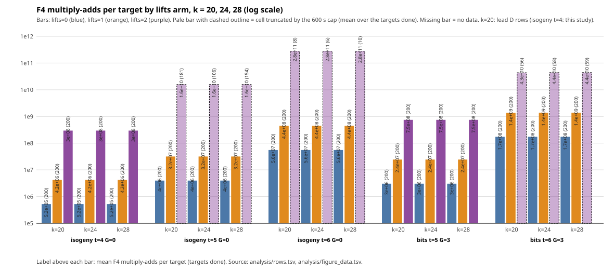

## Tables

All numbers are exact counts from the JSON files; ratios are computed by `analysis/make_tables.sh` (awk) from `analysis/rows.tsv`. The `verified` column counts hits that pass `[8]Sum = [8]R`; `exact` counts hits that satisfy `Sum = R`; the `fiber` column is the cofactor fibre size with `c` complete / `i` incomplete (0i = not used by lifts=0). [pcc:unverified]

### Table A: every run

`mul-adds/tgt / (cov/r)` is the per-relation cost at exact coverage (multiply-adds per target divided by the exact coverage; lifts=0 uses covered points, lifts 1 and 2 the projected points; "n/a" where the coverage is 0); the next column is the same with the all-coset upper bound of the coverage. `mul-adds/hit` is on observed hits and is undefined at 0 hits (never imputed). "prefix" rows are the re-runs on the first n targets of the capped lifts=2 arm.

| k | form | t | G | lifts | run | targets | capped | hits | verified | exact | calls/tgt | mul-adds/tgt | max deg | mean deg | max rows | max cols | max nnz | undec. | fiber | mul-adds/hit | mul-adds/tgt / (cov/r) | upper bd. (all cosets) | load |
|--:|:--|:-:|:-:|:-:|:--|--:|:-:|--:|--:|--:|--:|--:|--:|--:|--:|--:|--:|--:|:-:|--:|--:|--:|--:|
| 20 | isogeny | 4 | 0 | 0 | full | 200 | no | 0 | 0 | 0 | 1 | 5.23e+05 | 5 | 5.00 | 265 | 150 | 9349 | 0 | 0i | undef | 3.81e+09 | 4.21e+08 | 2.58 |
| 20 | isogeny | 4 | 0 | 1 | full | 200 | no | 1 | 1 | 0 | 7.995 | 4.18e+06 | 5 | 5.00 | 281 | 207 | 9349 | 0 | 8c | 8.36e+08 | 3.39e+09 | 3.36e+09 | 2.58 |
| 20 | isogeny | 4 | 0 | 2 | full | 200 | no | 1 | 1 | 0 | 1 | 2.95e+08 | 8 | 8.00 | 1092 | 1198 | 388679 | 0 | 8c | 5.9e+10 | 2.39e+11 | 2.38e+11 | 2.86 |
| 24 | bits | 5 | 3 | 0 | full | 200 | no | 0 | 0 | 0 | 8 | 3.04e+06 | 5 | 5.00 | 186 | 120 | 6879 | 0 | 0i | undef | 1.1e+11 | 1.62e+10 | 14.19 |
| 24 | bits | 5 | 3 | 1 | full | 200 | no | 0 | 0 | 0 | 64 | 2.43e+07 | 5 | 5.00 | 186 | 120 | 6879 | 0 | 8c | undef | 1.3e+11 | 1.3e+11 | 14.19 |
| 24 | bits | 5 | 3 | 2 | full | 200 | no | 0 | 0 | 0 | 8 | 7.47e+08 | 8 | 8.00 | 571 | 695 | 129162 | 0 | 8c | undef | 3.99e+12 | 3.98e+12 | 14.34 |
| 24 | bits | 6 | 3 | 0 | full | 200 | no | 0 | 0 | 0 | 8 | 1.72e+08 | 6 | 6.00 | 869 | 461 | 108616 | 0 | 0i | undef | 1.27e+12 | 1.66e+11 | 13.48 |
| 24 | bits | 6 | 3 | 0 | prefix | 58 | no | 0 | 0 | 0 | 8 | 1.72e+08 | 6 | 6.00 | 869 | 461 | 108616 | 0 | 0i | undef | 1.27e+12 | 1.66e+11 | 8.62 |
| 24 | bits | 6 | 3 | 1 | full | 200 | no | 0 | 0 | 0 | 64 | 1.38e+09 | 6 | 6.00 | 869 | 461 | 108616 | 0 | 8c | undef | 1.33e+12 | 1.33e+12 | 10.52 |
| 24 | bits | 6 | 3 | 1 | prefix | 58 | no | 0 | 0 | 0 | 64 | 1.38e+09 | 6 | 6.00 | 869 | 461 | 108616 | 0 | 8c | undef | 1.33e+12 | 1.33e+12 | 8.76 |
| 24 | bits | 6 | 3 | 2 | full | 58 | yes | 0 | 0 | 0 | 8 | 4.38e+10 | 8 | 8.00 | 3117 | 2269 | 2163480 | 0 | 8c | undef | 4.22e+13 | 4.22e+13 | 7.74 |
| 24 | isogeny | 4 | 0 | 0 | full | 200 | no | 0 | 0 | 0 | 1 | 5.23e+05 | 5 | 5.00 | 265 | 150 | 9349 | 0 | 0i | undef | 1.1e+11 | 8.5e+09 | 6.62 |
| 24 | isogeny | 4 | 0 | 1 | full | 200 | no | 0 | 0 | 0 | 8 | 4.18e+06 | 5 | 5.00 | 265 | 150 | 9349 | 0 | 8c | undef | 6.85e+10 | 6.8e+10 | 6.41 |
| 24 | isogeny | 4 | 0 | 2 | full | 200 | no | 0 | 0 | 0 | 1 | 2.95e+08 | 8 | 8.00 | 1023 | 1198 | 388679 | 0 | 8c | undef | 4.84e+12 | 4.8e+12 | 6.62 |
| 24 | isogeny | 5 | 0 | 0 | full | 200 | no | 0 | 0 | 0 | 1 | 3.96e+06 | 5 | 5.00 | 454 | 346 | 26856 | 0 | 0i | undef | 1.09e+11 | 1.43e+10 | 7.58 |
| 24 | isogeny | 5 | 0 | 0 | prefix | 106 | no | 0 | 0 | 0 | 1 | 3.96e+06 | 5 | 5.00 | 454 | 346 | 26856 | 0 | 0i | undef | 1.09e+11 | 1.43e+10 | 14.47 |
| 24 | isogeny | 5 | 0 | 1 | full | 200 | no | 0 | 0 | 0 | 8 | 3.17e+07 | 5 | 5.00 | 454 | 346 | 26856 | 0 | 8c | undef | 1.15e+11 | 1.15e+11 | 8.02 |
| 24 | isogeny | 5 | 0 | 1 | prefix | 106 | no | 0 | 0 | 0 | 8 | 3.17e+07 | 5 | 5.00 | 454 | 346 | 26856 | 0 | 8c | undef | 1.15e+11 | 1.15e+11 | 14.47 |
| 24 | isogeny | 5 | 0 | 2 | full | 106 | yes | 0 | 0 | 0 | 1 | 1.57e+10 | 8 | 8.00 | 5887 | 3746 | 8823511 | 0 | 8c | undef | 5.68e+13 | 5.67e+13 | 8.56 |
| 24 | isogeny | 6 | 0 | 0 | full | 200 | no | 0 | 0 | 0 | 1 | 5.55e+07 | 5 | 5.00 | 1397 | 1181 | 154877 | 0 | 0i | undef | 3.2e+11 | 3.83e+10 | 14.55 |
| 24 | isogeny | 6 | 0 | 0 | prefix | 6 | no | 0 | 0 | 0 | 1 | 5.55e+07 | 5 | 5.00 | 1397 | 1181 | 154877 | 0 | 0i | undef | 3.2e+11 | 3.83e+10 | 14.12 |
| 24 | isogeny | 6 | 0 | 1 | full | 200 | no | 0 | 0 | 0 | 8 | 4.44e+08 | 5 | 5.00 | 1397 | 1181 | 154877 | 0 | 8c | undef | 3.07e+11 | 3.06e+11 | 14.77 |
| 24 | isogeny | 6 | 0 | 1 | prefix | 6 | no | 0 | 0 | 0 | 8 | 4.44e+08 | 5 | 5.00 | 1397 | 1181 | 154877 | 0 | 8c | undef | 3.07e+11 | 3.06e+11 | 14.12 |
| 24 | isogeny | 6 | 0 | 2 | full | 6 | yes | 0 | 0 | 0 | 1 | 2.79e+11 | 10 | 10.00 | 15004 | 17524 | 47035110 | 0 | 8c | undef | 1.93e+14 | 1.92e+14 | 14.54 |
| 28 | bits | 5 | 3 | 0 | full | 200 | no | 0 | 0 | 0 | 8 | 3.04e+06 | 5 | 5.00 | 186 | 120 | 6879 | 0 | 0i | undef | 1.76e+12 | 1.99e+11 | 8.58 |
| 28 | bits | 5 | 3 | 1 | full | 200 | no | 0 | 0 | 0 | 64 | 2.43e+07 | 5 | 5.00 | 186 | 120 | 6879 | 0 | 8c | undef | 1.59e+12 | 1.59e+12 | 8.58 |
| 28 | bits | 5 | 3 | 2 | full | 200 | no | 0 | 0 | 0 | 8 | 7.47e+08 | 8 | 8.00 | 571 | 695 | 129162 | 0 | 8c | undef | 4.89e+13 | 4.88e+13 | 8.16 |
| 28 | bits | 6 | 3 | 0 | full | 200 | no | 0 | 0 | 0 | 8 | 1.72e+08 | 6 | 6.00 | 869 | 461 | 108616 | 0 | 0i | undef | 2.21e+13 | 2.66e+12 | 7.61 |
| 28 | bits | 6 | 3 | 0 | prefix | 59 | no | 0 | 0 | 0 | 8 | 1.72e+08 | 6 | 6.00 | 869 | 461 | 108616 | 0 | 0i | undef | 2.21e+13 | 2.66e+12 | 7.58 |
| 28 | bits | 6 | 3 | 1 | full | 200 | no | 0 | 0 | 0 | 64 | 1.38e+09 | 6 | 6.00 | 869 | 461 | 108616 | 0 | 8c | undef | 2.13e+13 | 2.12e+13 | 7.79 |
| 28 | bits | 6 | 3 | 1 | prefix | 59 | no | 0 | 0 | 0 | 64 | 1.38e+09 | 6 | 6.00 | 869 | 461 | 108616 | 0 | 8c | undef | 2.13e+13 | 2.12e+13 | 7.56 |
| 28 | bits | 6 | 3 | 2 | full | 59 | yes | 0 | 0 | 0 | 8 | 4.38e+10 | 8 | 8.00 | 3117 | 2269 | 2163480 | 0 | 8c | undef | 6.75e+14 | 6.75e+14 | 7.79 |
| 28 | isogeny | 4 | 0 | 0 | full | 200 | no | 0 | 0 | 0 | 1 | 5.23e+05 | 5 | 5.00 | 265 | 150 | 9349 | 0 | 0i | undef | n/a | 1.95e+12 | 8.45 |
| 28 | isogeny | 4 | 0 | 1 | full | 200 | no | 0 | 0 | 0 | 8 | 4.18e+06 | 5 | 5.00 | 265 | 150 | 9349 | 0 | 8c | undef | 1.75e+13 | 1.56e+13 | 8.45 |
| 28 | isogeny | 4 | 0 | 2 | full | 200 | no | 0 | 0 | 0 | 1 | 2.95e+08 | 8 | 8.00 | 1023 | 1198 | 388679 | 0 | 8c | undef | 1.24e+15 | 1.1e+15 | 8.38 |
| 28 | isogeny | 5 | 0 | 0 | full | 200 | no | 0 | 0 | 0 | 1 | 3.96e+06 | 5 | 5.00 | 454 | 346 | 26856 | 0 | 0i | undef | 6.04e+12 | 6.61e+11 | 8.35 |
| 28 | isogeny | 5 | 0 | 0 | prefix | 154 | no | 0 | 0 | 0 | 1 | 3.96e+06 | 5 | 5.00 | 454 | 346 | 26856 | 0 | 0i | undef | 6.04e+12 | 6.61e+11 | 8.68 |
| 28 | isogeny | 5 | 0 | 1 | full | 200 | no | 0 | 0 | 0 | 8 | 3.17e+07 | 5 | 5.00 | 454 | 346 | 26856 | 0 | 8c | undef | 5.31e+12 | 5.29e+12 | 8.25 |
| 28 | isogeny | 5 | 0 | 1 | prefix | 154 | no | 0 | 0 | 0 | 8 | 3.17e+07 | 5 | 5.00 | 454 | 346 | 26856 | 0 | 8c | undef | 5.31e+12 | 5.29e+12 | 8.54 |
| 28 | isogeny | 5 | 0 | 2 | full | 154 | yes | 0 | 0 | 0 | 1 | 1.57e+10 | 8 | 8.00 | 5887 | 3746 | 8823511 | 0 | 8c | undef | 2.63e+15 | 2.62e+15 | 7.96 |
| 28 | isogeny | 6 | 0 | 0 | full | 200 | no | 0 | 0 | 0 | 1 | 5.55e+07 | 5 | 5.00 | 1397 | 1181 | 154877 | 0 | 0i | undef | 6.51e+12 | 7.6e+11 | 8.49 |
| 28 | isogeny | 6 | 0 | 0 | prefix | 10 | no | 0 | 0 | 0 | 1 | 5.55e+07 | 5 | 5.00 | 1397 | 1181 | 154877 | 0 | 0i | undef | 6.51e+12 | 7.6e+11 | 8.45 |
| 28 | isogeny | 6 | 0 | 1 | full | 200 | no | 0 | 0 | 0 | 8 | 4.44e+08 | 5 | 5.00 | 1397 | 1181 | 154877 | 0 | 8c | undef | 6.08e+12 | 6.08e+12 | 8.59 |
| 28 | isogeny | 6 | 0 | 1 | prefix | 10 | no | 0 | 0 | 0 | 8 | 4.44e+08 | 5 | 5.00 | 1397 | 1181 | 154877 | 0 | 8c | undef | 6.08e+12 | 6.08e+12 | 8.45 |
| 28 | isogeny | 6 | 0 | 2 | full | 10 | yes | 0 | 0 | 0 | 1 | 2.79e+11 | 10 | 10.00 | 15004 | 17524 | 47035111 | 0 | 8c | undef | 3.82e+15 | 3.82e+15 | 7.82 |

### Table B: same-target comparison per cell

Each row compares the three arms on the same targets (the "prefix" rows where lifts=2 was capped, the full rows otherwise). `yield gain proj/cov` is the expected yield gain of lifts=1 over lifts=0 (exact ratio of the coverages), "cov=0" where lifts=0 covers no point; the observed gain, hits(lifts=1) / hits(lifts=0), is undefined in every k = 24 and k = 28 cell because both counts are 0. `per-relation 1/0` is `mul-adds 1/0` divided by the expected yield gain. `rows/cols/nnz 2/1` are ratios of the maximum matrix dimensions of lifts=2 over lifts=1. The k = 20 row is the reproduction cell. Lead 2's per-relation ratios at k = 20 for the five shapes were 0.89, 0.89, 1.10 (isogeny t = 4, 5, 6), 1.39, 1.02 (bits t = 5, 6) (read from lead D's README, not re-measured here).

| k | cell | matched targets | calls 1/0 | mul-adds 1/0 | yield gain proj/cov (expected) | per-relation 1/0 | mul-adds 2/1 | mul-adds 2/0 | max deg 0/1/2 | rows/cols/nnz 2/1 | hits 0/1/2 | verified-exact 0/1/2 | expected lifts=1 hits at coverage |
|--:|:--|--:|--:|--:|--:|--:|--:|--:|:-:|:-:|:-:|:-:|--:|
| 20 | isogeny t=4 G=0 | 200 | 7.995 | 7.995 | 9 | 0.8884 | 70.59 | 564.4 | 5/5/8 | 3.886/5.787/41.57 | 0/1/1 | 0-0/1-0/1-0 | 0.247 |
| 24 | bits t=5 G=3 | 200 | 8 | 8 | 6.759 | 1.184 | 30.73 | 245.9 | 5/5/8 | 3.07/5.792/18.78 | 0/0/0 | 0-0/0-0/0-0 | 0.0374 |
| 24 | bits t=6 G=3 | 58 | 8 | 8 | 7.669 | 1.043 | 31.77 | 254.2 | 6/6/8 | 3.587/4.922/19.92 | 0/0/0 | 0-0/0-0/0-0 | 0.0602 |
| 24 | isogeny t=4 G=0 | 200 | 8 | 8 | 12.8 | 0.625 | 70.55 | 564.4 | 5/5/8 | 3.86/7.987/41.57 | 0/0/0 | 0-0/0-0/0-0 | 0.0122 |
| 24 | isogeny t=5 G=0 | 106 | 8 | 8 | 7.605 | 1.052 | 494.9 | 3959 | 5/5/8 | 12.97/10.83/328.5 | 0/0/0 | 0-0/0-0/0-0 | 0.0292 |
| 24 | isogeny t=6 G=0 | 6 | 8 | 8 | 8.341 | 0.9592 | 628 | 5024 | 5/5/10 | 10.74/14.84/303.7 | 0/0/0 | 0-0/0-0/0-0 | 0.00869 |
| 28 | bits t=5 G=3 | 200 | 8 | 8 | 8.828 | 0.9062 | 30.73 | 245.9 | 5/5/8 | 3.07/5.792/18.78 | 0/0/0 | 0-0/0-0/0-0 | 0.00305 |
| 28 | bits t=6 G=3 | 59 | 8 | 8 | 8.313 | 0.9624 | 31.77 | 254.2 | 6/6/8 | 3.587/4.922/19.92 | 0/0/0 | 0-0/0-0/0-0 | 0.00383 |
| 28 | isogeny t=4 G=0 | 200 | 8 | 8 | cov=0 | cov=0 | 70.55 | 564.4 | 5/5/8 | 3.86/7.987/41.57 | 0/0/0 | 0-0/0-0/0-0 | 4.77e-05 |
| 28 | isogeny t=5 G=0 | 154 | 8 | 8 | 9.091 | 0.88 | 494.9 | 3959 | 5/5/8 | 12.97/10.83/328.5 | 0/0/0 | 0-0/0-0/0-0 | 0.000918 |
| 28 | isogeny t=6 G=0 | 10 | 8 | 8 | 8.566 | 0.9339 | 628 | 5024 | 5/5/10 | 10.74/14.84/303.7 | 0/0/0 | 0-0/0-0/0-0 | 0.00073 |

### Table C: k-scaling of F4 multiply-adds per target

Full rows only (lifts=2 rows are over the targets done inside the cap, shown in parentheses; the cap truncation changes the number of targets, not the per-target cost, which is nearly constant). k = 20 comes from lead D's JSONs (isogeny t = 4: this study's reproduction). Cells of different t are not pooled.

| cell | lifts | mul-adds/tgt k=20 (targets) | k=24 | k=28 | 24/20 | 28/24 | max deg 20/24/28 |
|:--|:-:|--:|--:|--:|--:|--:|:-:|
| bits t=5 G=3 | 0 | 3.04e+06 (200) | 3.04e+06 (200) | 3.04e+06 (200) | 1 | 1 | 5/5/5 |
| bits t=5 G=3 | 1 | 2.43e+07 (200) | 2.43e+07 (200) | 2.43e+07 (200) | 1 | 1 | 5/5/5 |
| bits t=5 G=3 | 2 | 7.47e+08 (200) | 7.47e+08 (200) | 7.47e+08 (200) | 1 | 1 | 8/8/8 |
| bits t=6 G=3 | 0 | 1.72e+08 (200) | 1.72e+08 (200) | 1.72e+08 (200) | 1 | 1 | 6/6/6 |
| bits t=6 G=3 | 1 | 1.36e+09 (200) | 1.38e+09 (200) | 1.38e+09 (200) | 1.013 | 1 | 6/6/6 |
| bits t=6 G=3 | 2 | 4.34e+10 (56) | 4.38e+10 (58) | 4.38e+10 (59) | 1.009 | 1 | 8/8/8 |
| isogeny t=4 G=0 | 0 | 5.23e+05 (200) | 5.23e+05 (200) | 5.23e+05 (200) | 1 | 1 | 5/5/5 |
| isogeny t=4 G=0 | 1 | 4.18e+06 (200) | 4.18e+06 (200) | 4.18e+06 (200) | 1.001 | 1 | 5/5/5 |
| isogeny t=4 G=0 | 2 | 2.95e+08 (200) | 2.95e+08 (200) | 2.95e+08 (200) | 1 | 1 | 8/8/8 |
| isogeny t=5 G=0 | 0 | 3.96e+06 (200) | 3.96e+06 (200) | 3.96e+06 (200) | 1 | 1 | 5/5/5 |
| isogeny t=5 G=0 | 1 | 3.17e+07 (200) | 3.17e+07 (200) | 3.17e+07 (200) | 1 | 1 | 5/5/5 |
| isogeny t=5 G=0 | 2 | 1.57e+10 (181) | 1.57e+10 (106) | 1.57e+10 (154) | 1 | 1 | 8/8/8 |
| isogeny t=6 G=0 | 0 | 5.55e+07 (200) | 5.55e+07 (200) | 5.55e+07 (200) | 1 | 1 | 5/5/5 |
| isogeny t=6 G=0 | 1 | 4.44e+08 (200) | 4.44e+08 (200) | 4.44e+08 (200) | 1 | 1 | 5/5/5 |
| isogeny t=6 G=0 | 2 | 2.79e+11 (8) | 2.79e+11 (6) | 2.79e+11 (10) | 1 | 1 | 10/10/10 |

Figure: [analysis/scale_lifts.svg](analysis/scale_lifts.svg) (log scale, three arms, per shape and k; capped cells marked), source `analysis/figure_data.tsv`.

