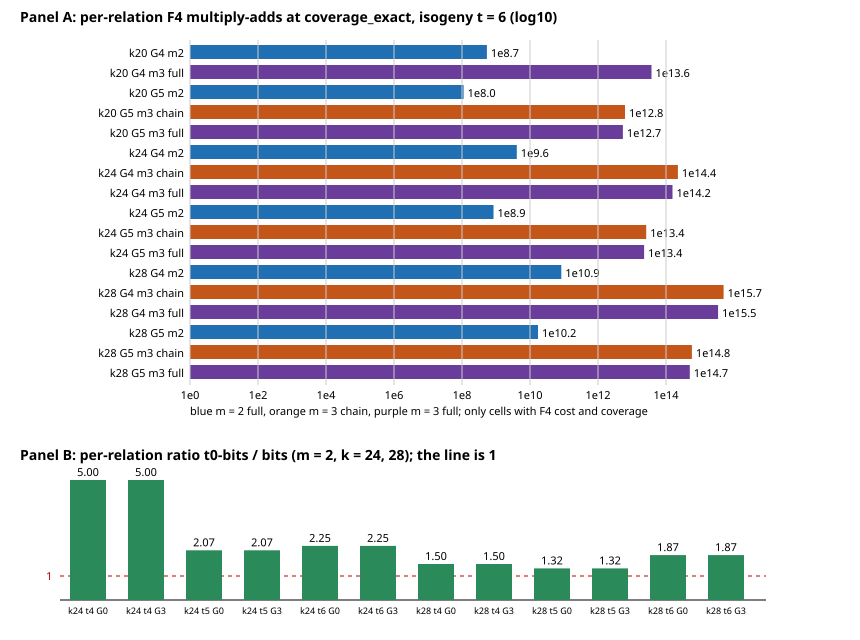

# Scale-up S4: m = 3 (lead 3) and t0-bits (lead E) at k = 24 and 28

Protocol: [PROTOCOL.md](PROTOCOL.md), committed (4fc3274527) before any cell ran. Data: `cells/` (one JSON per cell, with
status, `uptime` and stderr), tables in `analysis/` built by `analysis/make_p1.sh`, `make_p2.sh`, `make_svg.sh` (jq and awk).
Instrument: `/home/user/frozen-bin/curve25519_family_scale`, sha256
`d66b85b0dcb60c2d1b551a2e3ce19de4cc76e6897ce359eafce1bf579606ca90`, checked before the first cell and after the last
(`analysis/binary.sha256`, `analysis/binary.sha256.after`, identical). No code change, no build. Run locally on a shared
4-core box, one process at a time, `ulimit -v 3500000`; load average at cell start 1.6 to 14.8 (median 4.4, 66 cells).
Unit: F_p multiply-adds in F4 elimination. System construction, root-grid reading and lifts are native work not priced here
(AGENTS.md 5a); no rho reference was run, so no gap to the matched rho is computed and no leaderboard row is proposed.

**Scope of every statement:** the cells listed in the tables: k in {20, 24, 28}, one curve per k, one seed per (k, t), 50 targets
per Part 1 cell and 100 per Part 2 cell; Part 1 isogeny and bits forms, t in {6, 8}, G in {t-2, t-1}, m = 3 against m = 2;
Part 2 m = 2, mode full, t in {4, 5, 6}, G in {0, 3}. Nothing about other forms, t, G, m, k = 32 (refused by the engine), the
255-bit setting or a complete DLP. [pcc:unverified]

## Answer

**Part 1.** At k = 24 only the isogeny form at t = 6 returned data for m = 3 (4 of 16 cells); the other 12 failed on time or memory,
including every t = 8 cell and every bits cell. Those 4 cells hit the 900 s cap after 5 to 32 of 50 targets and cost 1.1e11 to 1.1e12 F4
multiply-adds per target, against 1.5e5 to 7.1e5 for the m = 2 cell with the same (form, t, G). The m = 3 coverage is 27 times
higher than the m = 2 coverage at k = 24, which is far from enough: the m = 3 per-relation cost, with `coverage_exact` as the hit
rate, is 2.7e4 to 5.5e4 times the m = 2 one in all 11 comparable pairs over k = 20, 24, 28. The F4 cost per target does not move with
k (k = 24 against 28 agree to 5e-8 at equal cells, k = 20 within 2 percent), while `coverage_exact` falls with k, so the per-relation cost of both m rises with k: for the
isogeny t = 6, G = 5, full cells m = 3 goes 5.4e12, 2.3e13, 5.0e14 and m = 2 goes 1.1e8, 8.4e8, 1.7e10 over k = 20, 24, 28.
No m = 3 cell is an improvement over m = 2 in this range; the classification of lead 3 (regression) is unchanged at deeper G and
larger k. Deep guessing did what lead B predicted for m = 2: the solving degree falls by one from G = t-2 to G = t-1 (m = 3 chain 6
to 5, full 11 to 10) and the cost per target falls 6.8 to 8.6 times (m = 3), but not enough. [pcc:unverified]

**Part 2.** At equal base size (the t0size pairing), t0-bits and bits have the same solving degree, the same polynomial terms and the same F4
multiply-adds per target in all 12 pairs at k = 24 and 28 (ratio 1 to within 6e-6), and the coverage penalty persists: per-relation
cost of t0-bits is 1.32 to 5.0 times that of bits. The expectation of a lower degree in the w form is not supported at any of the 12 pairs. All 460
planted targets were found and re-summed exactly. [pcc:unverified]

## Part 1: lead 3 (m = 3) with deep guessing

Cell naming `p1_k<k>_<form>_t<t>_g<G>_m<m>_<mode>`; `status`: ok = all 50 targets; capped = cap reached, analysed on targets done;
failed = no JSON (timeout: killed at 1000 s without output; memory: Rust allocation abort, return code 134); skipped = k = 28 cell whose k = 24
counterpart failed (protocol budget rule, not a result). "per-relation (modelled)" = multiply-adds per target / `coverage_exact`
(the observed hit rate is zero or too small to use); hits are listed.

| cell | k | form | t | G | m | mode | status | targets done | columns | F4 mul-adds / target | max degree | hits | coverage_exact | per-relation (modelled) |
|---|--:|---|--:|--:|--:|---|---|--:|--:|--:|--:|--:|--:|--:|
| k28_bits_t6_g4_m3_chain | 28 | - | - | - | 3 | - | skipped (k=24 counterpart failed) | - | - | - | - | - | - | - |
| k28_bits_t6_g4_m3_full | 28 | - | - | - | 3 | - | skipped (k=24 counterpart failed) | - | - | - | - | - | - | - |
| k28_bits_t6_g5_m3_chain | 28 | - | - | - | 3 | - | skipped (k=24 counterpart failed) | - | - | - | - | - | - | - |
| k28_bits_t6_g5_m3_full | 28 | - | - | - | 3 | - | skipped (k=24 counterpart failed) | - | - | - | - | - | - | - |
| k28_bits_t8_g6_m3_chain | 28 | - | - | - | 3 | - | skipped (k=24 counterpart failed) | - | - | - | - | - | - | - |
| k28_bits_t8_g6_m3_full | 28 | - | - | - | 3 | - | skipped (k=24 counterpart failed) | - | - | - | - | - | - | - |
| k28_bits_t8_g7_m3_chain | 28 | - | - | - | 3 | - | skipped (k=24 counterpart failed) | - | - | - | - | - | - | - |
| k28_bits_t8_g7_m3_full | 28 | - | - | - | 3 | - | skipped (k=24 counterpart failed) | - | - | - | - | - | - | - |
| k28_isogeny_t8_g6_m3_chain | 28 | - | - | - | 3 | - | skipped (k=24 counterpart failed) | - | - | - | - | - | - | - |
| k28_isogeny_t8_g6_m3_full | 28 | - | - | - | 3 | - | skipped (k=24 counterpart failed) | - | - | - | - | - | - | - |
| k28_isogeny_t8_g7_m3_chain | 28 | - | - | - | 3 | - | skipped (k=24 counterpart failed) | - | - | - | - | - | - | - |
| k28_isogeny_t8_g7_m3_full | 28 | - | - | - | 3 | - | skipped (k=24 counterpart failed) | - | - | - | - | - | - | - |
| repro_k20_bits_t4_g3_m3_chain | 20 | bits | 4 | 3 | 3 | chain | ok | 100 | 7 | 5.43e+08 | 6 | 0 | 0.000457 | 1.19e+12 |
| k20_bits_t6_g4_m2_full | 20 | bits | 6 | 4 | 2 | full | ok | 50 | 25 | 4.49e+07 | 5 | 1 | 0.00123 | 3.64e+10 |
| k20_bits_t6_g4_m3_chain | 20 | bits | 6 | 4 | 3 | chain | failed:timeout rc=124 | - | - | - | - | - | - | - |
| k20_bits_t6_g4_m3_full | 20 | bits | 6 | 4 | 3 | full | failed:memory rc=134 | - | - | - | - | - | - | - |
| k20_bits_t6_g5_m2_full | 20 | bits | 6 | 5 | 2 | full | ok | 50 | 25 | 1.8e+07 | 5 | 1 | 0.00123 | 1.45e+10 |
| k20_bits_t6_g5_m3_chain | 20 | bits | 6 | 5 | 3 | chain | failed:timeout rc=124 | - | - | - | - | - | - | - |
| k20_bits_t6_g5_m3_full | 20 | bits | 6 | 5 | 3 | full | failed:memory rc=134 | - | - | - | - | - | - | - |
| k20_isogeny_t6_g4_m2_full | 20 | isogeny | 6 | 4 | 2 | full | ok | 50 | 25 | 7.1e+05 | 5 | 0 | 0.00131 | 5.42e+08 |
| k20_isogeny_t6_g4_m3_chain | 20 | isogeny | 6 | 4 | 3 | chain | failed:timeout rc=124 | - | - | - | - | - | - | - |
| k20_isogeny_t6_g4_m3_full | 20 | isogeny | 6 | 4 | 3 | full | capped | 11 | 25 | 7.34e+11 | 11 | 0 | 0.0195 | 3.76e+13 |
| k20_isogeny_t6_g5_m2_full | 20 | isogeny | 6 | 5 | 2 | full | ok | 50 | 25 | 1.46e+05 | 4 | 0 | 0.00131 | 1.12e+08 |
| k20_isogeny_t6_g5_m3_chain | 20 | isogeny | 6 | 5 | 3 | chain | capped | 40 | 25 | 1.22e+11 | 5 | 1 | 0.0195 | 6.23e+12 |
| k20_isogeny_t6_g5_m3_full | 20 | isogeny | 6 | 5 | 3 | full | capped | 42 | 25 | 1.06e+11 | 10 | 1 | 0.0195 | 5.42e+12 |
| k24_bits_t6_g4_m2_full | 24 | bits | 6 | 4 | 2 | full | ok | 50 | 33 | 4.55e+07 | 5 | 0 | 0.000135 | 3.36e+11 |
| k24_bits_t6_g4_m3_chain | 24 | bits | 6 | 4 | 3 | chain | failed:timeout rc=124 | - | - | - | - | - | - | - |
| k24_bits_t6_g4_m3_full | 24 | bits | 6 | 4 | 3 | full | failed:memory rc=134 | - | - | - | - | - | - | - |
| k24_bits_t6_g5_m2_full | 24 | bits | 6 | 5 | 2 | full | ok | 50 | 33 | 1.82e+07 | 5 | 0 | 0.000135 | 1.34e+11 |
| k24_bits_t6_g5_m3_chain | 24 | bits | 6 | 5 | 3 | chain | failed:timeout rc=124 | - | - | - | - | - | - | - |
| k24_bits_t6_g5_m3_full | 24 | bits | 6 | 5 | 3 | full | failed:memory rc=134 | - | - | - | - | - | - | - |
| k24_bits_t8_g6_m2_full | 24 | bits | 8 | 6 | 2 | full | ok | 50 | 130 | 9e+09 | 6 | 0 | 0.00202 | 4.46e+12 |
| k24_bits_t8_g6_m3_chain | 24 | bits | 8 | 6 | 3 | chain | failed:memory rc=134 | - | - | - | - | - | - | - |
| k24_bits_t8_g6_m3_full | 24 | bits | 8 | 6 | 3 | full | failed:memory rc=134 | - | - | - | - | - | - | - |
| k24_bits_t8_g7_m2_full | 24 | bits | 8 | 7 | 2 | full | ok | 50 | 130 | 3.7e+09 | 6 | 0 | 0.00202 | 1.83e+12 |
| k24_bits_t8_g7_m3_chain | 24 | bits | 8 | 7 | 3 | chain | failed:memory rc=134 | - | - | - | - | - | - | - |
| k24_bits_t8_g7_m3_full | 24 | bits | 8 | 7 | 3 | full | failed:memory rc=134 | - | - | - | - | - | - | - |
| k24_isogeny_t6_g4_m2_full | 24 | isogeny | 6 | 4 | 2 | full | ok | 50 | 39 | 7.1e+05 | 5 | 0 | 0.000174 | 4.09e+09 |
| k24_isogeny_t6_g4_m3_chain | 24 | isogeny | 6 | 4 | 3 | chain | capped | 5 | 39 | 1.06e+12 | 6 | 0 | 0.00474 | 2.24e+14 |
| k24_isogeny_t6_g4_m3_full | 24 | isogeny | 6 | 4 | 3 | full | capped | 7 | 39 | 7.34e+11 | 11 | 0 | 0.00474 | 1.55e+14 |
| k24_isogeny_t6_g5_m2_full | 24 | isogeny | 6 | 5 | 2 | full | ok | 50 | 39 | 1.46e+05 | 4 | 0 | 0.000174 | 8.44e+08 |
| k24_isogeny_t6_g5_m3_chain | 24 | isogeny | 6 | 5 | 3 | chain | capped | 29 | 39 | 1.24e+11 | 5 | 0 | 0.00474 | 2.62e+13 |
| k24_isogeny_t6_g5_m3_full | 24 | isogeny | 6 | 5 | 3 | full | capped | 32 | 39 | 1.08e+11 | 10 | 0 | 0.00474 | 2.27e+13 |
| k24_isogeny_t8_g6_m2_full | 24 | isogeny | 8 | 6 | 2 | full | ok | 50 | 130 | 4.91e+06 | 5 | 0 | 0.00204 | 2.41e+09 |
| k24_isogeny_t8_g6_m3_chain | 24 | isogeny | 8 | 6 | 3 | chain | failed:timeout rc=124 | - | - | - | - | - | - | - |
| k24_isogeny_t8_g6_m3_full | 24 | isogeny | 8 | 6 | 3 | full | failed:timeout rc=124 | - | - | - | - | - | - | - |
| k24_isogeny_t8_g7_m2_full | 24 | isogeny | 8 | 7 | 2 | full | ok | 50 | 130 | 1.11e+06 | 4 | 0 | 0.00204 | 5.45e+08 |
| k24_isogeny_t8_g7_m3_chain | 24 | isogeny | 8 | 7 | 3 | chain | failed:timeout rc=124 | - | - | - | - | - | - | - |
| k24_isogeny_t8_g7_m3_full | 24 | isogeny | 8 | 7 | 3 | full | failed:timeout rc=124 | - | - | - | - | - | - | - |
| k28_isogeny_t6_g4_m2_full | 28 | isogeny | 6 | 4 | 2 | full | ok | 50 | 35 | 7.1e+05 | 5 | 0 | 8.52e-06 | 8.33e+10 |
| k28_isogeny_t6_g4_m3_chain | 28 | isogeny | 6 | 4 | 3 | chain | capped | 8 | 35 | 1.06e+12 | 6 | 0 | 0.000215 | 4.95e+15 |
| k28_isogeny_t6_g4_m3_full | 28 | isogeny | 6 | 4 | 3 | full | capped | 11 | 35 | 7.34e+11 | 11 | 0 | 0.000215 | 3.42e+15 |
| k28_isogeny_t6_g5_m2_full | 28 | isogeny | 6 | 5 | 2 | full | ok | 50 | 35 | 1.46e+05 | 4 | 0 | 8.52e-06 | 1.72e+10 |
| k28_isogeny_t6_g5_m3_chain | 28 | isogeny | 6 | 5 | 3 | chain | capped | 40 | 35 | 1.24e+11 | 5 | 0 | 0.000215 | 5.78e+14 |
| k28_isogeny_t6_g5_m3_full | 28 | isogeny | 6 | 5 | 3 | full | capped | 42 | 35 | 1.08e+11 | 10 | 0 | 0.000215 | 5.02e+14 |

The `repro_k20_bits_t4_g3_m3_chain` row is lead 3's cell: 543067299.99 multiply-adds per target, degree 6, 0 of 100 hits, coverage_exact
0.000457, against lead 3's 543067299, 6, 0, 0.00046 (A7 held).

### m = 3 against m = 2 at equal (k, form, t, G), per-relation at `coverage_exact`

Only pairs where both arms have F4 cost; no bits pair exists (every bits m = 3 cell failed); no t = 8 pair exists.

| k | t | G | m3/m2 mode | per-relation m3 | per-relation m2 | ratio |
|--:|--:|--:|---|--:|--:|--:|
| 20 | 6 | 4 | full | 3.757e+13 | 5.417e+08 | 69364.57 |
| 20 | 6 | 5 | chain | 6.232e+12 | 1.117e+08 | 55781.07 |
| 20 | 6 | 5 | full | 5.416e+12 | 1.117e+08 | 48473.91 |
| 24 | 6 | 4 | chain | 2.244e+14 | 4.092e+09 | 54849.03 |
| 24 | 6 | 4 | full | 1.550e+14 | 4.092e+09 | 37873.01 |
| 24 | 6 | 5 | chain | 2.619e+13 | 8.439e+08 | 31036.94 |
| 24 | 6 | 5 | full | 2.274e+13 | 8.439e+08 | 26941.54 |
| 28 | 6 | 4 | chain | 4.951e+15 | 8.332e+10 | 59417.98 |
| 28 | 6 | 4 | full | 3.418e+15 | 8.332e+10 | 41027.85 |
| 28 | 6 | 5 | chain | 5.778e+14 | 1.719e+10 | 33622.32 |
| 28 | 6 | 5 | full | 5.016e+14 | 1.719e+10 | 29185.78 |

Coverage that the binary reports (isogeny t = 6, G-independent): m = 2: 0.00131 (k = 20), 0.000174 (24), 0.0000085 (28); m = 3: 0.0195, 0.00474,
0.000215. Isogeny t = 8, k = 24, m = 2: 0.00204 (this is what the m = 3 cells there would have to beat; no m = 3 coverage was read for t = 8 at
k = 24 or 28 because the census was stopped, see Deviations; at k = 20 the census gave 0.960 for m = 3 and 0.0351 for m = 2). [pcc:unverified]

Observed relations. Two m = 3 cells found a relation: k = 20 isogeny t = 6 G = 5 chain (1 hit in 40 targets, 4.9e12 multiply-adds per hit) and full (1 in 42,
4.4e12 per hit), both verified; the modelled figures are 6.2e12 and 5.4e12. All other m = 3 and m = 2 cells in Part 1 at k = 24, 28 had 0 hits.
One hit per cell is not a rate; the modelled figures carry the comparison. [pcc:unverified]

### Failures and caps (all data)

  (`f4cost 20 bits 6 0 0 1 60 3 full`, G = 0) hit allocation failures (more than 2.8 GB resident when last read); a bits t = 8 m = 3 census cell at k = 20 was at 1.9 GB after
  37 s when I stopped it. So for the bits form the memory goes before any target is solved (the system build or the coverage reading); this is one census cell, not a
  located cause. Lead 3 bits t = 5 and 6 failures may be the same. [pcc:unverified]
  a located cause. Lead 3's bits t = 5 and 6 "failures" may be the same.
- bits, t = 8, m = 3, k = 24: all four cells aborted on allocation (3.5 GB), return code 134.
- isogeny, t = 8, m = 3, k = 24: all four cells killed at 1000 s without output (no target finished inside the cap; the cap is checked between targets).
- isogeny, t = 6, G = 4, chain, k = 20: killed at 1000 s without output, with load average 14.6 at its start. The same cell at k = 28 (load 4.0) did 8 targets and at
  k = 24 (load 12.2) 5, and the per-target cost does not depend on k, so this failure is plausibly load-dependent. It was not re-run.
- Capped counts (5 to 42 of 50) depend on the load during the cell; wall times are not compared and the cap is wall-clock.
- Undecided targets: 0 in every cell that ran. Hits in Part 1 at k = 20: bits t = 6 m = 2 had 1 hit in each of G = 4, 5 (50 targets), and the two m = 3 hits above.

### Predictions (frozen in PROTOCOL.md)

| | claim | outcome |
|---|---|---|
| A1 | every k = 24 m = 3 cell at t = 6 does at least 25 of 50 targets | **falsified**: isogeny G = 4 chain 5, full 7; bits t = 6, four cells failed. Isogeny G = 5 chain 29, full 32 reached it |
| A2 | no k = 24 m = 3 cell at t = 8 does 25 targets | **held**: 8 of 8 failed (4 timeout, 4 memory) |
| A3 | m = 3 per-relation at least 10 times m = 2 in every pair | **held**: ratios 2.7e4 to 6.9e4 (11 pairs); no ratio below 1 |
| A4 | F4 mul-adds per target agree within 2 across k for equal cells | **held where measurable** (k = 24 against 28 agree to 5e-8; k = 20 against 24 and 28 within 2 percent where k = 20 has data; the chain G = 4 cell has data at k = 24 and 28 only; bits cells have no m = 3 data) |
| A5 | max degree at G = t-1 not above that at G = t-2, strictly lower somewhere | **held**: isogeny t = 6 m = 3 chain 6 to 5, full 11 to 10, m = 2 5 to 4; bits m = 2 5 = 5 |
| A6 | mode full costs at least as much as chain per target | **falsified**: full is below chain in all 5 pairs with data (e.g. k = 20 G = 5: 1.06e11 against 1.22e11; k = 24 G = 4: 7.3e11 against 1.06e12; target counts differ, 5 against 7 at k = 24 G = 4) |
| A7 | k = 20 reproduction of lead 3's bits t = 4 G = 3 chain cell | **held** (543067299.99 against 543067299) |

## Part 2: lead E (t0-bits against bits) at k = 24 and 28

Pairing from `curve25519_family t0size` by lead E's rule (`analysis/pairing.tsv`, PROTOCOL.md). `covered points` and `coverage_exact` are the binary's; at
k = 28 and t = 4 the plain base covers 12 points of the subgroup, so the coverage ratios there rest on counts of 8 to 12. No cell hit the cap, none was undecided.
Random-target hits: 0 in all cells (expected hits are below 0.01 per cell), so the exactness check rests on the planted targets.

| cell | cols/pts | degree | terms | F4 mul-adds / target | matrix rows x cols | coverage_exact | per-relation | hits | planted found/done/exact |
|---|---|--:|--:|--:|---|--:|--:|--:|---|
| p2_k24_t4_g0_plain | 7/14 | 6 | 121.0 | 4.05e+06 | 430x243 | 9.54e-06 | 4.24e+11 | 0 | 19/19/19 |
| p2_k24_t4_g0_t0 | 6/12 | 6 | 121.0 | 4.05e+06 | 430x243 | 1.91e-06 | 2.12e+12 | 0 | 18/18/18 |
| p2_k24_t4_g3_plain | 7/14 | 4 | 22.0 | 8.88e+04 | 65x31 | 9.54e-06 | 9.32e+09 | 0 | 19/19/19 |
| p2_k24_t4_g3_t0 | 6/12 | 4 | 22.0 | 8.88e+04 | 65x31 | 1.91e-06 | 4.66e+10 | 0 | 18/18/18 |
| p2_k24_t5_g0_plain | 14/28 | 6 | 256.0 | 1.27e+08 | 1159x848 | 2.77e-05 | 4.6e+12 | 0 | 20/20/20 |
| p2_k24_t5_g0_t0 | 14/28 | 6 | 256.0 | 1.27e+08 | 1159x848 | 1.34e-05 | 9.53e+12 | 0 | 19/19/19 |
| p2_k24_t5_g3_plain | 14/28 | 5 | 64.0 | 3.04e+06 | 186x120 | 2.77e-05 | 1.1e+11 | 0 | 20/20/20 |
| p2_k24_t5_g3_t0 | 14/28 | 5 | 64.0 | 3.04e+06 | 186x120 | 1.34e-05 | 2.27e+11 | 0 | 19/19/19 |
| p2_k24_t6_g0_plain | 33/66 | 7 | 484.0 | 1.75e+09 | 2787x3102 | 0.000135 | 1.3e+13 | 0 | 20/20/20 |
| p2_k24_t6_g0_t0 | 32/64 | 7 | 484.0 | 1.75e+09 | 2787x3102 | 6.01e-05 | 2.92e+13 | 0 | 20/20/20 |
| p2_k24_t6_g3_plain | 33/66 | 6 | 154.0 | 1.72e+08 | 869x461 | 0.000135 | 1.27e+12 | 0 | 20/20/20 |
| p2_k24_t6_g3_t0 | 32/64 | 6 | 154.0 | 1.72e+08 | 869x461 | 6.01e-05 | 2.87e+12 | 0 | 20/20/20 |
| p2_k28_t4_g0_plain | 7/14 | 6 | 121.0 | 4.05e+06 | 430x243 | 3.58e-07 | 1.13e+13 | 0 | 19/19/19 |
| p2_k28_t4_g0_t0 | 8/16 | 6 | 121.0 | 4.05e+06 | 430x243 | 2.38e-07 | 1.7e+13 | 0 | 18/18/18 |
| p2_k28_t4_g3_plain | 7/14 | 4 | 22.0 | 8.88e+04 | 65x31 | 3.58e-07 | 2.48e+11 | 0 | 19/19/19 |
| p2_k28_t4_g3_t0 | 8/16 | 4 | 22.0 | 8.88e+04 | 65x31 | 2.38e-07 | 3.73e+11 | 0 | 18/18/18 |
| p2_k28_t5_g0_plain | 16/32 | 6 | 256.0 | 1.27e+08 | 1159x848 | 1.73e-06 | 7.36e+13 | 0 | 19/19/19 |
| p2_k28_t5_g0_t0 | 16/32 | 6 | 256.0 | 1.27e+08 | 1159x848 | 1.31e-06 | 9.71e+13 | 0 | 19/19/19 |
| p2_k28_t5_g3_plain | 16/32 | 5 | 64.0 | 3.04e+06 | 186x120 | 1.73e-06 | 1.76e+12 | 0 | 19/19/19 |
| p2_k28_t5_g3_t0 | 16/32 | 5 | 64.0 | 3.04e+06 | 186x120 | 1.31e-06 | 2.32e+12 | 0 | 19/19/19 |
| p2_k28_t6_g0_plain | 33/66 | 7 | 484.0 | 1.75e+09 | 2787x3102 | 7.81e-06 | 2.25e+14 | 0 | 19/19/19 |
| p2_k28_t6_g0_t0 | 34/68 | 7 | 484.0 | 1.75e+09 | 2787x3102 | 4.17e-06 | 4.2e+14 | 0 | 20/20/20 |
| p2_k28_t6_g3_plain | 33/66 | 6 | 154.0 | 1.72e+08 | 869x461 | 7.81e-06 | 2.21e+13 | 0 | 19/19/19 |
| p2_k28_t6_g3_t0 | 34/68 | 6 | 154.0 | 1.72e+08 | 869x461 | 4.17e-06 | 4.13e+13 | 0 | 20/20/20 |
| repro_p2_k20_t5_g3_plain | 11/22 | 5 | 64.0 | 3.04e+06 | 186x120 | 0.00032 | 9.49e+09 | 0 | 17/17/17 |
| repro_p2_k20_t5_g3_t0 | 12/24 | 5 | 64.0 | 3.04e+06 | 186x120 | 0.000259 | 1.17e+10 | 0 | 18/18/18 |

### t0-bits / bits per (k, t, G)

The k = 20 row is the lead E reproduction pair (plain 11 columns against t0 12; lead E: 0.810, 1.24).

| k | t | G | columns t0/plain | degree t0/plain | terms t0/plain | mul-adds ratio | coverage ratio | per-relation ratio |
|--:|--:|--:|---|---|---|--:|--:|--:|
| 20 | 5 | 3 | 12/11 | 5/5 | 64.0/64.0 | 1.0000 | 0.810 | 1.235 |
| 24 | 4 | 0 | 6/7 | 6/6 | 121.0/121.0 | 1.0000 | 0.200 | 5.000 |
| 24 | 4 | 3 | 6/7 | 4/4 | 22.0/22.0 | 1.0000 | 0.200 | 5.000 |
| 24 | 5 | 0 | 14/14 | 6/6 | 256.0/256.0 | 1.0000 | 0.483 | 2.071 |
| 24 | 5 | 3 | 14/14 | 5/5 | 64.0/64.0 | 1.0000 | 0.483 | 2.071 |
| 24 | 6 | 0 | 32/33 | 7/7 | 484.0/484.0 | 1.0000 | 0.444 | 2.254 |
| 24 | 6 | 3 | 32/33 | 6/6 | 154.0/154.0 | 1.0000 | 0.444 | 2.254 |
| 28 | 4 | 0 | 8/7 | 6/6 | 121.0/121.0 | 1.0000 | 0.667 | 1.500 |
| 28 | 4 | 3 | 8/7 | 4/4 | 22.0/22.0 | 1.0000 | 0.667 | 1.500 |
| 28 | 5 | 0 | 16/16 | 6/6 | 256.0/256.0 | 1.0000 | 0.759 | 1.318 |
| 28 | 5 | 3 | 16/16 | 5/5 | 64.0/64.0 | 1.0000 | 0.759 | 1.318 |
| 28 | 6 | 0 | 34/33 | 7/7 | 484.0/484.0 | 1.0000 | 0.534 | 1.871 |
| 28 | 6 | 3 | 34/33 | 6/6 | 154.0/154.0 | 1.0000 | 0.534 | 1.871 |

The F4 multiply-adds, degree, terms, matrix rows x columns and non-zeros are equal in every pair at k = 24 and 28 (in lead E at k = 20 the t = 6, G = 0 pair had
5541 against 2787 rows; that did not recur here). The coverage ratio follows the column ratio only roughly: at the two equal-column pairs it is 0.48 (k = 24, t = 5)
and 0.76 (k = 28, t = 5); the closed base has fewer distinct sums, so equal columns give less coverage. [pcc:unverified]

### Predictions (frozen in PROTOCOL.md)

| | claim | outcome |
|---|---|---|
| B1 | degree equal in all 12 pairs; lead E's lower-degree expectation fails | **held**: 12 of 12 equal; no pair has t0-bits below bits |
| B2 | terms equal in all 12 pairs | **held** (121, 22, 256, 64, 484, 154) |
| B3 | mul-adds ratio in [0.5, 2] | **held**: 1 to within 6e-6 |
| B4 | per-relation ratio above 1 in all 12 pairs; coverage ratio in [0.35, 0.75] at the two equal-column pairs | first part **held** (1.32 to 5.0); second part **split**: 0.483 inside at k = 24, 0.759 at k = 28 just outside |
| B5 | planted all found and exact, hits verified | **held**: every cell found = processed = exact (460 of 460); hits verified is vacuous at 0 hits |
| B6 | k = 20 reproduction of lead E | **held**: 3036910.41 and 3036908.79 against 3036910 and 3036908, degree 5, planted 17/17 and 18/18 |

### k-scaling

Per-relation ratio t0 / bits at fixed t over k = 20, 24, 28: t = 4: 3.00 (lead E), 5.00, 1.50; t = 5: 1.24, 2.07, 1.32; t = 6: 1.73, 2.25, 1.87. There is no trend in k;
the ratio moves with the column mismatch of each pairing (6 against 7 columns at k = 24, t = 4; 8 against 7 at k = 28), so only the sign (above 1) is stable across the 13 pairs measured. [pcc:unverified]

## Figure

## Deviations

1. **Stage order.** PROTOCOL.md gives no stage order; the driver was first launched as repro, p2k24, p1k20, p1k24, p2k28, p1k28 and restarted with the k = 20 deep-G anchor last
   after the first k = 20 cell timed out at load 14.6 and held the box for 17 minutes. No cell content changed.
2. **Interrupted cells.** The background driver was stopped twice at its 2 h limit mid-cell (`isogeny t = 8 G = 6 m = 3 full` at k = 24 and `isogeny t = 6 G = 4 m = 3 full` at
   k = 28); the partial output was removed and the cell re-run from the start under the same command. A third kill by me (the k = 20 stage, first attempt) did the same for
   `p1_k20_isogeny_t6_g4_m3_full`.
3. **Census stopped.** The coverage census (`f4cost ... 0 targets`) was stopped by me after the k = 20 rows (it was consuming the shared box on bits m = 3 cells that run out of
   memory), so `analysis/coverage_census.jsonl` has k = 20 only (6 rows, written before the protocol); the protocol text quotes the k = 24 isogeny t = 6 m = 3 row, which was
   read from a separate single run not saved to the file. Coverage for all cells that ran is in the cell JSON.
4. **Duplicate rows removed.** An early version of `make_p1.sh` listed each failed cell twice; fixed before any table here.
5. **k = 28 gating.** Applied as written: 12 of the 24 k = 28 cells were skipped because their k = 24 counterpart failed; the k = 28 m = 2 partners of those were not run either.
6. **Timeouts without cap data.** The binary prints one JSON at the end, so a cell whose first target outlasts the cap plus 100 s leaves no partial data.
7. **Not done.** No rho reference, no pricing of native work (AGENTS.md 5a), no `VALIDATION.json`, no benchmark or leaderboard entry; the PDF and prose lint are the only report
   artifacts. One curve and one seed per (k, t); no spread.

Report PDF: [REPORT.pdf](REPORT.pdf).
