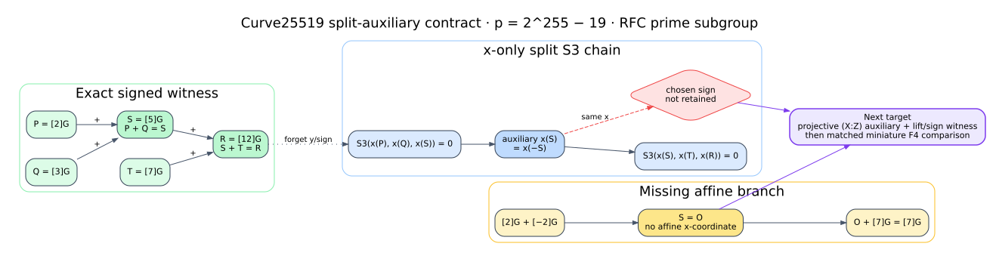

# Curve25519 split-auxiliary relation contracts (2026-11-18)

**Result.** Two native Rust contract tests now pin the sign and identity-point
boundaries of a split `S3` relation on the repository's exact full-width
Curve25519 model. A separate native diagnostic that imports the same model
source checked both frozen witnesses. The root library test gate is blocked by
the already-tracked compile breakage on `main`, so the integrated tests remain
implemented but not root-gate verified. `[pcc:unverified]`

Protocol: [PROTOCOL.md](PROTOCOL.md). Visual:
[split-chain.svg](split-chain.svg). PDF: [REPORT.pdf](REPORT.pdf). Raw checked
witness: [raw/contract-check.json](raw/contract-check.json).



## Request-to-evidence status

| Requested component | Status | Evidence |
|:--|:--|:--|
| Use Isogeny Labs Crypto, not a standalone toy | Implemented | `src/cryptanalysis/curve25519_ic.rs`; study-local native Rust checker |
| Establish the baseline | Complete at repository-evidence scope | Existing T0, exponent, algebraic-oracle, and closure studies below |
| Identify symmetry/splitting/auxiliary-variable leads | Complete as proposals | Lead matrix below; no performance claim |
| Check the split representation on Curve25519 | Diagnostic complete; integrated gate blocked | `raw/contract-check.json`; root compile blocker below |
| Set an optimization goal | Complete as a preregisterable target | “Optimization target” below |

## Checked contract

The exact curve is RFC 7748 Curve25519,
`v^2 = u^3 + 486662u^2 + u` over `F_(2^255-19)`, with the repository's
declared prime-order subgroup and base point `G`. The checked source is
`Curve25519IcModel::rfc7748()` and its exact `semaev_s3` implementation.

For `P=[2]G`, `Q=[3]G`, `S=[5]G`, `T=[7]G`, and `R=[12]G`, the native
diagnostic observed:

- `P+Q=S` and `S+T=R`;
- `S3(x(P),x(Q),x(S))=0` and `S3(x(S),x(T),x(R))=0`;
- negating `P` and `Q` leaves every abscissa in the split system unchanged,
  but the chosen fixed-signed equation `(-P)+(-Q)+T=R` is false.

For `P=[2]G`, `Q=-P`, `T=R=[7]G`, it observed `P+Q=O`, no affine
`x(O)`, and the exact join `O+T=R`. These are concrete checked witnesses, not
a new general polynomial identity. `[pcc:unverified]`

The contract is therefore:

1. an x-only split `S3` chain is existential over sign choices;
2. a relation collector that needs a chosen signed row must retain or recover
   compatible lift/sign data and verify it in the group;
3. an affine auxiliary abscissa needs a separate identity branch, or a
   projective representation with `Z=0`.

## Baseline measured elsewhere in the repository

- The T0 translation `x -> 1/x` approximately doubled distinct covered
  target abscissae against a blind pair oracle (ratios 1.944–2.016 over eight
  miniature cells). Full cofactor projection had about 3.8–4.0x the T0
  coverage once `N >= 64`; that prior study reports no pipeline result.
- The full-width `curve25519_ic` module already provides an exact unsplit S3
  witness and the exact RFC model used here.
- The 2026-11-08 exponent study found no `m=2` exponent lever; its `m=3` and
  `m=4` estimates were censored or undetermined under the frozen estimator.
- The 2026-11-12 closure note explicitly leaves split-Semaev systems and F4
  or polynomial-calculus lower bounds outside its restricted unsplit
  XL/Macaulay model.

These items are the baseline; this round adds a correctness boundary, not a
new timing row or exponent estimate. `[pcc:unverified]`

## Leads from the boundary

| Lead | Mechanism to test | Required charge/control | First falsifier |
|:--|:--|:--|:--|
| Projective split auxiliary | Represent each join by `(X:Z)` so `Z=0` retains `O` | Extra variables/equations, branch handling, exact group verification | Solver cost rises without recovering any relations omitted by affine x |
| Lift/sign witness | Carry one lift selector, slope witness, or y-compatible constraint across adjacent S3 joins | Selector variables and post-lift verification | x-only solutions cannot be lifted consistently, or added variables erase the degree benefit |
| T0-folded split chain | Use the existing invariant `kappa=x+1/x` at each split node | Exceptional `x=0`, orbit multiplicities, inversions, and Gröbner cost | The 2x algebraic yield does not offset larger F4 matrices |
| Balanced split tree | Replace one high-arity summation polynomial by a balanced tree of quadratic joins | Every auxiliary node, equality constraint, and infinity/sign branch | Degree falls but rows/columns or relation verification cost dominate |
| Cofactor/fiber label | Attach the cofactor or torsion-coset label needed by the final row | Label construction, lift attempts, and exact projected-row check | Label cost exceeds the relations recovered from otherwise dead fibers |

These are proposed experiment arms. They are not reported as new algorithms or
performance gains. The T0 idea extends an existing repository proposal; the projective
and lift/sign arms are the direct implementation consequences of this round's
checked witnesses.

## Optimization target

The next goal should be narrow and measurable:

> On the existing `k=20` Curve25519 miniature, reduce F4 field
> multiply-adds per **group-checked** relation by at least 25% versus the current
> `pkm-semaev` split-chain baseline, on matched targets and seeds, with zero
> invalid rows and with all auxiliary/sign/infinity work charged.

Use `m=4` first and replicate any passing arm at `k=24`. Report hit rate, F4
calls per target, multiply-adds per target and per group-checked relation, maximum
matrix rows/columns, lift failures, infinity-branch hits, and setup work. A
candidate advances only if its paired 95% interval for the cost ratio lies
below `0.80`; otherwise retain it as a structural or correctness result. This
is a proposed decision rule, not a measured outcome.

The first implementation arm should be the projective auxiliary plus explicit
lift verification. Only after that control passes should T0 folding be added,
so any gain can be attributed to symmetry rather than to silently dropped
branches.

## Evidence flow and build boundary

| Flow item | Outcome |
|:--|:--|
| Planned | Two integrated release-mode tests plus the complete `curve25519_ic` subset |
| Attempted | Root release build with Rust 1.90.0 and 1.94.1 |
| Blocked | 1.90.0 is below the locked AWS dependency MSRV; 1.94.1 reaches the root crate but `main` has 35 unrelated compile errors, including duplicate definitions and missing/drifted APIs |
| Completed | Study-local Rust diagnostic imports `src/cryptanalysis/curve25519_ic.rs` and checks the same frozen full-width witnesses; exit 0 |
| Excluded by protocol | Timings, solver runs, relation collection, exponent estimates, and end-to-end DLP claims |

The root blocker corresponds to the existing ACTIVE compile-repair task for 28
examples, tests, and binaries affected by lossy merges. The diagnostic does not
discharge acceptance item 5 in the frozen protocol; the integrated tests must
still be rerun after that repair lands.

Reproduce the completed diagnostic:

```bash
cargo +1.94.1 fmt \
  --manifest-path research/curve25519_split_aux_contracts_20261118/native/Cargo.toml \
  -- --check
cargo +1.94.1 run --release \
  --manifest-path research/curve25519_split_aux_contracts_20261118/native/Cargo.toml
```

The successful command used source revision
`61f107c94bd95317da2243558738689c590cf096` plus the uncommitted test and
study files in this PR. Host isolation is not relevant because no duration is
used as evidence. Toolchain: `rustc 1.94.1 (e408947bf 2026-03-25)`.

## Sources

Primary and repository sources consulted before implementation:

1. Petit, Kosters, Messeng, “Algebraic approaches for the ECDLP over prime
   fields,” PKC 2016,
   <https://christophe.petit.web.ulb.be/files/16PKC_primeECDLP.pdf>.
2. Galbraith and Gaudry, “Recent progress on the ECDLP,” 2015,
   <https://eprint.iacr.org/2015/1022.pdf>.
3. `research/curve25519_t0_symmetry_20261102/README.md` for the measured T0
   baseline and its algebraic-track proposal.
4. `research/curve25519_exponent_study_20261108/README.md` for the prior
   exponent study.
5. `research/curve25519_algebraic_oracle_search_20261107/README.md` for the
   existing algebraic-oracle search boundary.
6. `research/notes/index-calculus/PRIME_FIELD_IC_CLOSURE_20261112.md` for the
   restricted unsplit model and its explicit split/F4 exclusions.

The shared research-KB executable and sibling lead-atlas tool were unavailable;
the dated repository studies above were the bounded fallback.

## Visual and claim audit

The editable diagram source is [split-chain.dot](split-chain.dot); the SVG and
PDF were rendered for this round. The diagram distinguishes exact signed
relations, x-only existential equations, and the missing affine infinity
branch.

Checked and left unchanged because this round adds no measured performance or
canonical attack result: `docs/index-calculus-scoreboard.html`,
`docs/ic/progress-timeline.json`, the existing `docs/curves/` diagrams,
`docs/performance-gains/`, and prior study-local quantitative figures. No
`benchmarks/` copy is required because no speed or runtime result is reported.

No new `identity.certificate/v1` was issued: the report relies on two concrete
point witnesses and existing S3 code, not a new general polynomial identity.
All conclusions remain `[pcc:unverified]` until the repository claim workflow
registers and signs them.
