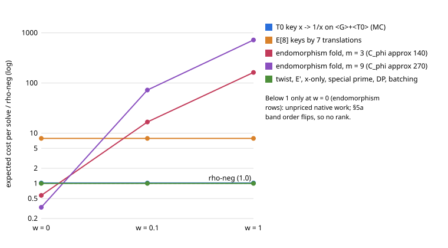

# Curve structure against rho-neg on the Curve25519-family miniature, k = 20 (2026-11-07)

**Class.** A derived lever audit with exact checks on one curve. No ecbench run: no lever survived
the checks, and the protocol ([PROTOCOL.md](PROTOCOL.md), frozen before any data) allowed a run only
for a survivor. Not a leaderboard or `benchmarks/` row. Every result sentence below is an unverified
assertion with no pcc claim id.

**Question (Track 2).** Is there a structure of these curves that makes a single-target ECDLP solve
cheaper than the lab's rho-neg in counted GAE, even if matched rho could use it too? The search is
adversarial to `curve25519_autolab_20261104/ideas/STRUCTURE-R4.md`, which concluded that every
structure is used by rho-neg, acts outside the order-r subgroup, or is priced as native work.

**Answer.** No lever lowers expected cost per solve below rho-neg across the w = 0, 0.1, 1 band on
this curve [pcc:unverified]. The only rows below 1 are endomorphism-orbit folds at w = 0, where the
endomorphism's field work is unpriced; at w = 0.1 the best of them costs at least 16.7x rho-neg, so
the §5a band order flips and no rank is admitted [pcc:unverified]. One correction to STRUCTURE-R4
came out of the checks: End(E) is Z[pi], not O_K, so the least non-scalar endomorphism degree is
772,948 (2134 sqrt(r)), not 1597 [pcc:unverified].

## 1. The curve

`y^2 = x^3 + 926 x^2 + x` over `F_p`, `p = 1,048,573`, `r = 131,203`, `sqrt(r) = 362.2`. The lab's
curve database was not reachable (no `ECDB_TOKEN`, no AWS access to `ecdb/api`), so every fact is
recomputed by `scripts/levers.py` (exact, pure Python, seed 20261107, 10 s) into `data/levers.json`.
The research-kb wrapper had no executable on this machine (`scripts/research-kb: no executable
found`), so the knowledge-base review is unavailable and no novelty claim is made.

## 2. Checks against the frozen predictions

All numbers in this table are measured by the named script, file `data/levers.json` unless noted.

| check | prediction | result | verdict |
|:--|:--|:--|:--|
| C1 `#E`, 2-part, twist | `8r`, cyclic `Z/8`, `4r'` with `r'` prime | `#E = 1,049,624 = 8r`; one rational 2-torsion abscissa (x = 0), v2 = 3; twist `1,047,524 = 4·261,881`, prime, `gcd(r, #E^t) = 1` [pcc:unverified] | passed |
| C2 `x(P + T0) = 1/x(P)` | all 10,000 samples | 10,000 / 10,000 [pcc:unverified] | passed |
| C3 `X(<G>) ∩ 1/X(<G>)` | empty | 0 of 65,601 abscissae; the translate set `x(<G> + T0)` equals `1/X(<G>)` exactly; translations by the order-4 and order-8 points: 0 hits in 2,000 samples each [pcc:unverified] | passed |
| C4 class counts | `(r − 1)/2` for every folded key | negation on `<G>`: 65,601; `{±P, ±P + T0}` on `<G> + <T0>`: 65,601 classes of size 4 [pcc:unverified] | passed |
| C5 draws to the first usable collision ÷ sqrt(r) | folded 0.886 ± 0.03, plain 1.253 ± 0.04 | plain 1.242 ± 0.015; negation 0.885 ± 0.010; T0 key 0.902 ± 0.010; `E[8]` key 0.872 ± 0.019 (600 trials); every recovered log checked [pcc:unverified] | passed |
| C6 endomorphisms | `lambda^2 = −1597 (mod r)`; least small-order degree ≥ 1597, order 10^6 | `t = −1050`, `t^2 − 4p = −4·1597·22^2`; `lambda = 23,879`, `lambda^2 + 1597 = 0 (mod r)`; least degree with eigenvalue of order 9: 69,197 granting `O_K`, 260,404,884 in `Z[pi]` [pcc:unverified] | passed as stated; the `O_K` grant is false (C6b) |
| C6b conductor of End(E) (added after C6, not frozen) | — | `pi` is not scalar on `E[2]` (C1) nor on `E[11]`: `gcd(psi_11, X^(p^5) − X)` has degree 5, not 60, with the positive control `X^(p^55)` giving 60 (`scripts/conductor11.py`, `data/conductor11.json`). So End(E) = Z[pi], conductor 22 [pcc:unverified] | new fact |
| C7 `E' = E/<T0>` | `8r`, full 2-torsion, `j ∉ {0, 1728}` | `#E' = 8r`; 2-torsion abscissae 0, 924, 928; `j(E') = 498,925` [pcc:unverified] | passed |
| C8 `j(E)` | `∉ {0, 1728}` | `j(E) = 481,878`, so Aut(E) = {±1} [pcc:unverified] | passed |

Derived from C6b: every endomorphism is `a + b·pi`, it acts on `<G>` as the integer `a + b` because
`pi` is the identity on `E(F_p)`, and its degree is `a^2 + t·ab + p·b^2`. The least non-scalar degree is
the norm of `pi + 525`, `1597 · 484 = 772,948` [pcc:unverified]. The embedding degree is the order of
`p` mod `r`: 131,202 = r − 1 (derived, one-line computation in this session) [pcc:unverified].

## 3. Lever table

"Factor" is expected cost per solve divided by rho-neg's, at w = 0 / 0.1 / 1 GAE per native operation
(AGENTS.md §5a). "MC" marks a factor from C5 (measured, `data/levers.json`); every other factor is
derived. `C_phi` is the native field-operation cost of one endomorphism evaluation.

| lever | mechanism, for this curve | factor on GAE (w = 0 / 0.1 / 1) | factor on wall time | verdict | evidence |
|:--|:--|:--|:--|:--|:--|
| automorphisms | `j ≠ 0, 1728`: Aut = {±1}, used by rho-neg | 1 / 1 / 1 | 1 | already in the baseline | C8 |
| Frobenius | `pi` is the identity on `E(F_p)`, so it folds nothing | 1 | 1 | closed | C6, C6b |
| T0 = (0, 0), `x -> 1/x` | `x(P + T0) = 1/x(P)` holds, but it maps `<G>` onto the other coset of `<G> + <T0>`. On `<G>` it merges nothing. On the order-2r group it gives classes of size 4, the same `(r − 1)/2` classes, so the same collision count | MC 1.019 ± 0.017 / ≥ 1.02 / ≥ 1.02 (one extra inversion per key) | about 1, plus the inversion | dead: class of size 4 only across cosets | C2, C3, C4, C5 |
| 4- and 8-torsion translations | not defined on the x-line (`x(P + T) ≠ x(−P + T)`); on points they leave `<G>`. Keys over `±P + E[8]` give `(r − 1)/2` classes of size 16 in a group of order 8r: the same count, at 7 charged additions per key | MC 0.98 per draw, 7.9 with the additions / same / same | worse | dead; projection by [8] (free Pohlig-Hellman) already gives this | C3, C5 |
| quadratic twist | `#E^t = 4r'`, `r' = 261,881`, `gcd(r, 4r') = 1`: a different group on the shared x-line | 1 | 1 | dead | C1 |
| 2-isogenous `E'` | `#E' = 8r`, `Z/2 x Z/4`, `j(E') ∉ {0, 1728}`. Classes `{±P + E'[2]}` on `<G'> + E'[2]` (order 4r) number about r/2: the same count. Transport costs a few field operations per point | 1 / ≥ 1 / ≥ 1 | 1 | dead | C7 |
| endomorphism-orbit fold (GLV-style classes `{±phi^i P}`) | End = Z[pi]; an endomorphism with eigenvalue of order m on `<G>` (m divides r − 1 = 2·3^2·37·197; m = 3 or 9 are the small ones) has degree at least 3.1·10^9 (m = 3, `8·47·823·10039`) or 2.6·10^8 (m = 9, `4·9·113·64013`). Classes of size 2m cut steps by sqrt(m); each step pays (m − 1)·C_phi native operations. Optimistic C_phi: sqrt-Velu on the prime factors, ≥ 140 (m = 3) and ≥ 270 (m = 9) | m = 3: 0.577 / ≥ 16.7 / ≥ 162; m = 9: 0.333 / ≥ 72 / ≥ 720 | far worse | dead: below 1 only while the field work is unpriced; band order flips; break-even w ≤ 0.0026 (m = 3) | C6, C6b; formula `(1 + w(m − 1)C_phi)/sqrt(m)` |
| smallest non-scalar endomorphism (GLV scalar splitting) | degree 772,948 = 2134 sqrt(r); one evaluation's field work exceeds the whole of rho at this size | 1 at w = 0 (only scalar multiplications shorten, set-up), > 1 at w > 0 | worse | dead | C6b |
| Montgomery x-only, differential addition | a rho step `P + R_j` needs `x(P − R_j)`, which a walk does not have; only ladders and progressions are differential, and a ladder costs 2 GAE per bit | 1 (walk) or > 1 (ladder) | field-level saving, equal for matched rho | dead in GAE | derived |
| `x(P ± Q)` from one square root | two points per operation is an accounting change unless each point is charged | 1 when charged | about 1 | accounting only | STRUCTURE-R4 §3 |
| negation walk with cheaper representatives | the representative `min(y, −y)` is already free in GAE; fruitless-cycle handling is walk overhead, not structure | 1 | small | already in the baseline | derived |
| distinguished points | parallelisation; single-target expected work rises by the tail `1/theta` | ≥ 1 | ≥ 1 (one core) | dead for one target | derived |
| tag tracing, Montgomery batch inversion | fewer field multiplications per step; still one group operation per step | 1 | < 1, equal for matched rho | wall time only | derived |
| special prime `2^20 − 3`, `p = 5 mod 8` | cheap reduction and one-exponentiation square roots | 1 | < 1, equal for matched rho | wall time only | derived |
| pairings, anomalous | embedding degree r − 1; `r ≠ p` | — | — | closed | derived |

`figures/lever_factors.svg` (from `scripts/make_figure.py`, values in `data/lever_factors.json`)
plots the five lever groups across w; only the endomorphism folds dip below 1, and only at w = 0
[pcc:unverified].

## 4. Where STRUCTURE-R4 was attacked, and what held

- **The T0 class of size 4.** It exists, but `T0` has order 2 and r is odd, so `P + T0` is never in
  `<G>`. The exact intersection count is 0, and the class count per group element is unchanged
  [pcc:unverified]. STRUCTURE-R4's statement holds.
- **Endomorphisms below sqrt(r).** STRUCTURE-R4 bounded the least degree by `|D_K|/4 = 1597`, which
  assumed End(E) could be `O_K`. The cyclic 2-part and the Jordan block of `pi` on `E[11]` put the
  conductor at 22, so the bound is 772,948 [pcc:unverified]. The conclusion holds with a 484x larger
  margin.
- **Counting at w = 0.** The one way to "beat" rho-neg in the counted unit is to move work into an
  unpriced endomorphism evaluation. The band rule exists for exactly this case, and the order holds
  in rho-neg's favour at w = 0.1 and 1 [pcc:unverified].

## 5. The ecbench test that would have followed

None is run. A surviving lever would have been tested as `rho.negation` against the lever variant on
one target per session, at least 16 sessions, `ecbench verify --replay`, a `bench.record/v1` record
per `docs/benchmark-records.md`, and `ecbench band` at w = 0, 0.1, 1, with the endomorphism
evaluation counted as named native work.

## 6. A non-structure observation (not a lever, not tested)

The lab's measured rho-neg at k = 20 is S = 1.447 (6 targets, T5 `ECBS1h405f20219036`) and 1.544
(16 targets, T12) at w = 0 (`research/curve25519_ic_atlas_20261104/REPORT.md` §6) [pcc:unverified].
The model constant is 0.886, and C5's class-collision draws reach 0.885 [pcc:unverified]. The gap of
about 1.6-1.7x at this size is walk overhead (jump-table and start set-up, distinguished-point tail,
fruitless cycles), not curve structure; any reduction is a better rho, which matched rho inherits
(derived, an unverified assertion). It is the only place on this curve where a solve cheaper than the
lab's rho-neg looks available, and it would be a rho-implementation result, not index calculus.

## 7. Limits

- One curve (k = 20). The algebraic facts (Aut, conductor, twist) differ by size; the class-count
  arguments do not.
- C5 draws uniform group elements through a table of the enumerated subgroup instead of walking; it
  checks class counts and collision usefulness, not walk overhead.
- `C_phi` lower bounds use sqrt-Velu's `sqrt(l)` per prime factor and ignore that the kernels live in
  extension fields; the true cost is higher, which only strengthens the verdict.
- C6b was added after the frozen checks; it is an exact computation with a positive control.
- No knowledge-base or ecdb review was possible on this machine.

## Files

`PROTOCOL.md`, `scripts/levers.py`, `scripts/conductor11.py`, `scripts/make_figure.py`,
`data/levers.json`, `data/conductor11.json`, `data/lever_factors.json`, `data/levers.stdout`,
`figures/lever_factors.svg`, `REPORT.pdf` (plain-text render of this README; no figure embedded).
