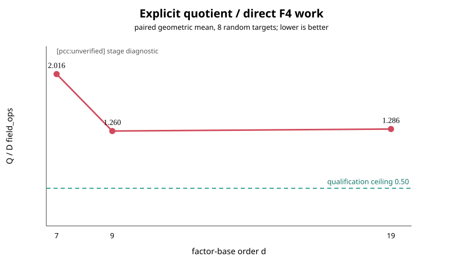

# Explicit quotient auxiliaries: a negative Curve25519 qualification

2026-11-25 · study `EXP-C25519-SYMREM-001` · native-Rust instrument
[`examples/curve25519_symmetric_remainder.rs`](../../examples/curve25519_symmetric_remainder.rs) ·
protocol [`PROTOCOL.md`](PROTOCOL.md), with pre-data amendments
[`AMENDMENT-1.md`](AMENDMENT-1.md) and [`AMENDMENT-2.md`](AMENDMENT-2.md)

**Verdict: stop before the gated `d=21,27,57` ladder and before `m=4`.**
Keeping the quotient of every multiplication modulo the cubic root polynomial
as two explicit variables lowers the maximum productive F4 degree from 5 to 4
on every random target, but the extra variables and equations cost more work.
At the frozen `d=19` decision point, the paired quotient/direct geometric-mean
work ratio is `1.2864624565`, with descriptive 95% paired-bootstrap interval
`[1.2864612925, 1.2864635223]`. The required upper endpoint was below `0.50`.

This is a stage diagnostic, `[pcc:unverified]`. It is not a total-work or
subexponential ECDLP result.

## Results

Random-target values below use eight exact target pairs per cell. `field_ops`
is the F4 engine's counted `F_p` multiply-add unit.

| d | direct mean `field_ops` | quotient mean `field_ops` | paired Q/D | max productive degree D / Q |
|--:|--:|--:|--:|--:|
| 7 | 43,405 | 87,503 | 2.015966 | 5 / 4 |
| 9 | 1,434,127 | 1,806,786 | 1.259851 | 5 / 4 |
| 19 | 1,643,659,599.25 | 2,114,506,365.625 | 1.286462 | 5 / 4 |

All 72 planned rows completed. There were no timeouts, memory kills,
degree-bound rows, exclusions, or invalid planted relations. All 24 planted
rows evaluated exactly and group-verified. Direct and quotient rows used the
same target scalar and affine point in every pair.

## Frozen gates

| gate | result |
|:--|:--|
| Correctness and zero invalid relations | pass |
| Candidate censoring no worse | pass, 0 vs 0 |
| At least 6 completed random pairs at `d=19` | pass, 8 |
| Upper 95% Q/D endpoint below 0.50 | **fail, 1.286464** |
| Productive degree lower by at least one on 6/8 pairs | pass, 8/8 |
| Build-work and peak-RSS ratios each at most 2 | **fail: RSS 2.4275**; build count 0.9838 |

The failed work-ratio gate alone closes the arm. The RSS failure independently
confirms that the lower degree was bought with too much state.

## What was tested

For distinct roots `w_i in mu_d`, both arms use
`q(X)=product(X-w_i)=X^3-e1 X^2+e2 X-e3`, the same binary
square-and-multiply schedule for `X^d mod q`, the same intermediate residues,
and the same symmetrized `S4` equation. The direct arm eliminates the quotient
at every multiplication. The candidate retains a degree-one quotient and
imposes five coefficient equations, keeping the membership gadget quadratic.

The first frozen coset `g=1` failed preflight because it supplied no planted
prime-subgroup target at `d=7`. Before any F4 row, the native search selected
the first admissible coset, `g=3`, with 4/10/34 distinct planted target
abscissae at `d=7/9/19`; Amendment 2 retains that failure and selection rule.

The root-polynomial chart represents only distinct abscissae. A complete
relation oracle would still require separately frozen repeated-root strata
`[2,1]` and `[3]`. This negative result gives no reason to build those charts
for this quotient-auxiliary arm.

## Reproduction and evidence

- `run_qualification.sh` runs the 72 cells in paired order.
- `raw/` contains one JSON row per cell.
- `evidence/analysis.json` is the native analyzer's decision record.
- `evidence/paired.csv` contains all 36 direct/quotient target pairs.
- `evidence/experiment.export.json` records the 72/72 flow.
- `preflight/` retains the failed fixture, coset search, exhaustive selftest,
  compile-repair provenance, unit tests, and binary hash.
- `evidence/report.typ`, `report.pdf`, `figure.svg`, and `figure.png` are the
  editable and rendered report assets. No JavaScript is used.
