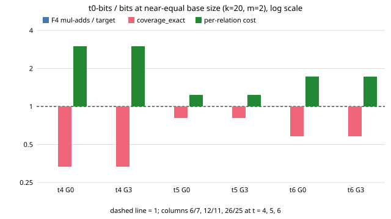

# Semaev S_3 in the T_0-invariant w = x + 1/x: F4 cost at m = 2 (lead E, 2026-11-02)

Class: component measurement of the `pkm-semaev` oracle (F4 over the bit tower). It claims no
change of any ranking and gives no distance to rho. Protocol: [PROTOCOL.md](PROTOCOL.md),
committed (a197a90b8f) before any cell ran. PDF: [REPORT.pdf](REPORT.pdf).

**Scope of every statement:** k = 20 miniature, one curve, m = 2, mode full, t in {4,5,6}
(X arm to 7), G in {0,3}, the offsets in the protocol, 100 random targets plus about 20
planted targets per cell, one seed per t. Nothing about m = 3 cost, other windows, other k or
curves, the 255-bit setting or a complete DLP.

## Answer

Writing the summands in w does **not** lower the solving degree or the F4 cost. In all six
primary pairs the solving degree, the polynomial size and the F4 multiply-adds per target are
equal (ratio 0.9999 to 1.0019). The reason is algebraic: the polynomial-in-w symmetrisation is
the Semaev polynomial of the 2-isogenous curve E/<T_0>, which has degree 2 in each summand
and total degree 4, the same as S_3. The factor 2^(m-1) of STRUCTURE.md is a statement about
the presentation `S_3/(z1 z2 z3) = (w1 w2 w3 - D)/2 - 2(w1+w2+w3) - 4A` that needs an extra
variable D_i with D_i^2 = w_i^2 - 4d (bilinear in (w_i, D_i)); that variable is not a bit-tower
variable and was not built, so the factor is neither confirmed nor refuted for that form.
At equal base size the closed base has fewer distinct sums, so the per-relation cost is higher
(1.2x to 3.0x). The one cell family where T_0 helps in the generic track (a 2x yield at fixed
columns) corresponds to the X arm here, which costs 5.7x to 23x more per relation.

## What was built

- `Membership::T0Bits`, `PkmSemaevOracle::new_t0_bits`, `T0Quotient`, `t0_factor_base`
  in `src/cryptanalysis/ic_framework/pkm_semaev.rs`; `from_spec` accepts `t0_bits=T[,lo=L]`.
- Derivation: with z = x - s (s = x_W(T_0)), d = 3s^2 + a, w = z + d/z; the quotient is
  y^2 = x^3 + a2 x + b2 at x = w + s, a2 = -3s^2 - 4d, b2 = 2s^3 - 8sd.
  N(w1,w2,w3) = S_3^{E/<T_0>}(w1+s, w2+s, w3+s). For d = 1: N (z2 z3)^2 = S_3(z1,z2,z3) S_3(1/z1,z2,z3).
  In Montgomery terms N = (Q - L)(Q' - L), Q = (W - D)/2, Q' = (W + D)/2, W = w1w2w3,
  L = 2(w1+w2+w3) + 4A, so N = sum_(i<j) w_i^2 w_j^2 - 4 sum w_i^2 + 16 - L W + L^2, with
  the leading coefficient in w3^2 equal to (w1 - w2)^2.
- Lift-back charged: target inversion, base map (set-up), two abscissa choices re-added through
  `lift_abscissae` on the group ledger; counters listed in the protocol.
- `curve25519_family f4cost` accepts `t0-bits[@lo]`; new subcommand `t0size`; `F4COST_PLANTED=n`
  runs n planted targets after the random ones; JSON gains `base_points`, `lo`, `solver_extra`
  (matrix size) and `planted_*`.
- Tests: `cargo test --release --lib pkm_semaev`: **test result: ok. 22 passed; 0 failed; 0 ignored;
  0 measured; 6086 filtered out** (8 new: quotient is the 2-isogenous curve; S_3-times-its-T_0-image
  identity; vanishes exactly on valid w-triples, exhaustive over F_229; degree equals the plain
  degree; F4 = grid = exact decomposable set on random and planted targets for windows (5,0), (6,0),
  (5,37) with guess 0/1/2; counters; m = 3; a base outside the window is refused).
  `cargo clippy --release --lib --bin curve25519_family -- -D warnings`: see the session log entry.
- Binary: `/home/user/frozen-bin/curve25519_family_leadE`, sha256
  `fa565fd4acf1da0695bdb271f12bbe88cd0064c4bb7be9b10898450a2f098846`.

## Table (all 17 cells)

`cols/pts` base columns/points; `deg` max solving degree; `terms` polynomial terms per
specialisation; mul-adds per target (F4, elimination only); matrix = max columns x max rows over
calls and max nnz; `cov` = `coverage_exact`; `per-rel` = mul-adds per target / cov; `hits/ver`
random-target relations / re-summed exactly; `pl` planted found/processed/exact; none capped,
none undecided. Cell names: `plain` = `bits` (lo 0), `t0` = `t0-bits` at the protocol's lo, `x` =
the secondary arm (cell name `x_tN` has bit-height N).

| cell | cols/pts | deg | terms | mul-adds/target | matrix | cov | per-rel | hits/ver | pl | capped | undec |
|---|---|---|---|---|---|---|---|---|---|---|---|
| plain_t4_g0 | 7/14 | 6 | 121.0 | 4046084 | 243x430, nnz 27671 | 9e-05 | 44238198883 | 0/0 | 18/18/18 | false | 0 |
| plain_t4_g3 | 7/14 | 4 | 22.0 | 88839 | 31x65, nnz 631 | 9e-05 | 971338996 | 0/0 | 18/18/18 | false | 0 |
| plain_t5_g0 | 11/22 | 6 | 256.0 | 127283713 | 848x1159, nnz 282072 | 0.00032 | 397619167682 | 0/0 | 17/17/17 | false | 0 |
| plain_t5_g3 | 11/22 | 5 | 64.0 | 3036910 | 120x186, nnz 6879 | 0.00032 | 9486946583 | 0/0 | 17/17/17 | false | 0 |
| plain_t6_g0 | 25/50 | 7 | 484.0 | 1753646633 | 3102x2787, nnz 1580643 | 0.00123 | 1420269748860 | 0/0 | 20/20/20 | false | 0 |
| plain_t6_g3 | 25/50 | 6 | 154.0 | 172426718 | 461x869, nnz 108622 | 0.00123 | 139647548220 | 0/0 | 20/20/20 | false | 0 |
| t0_t4_g0 | 6/12 | 6 | 121.0 | 4046079 | 243x430, nnz 27671 | 3e-05 | 132714438223 | 0/0 | 18/18/18 | false | 0 |
| t0_t4_g3 | 6/12 | 4 | 22.0 | 88839 | 31x65, nnz 631 | 3e-05 | 2914004853 | 0/0 | 18/18/18 | false | 0 |
| t0_t5_g0 | 12/24 | 6 | 256.0 | 127283651 | 848x1159, nnz 282072 | 0.00026 | 491176378800 | 0/0 | 18/18/18 | false | 0 |
| t0_t5_g3 | 12/24 | 5 | 64.0 | 3036908 | 120x186, nnz 6879 | 0.00026 | 11719163058 | 0/0 | 18/18/18 | false | 0 |
| t0_t6_g0 | 26/52 | 7 | 484.0 | 1757052672 | 3358x5541, nnz 2458293 | 0.00072 | 2452452998101 | 0/0 | 20/20/20 | false | 0 |
| t0_t6_g3 | 26/52 | 6 | 154.0 | 172425188 | 461x869, nnz 108639 | 0.00072 | 240667042206 | 0/0 | 20/20/20 | false | 0 |
| x_t5_g0 | 14/28 | 6 | 256.0 | 127284305 | 848x1159, nnz 282072 | 0.00027 | 463891188236 | 0/0 | 17/17/17 | false | 0 |
| x_t5_g3 | 14/28 | 5 | 64.0 | 3036911 | 120x186, nnz 6879 | 0.00027 | 11068109814 | 0/0 | 17/17/17 | false | 0 |
| x_t6_g0 | 22/44 | 7 | 484.0 | 1757104723 | 3358x5540, nnz 2459100 | 0.00078 | 2260170696869 | 0/0 | 19/19/19 | false | 0 |
| x_t6_g3 | 22/44 | 6 | 154.0 | 171995028 | 461x869, nnz 108616 | 0.00078 | 221237879148 | 0/0 | 19/19/19 | false | 0 |
| x_t7_g3 | 50/100 | 6 | 319.0 | 3459523546 | 1742x2809, nnz 730851 | 0.00277 | 1246977658839 | 0/0 | 19/19/19 | false | 0 |

Raw: [analysis/cells.jsonl](analysis/cells.jsonl) (derived), [cells/](cells/) (per-cell JSON, status
with `uptime`, empty stderr). Load average at cell starts: 1.3 to 1.8 (other lead and builds on the
box); no cell reached the 600 s cap, so no truncated samples; wall times (0 to 135 s) are not compared.

## t0-bits / bits, paired by (t, G), primary base pairs

| t | G | columns | degree | terms | mul-adds/target | coverage_exact | per-relation |
|--:|--:|:--|:--|:--|--:|--:|--:|
| 4 | 0 | 7 vs 6 | 6 = 6 | equal | 1.000 | 0.333 | 3.00 |
| 4 | 3 | 7 vs 6 | 4 = 4 | equal | 1.000 | 0.333 | 3.00 |
| 5 | 0 | 11 vs 12 | 6 = 6 | equal | 1.000 | 0.810 | 1.24 |
| 5 | 3 | 11 vs 12 | 5 = 5 | equal | 1.000 | 0.810 | 1.24 |
| 6 | 0 | 25 vs 26 | 7 = 7 | equal | 1.002 | 0.580 | 1.73 |
| 6 | 3 | 25 vs 26 | 6 = 6 | equal | 1.000 | 0.580 | 1.72 |

The column mismatch (one column, unavoidable: the closed base has an even number) is inside the
coverage ratios: at t = 5 the w base has one column more and covers 0.81 of the plain base, at t = 4
one fewer and 0.33. Matrix size is equal at t = 4, 5 and at G = 3 (nnz at t = 6, G = 3 differs by 0.02 percent); at
t = 6, G = 0 the w-form's largest matrix has 5541 rows against 2787 (nnz 2.46M against 1.58M), yet
the multiply-adds agree to 0.2 percent; the cause was not investigated.

## X arm (one column per class, bit-height t+1), against the plain arm with equal columns

| X cell | plain pair | degree X / plain | mul-adds ratio | coverage ratio | per-relation ratio |
|---|---|:--|--:|--:|--:|
| x_t5_g0 | t4 G0 | 6 / 6 | 31.5 | 3.00 | 10.5 |
| x_t5_g3 | t4 G3 | 5 / 4 | 34.2 | 3.00 | 11.4 |
| x_t6_g0 | t5 G0 | 7 / 6 | 13.8 | 2.43 | 5.7 |
| x_t6_g3 | t5 G3 | 6 / 5 | 56.6 | 2.43 | 23.3 |
| x_t7_g3 | t6 G3 | 6 / 6 | 20.1 | 2.25 | 8.9 |

## Predictions (frozen in PROTOCOL.md)

| | claim | outcome |
|---|---|---|
| P1 (E) | degree strictly lower in the w-form at G = 0, every t | **falsified**: 6=6, 6=6, 7=7 |
| P2 (D) | degree equal in all six pairs | **held** |
| P3 (D) | polynomial terms equal | **held** (121, 22, 256, 64, 484, 154) |
| P4 (D) | mul-adds ratio in [0.5, 2] | **held** (0.9999 to 1.0019) |
| P5 (D) | coverage ratio in [0.3, 0.75] | **falsified at t = 5** (0.81; the w base has 12 columns against 11); 0.33 and 0.58 inside |
| P6 (D) | per-relation ratio > 1 everywhere, in [1.2, 4] at t = 5, 6 | **held** (3.00, 3.00, 1.24, 1.24, 1.73, 1.72; band also held) |
| P7 (D) | X per-relation ratio > 3 in all five cells | **held** (5.7 to 23.3) |
| P8 | planted all found and exact, hits verified | **held**: planted 18/18, 18/18, 17/17, ... all cells found = processed = exact; random hits 0 in every cell, so `hits_verified = hits` is vacuous |

## Deviations and caveats

1. Base sizes cannot be matched exactly (even closed base versus 7, 11, 25 columns); mismatch one
   column, reported and priced through each arm's own coverage.
2. The first test run had two failures in my new tests (a planted target equal to T_0, which has no
   invariant, and an empty base at t = 3). Fixed in the tests only (skip T_0, t = 4); no oracle change.
3. The first frozen binary was rebuilt before any data to add matrix-size fields and the planted
   option; the cells use the second one (sha above). Source edits to `f4cost` JSON used a map
   insert because the `json!` macro hit the recursion limit.
4. `agrees_with_grid` gained a sibling `agrees_with_grid_skipping` (the original delegates to it);
   `montgomery_instance` delegates to `montgomery_instance_from`.
5. Random-target hits are zero in all 17 cells (coverage 3e-5 to 3e-3), so the exactness check on
   real runs rests on the planted targets and the unit tests.
6. One curve, one seed per t, no spread. Not measured: the (w, D) degree-1 presentation, m = 3 cost
   in the runs, other windows, G between 0 and 3, wall times.
7. The full t0size scan (162 KB) was not kept; the selection rule and chosen rows are in the protocol.

## Coordinator review (main session, 2026-11-02)

- **What was refuted, and what was not.** The w-form tested here writes each
  summand's w in bits and uses the symmetrised polynomial N of degree 2 per
  variable. For that form, the expectation of a lower degree at m = 2 is
  falsified in all six primary pairs: degree, terms and F4 multiply-adds per
  target are equal to within 0.2%. The STRUCTURE.md factor 2^(m−1) belongs to a
  different presentation ((w, D) with D² = w² − 4d), which was not built because
  D is not a bit-tower variable. That presentation is still open, not refuted.
- **Per relation, the w-form is worse here.** At comparable column counts its
  `coverage_exact` is lower (ratios 0.33, 0.81, 0.58), so per-relation cost is
  1.2–3× higher. The X arm, matched on w-class count, is 5.7–23× higher. The
  T_0-closed base that gave 2× on the generic track gives nothing to the
  algebraic oracle in these cells.
- **Why the F4 cost is identical.** Both forms put the same bit tower and the
  same S₃-shaped polynomial (degree 2 per summand, total degree 4) into F4, so
  F4 sees the same shape. What changes is only which points the bits name.
