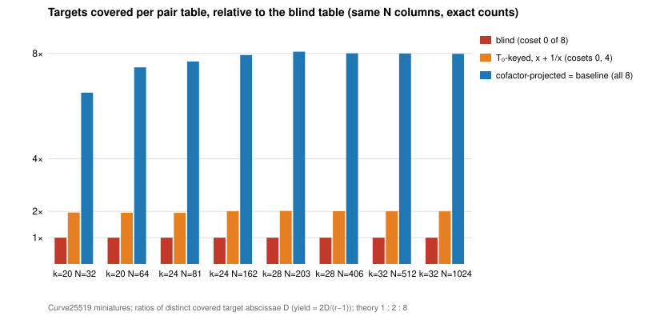

# T₀ symmetry in Curve25519-family relation collection (2026-11-02)

**Class:** a mechanism measurement with exact counts. It is a negative
result against the baseline and a 2× stage effect against the blind oracle;
no pipeline improvement is claimed. Protocol: [PROTOCOL.md](PROTOCOL.md),
frozen before any count. Parent study:
[`../curve25519_ic_baseline_20261102`](../curve25519_ic_baseline_20261102/README.md).
PDF: [REPORT.pdf](REPORT.pdf).

## What was tried

On `y² = x³ + Ax² + x`, the rational 2-torsion point `T₀ = (0,0)` acts on
abscissae as `x ↦ 1/x`, and `[8](P + T₀) = [8]P`, so `P` and `P + T₀` have
the same discrete log after the cofactor projection. A pair table keyed by the
invariant `κ(S) = x(S) + 1/x(S)` decomposes a subgroup target `R` when
`R = ±P_i ± P_j` **or** `R = ±P_i ± P_j + T₀`. The column count and the group
operations stay the same, and each table entry and probe costs one extra
(batchable) field inversion. `curve25519_family t0` builds the oracle, counts
covered targets exactly over every pair, and runs it on 200,000 random targets
per cell. Every hit is verified by point arithmetic.

## Result



| k | N | D blind | D T₀ | D projected | T₀ ÷ blind | projected ÷ T₀ | MC T₀ hits (verified) | z blind / T₀ |
|--:|--:|--:|--:|--:|--:|--:|--:|:--|
| 20 | 32 | 154 | 301 | 1003 | 1.955 | 3.332 | 953 (953) | 1.50 / 1.17 |
| 20 | 64 | 533 | 1037 | 3983 | 1.946 | 3.841 | 3124 (3124) | 0.45 / −0.67 |
| 24 | 81 | 851 | 1654 | 6552 | 1.944 | 3.961 | 305 (305) | −0.42 / −0.59 |
| 24 | 162 | 3268 | 6549 | 25956 | 2.004 | 3.963 | 1195 (1195) | −1.25 / −1.53 |
| 28 | 203 | 5101 | 10286 | 41158 | 2.016 | 4.001 | 120 (120) | −0.62 / −0.24 |
| 28 | 406 | 20483 | 41090 | 163978 | 2.006 | 3.991 | 469 (469) | −0.33 / −0.94 |
| 32 | 512 | 32755 | 65593 | 262030 | 2.003 | 3.995 | 54 (54) | 0.32 / 0.73 |
| 32 | 1024 | 131021 | 261982 | 1046489 | 2.000 | 3.995 | 194 (194) | 0.65 / −0.08 |

`D` is the number of distinct target abscissae covered, and yield is
`2D/(r − 1)`. Raw output: [`analysis/t0.jsonl`](analysis/t0.jsonl).

| prediction | outcome |
|:--|:--|
| Q1: T₀ ÷ blind in [1.8, 2.2] | **holds**, 8/8 cells (1.944 to 2.016) |
| Q2: projected ÷ T₀ in [3.6, 4.4] | holds in 7/8 cells. **Misses** at k = 20, N = 32 (3.332): with 32 base points the coset labels are uneven (coset 0 holds 154 of 1,023 sums against 128 expected), so the blind count, and with it T₀'s, sits above its mean. The ratio is at most 4 in every cell, so the conclusion stands. |
| Q3: every hit verified; MC within 4σ of exact | **holds**, 8/8 cells (all 6,414 T₀ hits verified, abs(z) ≤ 1.53) |

## Reading

- **The symmetry is real and the oracle works.** Keying by `x + 1/x` doubles
  the targets a blind table covers at no cost in columns or group
  operations. This is exactly the 2 of 8 cosets that `⟨T₀⟩` reaches.
- **It cannot improve the baseline in the generic-decomposition track.**
  Translation by any torsion point can recover at most the cofactor, 8×.
  Cofactor projection, which the baseline already uses, recovers all 8, and
  T₀ alone recovers 2. Measured, projection beats T₀ by 3.8 to 4.0× at every
  size with N ≥ 64. Keying by `x([8]S)` instead, which is invariant under
  all of `E[8]`, is projection again with 3 extra doublings per probe. So no
  ecbench arm was run, as the protocol states.
- **Where it does matter: algebraic decomposition.** A Semaev/PKM system
  needs a factor base with an algebraic description, such as "small x".
  Projection by 8 scrambles x, so that track cannot project and pays the
  full 8× cofactor penalty. There, closing the base under `x ↦ 1/x` gives
  the measured 2× in yield for free. It also gives the symmetry
  `S₃(1/x₁, 1/x₂, x₃) = S₃(x₁, x₂, x₃)/(x₁x₂)²` (unit-tested), which lets
  `S_{m+1}` be rewritten in T₀-invariant variables, the Faugère–Gaudry–
  Huot–Renault idea. The rest of the cofactor in that track would need
  the rational cyclic 8-isogeny `E → E/⟨T₈⟩`, whose x-coordinate is the
  `E[8]`-invariant key. These are proposals, not measurements.

## Next

1. On the algebraic track: a T₀-closed small-x base under `pkm-semaev` on the
   miniatures, against the same base unclosed. The predicted yield is 2×;
   the open question is the Gröbner cost of the symmetrised system.
2. The generic-track ratchet stays with the baseline's candidates (base-size
   retune, closed fiber), which T₀ does not change.

## Reproduce

```bash
cargo build --release --bin curve25519_family
for k in 20 24 28 32; do for n in <N_a> <2N_a>; do
  ./target/release/curve25519_family t0 $k $n 200000 $((2026110300+k)); done; done > t0.jsonl
./target/release/curve25519_family t0-figure t0.jsonl t0.svg
```

`N_a` = 32, 81, 203, 512 for k = 20, 24, 28, 32. Run time is under 1 minute per cell.
