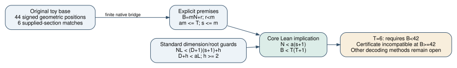

# Six section agreements versus a standard folded certificate

23 November2026. Conditional integer result and original toy-base audit.

The standard linear-algebraic folded-RS certificate has incompatible
dimension and root-count guards at length B>=42 when only six unfolded
agreements are available. Core Lean checks this implication. It restricts a
published sufficient certificate; it does not prove decoder failure outside
that guarantee. [pcc:unverified]

Let B=mN+r, r<m, 1<=s<=m, L=m-s+1. If a complete blocks agree and at most T
original positions agree, am<=T. For five-dimensional polynomial messages,
the standard guards are NL<(D+1)(s+1)+4 and D+4<aL. They imply N<a(s+1).
The formal statement allows any h>=2 in place of4. Since a>=1 gives m<=T,
B<m(N+1)<=ma(s+1)<=T(T+1). Thus T6 requires B<42, including discarded tail.
Five exact declaration bindings and final gate outputs are retained in
PROOF_MAP.md. Actual-curve geometry and code applicability are separate
proof obligations. [pcc:PCC-20261123-243ecb]

The Rust audit reconstructs the original p101/A95/q3/K8 base through native
membership/index witnesses. It retains both signs, excludes the two raw labels
with identity eightfold image, and obtains44 distinct signed geometric
positions. Cofactor aliases remain separate indexed columns. The supplied
normalized section has exactly six matches, with correct R-pole and -R
removable fibres; original TargetCircuit, raw-R and independent numeric
section replay agree. All21 pairs1<=s<=m<=6 fail even the optimistic standard
guards. It also records21 arithmetic-only cases at declared integer length
213156431*20633, without enumerating that base. [pcc:PCC-20261123-1b51f3]

Small controls include a genuine positive certificate at B6/m1/s1 and a
floor-only positive/full-certificate negative at B41/m6/s6. Three release
unit tests, fmt and strict all-target Clippy pass locally. Source101 is four
constituent archives, not a monolithic archive. Compiled hashes, binary
pre/post checks, write-once qualification records and actual shell transport
positive/collision controls are retained. One final native call exits0 with
no backend invocation or new root discovery. [pcc:PCC-20261123-1b51f3]

The complete native capture is a6584-byte lossless archive; source delta is
7732bytes. Both fit actual artifact policy. Local Lean pass is distinct from
unsigned attestations and independently signed standing. Earlier selected
elimination archives still await genuine upload credentials/receipts; this
component supplies no substitute receipt.

The polynomial-message/Artin model is optimistic and uninstantiated for the
elliptic section code. Cyclic torus labels alone do not supply a function-field
automorphism. Raw aliases require their actual agreement budget T, not an
assumed six. Rank-dependent interpolation, partial-block/list recovery,
different degree allocations and changed support models remain open.
[pcc:unverified]

Next, test the D<=1 rank-dependent escape with at most18 exact interpolation
columns on genuine original large-q rows; retain a full-rank minor/inverse or
a nullspace candidate with residual checks. This would discriminate one
natural-order low-degree space, not all decoders. A useful search algorithm
still needs q,K-dependent cold cost, original projection and full yield/rank/
selection/recovery accounting. NEXT.md specifies the proposed boundary; no
new campaign is scheduled. [pcc:unverified]

Sources checked: Guruswami [1106.0436](https://arxiv.org/pdf/1106.0436)
sections3.1--3.2/equations5--9/Theorem7; Guruswami--Rudra
[cs/0511072](https://arxiv.org/pdf/cs/0511072) section2.2;
Guruswami [0811.4139](https://www.ias.edu/sites/default/files/math/csdm/07-08/vguruswami_artin_automorphisms_cyclotomic.pdf)
sections1.2/3/6. Existing theory-v1 energy lemma already contains the
genus-two cover; its energy theorem remains unproved. Shaska--Voelklein
[math/0107142](https://arxiv.org/pdf/math/0107142) supplies classical background.
KB unavailable; unsuccessful primary retrievals and intended queries are in
PROTOCOL.md. No novelty is claimed for folding, the existing cover or the
elementary budget implication.
