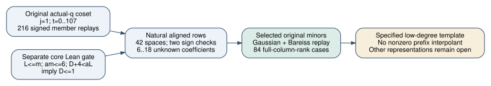

# Original-coset interpolation rank: the low-degree escape

23 November2026. Native finite-template certificates and a separate integer gate.

The fixed native audit records full column rank for all42 declared spaces in
both sign orientations (84cases) on ORIGINAL actual-q torus-coset rows. It
retains108 original parameters and216 signed membership/index/cofactor checks,
all selected minors, determinant inverses and full matrices. Gaussian and
separate Bareiss determinants agree;84 corrupted determinants refuse.
[pcc:PCC-20261123-4b28f6]

Public parameters are p=2^255-19, A486662, a60824497, q213156431, K20633,
j1 and t0..107. The original map checks both rational branches, requires one
admitted branch, and uses the smaller raw-v root plus its negative. No q1
replacement or planted target/section. z_t=h^(1+a*t), gamma=h^a, and received
r_t=-x_t*y_t. Natural blocks start at b*m, with offsets0..m-s; no wrap,
reordering or skipped bad positions. All intended original-member checks
complete. [pcc:PCC-20261123-4b28f6]

The optimistic classical template is Q=A0(X)+sum Ai(X)*Yi, degree A0<=D+4,
degree Ai<=D. For1<=s<=m<=6 and D0/1, the row consists of z_t powers and
z_t^d*r_(t+i). There are6..18 unknown coefficients. Positive/negative streams
are related by column signs; native determinant parity agrees. They are two
checks per space, not independent experiments. [pcc:PCC-20261123-4b28f6]

| m,s,D | Declared rows | Columns/rank, both signs |
| --- | ---: | ---: |
| 1,1,0 |108|6/6|
| 1,1,1 |108|8/8|
| 3,3,1 |36|12/12|
| 6,6,1 |18|18/18|

Conditional interpretation: full-column-rank prefix rows leave only the zero
homogeneous solution in that particular space. More rows containing them
cannot create a nonzero solution. This closes the defined rank-dependent
escape subject to correctness of the native field/matrix computations. It is
not a general decoder lower bound. The two recurrences share field primitives
and producer custody; no independent signed/native-rank formal proof follows.
[pcc:unverified]

The separate core Lean theorem checks L<=m, am<=6 and D+4<aL imply D<=1.
Final focused gate1named/0trusted and maintained local verification pass,
with propext only. Initial no-sources gate ran before the file was tracked;
its bound logs remain unchanged, separate from the successful final gate.
This is an integer implication, not native rank/geometry/code applicability.
[pcc:PCC-20261123-6a18e8]

One qualified600second/2GiB-cap call exits0; three release unit tests/fmt/
strictClippy pass before qualification. Native101 context is four constituent
archives, not a monolithic archive. Source/compiled4/binary pre-post and
write-once qualification/shell transport controls match. Full9739410-byte
capture roundtrips through a537824-byte archive. Actual policy selects it;
it is retained untracked pending genuine storage access/receipt. The native
statement binds summary/inventory, not unavailable remote bytes. No decoder,
unknown-root discovery, benchmark or paid/backend campaign occurred.
[pcc:PCC-20261123-4b28f6]

Outside scope are other cosets/orderings/alignments, signs chosen per position,
other coordinates/trivializations/weights/degrees, nonlinear and partial/list
interpolation. Polynomial-message applicability to the actual elliptic
section space remains uninstantiated. NEXT.md proposes deriving the original
received-symbol curve ideal and discarding universal identities before testing
informative nonlinear constraints. That successor is not implemented or
scheduled; q,K-dependent search cost and all original yield/rank/selection/
recovery obligations remain open. [pcc:unverified]

Sources: Guruswami [1106.0436](https://arxiv.org/pdf/1106.0436), section2.2,
equations4--8 and section2.3/Theorem7; official
[FLINT fmpz_mat](https://flintlib.org/doc/fmpz_mat/index.html) fraction-free
minor/determinant documentation. Prior frozen section3.1--3.2 locator is
corrected additively by709111; no old bytes changed. AMS Bareiss original
returned403 and is not claimed read. KB/conductor unavailable as recorded in
PROTOCOL.md. No novelty claimed for these classical primitives.
