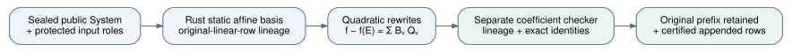
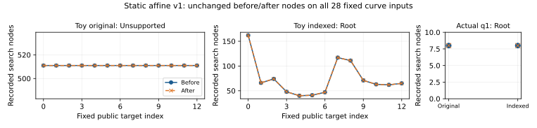

# One-pass affine consequences: certificates and a fixed-input null result

16 November 2026. Producer evidence, unsigned/unverified.

The new Rust component constructs an affine basis from the input's linear
equations, substitutes that basis into the original quadratics, and appends
certified consequences without removing original variables or equations. A
separate BigUint coefficient checker checks row lineage and each exact
telescoping identity before constructing the admitted output. Core native
PCC-20261116-313284; corrected thin-shell interface PCC-20261116-503900.
[pcc:unverified]

| Fixed curve domain | Before → after outcome | Before → after nodes |
|---|---|---|
| Toy original, 13 public targets | Unsupported → Unsupported, all 13 | 511 → 511 each |
| Toy indexed, same 13 targets | Root → Root, all 13 | 162,66,74,48,40,41,47,117,111,71,63,62,65 unchanged |
| Distinct actual-q1 original/indexed, two inputs | Root → Root, both | 8 → 8 each |

All 28 curve inputs retain outcome class and node count. This is a scoped null
result for this static pass. It does not establish equal decision traces,
runtime, complete work or memory; dynamic reduction and nonlinear inference
were not tested. Returned roots receive independent original-equation checks
and native indexed-row/group replay. [pcc:unverified]

For each pivot, the normalized row is `B_v = x_v − E_v`. Its lineage is a
constant linear combination of original linear rows. A quadratic rewrite is
checked coefficient by coefficient as `f − f(E) = Σ_v B_v Q_v`. Protected
semantic branching indices are not pivots, and protected-only side consequences
remain. This is one static pass, not branch-local elimination or F4. [pcc:unverified]

| Large actual-field input, static only | Variables retained | Input → output equations | Pivots | Solver calls |
|---|---:|---:|---:|---:|
| Original six-member circuit | 1059 | 1089 → 1174 | 37 | 0 |
| Indexed six-member circuit | 1989 | 2223 → 2548 | 157 | 0 |

Both outputs retain degree two and every original constraint. Compiler event,
pair and cumulative modeled reservation counters are partial diagnostics,
not cold work or live allocation measurements. [pcc:unverified]

The graph copies recorded values, all 28 fixed inputs; there is no sampling,
uncertainty model, timing or fitted scaling law. Plot data/source are adjacent.

## Exact domains, controls and provenance

Toy controls use p101/A95, h(17,12), a17/q3/k8, arity two, distinct raw columns,
with identity columns excluded and aliases retained. The actual-q1 control uses
p=2^255−19/A486662, h_new=h_old^213156431, a60824497/q1/k2, arity two: a distinct
two-column domain, not the huge original q213156431 factor base. The huge cases
are static certificate controls only. [pcc:unverified]

There are 34 sealed quadratic requests: 26 toy, two actual-q1, two huge static,
four small polynomial inputs. All receive checked certificates. Exhaustive Fp29
controls inspect 24,389 assignments/one accepted for a coupled three-variable
system, and 841 assignments each for conflict/zero accepted, nonlinear/28
accepted and protected-input/one accepted. Coupled Unsupported becomes Root;
conflict Unsupported becomes NoRootObservation; nonlinear remains Unsupported.
That last observation is not an absence certificate. Eight certificate
corruptions, original binding mutation, 11 malformed requests, oversized input
and seven forced cap classes are retained. The old Unsupported-child/other-child
root regression is a separate declared degree-four old-interface control.
[pcc:unverified]

First release unit controls passed with an unused import warning. A subsequent
strict-Clippy iterator-style failure and its source remain; final release build,
fmt and strict all-target Clippy pass locally. No qualified Rust/fixture edits
followed. The initial standalone interface invocations used a Python launcher,
contrary to the native-orchestration rule. Those exact receipts remain and are
excluded from final interface acceptance. The separately frozen thin shell
reran the same three positive and ten negative coefficient-file checks with
all expected exits, no new root search. See INTERFACE_PROVENANCE.md.
[pcc:unverified]

The 64-input context is composite: old 43-input v2 archive plus unchanged
six-input indexed and six-input worklist deltas, plus nine-input affine delta.
The final 2,710,656-byte executable has SHA-256
`54ad26145290b1228e4f45c6669176ae4b79ca17c7f187441bc9b6c2b7d1de7d`.
Complete core raw evidence is 283 files/16,263,777 bytes, one 146,256-byte archive
SHA-256 `ef5b561a184672f36ac9c2e12963f23d14d56aa731ea6e3d79f68968b3e2a875`.
The corrected shell round is separate, 1,576 bytes. Source manifests,
member hashes, pre-call receipts and reproduction commands are in
[FROZEN.md](../../affine-closure-v1/FROZEN.md) and
[REPRODUCE.md](../../affine-closure-v1/REPRODUCE.md). [pcc:unverified]

## Prior art, acceptance and next check

Shoup, *A Computational Introduction to Number Theory and Algebra*, v2,
§14.4, pp388–391, establishes elementary row operations and elimination:
<https://shoup.net/ntb/ntb-v2.pdf>. Repository fallback
`research/p256_aux_smooth_20261114/continuation_20261116/{REPORT.md,linear_reduce.cpp}`
already uses affine substitution/reconstruction. Mackworth1977 queue scheduling
informs the unchanged prior solver. No novelty is claimed for linear elimination
or telescoping identities. KB tools/wrapper unavailable; Magma handbook retrieval
returned 401 and was not read. These are source-access gaps, not novelty evidence.

| Requirement | Standing / next dependency |
|---|---|
| Public inputs, literal originals retained, checked coefficient certificates | Implemented; local native evidence, unsigned |
| Fixed curve branch reduction | Not observed on all 28 declared inputs |
| Huge original-base root discovery | Not attempted by this component |
| Complete cost/live-memory comparison | Open; partial diagnostics only |
| Formal/signed compiler and execution validation | Open |
| Raw artifact store publication | Requires genuine trusted receipt; see PUBLISHING.md |

Next: versioned branch-local affine reduction with certificate/rollback checks,
the same public inputs, root order and limits. It may expose new linear
consequences or reproduce this null result with added overhead. Price compilation,
certificate checking, parsing, containers, allocation, all failed branches,
original/replay checks and serialization before any performance claim. No such
campaign is scheduled by the CI checker. Canonical cost/exponent charts and
benchmarks stay unchanged because this stage adds no admitted performance datum.
The broader original-base/yield/selection/kernel/recovery contract and original
route criteria remain open. [pcc:unverified]

