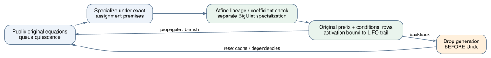
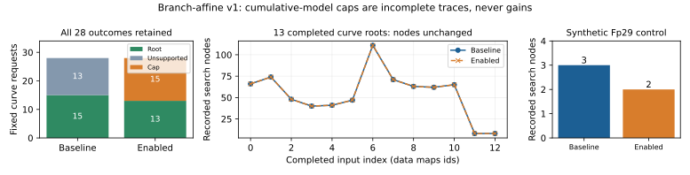

# Branch-local affine consequences: lifetime checks and a budget regression

16 November 2026. Producer evidence, unsigned/unverified.

The Rust bridge derives conditional affine consequences at propagation
quiescence. A separate BigUint path recomputes specialization, checks exact
assignment premises against a LIFO trace, and invokes the frozen static
coefficient checker. A generation is removed before any Undo. Every original
variable/equation remains a literal prefix. Native PCC-20261116-0c76bf;
separate native post-call reader PCC-20261116-10062c. [pcc:unverified]

| Fixed curve requests, n28 | Root | Unsupported | Cumulative-model cap |
|---|---:|---:|---:|
| Unchanged old v1 / disabled fork | 15 | 13 | 0 |
| Enabled branch-local bridge | 13 | 0 | 15 |

All13 original toy inputs reach the reservation cap, as do two previously
completed indexed inputs (toy00 and toy07). The11 other indexed toy roots and
two actual-q1 roots retain their baseline node counts. Thus this recomputation
variant adds no completed-curve node gain at this fixed budget and loses two
baseline roots to caps. A capped shorter trace is never a pruning gain or an
absence result. The64MiB ceiling concerns cumulative modeled reservations,
not measured live memory/RSS. [pcc:unverified]

Plots copy the native reader's RESULT.json; all28 curve cases remain. The
Fp29 conditional-root fixture, one synthetic control, changes3to2nodes and
discovers the z0 root before the old solver's z1 root. It is separate from the
curve outcome. No timing, sampling, uncertainty model or fitted scaling law.
[pcc:unverified]

## Interface, domains and correctness controls

The copied Off engine matches the unchanged old engine's full answers,
decisions, counters and schedule on33 systems (five small plus28 curve).
This guards the comparator; enabled reasoning can legitimately change the
root/trace. Inputs contain only a public System, semantic branch indices,
finite limits and mode. No root, label, sign, point list or scalar is a query
argument. Index-table construction is replay-only and is unpriced here.
[pcc:unverified]

Toy: p101/A95/h(17,12), a17/q3/k8, arity two,13 public image targets, distinct
raw columns with aliases retained and identity columns excluded. Actual:
p2^255−19/A486662, h_new=h_old^213156431, a60824497/q1/k2, arity two,
original/indexed inputs. This actual domain has TWO columns; the huge original
q213156431 six-member systems receive zero solver calls in this stage.
[pcc:unverified]

At quiescence before a nonunique branch or Unsupported exit, the bridge
recomputes a basis from specialized original equations, protects semantic
branch indices, and appends only admitted conditional rows. A row generation
is leased to its exact premise snapshot. Replacement and rollback discard it,
resetting dependency/cache/queue state. This version recomputes rather than
maintaining an incremental basis. The trace checker validates coefficient
identities/lifetimes and returned original assignments, not search completeness
or logical necessity of every decision. Native indexed-row/group replay is
retained for every returned curve root. [pcc:unverified]

Five Fp29 controls include coupled and protected linear systems, a conditional
root, a conditional contradiction then another branch's root, and an
underdetermined nonlinear system. Original truth enumeration is841 assignments
for each two-variable input and24389 for each three-variable input. Each
conditional generation is checked over every matching assignment; the
nonlinear control has28 original roots and remains Unsupported. Eight trace/root
mutations, seven forced caps and four malformed public requests are refused.
Removing Drop before Undo is an explicit corruption case. [pcc:unverified]

## Resource and source scope

V1 solver limits stay1024nodes/depth128/10000000 charged diagnostic events/
64MiB cumulative modeled reservations, with4096variables/8192equations/
32768terms/degree2. Additional pass cap1024 and trace-event cap65536 are finite
refusals. Recorded compiler work and specialization/rebuild/trace reservations
are charged; coefficient-checker internals, parsing/serialization, all actual
container/allocator costs, live storage and original/group replay are not
fully priced. These counters are not cold work or total field operations.
[pcc:unverified]

The98-input core context is composite: unchanged64inputs plus34new (six
Rust/Cargo files and28 exact request copies). All35 compiled bindings and five
source archive round-trips match. Retained executable SHA-256
`87e5872e4f5743884237b56b740a27be6f03c2e1127adde1ccf60c149ebcfb4f`.
Whole raw core:247files/110509160bytes in280300-byte archive SHA-256
`5332de1c3b6981ab664cc6e71b1c162996ac7ef812a572a382af5382b27896ad`.
Full source/member/pre-call bindings and commands:
[FROZEN.md](../../branch-affine-v1/FROZEN.md),
[REPRODUCE.md](../../branch-affine-v1/REPRODUCE.md). [pcc:unverified]

The core release library controls, strict all-target Clippy, fmt and build pass
locally. Qualified source/fixtures remain unchanged. One post-call Python
status-grouping diagnostic is excluded from report acceptance. A separately
frozen Rust reader instead hashes all247 raw members, compares33 old/disabled
artifacts and computes these totals. Its source/binary/39rlib bindings and
pre-call are separate from the98-input core. Initial native reader build failed
because the assumed release/deps directory did not exist; actual Cargo
build/out paths fixed the lookup without source changes. Complete logs and
11020-byte separate audit-round archive are retained. No solver rerun for
post-call aggregation. [pcc:unverified]

## Prior art and next gate

Soos, Nohl, Castelluccia, *Extending SAT Solvers to Cryptographic Problems*,
section3.2 pp248–249:
<https://www.msoos.org/wordpress/wp-content/uploads/2011/03/Extending_SAT_2009.pdf>.
Its GF2 solver invokes Gaussian reasoning at propagation quiescence, restores
matrices on backtracking, and distinguishes fewer explored branches from time
gains. These are prior methods, not a prime-field complexity result here.
Shoup NTBv2 section14.4 pp388–391 covers classical linear operations:
<https://shoup.net/ntb/ntb-v2.pdf>. KB MCP/wrapper unavailable; the guessed first
paper URL404 was corrected through the author's index, and the primary section
was read. No novelty claim for this hybrid mechanism.

This closes the fixed-control pruning claim for this recompute-every-quiescence
implementation and budget, while preserving the checked conditional-row
component. It does not disprove branch-local reasoning, other solvers or an
index-calculus family. Next: share the immutable original prefix and maintain
a bounded reversible linear component, accounting for row/certificate/checker
and allocation work before comparison. A depth cutoff needs a separately
frozen schedule; the cipher paper's cutoff is not validated for these inputs.
See [NEXT.md](../../branch-affine-v1/NEXT.md). No successor campaign is scheduled
by the CI checker. Canonical cost/exponent charts and benchmarks stay unchanged
because this stage adds no admitted performance datum. Original route criteria
and consumer source pin remain unchanged. [pcc:unverified]

