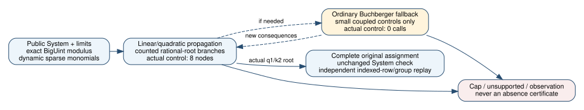
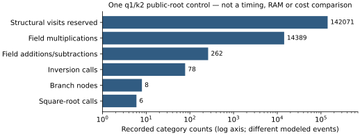

# Public-system root control for a sparse elimination baseline

The new isolated Rust solver returns a 71-variable witness satisfying 81
original equations and independent indexed-row/group replay for the declared
actual-field q1/k2, arity 2 control. The row is +column(1,0)+column(2,0).
Only public System/limits enter the solver. Native PCC-20261116-9dda07;
unsigned producer evidence. [pcc:unverified]

This is a TWO-column family with h_new=h_old^213156431, q1 and k2, over
p=2^255-19 on the existing curve. It is not the huge original q213156431
base, a six-member decomposition campaign or a DLP solve. The known-answer
constructor's labels/signs/witness are not supplied to the query.

The actual root uses 8 propagation branches, 0 Buchberger calls and0 pairs.
Thus this case demonstrates linear/quadratic propagation, not a Gröbner
speed result or a general degree 2 solving bound. Two small coupled quadratic
controls exercise the ordinary Buchberger fallback over Fp101 and the
actual prime. The implementation is not matrix F4. [pcc:unverified]

| Fixed check | Observed scope |
|---|---|
| Actual q1/k2 input | 71 variables, 81 equations, 243 terms; original root and indexed row replay |
| Coupled quadratic controls | Two fields; ordinary Buchberger exercised |
| Dynamic-index test | 1,100 declared variables,ONE constrained variable; exact large coefficient retained |
| Square-root cross-check | All101 Fp101 inputs plus five actual-field edges:106 agreements |
| Forced resource cases | Nine lowered caps distinguish refusal from absence |
| Higher-degree extraction | Cubic is explicitly unsupported |
| Original full six-member input | Immutable1059/1089 input,FORCED work 1 refusal; no full solve attempt |

These are fixed development controls. Returned roots receive unchanged
System and point/row replay plus mutation/truncation refusal. Negative
coefficient/index serialization and an even modulus reject; noncanonical
positive coefficient reduction preserves the field. No statistical target
yield is estimated. [pcc:unverified]

Actual-case counters record14389 field multiplications, 262 additions/
subtractions, 78 inversion calls, 6 square-root calls, 142,071 reserved
structural visits and 8 branch nodes. The156814 charged-event model and
5251936 cumulatively reserved represented bytes are not normalized GAE,
elapsed time or peak RSS. Original/group replay, parsing/serialization and
complete container/allocation overhead remain unpriced. Full-accounting
acceptance remains open; no performance ratio or exponent follows.
[pcc:unverified]

Source49 qualification reuses unchanged 43-input v2 plus five new crate
inputs and the immutable full-system gzip. The35180-byte delta, six
compiled-in pins and retained binary0e8c90e754ca308f324b90e4504cf17d2e5209218d07f6fcb0a692671e0d77d6
match. Release test/fmt/strict Clippy pass. First unused-import/source and
resource-admission audit versions remain retained. All standing remains
unsigned/unverified. [pcc:unverified]

Next: complete accounting and compare worklist propagation, then a redundant
unknown-index-bit augmentation against the original system on identical
public targets. Preserve all original guards and validate extension/
projection before using it. It trades algebraic extraction for explicit
solver work; index recovery remains charged inside that augmented solve.
See direct-elimination-v1/NEXT.md.

Sources: [PKM2016, sections4/5](https://people.maths.ox.ac.uk/petit/files/16PKC_primeECDLP.pdf);
[Kosters--Yeo](https://arxiv.org/abs/1503.08001);
immutable engine-source review3aeb9e/SOURCE_REVIEW.json. KB runtime unavailable;
primary texts/source were read. Existing low-degree composition and first-fall
heuristics do not supply a complexity bound for this fixed-six target law.
No novelty is claimed for the baseline algorithms. Canonical scoreboard/
timeline remain unchanged: no admitted performance datum was added.
