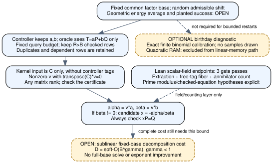

# Scalar-field cancellation and the cost of base testing

16 November 2026. Producer results; signed PCC standing unverified.

Three Lean scalar-field endpoints now check extraction, free mixed-label
fiber size and the annihilator count for a nonzero coefficient vector. They
reuse existing Mathlib and CryptoLean laws at the actual Curve25519 scalar
modulus, under an explicit primality hypothesis and the stated matrix/field
contracts. No statistical matrix-rank hypothesis occurs in those statements.
PCC-20261116-0bbe9a. [pcc:unverified]

## Requirement and evidence

| Goal component | Evidence delivered | Scope still open |
|---|---|---|
| Use Rust to make the route concrete | `tools/torus-energy`: exact calibration and finite reduction controls | Large-base sampling, decomposition and a fast sparse kernel implementation |
| Make rejection criteria precise | Finite energy-gap design and tag-dependent-kernel counterexample | Actual sampling-law instance, independent mathematical review |
| Price complete stages | Birthday test's quadratic RAM exposed; bounded-restart alternative written | Geometric average, solver cost, family generation and full charged pipeline |
| Formalize feasible mathematics | Three scalar-field endpoints; three new Core block-size inequalities | Actual point-group and retained-row selection bridges |

These are component results. They do not establish the requested novel
index-calculus breakthrough. [pcc:unverified]

## The statistical rank hypothesis was stronger than necessary

The controller samples a,b uniformly in F_ell, keeps both coefficients and
their generating seed out of the decomposition and kernel inputs, and submits
T=aP+bQ to the oracle. Every returned curve relation is checked. For R>B
successful rows C, choose a nonzero left-kernel vector v from C alone.
Conditional on the targets/rows, the private b tags remain uniform. Exactly
one choice of a nonzero-coordinate tag makes v*b zero after all others are
fixed. Thus scalar extraction has a 1/ell denominator failure under this
sampling/selection model, without requiring full matrix rank.
This conditional argument is [written separately](../../energy-test-v1/RANKFREE_REDUCTION.md)
and remains subject to independent review and its full sampling bridge.
[pcc:unverified]

The matrix/counting [Lean project](../../lean-kernel/README.md) instantiates
`SingleRelation.recover_from_relation`, `mixed_label_fiber_card`,
`Matrix.dotProduct_mulVec` and the existing kernel-cardinality law. The
[gate](../../lean-kernel/gate-v1/) passes three endpoints with only propext,
Classical.choice and Quot.sound, and zero trusted-native exceptions. It is
not a proof that an actual oracle receives no private tags or that real
retained rows follow the claimed law. [pcc:unverified]

The [finite native controls](../../energy-test-v1/rankfree-control-v1/)
exhaust 125 tag vectors over F5: 25 annihilated denominators and 100 correct
known-secret candidates with a tag-blind kernel. A tag-dependent kernel
annihilates all 125. Two actual-Curve25519 fixtures, with full-column-rank and
rank-one matrices, check every group row and the final known scalar 1234567.
No unknown DLP is solved. The example's dimension-capped Gaussian elimination
is cubic; it does not implement the sparse bound. PCC-20261116-ab1a1d.
[pcc:unverified]

## An optional birthday test has a real space cost

The [draft](../../energy-test-v1/PROOF_DRAFT.md) proposes a gap test for
C<=100W0 versus C>=576W0, with no promise between. A block of
n=floor(sqrt(W0)/40) samples yields a collision flag. The endpoint flag
probabilities are <=1/32 and >=1/17 under the IID moment argument. For 8192
independent blocks, accept at at most 341 collision flags. Native exact
integer binomial tails at those endpoints are each <=2^-20. This is a
calibration of a proposed test, not a measurement of any actual base.
[pcc:unverified]

[Calibration and native controls](../../energy-test-v1/control-v1/) include
four unit tests and two algebra-only identity tests. The native planner gives
268951465398242860562463204936310 samples per block and a total ceiling of
2203250404542405513727698574838251520 at the actual torus parameters.
Neither base sampling nor a solver was invoked. Its retained labels need
quadratic RAM in the factor-base size; matching a time exponent does not
satisfy the intended linear-memory profile. PCC-20261115-95e243.
[pcc:unverified]

The [Core arithmetic endpoint](../../lean/Arithmetic.lean) checks n>=2,
1600n²<=W0 and W0<=2304(n-1)². The new receipt passes all seven declarations
in the file with no axioms or native exceptions; only the three new integer
inequalities are claimed by PCC-20261116-b8586d. They are not probability
theorems. The algebraic variance simplification has native identity certificate
IDC1hf141ff81c695aa6e; its IID interpretation is outside that certificate.
[pcc:unverified]

## Bounded restart proposal and remaining exponent condition

If the earlier geometric average and planted-hit assumptions imply a constant
fraction of good bases, the attack can choose a base uniformly and give it a
fixed complete budget before restarting. It need not run the birthday test
to identify good bases. With the proposed good-base yield, R=L+1 checked
rows can be targeted with ceil(800*ell*R/W0) oracle queries, retaining all
failures and limiting every attempt. The sampling and algorithmic assumptions
are explicit in the reduction draft. [pcc:unverified]

Known black-box linear algebra handles singular matrices without a statistical
full-rank assumption. Padding C^T with zero rows preserves its kernel.
The cited soft-quadratic sparse bound is separate from our cubic control
implementation. A common factor-base column universe is essential: changing
to fresh columns per target invalidates R>B. [pcc:unverified]

The conditional time balance remains 2/(5-gamma) if D=soft-O(B^gamma),
gamma<1, and all geometric, family-generation and full-phase bounds hold.
No such decomposition-cost bound or admitted timing has been obtained.
The isolated full-base runner and live spend/capacity readback remain required.
Canonical performance graphs are unchanged. [pcc:unverified]

Sources: [DGPP, section 2.1, Lemmas 2–3](https://arxiv.org/abs/1611.03579),
[Petit–Kosters–Messeng, section 2.1](https://people.maths.ox.ac.uk/petit/files/16PKC_primeECDLP.pdf),
[Kaltofen–Saunders, section 4](https://users.cs.duke.edu/~elk27/bibliography/91/KaSa91.pdf),
[RFC 7748](https://www.rfc-editor.org/rfc/rfc7748).
These established techniques are not claimed as novel. Initial Goldreich-note
fetch returned HTTP 503; DGPP's primary paper was downloaded and read instead.
