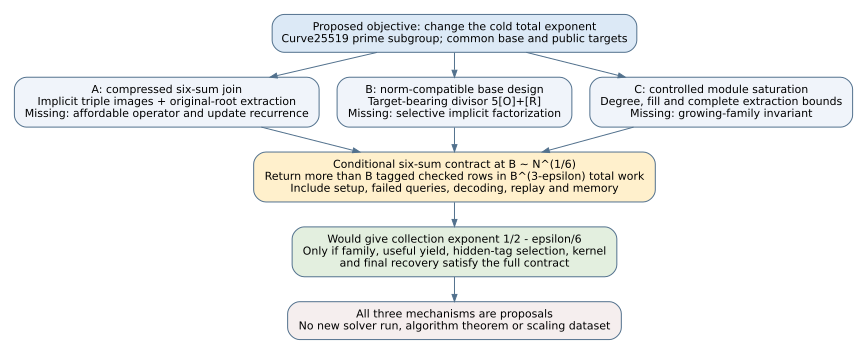

# Exponent-moving mechanisms: a theorem-first research portfolio

17 November 2026. Analytical search and proposed priorities; no experiment,
solver call, timing, scaling fit or new algorithm implementation. Mathematical
derivations below are producer assertions, unsigned/unverified. They are not
new attack bounds. [pcc:unverified]

**Priority:** seek a compressed, witness-producing six-sum join on a compact
algebraic base. Its concrete target is more than B checked, privately tagged
relations in total work below B^3 at B=N^(1/6), including setup. Plain triple
enumeration already consumes the square-root budget. Norm-based base design
and a family-wide solving-degree argument are two distinct ways to try to
obtain the missing compression. These are research nominations, not claims
that such compression exists. [pcc:unverified]

## Request and evidence boundary

| Requirement | This search delivers | Still required |
|---|---|---|
| Find exponent-moving ideas | Three detailed mechanism cards and a secondary arithmetic lead | A working algorithm or theorem crossing a threshold |
| Explain what would count | Saturated-yield envelope, batch contract and scoped rejection rules | Admissible family, useful yield and complete costs |
| Use existing Curve25519 work | Exact original parameters, old solver/audit results and prior-art comparison | Full-base root discovery |
| Make the plan reviewable | Markdown, editable diagram and inspected PDF in the existing lane PR | Independent mathematical review |

The curve is E: v^2=u^3+486662u^2+u over p=2^255-19, with cofactor 8 and
prime subgroup order N=2^252+27742317777372353535851937790883648493.
The existing original large circuit uses a=60824497, q=213156431, k=20633,
six members, 1059 variables and 1089 equations. Its original source, raw
evidence, ROUTE_CRITERIA.md and ROUTE_CRITERIA_V3.md retain their bytes.
No current fixed base is silently identified with B=N^(1/6). The earlier
scaling report explicitly records that cardinality gap. [pcc:unverified]

## 1. The exponent contract

Let B=N^beta be the common column universe and m a **fixed** arity. Let D be
expected work per attempted public-target decomposition, including failures,
root lifting, index/sign recovery and checking. Let y be the probability of
a checked returned decomposition. Setup P, kernel work K and final recovery H
are charged to one cold DLP. The conditional accounting is

    C = P + O(B) D/y + K + H.

O(B) accepted rows suffice for the existing controller-private coefficient
protocol if its hypotheses hold: use R>B rows over a common base, choose a
nonzero left-kernel vector from the rows alone, and keep coefficient tags
hidden from the oracle and selection/kernel routines. The protocol does not
need independent or full-rank rows. Its actual point, selection, restart and
cost bridges remain obligations; homogeneous collisions alone do not supply
private target tags. See RANKFREE_REDUCTION.md. [pcc:unverified]

Suppose D=soft-O(B^gamma), y is at least an inverse-subpolynomial factor times
N^(-eta) min(1,B^m/N), and P,K,H have exponents sigma, lambda, delta.
Here eta>=0 records an extra useful-yield loss beyond the proposed geometric
law. Uniform conditional trial bounds or a justified stopping analysis must
support use of D/y. Then the proposed upper-bound envelope is

    alpha = max(sigma, lambda, delta,
                (1+gamma) beta + max(0,1-m beta) + eta).

This is a conditional formula, not an empirical estimate. If eta=0,
P+K+H=soft-O(B^2), gamma>=0, and m>=2, minimization gives

    0 <= gamma <= 1:   beta*=1/(m+1-gamma), alpha*=2/(m+1-gamma);
    1 <= gamma <= m-1: beta*=1/m,           alpha*=(gamma+1)/m.

For gamma>m-1 the infimum over positive beta is instead 1 as beta approaches
zero; the second formula must not be extrapolated into that range.

Derivation: below beta=1/m the collection line is
1-(m-1-gamma)beta; above it the line is (1+gamma)beta. For gamma<=1,
the first line meets 2beta at or below 1/m; their maximum decreases then
increases around that intersection. For 1<=gamma<=m-1, the 1/m boundary
minimizes the maximum. At gamma=m-1 it can also be attained below that
boundary. No uniqueness is claimed. [pcc:unverified]

| Arity | Strict query target in this model | Illustrative conditional point |
|---|---|---|
| 4 | gamma<1 | gamma=1/2, beta=2/9, alpha=4/9 |
| 6 | gamma<2 | gamma=3/2, beta=1/6, alpha=5/12 |
| 8 | gamma<3 | gamma=5/2, beta=1/8, alpha=7/16 |

These illustrative points already occur in scaling-audit-v1; they are not
new results. For the six-sum point, eta adds directly to 5/12 at beta=1/6:
the margin disappears at eta=1/12, even before extra setup or kernel work.
A family-wide argument must bound every term. Fixed-size constants and memory
remain important separately. An exponent is defined along a declared growing
family, not by the single number 255. [pcc:unverified]

## 2. Lead A: implicit six-sum joins with witness extraction

**Mechanism.** Exploit compact torus/coset constraints and the actual elliptic
addition correspondence to manipulate an implicit triple-sum image, instead
of listing its B^3 signed triples. Explore quotient-ring modular composition,
structured resultants and multiplication/translation operators with low
displacement complexity. Ordinary matrix rank is not a speed criterion:
full-rank Fourier matrices still have fast algorithms. [pcc:unverified]

**Concrete object.** For a declared base map Phi and public target T, the
relation is

    Phi(z1)+Phi(z2)+Phi(z3) = T-Phi(z4)-Phi(z5)-Phi(z6),

with every zi satisfying its original coset/index constraints. Phi includes
the actual chart, square-root choice, cofactor clearing and signed point.
It is not replaced by torus multiplication. All sign branches, poles,
identity exclusions and distinct raw-column guards are retained.

Seek an exact **existence or counting operator** on this restricted domain
with a compressed representation stable under fixing index prefixes. Couple
it to self-reduction to recover original roots. Boolean existence or exact
integer counting is required; a zero count modulo one field characteristic
does not certify emptiness. Construction, every restriction, false candidate,
decoding step and independent original-row replay are charged.

**Success condition.** Give a public-coordinate algorithm that, for a common
base B~N^(1/6), processes controller targets with hidden independent tags and
returns R>B checked rows in total soft-O(B^(3-epsilon)) work for a fixed
epsilon>0, with setup no larger and memory declared. This would contribute
an exponent 1/2-epsilon/6; the other phases must fit. An alternative per-query
bound gamma<2 under the stated yield law also crosses the model threshold.
No such operator, algorithm or family theorem has been supplied.
[pcc:unverified]

**Next discriminating derivation.** Specify the operator entries directly
from public coordinates and compact base constraints; exhibit the exact
compressed representation, update rule and root-extraction recurrence. Prove
its storage/work bound before implementing a new solver. [pcc:unverified]
A matrix-multiplication
exponent is useful only after an actual reduction with affordable entries,
construction and witness recovery; writing a cubic tensor changes no cost.

**Reject or revise this instantiation if** it materializes all triple sums,
expands a cubic coefficient array, needs unknown logarithms as labels, or its
update/root-extraction recurrence costs B^3 or more at the selected model
point. This rejects that algorithm extension, not every compressed join.

**Degree warning.** A nonzero rational function on E that vanishes on s
distinct triple sums has pole-divisor degree at least s, since principal
divisors have degree zero. If that support has size Theta(B^3), an ordinary
dense annihilator cannot have subcubic coefficient storage. This is conditional
on the support size and applies to explicit dense representations. Compact
high-degree circuits or a different operator are not excluded.
[pcc:unverified]

**Prior art.** PKM2016 section 5 already asks for dedicated generalized root
finding. Fast multipoint evaluation takes an explicit coefficient vector and
does not construct a compressed eliminant or discover roots. The repository's
ecdl-tensor-ic already has counting-to-search; its implemented contractors
enumerate exponentially and its proposed fast contractor is missing. The new
task is a concrete operator for this compact algebraic base with a full cost
bound, not a new name for tensor contraction. See SOURCES.md.

## 3. Lead B: design the base and the relation generator together

**Mechanism.** Look for a base whose membership polynomial interacts directly
with norms of low-pole functions on E, rather than hoping that compact torus
membership alone makes elliptic sums easy. In its affine quadratic function
field, a numerator A(u)+v B(u) has norm

    A(u)^2 - (u^3+486662u^2+u) B(u)^2.

Search for a compact, compositional or norm-compatible base polynomial for
which constrained factorization of such norms can be performed implicitly.
Restore denominators and full divisors: this displayed numerator by itself
does not specify the target relation or signed ordinates.

**Target-bearing construction.** For public R, use a function with full pole
divisor 5[O]+[R] and six rational zeros in the declared base. The principal
divisor identity implies their elliptic sum is R. Riemann--Roch gives dimension
six for L(5[O]+[R]); it does not find a function with those zeros. Require full
pole order, rationality, orientation, multiplicity and every original guard.
Sampling R with private controller coefficients can supply the tag bridge.
[pcc:unverified]

**Success condition.** Construct the base, implicit norm-factorization
algorithm and uniform useful-yield bound so that the complete costs meet
Lead A's batch contract or the four-/six-sum query threshold. Count base
construction, gcd/factoring/coefficient expansion, all rejected functions,
overlapping columns and kernel work.

**Next discriminating derivation.** Write one exact symbolic norm/base identity
and an extension/projection map to the original signed relation, followed by
its cost and useful-target coverage. Seek overlapping relations, rather than
disjoint blocks manufactured by declaring a base from known zeros.

**Reject or park this instantiation if** it only factors functions with planted
zeros, generates homogeneous relations without a DLP reduction, or samples
essentially uniformly from an unrestricted function space. Under the usual
uniform-divisor heuristic the latter's base-supported zero probability is
about (B/p)^6, up to fixed-arity factors, so blind sampling offers no proposed
gain. That heuristic is a warning, not a proved lower bound. Small defining
functions alone supply neither target coverage nor usable tagged rows.
[pcc:unverified]

**Prior art.** Function-field index calculus, divisor relations and
compositional factor bases are classical. Diem2011 has an actual subfield
mechanism over extension fields; Fp has no proper subfield. The 2020
quasi-subfield paper's characteristic-power structure does not instantiate
an intermediate subfield over this prime field. A new substitute needs its
own bound; neither paper certifies this proposal. See SOURCES.md.

## 4. Lead C: a family-wide saturation/extraction bound

**Mechanism.** Use affine quotienting and selected polynomial multiples only
as components of a degree-controlled module algorithm. Seek a bound on the
number of admitted monomials, fill, coefficient bit sizes and complete root
extraction across the family, including predominantly inconsistent targets.
The next affine-quotient audit remains a proposed support test, not the
exponent mechanism itself.

**Success condition.** If the admitted matrix dimension is M(B), a dense
M^omega cost already requires M^omega=o(B^2) for the six-sum per-query target,
with construction, filling, consistency decisions and extraction included.
Sparse alternatives need their own total bound. A uniformly bounded solving
degree with O(log B) variables would be one possible ingredient, but only if
the actual encoding, all field/range constraints and complete extraction
justify that bound. A cheap first fall is insufficient. [pcc:unverified]

**Next discriminating derivation.** Establish an exact invariant preserved by
the multiplication/reduction schedule and an extraction theorem with cost.
Then test its predictions on the immutable actual equations with original
guards, under a separately admitted protocol. The original constant-row-space
audit found no new input-only relations; it excludes only that fixed linear
combination space. It says nothing about a whole polynomial ideal or every
representation. PCC-20261117-f9b20c is unsigned/unverified.

**Reject or revise the stated bound if** it fails on one member of its claimed
universal domain, requires a planted index/sign, or omits higher-degree fill,
field equations or expensive root cases. A cap/timeout parks that implementation;
it is not a universal solving-degree or complexity lower bound. Kosters--Yeo's
first-fall analysis is a reason to require the stronger invariant.

## 5. Secondary lead and tempting shortcuts

**Arithmetic small roots.** A small-height base could exploit p=2^255-19 and
the integer coefficients of Montgomery/Edwards equations. Before nominating
a lattice solver, provide the exact integer lift, height bounds, independent
short polynomials, carry variables and determinant/root-isolation analysis.
Target coefficients are generally full-size. Classical univariate modular or
bivariate integer small-root results do not automatically cover a multivariate
modular summation system. The existing joint-smallroot-native work is prior
art to review before implementation. This lead is secondary because that
bridge has not been supplied. No new lattice run is requested or scheduled.

**Wagner-style filters.** Wagner treats integer modular sums via intervals as
well as quotient-group versions. Therefore prime order alone does not reject
all generalized-birthday algorithms. On elliptic points, however, a coordinate
hash is not a compatible scalar interval. Any exact homomorphism from C_N to
a group with no N-torsion is trivial: N*phi(P)=0 forces phi(P)=0. Thus a small
exact additive torus/bit tag cannot simply be assumed. Approximate/nonlinear
filters remain possible research, but must supply conditional selectivity,
efficient joins and root retention. Accessible scalar-log labels cannot be
assumed. Wagner's generic-group limitation applies to generic operations;
these leads must use the concrete representation. [pcc:unverified]

**Charts, twists and isogenies.** Give exact subgroup transport and a changed
degree, arithmetic-height or operator-cost argument. A fixed-degree bijection,
a bounded automorphism fold, fewer terms at unchanged relevant degree, or
more cores supplies no exponent argument by itself. Twisting to another DLP
without a recoverable transport map changes the problem.

**Larger arity or caps.** The existing reference solver enumerates signed
triples. At B=N^(1/6), its B^3 setup has exponent 1/2 before later phases.
Increasing its caps does not meet Lead A. Batch reuse within one DLP is
allowed, but all setup is charged; dividing cost over unrelated target DLPs
is not the cold single-target claim.

## 6. Execution order and criteria

1. Work first on Lead A's exact compressed operator and recurrence. An actual
   root-producing subcubic algorithm is the deliverable, not a smaller circuit.
2. In parallel only as a conceptual alternative, derive one norm-compatible
   construction for Lead B. No parallel agents or jobs are launched by this plan.
3. Use the affine quotient only where it can test a stated invariant for Lead C.
   Register its predictions and limits before any experimental comparison.
4. Before escalation, give a growing admissible family, actual base cardinality,
   target law, useful-yield floor, common columns/private-tag selection,
   kernel/recovery bounds, memory and complete cold accounting. Implementation
   of research algorithms will be Rust/native under existing qualification rules.
5. Follow the unchanged consumer ROUTE_CRITERIA_V3.md: exact counterexample,
   proved scoped exclusion, rejected finite quantitative promise, implementation
   parked, invalid experiment or open. [pcc:unverified]
   Failure of one compressed representation
   is not disproof of all index calculus. T2 evidence separately needs the
   registered six-size/24-order-bit/held-out and validation requirements.

These are ordered mathematical tasks, not an admitted experiment protocol.
No EKS allocation, paid run, solver campaign, source test or broad library
rerun occurred in this search. The wider scientific objective remains open.

## Sources, status and graph review

See [SOURCES.md](SOURCES.md) for primary passages, failed fetches, bounded
repository review and novelty scope. Sources checked (KB): unavailable; no
research-KB MCP is loaded and scripts/research-kb exits 127. Exact Git objects
and primary sources were the fallback. Conductor exits 127; its documented
unconfigured fallback is warning-only. No reservation or delegation is claimed.

Existing docs/index-calculus-scoreboard.html, docs/ic/progress-timeline.json,
docs/ic-leaderboard.html and the study scaling/report diagrams were considered.
This proposal adds no measured result, promoted score or established map edge;
their data/rendered copies stay unchanged. This proposal's diagram explicitly
labels all mechanisms as proposed. No performance benchmark row is added.
