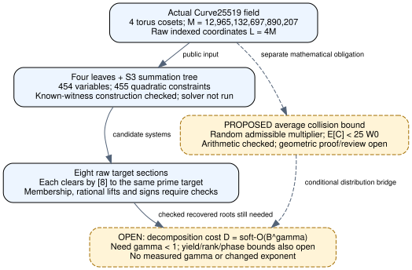

# Four-point torus construction and conditional exponent target

15 November 2026. Producer evidence; PCC standing unverified.

The Rust compiler now represents a four-point decomposition over the actual
Curve25519 field with 454 variables and 455 degree-two constraints. The
archived known witness satisfies every equation. Eight raw preimages of
the cofactor-cleared target are constructed and checked separately.
No large-base solver was invoked. [pcc:unverified]

## Request and evidence

| Requested work | Current deliverable | Remaining acceptance condition |
|---|---|---|
| Use Rust in isogeny-labs crypto and cryptanalysis | Shared `torus-s4-tree` compiler; bounded root-recovery consumer | Independent verification and admitted full-base runs |
| Search a route capable of changing an exponent | Four-point route and conditional target below | Solver gamma<1 plus complete family/phase bounds |
| Define when a route is disproved | Consumer `ROUTE_CRITERIA.md` with theorem/counterexample/statistical rejection rules | Apply only to an explicit frozen proposition |
| Go larger | Actual 255-bit field, four cosets, four leaves and all eight raw sections | Full-base solving remains pending; construction is not a timing |

These are component deliveries, not completion of the requested cryptanalysis.

## Exact instance and controls

E: v²=u³+486662u²+u over p=2^255-19; standard order 8*ell with
ell=2^252+27742317777372353535851937790883648493. Membership uses four cosets
of H of order M=60824497*213156431 in the norm-one torus in Fp2=Fp[sqrt(2)].
The raw indexed base size is L=4M. The lower bound on prime-group sign
classes is (M-1)/2, conditional on the stated curve order and injection/fiber
argument. The group order is sourced from RFC 7748, not recomputed here.
[pcc:unverified]

The frozen [construction archive](../../four-point-v1/) records
`solver_invoked=false`, 454 variables, 455 equations and maximum input degree
two. [Native controls](../../four-point-final-controls.log) cover actual-field
witnesses, equation mutation, internal cancellation/identity sums, arities
2–6, admissible shifts, branch arithmetic and cofactor sections. The exact
integer tests check the S3 coordinate identity and both elliptic-map
equations. Imported identity/SHA tests are separate inherited regressions.
These are producer observations under PCC-20261115-02fa5a. [pcc:unverified]

The older three-leaf/full-M circuit had 395 variables and 396 equations;
it uses a different M and one coset. These counts are different constructions,
not a measured speed comparison. Its [original report](../report.pdf)
remains historical evidence. [pcc:unverified]

## Proposed distribution step

For admissible random torus multiplier sigma, let r_sigma(Q) count signed
ordered four-tuples of distinct raw indices summing to Q after cofactor
clearing. Put W0=16L(L-1)(L-2)(L-3), C_sigma=sum_Q r_sigma(Q)^2 and K=2^28.
The [frozen draft](../../theory-v1/energy-lemma.md) proposes

    E[C_sigma] <= 24W0 + K*W0²/(p+1-28M) < 25W0.

The geometric argument uses disjoint branch sets of genus-two covers,
independent square-root flips and a bound for the degree of an elliptic
sum map. The [source addendum](../../theory-v1/SOURCE_ADDENDUM.md) gives the
precise Milne corollaries and relevant encoding-distribution literature.
Independent review and actual-object formalization are still open.
The average bound would not certify the fixed sigma=1 base. [pcc:unverified]

Core-only [Lean arithmetic](../../lean/Arithmetic.lean) checks four concrete
dependencies, including K*W0<p+1-28M. The maintained proof gate reports four
theorems, zero trusted-native exceptions, and no axioms in these declarations.
It does not prove the geometric or algorithmic conclusions. Producer record:
PCC-20261115-2deca4; [receipt](../../lean/gate-v1/). [pcc:unverified]

If the proposed energy bound holds, weighted Cauchy–Schwarz transfers
label-hidden planted success to uniform-target yield. The draft explicitly
requires that the solver receive only the public target/base; generating
tuple labels or seeds invalidate this transfer. Constant planted success
has not been established for the large system. [pcc:unverified]

## Cost target and rejection criteria

Conditional on the distribution, independent-row/rank and family assumptions,
relation work is soft-O(ell*D/B³), with sparse linear algebra soft-O(B²).
If D=soft-O(B^gamma), balancing gives exponent 2/(5-gamma):

| Assumed gamma | Conditional exponent | Status |
|---:|---:|---|
| 0 | 2/5 | hypothetical |
| 1/2 | 4/9 | hypothetical |
| 1 | 1/2 | boundary only |

These are algebraic consequences of assumptions, not fitted measurements.
Setup, indexing, parameter generation, failed queries, validation, cofactor
transport and descent must fit the full bound. An isolated size does not
supply a growing family. [pcc:unverified]

The consumer criteria reject only explicit propositions: a checked
counterexample rejects a universal construction claim; a corrected fixed
binomial test can reject a budgeted success promise; finite scaling tests
reject the registered finite-range model. A timeout alone parks the solver
implementation. No current observation disproves every Edwards-y,
four-point, twist or index-calculus route.

## Open next actions and limits

The native four-point recovery path must check the original system, union
membership, rational lifts, signs and actual affine sum; empty recovery is
not an absence certificate. A full-base run requires a qualified isolated
Singular runtime plus live capacity and budget remainder. No cloud job was
launched here. See the named [proof/cost](../../../../problems/curve25519-torus-four-point-decomposition.md)
and [runner](../../../../problems/curve25519-singular-isolated-runner.md) obstructions.

The root library compatibility run was stopped after 51 minutes and is
explicitly incomplete; a focused existing failure referenced an absent
fixture. See [preserved status](../../root-library-compatibility/STATUS.md),
PCC-20261115-806be3. It is not reported as a passing library suite.
[pcc:unverified]

Sources: [RFC 7748](https://www.rfc-editor.org/rfc/rfc7748),
[RFC 9380](https://www.rfc-editor.org/rfc/rfc9380),
[Petit–Kosters–Messeng](https://people.maths.ox.ac.uk/petit/files/16PKC_primeECDLP.pdf),
[Milne AV §5](https://www.jmilne.org/math/CourseNotes/AV.pdf),
[Farashahi et al.](https://www.normalesup.org/~tibouchi/papers/welldistributed.pdf).
Research-KB executable/catalog unavailable; repository and primary sources
were used. Novelty is not established. Canonical performance graphs remain
unchanged because no admitted timing, comparison or new attack edge is claimed.
