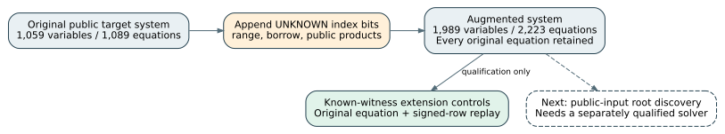
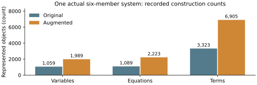

# Unknown indices inside the original six-member system

The new Rust compiler appends unknown t bits and deterministic range,
borrow and constant-product gates to the ORIGINAL actual six-member
Curve25519 system. Its1059 variables/1089 equations are literal prefixes
of the1989-variable/2223-equation/6905-term quadratic augmented system.
The SAME known original witness extends and replays;1989 single-variable
mutations are rejected. Native PCC-20261116-b3227f, unsigned. [pcc:unverified]

The actual parameters remain p=2^255-19, A486662, a60824497,
q213156431,k20633 and the original torus generator. The new168 unknown
t bits and762 deterministic variables expose indexing within the algebraic
system. Supplied labels occur ONLY in the qualification extension helper;
there were zero solver invocations and no discovered new root. [pcc:unverified]

## Fixed native correspondence controls

| Fp101 membership fixture | All field-pair checks | Original roots | Canonical t checks on those roots |
|---|---:|---:|---:|
| a17,q3,k8 | 81608 | 24 | 96 |
| a51,q2,k2 | 20402 | 4 | 8 |
| a3,q17,k1 | 10201 | 17 | 544 |
| a17,q1,k1 | 10201 | 1 | 1 |

Every accepted original member has one accepted canonical index extension.
The complete122412 membership-pair and24024 toy target comparisons are
retained in a146436-byte trace, gzip1436 bytes. Toy targets retain22 of24
raw columns,44 signed leaves and the original identity exclusions
(j1,t2)/(j8,t2); all1848 accepted target assignments replay original rows.
These are fixed development controls, not arbitrary auxiliary-assignment
enumeration or useful-target yield. [pcc:unverified]

The279 toy overflow tests include23 labels that already produce the same
original parameter. Their refusal demonstrates why coordinate equality
alone cannot enforce a canonical label. The actual t=q alias is also
rejected. Twelve malformed constructor cases, wrong target, shape,
noncanonical values and all1989 actual variable mutations are retained.
Prime-field validity remains external; admission caps a/q at32bits and
checks norm/extension chart/exact generator order. [pcc:unverified]

## Conditional algebraic bridge

Existing Mathlib primitive-root laws give the algebraic index step. In a
field, let h have primitive order M=a*q and put g=h^a. Then g is primitive
of orderq. If h!=0 and z^q=(h^j)^q, r=z/h^j has r^q=1. Hence g^t=r
for t<q, and the range-restricted t is unique. Multiplying by h^j gives
the appended coordinate relation. This argument does not depend on q being
prime. Lean PCC-20261116-77b508 instantiates the existing laws at actuala/q;
the focused gate audits3 named theorems,0 failing and0 trusted-native,
with standard foundations. Signed standing is unverified. [pcc:unverified]

The endpoints are actual_subgroup_primitive, actual_coset_index_exists and
actual_coset_index_unique. They assume Field/nonzero h/primitive-root
contracts. Native arithmetic, actual primality/order-checker binding,
Boolean/borrow/product compiler semantics, full native root bijection and
curve/group replay are not formalized by those endpoints. The proof map
lists these missing bridges; native controls do not fill them.

The graph displays counts of represented objects for one actual system.
It is not a solver-work, time or memory comparison. Public role bindings
are version-bound to the original member layout; they are not a theorem
about an arbitrary future compiler. Full cold accounting remains open.

## Reproducibility and next gate

The49-input context reuses the unchanged43-input55368-byte v2 source
archive plus a34384-byte six-input delta (five new crate files and the
unchanged original-system gzip). All source/archive/compiled hashes match.
The1565216-byte retained executable has SHA256
1bd10ec12e3ae459dde65cd14c5f69772edd1c6e00b8fe137dc85a0763b39bfc;
its separate immutable qualifier and Rust pre-call commit identities before
controls. Release test/fmt/strict Clippy pass locally. [pcc:unverified]

The first Lean source type-checked with an unused trailing tactic; its
source/log remain retained. Final sources remove that tactic and keep the
maintained gate's module/deprecation advisories. No gate, limit, signer,
original source, criteria or frozen evidence was changed.

Next, complete accounting and implement dependency propagation on identical
public original/augmented inputs with all failed branches and final original
replay charged. Only a separately admitted solver comparison can decide
whether this representation makes discovery cheaper. No paid job, timing,
sampling campaign, full-base enumeration or broad root-library rerun occurred.

Sources: existing native source review PCC-20261116-3aeb9e; HAC chapter2,
Facts2.170/2.172/2.173/2.213, and chapter14 Algorithms14.9/14.76/14.79;
pinned Mathlib RootsOfUnity.PrimitiveRoots. KB unavailable; direct primary
sources were read. These classical constructions are not claimed novel.
Protocol, source qualification, raw records and the next gate are in
indexed-circuit-v1; direct Lean scope is in sibling lean-indexed-v1/PROOF_MAP.md.
Canonical performance graphs remain unchanged because no performance datum
was added.
