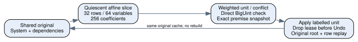
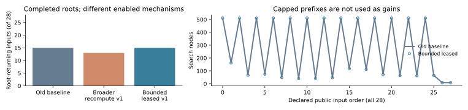

# Bounded leased affine consequences

17 November 2026. Producer native component evidence PCC-20261117-532e0c;
all standing unsigned/unverified. Fixed development controls, not a benchmark.

The bounded leased Rust arm preserves all15 baseline roots on28 curve inputs,
with13Unsupported and zero caps. It records no completed-curve node gain.
The earlier broader recompute arm had13roots/15cumulative-model caps. The new
reasoning is narrower, so this comparison is not an equivalent-engine speed
claim. The no-lost-completion gate passes at these controls; pruning is not
observed at this scope. Full cold and allocator accounting remains open.

The original System, dependency arrays and cache remain shared. At quiescence,
specialize only original equations; choose a deterministic connected slice of
affine residuals bounded by32rows/64variables/256coefficients. Sparse forward
elimination carries original-equation weights. Only unit or contradiction rows
affect search after separate direct BigUint coefficient/premise checks. Trace
binds labelled unit applications and drops leases before LIFO Undo. No original
System copy or dependency rebuild is performed. This is bounded recomputation,
not a persistent incremental basis. It performs no nonlinear rewriting or
quadratic-row cancellation; ignored rows make the slice incomplete.

The disabled engine matches unchanged worklist v1 answers, decisions, counters
and schedule on33systems. All returned roots receive independent original
equation checking and native indexed-row/group replay. Query inputs are public
System/roles/mode/limits; replay tables, labels, signs, scalar and witness are
outside the query. Five bounded Fp29 truth domains, trace/root/unit mutations,
forced caps and malformed requests remain in the full raw record. The separate
synthetic conditional case changes3to2nodes; it is not a curve pruning result.
Unsupported or resource refusal is never an absence certificate.

Toy domain: p101/A95/h(17,12)/a17/q3/k8, arity2,13fixed image targets with distinct
raw columns, aliases retained and identity columns excluded. Actual domain:
p2^255-19/A486662,h_new=h_old^213156431,a60824497/q1/k2,arity2. That actual fixture
has TWO columns, not the huge original q213156431 base. The huge original
systems receive zero solver calls in this stage.

Old finite limits remain1024nodes/depth128/10million diagnostic events/64MiB
cumulative modeled reservations,4096vars/8192equations/32768terms/degree2.
Extra1024passes/65536trace events and the new bounded slice are finite guards.
New component and in-query checker arithmetic is charged, with storage/scans
modeled before admission. Those bytes are not live allocation/RSS. Whole cold
parsing, serialization, replay and allocator/container costs are unpriced.
No timing, speedup, external-fastest, growing-family or exponent claim is made.

Frozen133-input context: unchanged98 plus35new Rust/Cargo/request inputs;
six source archive round-trips and36compiled bindings matched. New21268-byte
source delta SHA d3f611b4faf005dfc72a679178d3f75b4c7c63aec6e36424b1079a1ac5cdf1df.
Copied3323936-byte executable SHA939476d96d8111aef1cb651d4d529f998d96c87c5a78d6b7dcbb1668022a8eba.
Whole249-file9258198-byte raw record is34644-byte native archive SHA
8b7339863e182f3ffdad1331c136f92e83a511b1202e56fd44c70cc2d9161df2.
Separate copied qualifier and distinct build/pre-call/post-call records precede
calls; aggregate counts are generated in Rust. First compile failure (borrow
and unused import) remains with initial source/log. Corrected release unit,
fmt, strict all-target Clippy and build pass; no source edit after qualification.

Sources checked: KB unavailable (MCP absent, wrapper127); branch-affine-v1
protocol/NEXT/native source and Soos/Nohl/Castelluccia, *Extending SAT Solvers to
Cryptographic Problems*, section3.2 pp248–249,
https://www.msoos.org/wordpress/wp-content/uploads/2011/03/Extending_SAT_2009.pdf.
Its Boolean Gaussian/DPLL integration and restored state are prior art, not a
Curve25519 theorem or justification for selecting these cutoffs.

Next distinct hypothesis: bounded monomial-column elimination on original
quadratic rows, with certified cancellations exposing affine units. Check
classical linearization/Macaulay prior art before a successor protocol. Original
route-criteria V3 yield/family/selection/rank/kernel/recovery and full cold-work
obligations remain open. No successor campaign is scheduled by the CI checker.

Canonical performance graphs and benchmarks remain unchanged: no admitted
performance or exponent datum is added. The graph displays only native recorded
counts, all28 outcomes retained, without timing or statistical inference.

Publication: PR4475 merged externally during qualification. Exact subjects were
transferred to canonical main2043bee6ae, which now contains all98 predecessor
inputs. Main's1279-row prefix is retained and only new unpublished claims are
registered. Seven earlier published registrations remain omitted upstream;
their original events are archived without replay. See transfer and closure
facts. Source was not rerun for metadata. Older large archive receipts remain
separate publishing dependencies, not scientific evidence.
