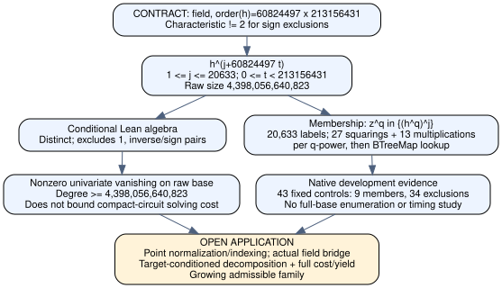

# Many-coset torus construction and membership

16 November 2026. Conditional algebra and fixed Rust development controls.
All PCC standing remains unverified. This is the next parameter component
of the [scaling plan](../scaling-audit-v1/REPORT.md).

The 20,633-coset proposal now has a conditional injectivity/cardinality,
admissibility and membership certificate. It supplies 4,398,056,640,823 raw
torus coordinates, close to the prior sixth-root target of 2^42. It does not
yet supply a normalized elliptic-point base or a decomposition algorithm.
PCC-20261116-ac25ef, PCC-20261116-cc48bc. [pcc:unverified]

## Construction and exact scope

Write a=60824497, q=213156431, M=a*q=12965132697890207 and k=20633.
In a field F, assume h has exact multiplicative order M. Define

    S = {h^(j+a*t) : 1 <= j <= k, 0 <= t < q}.

The subgroup generated by h^a has order q. Two encoded exponents are in
[1,M), and equal powers have equal exponents by the primitive-root law.
The fixed remainder bounds then give equal j and t. Thus |S|=k*q
=4398056640823. No element is 1. For a product of two elements to be1,
its exponent would have to be divisible by M, hence by a; the residual
j+j' is strictly between 0 and a since 2k<a. This excludes inverse pairs.
Every element is an Mth root, and M is odd. In characteristic other than 2,
this also excludes sign pairs and products equal to -1. These are raw torus
coordinate statements. PCC-20261116-ac25ef. [pcc:unverified]

The [instance map](../../lean-cosets-v1/PROOF_MAP.md) applies existing Mathlib
primitive-root and finite-range laws, without a new generic group theory.
The actual field/order/norm-one hypotheses are not constructed in Lean.
The native control reuses the maintained `TorusParameters::actual_four`
routine, including its existing nonsquare, norm and exact-order checks.
The h bytes match the earlier pinned four-point fixture. The actual point
count, Elligator branches, cofactor normalization, point selection and a
growing family remain separate contracts. [pcc:unverified]

## Recognition has a small table

The complete conditional characterization is

    z in S  iff  z^q is in { (h^q)^j : 1 <= j <= k }.

Forward implication is the power law. Conversely, divide by h^j; a qth
root of one is a power of h^a by Mathlib's existing primitive-root
enumeration theorem. This direction applies to arbitrary field candidates,
not only candidates already promised to lie in the parent subgroup.
PCC-20261116-ac25ef. [pcc:unverified]

The [Rust example](../../../../tools/torus-energy/examples/many_coset_audit.rs)
builds a BTreeMap of both canonical Fp coordinates of(h^q)^j and returns j.
Given h, setup is one qth power plus k-1 Fp2 multiplications and O(k) table
storage. With the existing exponentiation code, a qth power uses 27
squarings and 13 multiplications in Fp2; lookup takes O(log k) comparisons
of the coordinate keys. Parameter construction/checks, conversion and
allocation are additional costs. No runtime or calibrated field-operation
price was measured. PCC-20261116-cc48bc. [pcc:unverified]

Recognition returns the coset label j, not the within-subgroup exponent t.
It does not invert Elligator, choose a canonical signed point class,
construct the relation matrix index, or recover its logarithm. Those costs
cannot be silently assigned to this routine.

## A precise polynomial representation boundary

The [separate degree endpoint](../../lean-cosets-v1/DEGREE_PROOF_MAP.md)
applies Mathlib's existing root-count theorem: any nonzero univariate
polynomial over F that vanishes on every raw element of S has degree at
least 4398056640823. This rejects a proposed nonzero raw-coordinate
membership polynomial of smaller degree. A dense coefficient array for
such a polynomial has at least L+1 slots. PCC-20261116-1aecf2.
[pcc:unverified]

This degree statement does not bound sparse support, arithmetic-circuit
size, a changed coordinate's degree, or multivariate solving degree. Nor
does O(L) dense input alone disprove the conditional cost target. In
particular, the O(log k) native lookup cannot be inserted as a free
polynomial-solver operation. A compact addition-chain/selector encoding
must retain its constraints, exceptional cases and witness recovery.

## Evidence, applicability and next gate

| Requirement | Status and evidence |
|---|---|
| Raw cardinality and alias exclusions | Conditional Lean endpoints; exact order and field hypotheses explicit |
| Complete membership characterization | Conditional Lean endpoint, including arbitrary candidate z |
| Native implementation |43 fixed designated cases: 9 members, 34 exclusions; one example test, fmt and strict Clippy pass |
| Reproducibility | Pre-call example/binary hashes;33 source-input hashes; 51,784-byte post-call source-v5 archive |
| Polynomial degree boundary | Separate conditional Mathlib root-count endpoint |
| Point normalization/indexing | Open; not discharged by raw membership |
| Structured decomposition and uniform useful yield | Open; no solver invoked |
| Asymptotic exponent | Requires actual solver/phase bounds and a growing admissible family |

All rows cite the three PCC records above and remain [pcc:unverified].
The [raw native record](../../many-cosets-v1/native-control-v1/many-coset.json),
[pre-call qualifier](../../many-cosets-v1/native-control-v1/pre-call.json),
[source manifest](../../many-cosets-v1/SOURCES.sha256), source archives and
versioned proof-gate receipts retain actual outputs. The native inputs are
public predetermined correctness cases, not a sampled yield study or a
performance panel. Curve25519 is the user's explicitly requested curve.
No base enumeration, root search, paid job or broad root-library rerun ran.
Canonical performance/leaderboard graphs remain unchanged.

The final focused gate audits all 11 named endpoints with zero failing or
trusted-native axioms. Earlier ten-endpoint gate-v1 and both direct
assembly builds are retained; no proof source failed. This is local kernel
and foundation auditing, not signed PCC standing. [pcc:unverified]

The next discriminating gate is a target-conditioned decomposition
interface with checked original-ideal witnesses and charged coset
constraints, preprocessing, normalized indexing, selection and output work.
For the prior one-retained-row six-summand model at beta=1/6, an actual
gamma<2 would be required to move its exponent below 1/2. The model remains
conditional; this report establishes no gamma. Multi-output methods keep
the separate query-aggregate contract. [pcc:unverified]

Use the existing [route criteria V3](https://github.com/isogeny-labs/cryptanalysis/blob/2dee266203bedb19e302d2af64240815c679f085/research/curve25519_torus_native_20261115/ROUTE_CRITERIA_V3.md) unchanged.
A counterexample rejects the corresponding construction/contract; the
degree endpoint rejects only the lower-degree univariate representation.
A timeout or a slow implementation does not disprove all compact
representations, and a small membership table does not establish a cheap
decomposition route.

Sources checked (KB unavailable): Petit–Kosters–Messeng, PKC 2016,
[section 3.3](https://people.maths.ox.ac.uk/petit/files/16PKC_primeECDLP.pdf)
already uses multiplicative subgroups/cosets; Mathlib
`RingTheory/RootsOfUnity/PrimitiveRoots.lean` and
`Algebra/Polynomial/Roots.lean`, revision
cfc55fc58714a59dc06e6e79edc6d1d95140d3c2; prior frozen scaling and
four-point parameter records. No novelty claim follows from the coset union.
