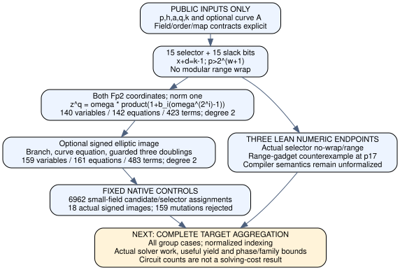

# A quadratic many-coset membership and point-image interface

16 November 2026. Construction and fixed correctness controls only.
PCC-20261116-688961 and PCC-20261116-645f28 remain unsigned. [pcc:unverified]

The new Rust compiler accepts public parameters and exports a lifted
quadratic system for the [many-coset base](../many-cosets-v1/REPORT.md).
An optional interface emits a nonidentity eightfold elliptic image.
It uses both Fp2 coordinates, a bounded binary selector and explicit inverse
guards. It contains no target-sum oracle or decomposition-cost result.
[pcc:unverified]

| Actual-parameter module | Variables | Equations | Terms | Maximum degree |
|---|---:|---:|---:|---:|
|Membership|140|142|423|2|
|Membership plus nonidentity cofactor image|159|161|483|2|

These are counts of the exported systems, not running-time measurements.
They are different output interfaces, not competing attack arms.
PCC-20261116-688961. [pcc:unverified]

## The selector and both field coordinates matter

The public inputs are p, a norm-one h, a,q,k and optionally curve coefficient A.
The external mathematical contracts are a prime field with nonsquare2,
order(h)=a*q, 0<2k<a, and the stated actual curve/map hypotheses. The
constructor does not certify primality, exact order or the Elligator law.
Actual values are a=60824497, q=213156431, k=20633, p=2^255-19 and A=486662.
The compiler receives no planted j,t, point or secret scalar.

Set omega=h^q and x=j-1. Fifteen selector bits and fifteen slack bits impose
x+d=k-1, with each bit b satisfying b(b-1)=0. The explicit bound
p>2^(w+1), w=15 here, makes that equality an integer range check.
The selector product is

    omega * product_i (1+b_i*(omega^(2^i)-1)).

Both coordinates of this value equal those of z^q. There are 39 lifted Fp2
power gates (the first multiply-by-one is folded) and 15 selector gates.
The norm-one equation is retained. No k-entry lookup table is used by the
circuit. This is an algebraic representation, not a fast root finder.
PCC-20261116-688961. [pcc:unverified]

The earlier primitive-root characterization identifies this predicate with
S={h^(j+a*t):1<=j<=k,0<=t<q} under its external field/order contracts.
Each multiplication output has a defining equation; canonical witness
generation evaluates this gate graph. A full compiler soundness theorem
and the actual Fp2 type bridge have not been formalized.

The [new numeric proof map](../../lean-circuit-v1/PROOF_MAP.md) uses existing
Mathlib cast/valuation laws. Its three endpoints cover the actual no-wrap
range and the range-only counterexample p17,x31,d3,k18: field equality holds
while x exceeds the intended cap. This counterexample concerns the generic
range gadget, not the full valid torus-parameter contract. It does not refute
the actual guarded encoding. Boolean decoding and compiler semantics remain
outside those endpoints. PCC-20261116-645f28. [pcc:unverified]

## Optional signed image and explicit domain

For the actual curve, a Boolean c chooses

    u=-A/2+(1-2c)*A/(2*z.a),     v²=u³+A*u²+u.

The circuit includes inverse(z.a), a named u² auxiliary and the curve equation.
The actual Elligator branch property is inherited as a contract; native
controls check one rational u branch and both v signs for each fixed input.
Three guarded affine doublings then emit [8](u,v), with inverse(2v) at each
stage. If [8]P is nonidentity, these denominators cannot vanish. Identity
images are explicitly outside this retained-base interface. Poles are not
accepted as witnesses. [pcc:unverified]

This supplies one member's signed image. It does not normalize cofactor
aliases, recover the subgroup exponent t/index, join several members to a
public target or count useful relations. A later sum circuit must handle
equal-point, inverse and identity intermediates completely; excluding them
without a new analyzed protocol would weaken the relation problem.

## Fixed controls and reproducibility

- In the Fp59 arithmetic fixture, h=(54,37) has order15; a=5/q=3/k=2 gives six
  directly enumerated members. All 3481 coordinate candidates and both valid
  selectors produce 6962 canonical gate assignments. Their outcomes match
  direct enumeration. The complete zero/one trace and indexing layout are
  retained. This is not an elliptic-curve benchmark or a parameter search.
- Actual j in{1,10316,20633}, t in{0,1,213156430}, with both raw-point signs,
  give18 fixed cases. Every equation holds; outputs match the existing
  curve API's [8]P and remain nonidentity/on-curve. No failed input was omitted.
- Every one of 159 variables in the first actual assignment was changed;
  each single-variable mutation is rejected. Rejected controls also include
  short/extra/noncanonical values, nonbinary/overflow selectors, unsafe
  modulus and a zero affine-doubling denominator.

PCC-20261116-688961 covers these local software observations only.
[pcc:unverified]

The [raw record](../../membership-circuit-v1/native-v1/controls.json),
[pre-call qualifier](../../membership-circuit-v1/native-v1/pre-call.json),
[source manifest](../../membership-circuit-v1/SOURCES.sha256) and compressed
complete systems retain actual inputs/output. The release suite, formatting
and strict Clippy pass. All38 archived source/manifest inputs and five
compiled-in crate hashes match; the post-check archive is 45784 bytes.
Earlier failed Lean/lint attempts remain separate, with exact source.
Final focused proof gate audits three named endpoints, zero failing/trusted
native exceptions. These checks are not signed execution or a verified compiler.
[pcc:unverified]

Curve25519 is explicitly user-requested. No solver invocation, target-DLP
recovery, sampling, timing experiment, full actual-base enumeration, paid job
or broad root-library rerun occurred. Canonical performance/leaderboard graphs
remain unchanged. The existing source pins, criteria and frozen reports retain
their bytes. [pcc:unverified]

## Next gate

Compose several member modules with complete public-target aggregation,
including its exceptional cases and normalized index recovery. Then establish
and qualify full cold decomposition work/yield with original-relation
witnesses. In the previous six-sum model at beta1/6, gamma<2 would be needed
for its modeled exponent below1/2, alongside every phase/family hypothesis.
This representation supplies no gamma. [pcc:unverified]

Sources checked (KB unavailable):
[PKM2016 section3.3](https://people.maths.ox.ac.uk/petit/files/16PKC_primeECDLP.pdf)
already supplies subgroup/coset compositions; existing Rust torus-s4 and
torus-s4-tree polynomial/Fp2/curve APIs; the frozen many-coset and route
criteria records; Mathlib ZMod valuation laws at
cfc55fc58714a59dc06e6e79edc6d1d95140d3c2. No novelty claim is established.
