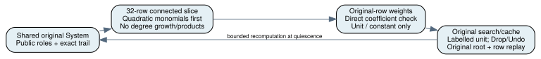
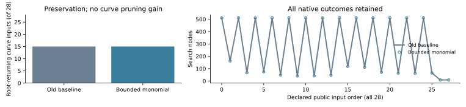

# Bounded quadratic-monomial cancellation

17 November2026. Native core PCC-20261117-1ab7fd, source/literature3187dc and
separate actual-engine rollback6a68d9; all producer standing unsigned/unverified.

The Rust module now obtains checked linear units from constant-weight
combinations of original quadratic rows. Two new coupled-quadratic polynomial
controls over Fp29 and the Curve25519 prime return roots. The28curve controls
still return15Root/13Unsupported/0Cap with unchanged node counts. This passes
fixed preservation and polynomial-cancellation gates, and fails the completed-
curve pruning prediction for this bounded unit-only implementation/domain.
It does not reject all linearization, other solvers or index calculus.

An incomplete connected slice retains at most32rows/64original unknown
variables/256input coefficient entries. Quadratic monomial columns pivot before
linear columns; constants remain augmented. No equation products, monomial
multipliers or degree growth occur. Original System/dependencies/cache remain
shared. Only normalized linear units or nonzero constants affect search after
separate direct BigUint coefficient/premise checking. Labelled unit applications
and Drop-before-LIFO-Undo traces remain. Composed univariate quadratics are
currently discarded. This is bounded classical degree-two linearization, not
full XL, F4 or a Gröbner basis; ignored rows prevent completeness claims.

Core35unique systems retain all old33 plus two labelled polynomial controls.
Old/Off match full answers, decisions,counters,schedule on35. Every returned
curve root receives independent original-equation and native indexed-row/group
replay. Query inputs are public System/roles/mode/limits; witness,scalar,labels,
signs,point list and replay tables remain outside. Toy curve p101/A95/h(17,12)/
a17/q3/k8,arity2,13image targets, aliases retained and identity columns excluded.
Actual curve p2^255-19/A486662,h_new=h_old^213156431,a60824497/q1/k2,arity2,TWO
columns. Huge original q213156431 systems receive zero solver calls here.

The new polynomial equations are xy+x-1=0,xy+2x-3=0. Both fields produce a
checked root in one node where old extraction is Unsupported in one node;
these are polynomial controls, not actual curve decompositions. Fp29 truth is
enumerated. The old synthetic rollback case now finishes at root (3to1nodes).
Its core lease-reader fixture is explicitly AUTHORED with placeholder counters;
it is not an observed engine rollback. All10core trace/root/unit mutations,
8forced caps and4malformed refusals remain. Ordinary core caps are outcomes,
not data exclusions; Unsupported/refusal is not an absence certificate.

Separate native runtime contract: Fp29 z²-z=0,zu+u+v-1=0,zv+u+v-2=0,branch role z.
Old extraction is Unsupported after3nodes; the new engine returns [1,0,1] in
3nodes, with2activations/2Drops/1Undo. Complete24389original assignments have
one root. The full reader accepts and missing-Drop/wrong-Undo corruptions refuse.
This one-system contract closes actual conflict/rollback coverage without
editing or rerunning core35; it is not a curve or performance comparison.

Old solver caps remain1024nodes/depth128/10million diagnostic events/64MiB
CUMULATIVE MODELED reservations,4096vars/8192equations/32768terms/degree2.
Extra1024pass/65536trace and fixed slice guards remain. Arithmetic/scans/
weights/checker/model reservations are charged. Full cold parsing,serialization,
replay,allocator/container overhead and live storage remain open. No timing,
speedup, external-fastest, complete-cost or exponent result is claimed.

Core140input context=unchanged133+7newCargo/Rust files, exact old28request bytes
reused, seven source archive round-trips and36compiled bindings matched. New
16508-byte source delta SHAdebfd1a9bac20a2899ee329f6f56685b6f88eee0a19be7910348dafe2f3a4abb.
Copied3375440-byte executable SHA7c3f639c461a4cfaa7d480f0e26d044708f2246357e36d274e3737b84fa4c6b5.
Raw262files/9294358bytes ->36380-byte archive SHAce91078fa0379457663df2d2454e94b25fa0b6b459b960b9f24da71600c62d14.
Separate runtime context143=core140+3helper inputs,4396-byte source delta;
1163056-byte executable SHAa33cf3b2053489e8632f8a094f5d39a64fbc9fb20dae8db63c915f84a4c13625.
Raw8files/36567bytes ->2020-byte archive SHA2bbb7a93b2d338dffa88e69f670bd49fd3c7f42b1f8345ebff2a11eebd67f1a5.
No monolithic140/143archive. Separate copied qualifiers and distinct build/
pre-call/post-call records precede calls. Both native result sets aggregate in
Rust. Core first release library/fmt/strict Clippy/build and helper checks pass.
No source correction/cap tuning after outcomes or edit after qualification.
Source-pack metadata first stopped on sparse-missing historical archives before
binary/pre-call/calls; exact tracked blobs restored without replacing new bytes.

Primary prior art: Courtois/Klimov/Patarin/Shamir, author-hosted xlfull.pdf,
section3 Definition3.01 and appendix8,
https://www.nicolascourtois.com/papers/xlfull.pdf. Monomial linearization is
classical; generic independence heuristics are not adopted for these circuits.
KB unavailable (MCP absent/wrapper127). IACR conference and Diem full PDF403;
Diem bibliography/abstract only, no proof imported. No algorithm novelty claim.

Next distinct hypothesis: admit certified degree-at-most-two univariate
consequences with complete root-set/nonresidue checking and allowed public roles.
Freeze that successor before calls; do not retune this packet. Original route
criteria V3 growing-family/yield/selection/rank/kernel/recovery and full cold
work remain open. No successor campaign is scheduled by the CI checker.
Canonical performance/exponent graphs and benchmarks stay unchanged because no
admitted performance datum is added; the plot copies only native recorded values.
