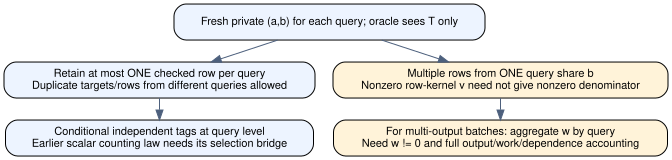

# One retained row per independent query

16 November 2026. Explicit contract addendum to the frozen reduction and
saturated-yield reports. Their bytes and original receipts remain intact.

The earlier proposal did not explicitly cap retained output rows per query.
For its independent-row-tag argument, require **at most one retained checked
relation from each query with fresh independent private coefficients**.
Choose that relation using only the public target, base, checked outputs and
tag-independent coins. Repeated public targets or identical rows from
different queries remain allowed; their coefficient draws are distinct.
Actual point/retention implementation and probability bridges remain open.
[pcc:unverified]

## A concrete witness to the missing condition

Over F5, take C with two identical rows (1), a fixed kernel vector v=(1,-1),
and tags (b,b) from one query. For every b, v is nonzero, v^T C=0 and
v dot (b,b)=0. The kernel is tag-blind; shared tags alone cause cancellation.
The new `SharedQueryCounterexample.lean` checks this concrete instance using
existing Mathlib laws. It does not construct actual curve decompositions.
This refutes the extension that treats same-query rows as independent tags;
it does not refute the one-row protocol, multi-output algorithms in general,
or the scalar extraction identity under its stated nonzero denominator.
[pcc:unverified]

## Multi-output batches need a separate condition

Let pi(i) identify the query that produced row i, with private coefficient
b_j for query j. The denominator is

    sum_i v_i b_pi(i) = sum_j w_j b_j,
    w_j = sum_{i: pi(i)=j} v_i.

The earlier annihilator-count law can apply at the **query** level when the
aggregated vector w is nonzero and chosen independently of the private tags.
Nonzero v by itself does not ensure nonzero w. Arbitrary query grouping,
selection, point equations and probability bridges are not formalized by
the new F5 witness. No new generic probability law is claimed.
[pcc:unverified]

Likewise a probability of success y is at most one, but the number of
returned rows can exceed one. The prior P+B*D/y+L and rational-envelope
examples are the **at-most-one-retained-row model**. A multi-output batch
must account for total work, output/checking work, group dependencies and
the query-aggregate kernel condition; it may not reuse the one-row formula
silently. Fast batching remains a research option, not an excluded route.
[pcc:unverified]

This clarification changes no frozen theorem, source pin or data. The
original scalar-field and rational-model endpoints retain their exact
statements; their application to an actual attack remains conditional.
Source: [PKM2016 section2.1/Algorithm1](https://people.maths.ox.ac.uk/petit/files/16PKC_primeECDLP.pdf),
the frozen private-coefficient proposal and existing CryptoLean.SingleRelation
label-fiber/recovery laws. No novelty or improved exponent is asserted.
[pcc:unverified]
