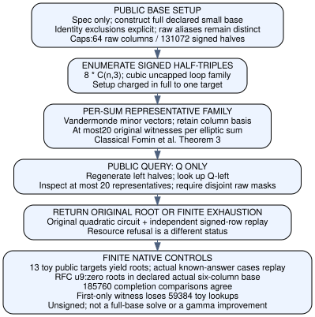
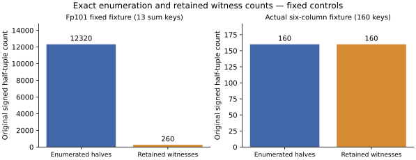

# Public-input roots with representative half-sum families

16 November 2026. Bounded native reference and finite correctness evidence.
PCC-20261116-7de4ca; signed standing unverified. [pcc:unverified]

The new Rust reference builds its declared factor base from public
parameters, then receives only a target. It discovers roots and checks them
against the unchanged original target circuit and independent indexed-row
replay. It can report exhaustion of the declared finite base/arity. Resource
refusal and exhaustion are distinct. No planted labels, point list, scalar
or witness enters the solve query. [pcc:unverified]

## A complete half-sum table needs more than one witness

Six members must have distinct raw indices, while their point images can
coincide. For a fixed left triple, the right half must avoid its three raw
indices. Keeping only the first triple for each elliptic sum can lose such
a completion. In the fixed toy control this happens in 59384 of 160160
disjoint-completion lookups. This is a lookup result; it does not assert
that the whole one-witness solver misses every public target.

The first concrete retained example has elliptic half-sum identity,
forbidden raw mask 11, first-witness mask 19 and valid-completion mask 2096.
The first overlaps; the latter is disjoint and has the same elliptic sum.
Masks refer to raw public enumeration slots, preserving identity exclusions.
PCC-20261116-7de4ca. [pcc:unverified]

Use the established representative-family construction, not an arbitrary
discard rule. For half-size r<=3, assign raw label i a Vandermonde vector
(1,x_i,...,x_i^(2r-1)), x_i=i+1 in the prime field, with p>raw_count.
Each half is encoded by its r-by-r minors. Per elliptic sum retain a column
basis of those vectors and the corresponding ORIGINAL signed triples.
Its dimension is C(2r,r), at most 20. A disjoint completion is a nonzero
determinant functional; if it is nonzero on the full span, it is nonzero on
one selected original witness. This is the uniform-matroid application of
Fomin/Lokshtanov/Panolan/Saurabh Theorem 3, not a new algorithmic theorem.
Formal compiler/matroid/curve-instance verification remains open.
Identity targets are group-law controls; production nonzero-query and
one-retained-row rules remain unchanged.

## Fixed coverage and actual bounded outcome

|Declared fixture|Retained raw columns|Signed triples enumerated|Sum keys|Original witnesses retained|max/key|
|---|---:|---:|---:|---:|---:|
|Fp101/A95/a17/q3/k8|22 of24|12320|13|260|20|
|Actual field, a60824497/q1/k6|6 of6|160|160|160|1|

The toy excludes exactly the same two identity columns(j1,t2),(j8,t2) as
v2; aliases remain separate. All 13 public cofactor-image targets return
six-member original roots. The actual fixture uses h_new=h_old^213156431,
then q=1,k=6. It is a six-column control, not the huge actual many-coset
base. Known-answer targets at arity2/4/6 return and replay roots. The public
RFC u9 point exhausts that exact six-column arity6 base; independently
enumerating all 64 sign choices also yields zero roots. That result says
nothing about larger bases or general Curve25519 decompositions.
PCC-20261116-7de4ca. [pcc:unverified]

All 160160 toy and 25600 actual full-family/compressed completion queries
agree:185760 total. Actual comparisons contain1280 yes and24320 no cases;
toy cases are all yes. Selected original minor vectors are independently
reinserted to check linear independence. Synthetic first-witness and
duplicate-column controls, malformed targets/arity/field labels and the
huge-base guard behave as specified. The complete trace, basis data,
public inputs, roots and witness vectors are retained in
[native-v1](../../root-reference-v1/native-v1/controls.json).
[pcc:unverified]

Counts are exact finite populations, not timings, RAM bytes or performance ratios.
Representatives also store up to 20 field coordinates each; the plot does
not estimate their byte footprint. Diagnostic reuse across13 targets is
correctness coverage, not a primary batch comparison.

## The scaling boundary is explicit

The bounded implementation caps raw columns at 64 and signed halves at 131072.
For its uncapped loop family at six members, construction still enumerates
8*C(n,3) signed halves. With fixed-dimensional minor/basis work and dictionary
factors this is cubic in retained raw cardinality n; the number of stored sum keys
is at most cubic. Representative families prevent long collision
bucket scans and preserve distinctness; they do not remove enumeration.

Lifting only the caps therefore does not meet the subquadratic six-sum gate.
In the earlier n~ell^(1/6) model, cubic target-independent setup already
reaches exponent1/2 before later phases. It cannot support a strict advantage
at that model point. This scopes rejection to this algorithm extension.
Other methods, useful yield and growing-family claims stay open. Complete
cold-cost interpretation charges all setup to one target; the retained API
event counts omit normalized field work and are not performance evidence.

Next implement a bounded public-input solver for the quadratic ideal that
explicitly avoids triple enumeration, with original-root lifting and the
unchanged [route criteria](../../root-reference-v1/NEXT.md). A table compressed
after constructing every triple does not move that boundary.

## Reproduction, identity scope and retained failure

Focused release test, fmt and strict all-target Clippy pass. First Clippy
rejected a needless index loop in the determinant AST constructor; source/log
retained. Replacing it with enumerate changes no polynomial or criterion.
The qualified executable writes source/binary hashes before controls and
exited0. [pcc:unverified]

The composite source snapshot has 50 inputs: unchanged43-input v2 dependency
archive and a13808-byte seven-input delta. All hashes and both archive
round-trips match; seven compiled-in source/fixture hashes match.
[FROZEN.md](../../root-reference-v1/FROZEN.md) and
[REPRODUCE.md](../../root-reference-v1/REPRODUCE.md) specify exact reconstruction.
Old source, archives, direct Lean bindings, claims and raw evidence retain bytes.

IDC1hd26c4be98ace1e7d is the standard six-column Vandermonde determinant
identity, syntactic degree 15, evaluated by the maintained native checker
over its declared2^61-1 field in two fixed 32-point streams. A plus-one
corruption is refused. This is not a formal identity or a separately signed
verification of the reference, representative-family theorem or actual field.

No benchmark, sampling, paid job, new solver campaign, full huge-base
enumeration or broad library rerun occurred. The user requested Curve25519;
the small fixture is an arithmetic control, not a performance-panel substitute.
The canonical docs/index-calculus-scoreboard.html and
docs/ic/progress-timeline.json remain unchanged because no admitted timing
or attack-cost measurement was produced. [pcc:unverified]

Sources checked(KB runtime unavailable):
[Fomin, Lokshtanov, Panolan, Saurabh, arXiv1304.4626v4](https://arxiv.org/abs/1304.4626),
section 2.5/Theorem 3 and its minor-vector/determinant proof; earlier RFC8032/
RFC7748 group/conversion sources, native identity/curve APIs and frozen
target/coset/reduction records. No novelty claim for classical MITM,
representative sets, Vandermonde identities or BSGS.
