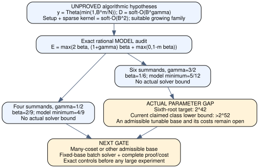

# Saturated-yield scaling audit and revised research plan

16 November 2026. Numeric model and actual-parameter arithmetic only.
Signed PCC standing is unverified. No solver or sampling run occurred.

The new plan has a concrete parameter gate: the currently used four-coset
cardinality bound is above the unit-constant six-summand target. The arithmetic
below is conditional on the earlier transport/cardinality bound. It does
not rule out six-summand index calculus or a different admissible base.
PCC-20261116-ebfd31 and PCC-20261116-76dc04. [pcc:unverified]

## The cost model must cap success at one

Write N for prime-group order, B=N^beta for base cardinality, m for fixed
summand count, P for full preprocessing, D for work per query, y for the
probability of a checked returned decomposition, and L for kernel work.
The proposed single-DLP accounting is P+B*D/y+L. Batched algorithms instead
charge their entire batch and all its returned checked rows.

**Hypotheses, not results:** suppose y=Theta(min(1,B^m/N)),
D=soft-O(B^gamma), P+L=soft-O(B^2), and all remaining phases fit that
accounting on an admissible growing family. Then the proposed exponent
envelope is

    E(beta)=max(2 beta, (1+gamma) beta+max(0,1-m beta)).

All geometric/yield, algorithmic, family and bit/field/curve-unit bridges
remain obligations. In particular, the existing four-sum geometric draft
does not certify a six-sum yield law. Fixed-arity constants, including its
collision/trivial-permutation constants, must also be charged at 255 bits.
This equation is a conditional model, not a measured attack. [pcc:unverified]

| Summands m | Hypothetical gamma | Candidate beta | Model exponent | Status |
|---|---|---|---|---|
|4|1/2|2/9|4/9|Numeric rational-envelope minimum checked in Lean|
|5|3/2|1/5|1/2|Native arithmetic model only|
|6|3/2|1/6|5/12|Numeric rational-envelope minimum checked in Lean|
|8|5/2|1/8|7/16|Native arithmetic model only|

The [Lean project](../../lean-scaling/PROOF_MAP.md) proves lower bounds for
every rational beta and attained values for the four/six rows. For m6,
gamma3/2, omitting saturation would balance at beta2/11 and suggest4/11;
the actual capped model there is5/11. Its minimum is instead5/12 at1/6.
The maintained gate audits 12 declarations with no failing or trusted-native
axioms; only ten named endpoints are claimed. This is a model audit, with
the real-power/asymptotic and actual-algorithm bridges explicitly open.
PCC-20261116-76dc04. [pcc:unverified]

## Actual parameter gap

At N=2^252+27742317777372353535851937790883648493,
floor(N^(1/6))=2^42=4398046511104. The current M=12965132697890207
and the earlier transport bound give B>=(M-1)/2=6482566348945103.
The latter integer's sixth and fifth powers both exceed N. Reusing those
parameters requires a separate finite-size analysis. In the unit-constant
gamma3/2 budget model, the BD term at that lower bound exceeds sqrt(N).
This does not price an actual solver, supply a calibrated runtime comparison,
or disprove B=Theta(N^(1/6)) along some growing family. It is not an
algorithmic lower bound or an asymptotic impossibility theorem.
PCC-20261116-ebfd31 and PCC-20261116-76dc04. [pcc:unverified]

The native audit lists two arithmetic-only ways to target raw cardinality
near 2^42: 72308 cosets of the 60824497 subgroup, or 20633 cosets of the
213156431 subgroup. The latter proposed raw product is 4398056640823.
Distinctness, no-sign-alias admissibility, point transport, normalized B,
recognition cost and growing-family availability are NOT checked. Thousands
of membership branches cannot silently inherit the four-coset compiler's
size or cost. These are candidate parameters, not constructed bases.
PCC-20261116-ebfd31. [pcc:unverified]

The [Rust controls](../../energy-test-v1/scaling-audit-control-v1/) use exact
integer/rational arithmetic, a separately copied immutable executable and a
pre-call binary digest. Two native checks pass, including an independent
rational-grid check. The preserved source-v3 archive is explicitly post-call.
No root search, sampling, timing experiment or full-base solver was invoked.
[pcc:unverified]

## Revised plan and decisions

1. **Admissibility and honest accounting first.** Freeze four/five/six cards
   with N,B,m, setup/query/kernel/memory costs, target law and hypotheses.
   Test whether current divisors or many-coset/auxiliary constructions can
   instantiate the desired sizes without shifting cost into recognition.
2. **Two solver targets.** Continue four-sum sublinear-query work and test
   six-sum strictly-subquadratic-query ideas at a genuinely suitable base
   size. Give every candidate a written algorithm and full cost bound before
   spending on large cases. The conditional thresholds do not supply either
   algorithm. Five and eight summands remain model controls.
3. **Fixed-base batch approach.** Reuse algebraic setup across queries within
   one DLP, retaining a common column universe. Investigate modular composition,
   structured elimination and multipoint routines while charging coefficient
   expansion and root discovery. Dense coefficient arrays or complete pair
   tables have their full time/memory costs; a fast evaluation theorem alone
   does not perform decomposition.
4. **Proof approach.** Review the cover/collision draft and extend its exact
   hypotheses to each arity. Complete the hidden-tag stopping/selection and
   actual-point bridges. The proposed bounded-restart protocol is separately
   frozen under PCC-f0439a; the optional birthday test remains quadratic-RAM
   diagnostics, not a required linear-memory phase. [pcc:unverified]
5. **Representation and transport controls.** Compare Edwards-y, Montgomery
   and selected invariant quotients on the same actual instances. Admit a
   twist/isogeny route only with explicit DLP transport and cost. Term count
   earns no success/cost promotion by itself.
6. **Escalate only after discriminating controls.** Independent exact small
   controls, then frozen budgets/targets/predictions and matched external
   native solvers, then six sizes spanning 24 order bits and held-out tests.
   Qualified EKS execution still requires actual runner and spend/capacity
   readback. This plan launched no job. A fit alone is not an asymptotic proof.

Use the consumer's frozen ROUTE_CRITERIA_V3.md outcomes: exact counterexample,
proved scoped exclusion, corrected rejection of a finite quantitative promise,
implementation parked, invalid experiment, or open. A timeout does not prove
an exponent lower bound. Original criteria and source/evidence bytes stay intact.
[pcc:unverified]

## Sources and novelty scope

- [Petit--Kosters--Messeng, sections3.1--3.2](https://people.maths.ox.ac.uk/petit/files/16PKC_primeECDLP.pdf): compositional factor bases, arity/cost optimization and unresolved solving complexity. Read the primary text, not only its abstract.
- [Bhargava et al., introduction and Theorem1.1](https://arxiv.org/html/2205.00342v1): fast multipoint evaluation takes a coefficient-vector input. Reading/constructing that input and finding roots remain costs here.
- [Kaltofen--Saunders, section4](https://users.cs.duke.edu/~elk27/bibliography/91/KaSa91.pdf): singular sparse systems and independent kernel sampling; the retained native control is cubic and does not implement the cited bound.
- [Original four-sum draft](../../theory-v1/energy-lemma.md), its source addendum, actual parameter record, and the separate [private-coefficient proposal](../../energy-test-v1/RANKFREE_REDUCTION.md).

KB unavailable: no loaded research-KB MCP or repository wrapper. Bounded
repository/theorem-source searches and primary sources supplied the fallback.
The Edwards-symmetry eprint fetch returned403; no novelty clearance or negative
result follows. No claim of a novel algorithm or new actual attack exponent.
Canonical measured-performance graphs remain unchanged because this audit
contains no admitted performance result. [pcc:unverified]
