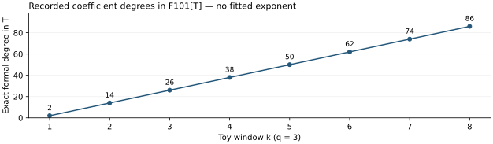

# Curve25519 section coefficients: reduced support, growing degree

The separate Rust component replaces explicit Frobenius and ordinate tests
with first-power torus membership and an eightfold-denominator unit guard,
under the written Fp norm-section and original distinct-raw-column hypotheses.
It qualifies the numeric predicate, while coefficient discovery stays open.
Native claim PCC-20261123-ddf583; written derivation PCC-20261123-eae0ef.
All standing is producer unsigned/unverified. [pcc:unverified]

## The candidate system

For finite R=(r,s),s!=0, normalize c4=1. Five unknowns determine
U=(X-r)(c0+c1X+c3X²)+c5s, V=(X-r)(c2+X)+c5,
and S=-(U²-(X³+AX²+X)V²)/(X-r), a monic sextic. The identity-R chart
normalizes c5=1. The reduced predicate is E_B mod S=0 and gcd(S,D3)=1;
keep the original map-denominator inverse guard and Q=[8]R contract.
The unchanged original extractor still checks every returned indexed row.
[pcc:unverified]

The signed trace membership polynomial has degree D=2qk and explicitly
displayed distinct Fp roots under odd exact torus order and2k<a. Its cleared
Moebius pullback E_B is split and squarefree. Raw x values are injective across
the original positive window. A squarefree norm with these roots cannot have
a nonsquare ordinate: otherwise U and V share that root, forcing a squared
factor of S. Three classical Montgomery doublings supply D3, excluding
identity eightfold images. The complete argument and exceptional cases are
in section-coeff-v1/DERIVATION.md. [pcc:unverified]

This is specific to the original distinct-raw/Fp contract. Generic RR9 radical
support and squarefree reduction are prior work; its repeated-support coverage
objections still apply to other bases. Arbitrary algebraic-closure coefficient
solutions need not be original Fp rows. A solver must pay for Fp extraction
and original lifting. [pcc:unverified]

## Fixed native evidence

| Declared control | Observation |
|---|---|
| 24 toy columns, 48 signed-trace map roots | split, squarefree, distinct x; 22 nonidentity images |
| 1792 six-column signed tuples from eight retained columns | 1770 supported original replays; 22 finite two-torsion chart refusals |
| Identity-R cases inside supported tuples | 16 original replays |
| 101 c3 pencil values | 1 accepted/replayed; 98 predicate refusals; 2 map-chart refusals |
| Repeated raw support | old sixth-power support passes; new first power refuses |
| Six distinct columns including identity image | membership passes; D3 unit guard refuses |
| Original actual q213156431/a60824497, k31 and k20633 | both supplied sections extract j1..6,t0 with original replay |

One worker completes1810 records including completion. Coefficients are
constructed from known points, not discovered from a public-target cohort.
The actual base is not enumerated. Four focused release tests, fmt and strict
all-target Clippy pass. Counts establish correctness scope, not useful yield,
timing, live RAM, complete bitops or a speed ranking. [pcc:unverified]

The dense toy polynomial is built from the displayed raw roots; the fast versus
dense comparison covers the101 coefficient-pencil values. References share
field primitives, and this is not an independent implementation of every
mathematical bridge. [pcc:unverified]

## Degree audit and the next scaling question

On the formal c3=T pencil, s5=-T²+lower terms. Repeated monic reduction
of the leading X^D term has a unique maximal-degree path using -s5; every
other branch loses more X degree. Thus the literal X5 remainder coefficient
has T-degree2(D-5)=4qk-10. Exact native toy degrees at k1..8 are
2,14,26,38,50,62,74,86. The actual parameter formula gives
17,592,226,563,282; the actual polynomial is not expanded. [pcc:unverified]

The compact five-input representation therefore does not provide constant-
degree literal equations. This degree is not a lower bound on solving degree,
regularity, minimal generators or other solvers. The practical next obligation
is an unknown-coefficient circuit with extension/projection correctness and a
structured elimination/root-extraction bound. Avoid all-triple construction;
charge setup, failed attempts, original indexing/lifting, memory and useful
rank under the original family/private-selection/kernel/recovery criteria.
[pcc:unverified]

## Proof and provenance scope

Two existing-law Lean endpoints pass the maintained file audit,2 named
theorems/0 failing/0 trusted native, standard axioms only: squarefree
inheritance (PCC548372) and no squared linear divisor (PCCaa408d). They do
not formalize the trace/norm/native/group or degree induction. The full proof
map remains partial. All claims are unsigned. [pcc:unverified]

Native source112d723022 has41 inputs: frozen30-input58112-byte context plus
11-input13500-byte delta. Eight compiled hashes and the1651728-byte copied
binary19a02061785d match pre/post. The complete4581082-byte raw JSONL has
digest7b59c8519927; its164272-byte archive8f7b6024a389 is selected by the
actual artifact policy. See PUBLISHING.md for trusted upload standing; a
local hash is not an upload receipt. Four complete auxiliary witnesses are
retained; all remaining original rows/coefficients and witness digests remain
in the complete raw archive. [pcc:unverified]

Prior art: [Gassert arXiv1209.4396](https://arxiv.org/abs/1209.4396), half-trace
scaling of the monic convention;
[EFD Montgomery XZ doubling](https://hyperelliptic.org/EFD/g1p/auto-montgom-xz.html);
[official Sage Mumford divisor documentation](https://doc.sagemath.org/html/en/reference/arithmetic_curves/sage/schemes/hyperelliptic_curves/jacobian_morphism.html);
internal RR9 radical-support result. KB unavailable; Cantor1987 primary PDF403.
No exhaustive novelty clearance is asserted. [pcc:unverified]
