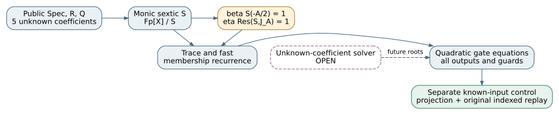
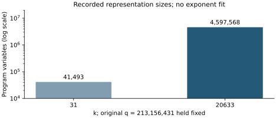

# Guarded coefficient circuits for original Curve25519 sections

2026-11-23. Producer construction/control report; unsigned statements
PCC-20261123-70247b and PCC-20261123-7f4e38. Source PR5040.

The compiler now keeps five normalized section coefficients unknown and emits
acyclic quadratic equations over Fp, with two explicit inverse inputs. It
accepts public Spec,R,Q=[8]R only. Known coefficients enter a separate extension
control, which fills wires and then projects them back through the unchanged
original indexed extractor and group replay. [pcc:unverified]

For the original actual parameters p=2^255-19,A486662,a60824497,q213156431,
the fixed k20633 program contains4597568 variables and4597589 equations.
All15 fixed arms and completion succeeded, including the full-k known-section
replay. This is a representation and correctness result, with no coefficient
discovery or solving-degree/performance inference. [pcc:unverified]

## Construction and domain

Use the original Fp norm-section chart, c4=1 for finite R with nonzero ordinate,
or c5=1 for R=O. Construct its monic sextic S. With r0=-A/2 and
S=(X-r0)B+S(r0), beta*S(r0)=1 guards the original map and
lambda=-(A/2)*beta*B modulo S. No unknown inverse is evaluated freely.

For the declared rational nonzero-ordinate support, use the classical guard
J_A=(X-1)((X^2-1)^2-4(X^3+A X^2+X)). The required hypotheses A+2 square and
A-2 nonsquare give unique rational2-torsion and only the x1 rational order4
branch. Thus J_A detects points killed by8 on this domain. Introduce
eta*det(M_J)=1, using a division-free determinant of multiplication by J_A
modulo S. The degree5 guard replaces the old degree63 denominator only under
these rational-support hypotheses. The membership condition remains.
[pcc:unverified]

Compile tau=4T_q(lambda)^2-2 and the frozen fast finite-free geometric-product
recurrence. Every final Fp coordinate, forced norm-factor remainder and inverse
guard remains constrained. The topological gate argument gives a written
extension/projection construction over Fp. It is not a formal native compiler
theorem or an algebraic-closure equivalence. PROOF_MAP.md names each gap.

## Fixed controls and recorded sizes

One qualified local native call,600-second wall/2GiB virtual-memory caps:
15 planned arms,15 attempted,15 completed,zero excluded;16 JSONL records include
completion. Four focused release tests, fmt and strict all-target Clippy also
passed after retained failed build/lint attempts. [pcc:unverified]

| Fixture | Variables | Equations | Input roles |
| --- | ---: | ---: | --- |
| Original actual q, k31 |41493|41514| five coefficients, two guards |
| Original actual q, k20633 |4597568|4597589| five coefficients, two guards |

The graph contains one deterministic program per fixed k, with q and the
known actual section held fixed. Counts have no sampling interval; they are
not timings, normalized work or a fitted growing-family exponent.

Controls include eight toy sign patterns, two identity-R sections, all101 c3
pencil values (one accepted, original replay retained), all102 nonzero-ordinate
toy points for rational torsion, six actual signed low-order points,64
distributed wire mutations plus two inverse-input mutations, and malformed/
resource refusals. The largest actual case retains the original q and j1..6/t0
known section. It is not a uniform public-target root-discovery cohort.
[pcc:unverified]

## Provenance, publication and next step

Local source6f4987bd preceded the call; public sourcee1591a20 has identical
source blobs. Composite54 inputs comprise unchanged old30 and old11 snapshots
plus the new13-input21360-byte delta. Ten compiled-in hashes, all54 source
hashes and immutable binary46e75f76 match before/after. [pcc:unverified]

The complete native archive is117571164bytes, SHA256697a904ccfda...;
raw218010bytes/e9d3ccf6a00b and all24 complete gate/assignment exports are
retained locally. Trusted-store publication is pending; the Git metadata
projection is not an upload or signed execution receipt. [pcc:unverified]

The decisive next step is unknown-coefficient solving on the same guarded
predicate, followed by original lifting and full setup/yield/family/memory
accounting. Seven input wires do not remove the millions of auxiliary
variables or establish low solving degree. No new canonical leaderboard or
progress-graph datum is admitted by this construction; those views stay
unchanged by this work.

Sources: Costello--Smith, Montgomery curves and their arithmetic, sections2.3
and3.3, https://arxiv.org/html/1703.01863v1 ; EFD Montgomery XZ formulas,
https://hyperelliptic.org/EFD/g1p/auto-montgom-xz.html ; Macaulay2 determinant
strategy documentation; frozen section-coeff-v1 DERIVATION/NEXT and
tools/torus-quotient-query/src/arithmetic.rs. KB/ecdb access gaps and failed
source fetches are recorded in the new DERIVATION; no novelty clearance.

