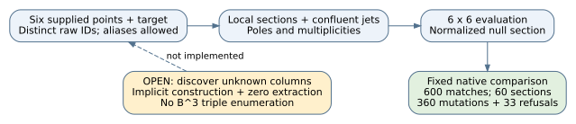
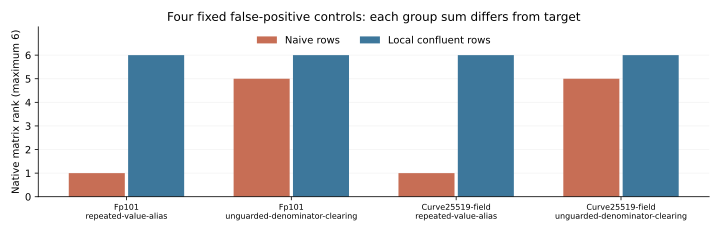

# Six-section elliptic relation predicate with poles and multiplicities

17 November 2026. Native fixed development controls; classical geometric
construction, not a new root-discovery algorithm. Producer unsigned/unverified.

The new Rust component evaluates a six-dimensional elliptic section map on
six supplied candidate points. All600 registered point/target decisions agree
with the existing native group law:60 singular cases carry checked normalized
null sections, and540 are nonsingular. All360 single-coefficient mutations,
33 malformed/unsupported/certificate controls and four naive counterexample
controls give their registered outcomes. These are fixed given-candidate
checks, not a torus-base discovery or scaling dataset. [pcc:unverified]

## Native result and coverage

| Native output field | Value | Meaning |
|---|---|---|
| planned/attempted/matched comparisons |600/600/600| Point tuples against public targets |
| positive sections |60| Rank5 and checked nonzero section |
| coefficient mutations refused |360| Six changes per positive certificate |
| naive counterexamples reproduced |4| Two defects in each declared field |
| malformed/unsupported/certificate refusals |33| Errors or certificate rejections, not absence |

Native fields are Fp101 and Fp(2^255-19); actual A=486662 and toy A=95.
The actual prime subgroup order remains
N=2^252+27742317777372353535851937790883648493, cofactor8. Native input
is a curve, exactly six distinct raw column IDs with already oriented finite
points, and a target. Equal geometric points are allowed. Native v1 rejects
member identity, finite2-torsion, off-curve/noncanonical inputs, singular A,
other moduli and wrong arity explicitly. Target identity is supported.
The geometric theorem is broader than this native uniformizer coverage.
[pcc:unverified]

Fixed controls use G=[8](2,17) on the toy curve, checked to have order13,
and G=[8](9,sqrt(f(9))) in the actual field. The latter are public point
controls; no membership in the original huge torus base is claimed. All28
multiplicity patterns over G,2G,3G and two distinct-point tuples are checked
against the protocol's fixed targets. The old group-addition implementation
is used only by the control comparator, not by the section predicate.
Membership, index/sign decoding and cofactor provenance remain original
pipeline obligations. [pcc:unverified]

## Concrete algebraic formulation

For public R=(r,s),s!=0, let D=5[O]+[R]. A basis of L(D) is

    1, x, y, x^2, xy, h_R=(y+s)/(x-r).

For R=O use the L(6O) basis1,x,y,x^2,xy,x^3. For effective
Z=sum_i[P_i] of degree6, evaluate local sections and all required jets at
repeated points. The6x6 evaluation map has kernel L(D-Z). Thus the classical
degree-zero divisor argument gives

    singular evaluation map iff sum_i P_i=R.

This is the elliptic-code/subset-sum connection in Cheng and Li--Wan--Zhang,
not a novelty claim. The readable derivation and exact domain are in
section-operator-v1/DERIVATION.md. Native/compiler and geometric formalization
are separate; finite controls do not establish the universal native theorem.
[pcc:unverified]

For an admitted finite P=(a,b), use t=x-a and Hasse coefficients y_n from
y(t)^2=f(a+t), dividing only by2b. A multiplicity m requires orders0..m-1.
The implementation retains y_6 because the removable-pole chart shifts one
coefficient. At P=R it evaluates sections after multiplying by t; at P=-R
it takes the removable quotient; elsewhere its denominator is a unit.
This keeps original target coincidences instead of silently excluding them.
[pcc:unverified]

## Two exact defects in naive encodings

1. **Repeated geometric points.** Six distinct raw IDs all carrying G against
   target7G give identical ordinary value rows. The naive determinant is zero
   although the group sum is6G. Confluent jets restore rank6. The inputs are
   synthetic indexed point controls, not a claim of six such original-base
   aliases.
2. **Unguarded denominator clearing.** On G,2G,...,6G against target-G,
   the row

       (x-r, x(x-r), y(x-r), x^2(x-r), xy(x-r), y+s)

   becomes zero at the member G=-R. The naive determinant vanishes although
   the actual sum is not-R. Local section evaluation restores rank6.

Both controls were reproduced in each field. They reject the corresponding
universal naive-predicate promises, not the corrected section construction
or all coordinate/index-calculus routes. Every raw matrix/point/certificate
decision is retained, without dropping exceptional cases. [pcc:unverified]

## What this exposes for exponent research

The generic chart gives six shared-section equations

    (x_i-r)(c0+c1*x_i+c2*y_i+c3*x_i^2+c4*x_i*y_i)
        + c5*(y_i+s)=0,

with a nonzero projective coefficient vector. They are linear in c and cubic
in the point-coordinate features (total degree at most4 jointly), before
auxiliary quadratic compilation. Confluent and pole branches are part of
the full statement. No new full-base compiler or replacement of the frozen
original target circuit has been implemented. [pcc:unverified]

For geometrically distinct members, splitting the six rows into two triples
gives the standard20-term Laplace/Pluecker pairing of their3x3 minors. This
is a low separation-rank formula for the determinant VALUE. It is not a
low-rank existence/counting operator. Across repeated geometric points, jet
orders also depend on global multiplicities; half representations need that
extra information rather than assuming the distinct-point formula applies.
[pcc:unverified]

A simple warning is exact: the value matrix V_xy=x-y over distinct field
labels has rank at most2, but its zero-indicator matrix is the identity,
whose rank is the number of labels. Therefore low polynomial-value rank
does not imply low zero-predicate rank. Nor does rank exclude fast algorithms
by itself. A subcubic zero-finding/extraction algorithm needs its own argument.
[pcc:unverified]

The next concrete task is an implicit family of these section/minor features
with affordable construction and a zero-extracting query/restriction operator.
Enumerating all B^3 triples first still spends N^(1/2) at B~N^(1/6).
The preceding target remains: more than B usable privately tagged rows in
B^(3-epsilon) TOTAL work, with setup, yield losses, original roots, common
columns, kernel and recovery included. Six-dimensional verification by itself
does not supply a decomposition exponent. [pcc:unverified]

## Reproduction and qualification

Native source was frozen in local commit727d40ab01bd306807836d762f4ac51ee429e37e
before the one final controls call. Seven compiled-in hashes match nine
source/contract inputs in source-v1.tar.xz (17976bytes). The separately copied
953248-byte executable has SHA256
0eb6ccd2128f0780ac3c2f2c8e2c5c30d0dc2afa834208892cc8544b0c3c3cc6.
BUILD is explicitly post-build; PRECALL was not overwritten; POSTCALL records
exit0 with source/binary unchanged. This is producer qualification, not an
external signed execution receipt. [pcc:unverified]

All1736065 raw JSON bytes are retained locally and losslessly compressed to
71625bytes under native-v1/controls.json.gz; SHA256 of the original is
d11cce0e804eee70a38c38402d1a0d6c980094883e21ab306d683e7a389133c9.
SUMMARY.json copies native top-level fields, and the rank figure reads exact
native counterexample objects. Python only handles metadata/archive/layout;
all field, group, jet, matrix and comparison work is Rust. [pcc:unverified]

Focused release unit tests(two), fmt, strict all-target Clippy and release
build pass locally. The pinned Lean project checks one literal native Fp101
matrix/section pair: toy_section_kernel proves its nonzero kernel certificate,
and toy_section_det_zero applies the existing Mathlib determinant law. The
focused build and maintained direct axiom audit pass: two named endpoints
plus the101-primality instance, three audited declarations, zero failing or
trusted-native, standard propext/Classical.choice/Quot.sound only. This does
not prove the native/geometric conversion. [pcc:unverified]

The full maintained gate wrapper produced empty stdout and no usable receipt
during a disk-space failure; it is UNCONFIRMED, not a claimed pass or
mathematical failure. Generated cache objects outside the exact imported-module
closure were removed, preserving sources, research evidence, copied executable
and all imported modules. Initial missing-cache, notation-import, field-import
and packaging failures are preserved. PROOF_MAP.md and lean-check/CHECK.json
state the missing Riemann--Roch/Pic^0/evaluation/compiler bindings. Native
source9 and results stayed unchanged throughout formal work. Native result
claim PCC-20261117-b77508 remains unsigned/unverified. [pcc:unverified]

## Sources, requirements and publication scope

- [Cheng, cs/0507026, section2/Theorem1](https://arxiv.org/pdf/cs/0507026):
  exact same section-space/subset-sum connection. Its general variable-arity
  worst-case hardness is not a fixed-six average-case exclusion.
- [Li--Wan--Zhang,1501.01138, section4](https://arxiv.org/pdf/1501.01138):
  elliptic-code sum criterion. Dense-evaluation existence results do not
  instantiate B~N^(1/6).
- [Cardinal--Sharir, SoCG2023.22](https://drops.dagstuhl.de/entities/document/10.4230/LIPIcs.SoCG.2023.22):
  real-RAM/algebraic decision-tree degeneracy testing. No finite-field or
  subcubic six-sum complexity is transferred.
- [Snowden, Math679 lecture2](https://websites.umich.edu/asnowden/teaching/2013/679/L02.html):
  Riemann--Roch, principal divisors and Pic^0.
- Prior exponent-ideas-v1, root-reference-v1 representative-family protocol,
  original target-circuit-v2 and the immutable consumer ROUTE_CRITERIA_V3.md.

Sources checked (KB): unavailable; no loaded research-KB MCP and the wrapper
is absent/127. Author arXiv texts replace failed UCI/Citeseer retrievals.
Conductor is absent/127 with its documented warning-only fallback. No reservation
or delegation claimed. Cloud runtime guidance and the repository's evidence,
visual and Lean instance-gate skills were used.

Request status: a concrete classical representation and native predicate are
implemented with fixed controls; the implicit zero-search/extraction algorithm
and its exponent bound remain open. No source tests were rerun after sealing,
no paid/solver campaign was launched, and no full original base was enumerated.
Original pinned source/raw/criteria/report bytes are unchanged. Canonical
scoreboards/progress graphs gain no measured performance datum or established
map edge; no benchmark row or novelty promotion is added.
