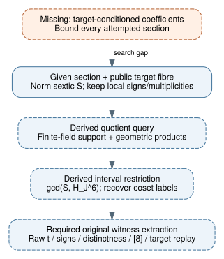

# Structured section queries and the coefficient-search budget

**Status:** derived interface with two native evaluated residual identities and
one checked existing-law assembly endpoint. No implemented quotient query,
coefficient solver or changed attack exponent. [pcc:unverified]

The concrete next interface uses a norm sextic to represent all six candidate
zeros at once. In its fixed-dimensional quotient algebra, torus membership can
be expressed through two geometric products, with interval restrictions for
label recovery. The complete search still needs a target-conditioned source
of useful section coefficients. [pcc:unverified]

## Construction and domain

Transport the original public target Q through the complete rational fibre
of [8]. For a finite fibre point R=(r,s), use the classical section
f=c0+c1x+c2y+c3x^2+c4xy+c5(y+s)/(x-r). Set U=(X-r)(c0+c1X+c3X^2)+c5s,
V=(X-r)(c2+c4X)+c5, and S=(U^2-CV^2)/(X-r), C=X^3+AX^2+X. Normalize
c4=1 and S monic. The removed factor is the forced -R zero of (x-r)f;
the remaining six zeros retain orientation through local sections.
This is classical norm/divisor algebra, also used by the project's RR9 work.
[pcc:unverified]

Assume the original exact norm/order/map contracts, p odd with2 nonsquare,
h of order a*q, a/q odd, q dividing p+1, 2k<a, and complete target-fibre
coverage. In A=Fp[X]/S, let lambda=A/(2X+A), u=T_q(lambda), a_j=Re((h^q)^j).
Require the denominator to be a unit. Three sixth-power tests express support:
(X^p-X)^6=0, (C(X)^((p-1)/2)-1)^6=0, and H^6=0 with H=product_j(u^2-a_j^2).
The powers preserve multiplicities; they do not assume the quotient is a field.
Full sign, raw-distinctness, nonidentity-image and public-target replay stay
mandatory after extraction. The faithful geometric/native proof is open.
[pcc:unverified]

## Query and label restriction

Adjoin v with v^2-(4u^2-2)v+1=0 and put rho=(h^q)^2. Then
P_J(v;rho)P_J(v;rho^-1)=(4v)^|J| H_J. The extension is monic/free and v is
a unit; cancellation does not divide by a possible zero divisor. Existing
geometric-product algorithms construct/evaluate these products in
O(M(sqrt(|J|))+sqrt(|J|)) fixed-algebra operations. With quasi-linear native
polynomial multiplication, the conditional query cost is soft-O(sqrt(k)+log p+log q).
Naive convolution would not realize that bound. [pcc:unverified]

For label intervals use gcd(S,H_J^6), descend only occupied primary factors,
then factor polynomials of degree at most6. Recover signed ordinates by local
section orders, torus parameters by the old guarded trace lift, and raw t by
the original bounded decoder. At most6 occupied interval paths give a
soft-O(sqrt(k)) restriction cost, while index decoding still costs its charged
setup and up to soft-O(sqrt(q)) per extracted fixed-size witness. No step
chooses the section coefficients. [pcc:unverified]

## Cold seed budget and a scoped rejected route

For C_seed attempted coefficient vectors and R_out useful rows, charge
W_setup + C_seed*soft-O(sqrt(k)+log p+log q) +
R_out*soft-O(sqrt(k)+sqrt(q)+log p) + private selection + kernel + recovery.
Include scalar operations, failed tests, finite-field factorization's stated
expected cost, scratch storage, decoder tables and retained rows. At
k=B^theta and C_seed=B^chi, the seed-testing phase needs chi+theta/2<3.
No admissible-family constructor or useful-yield theorem establishes it yet.
[pcc:unverified]

Uniform normalized coefficients cannot meet this model. There are p^5 seeds;
a useful degree6 zero divisor uniquely determines its section up to scale.
For M signed preimage points there are at most binomial(M+5,6) divisors,
including repeats. Thus Pr[hit] <= binomial(M+5,6)/p^5, or O(p^-4) at
M=O(p^(1/6)). This is a written counting rejection of uniform chart sampling,
not an exclusion of biased coefficient generation or index calculus. The
actual divisor/counting Lean bridge and independent verification remain open.
[pcc:unverified]

## Evidence, formal scope and remaining action

- Native IDC1h5aa2ca2649f9d3c6 (degree3) and IDC1ha8ad4123fd0897a8 (degree5)
  each passed fixed32+32 evaluated checks and plus-one refusal in the maintained
  2^61-1 field. Source9/compiled5/archive17104bytes and retained binary match;
  nine maintained module release tests,fmt,strictClippy and build passed.
  Native record PCC-20261117-e20e6b is unsigned. [pcc:unverified]
- The maintained standalone Lean proof gate passed one existing-law endpoint,
  sixth_power_rescaling_zero_iff, with propext and zero failing/trusted-native.
  It covers unit cancellation only. It is not a norm/divisor, counting,
  quotient-algorithm, raw-map or cost proof. [pcc:unverified]
- First missing dependency/non-Serialize build, inherited SHA Clippy warnings,
  missing-PATH and binder Lean failures are retained. Hashing now uses the
  pinned sha2 backend; maintained source/helper bytes are unchanged. The final
  native launch's Python file-capture wrapper is disclosed in LAUNCH_NOTE;
  shell reproduction is supplied and no unchanged rerun hides that departure.
- Next: implement the finite-free-algebra query/restriction and original lifting
  under separate qualification, then establish a biased coefficient constructor
  and complete cold/yield contract. No experiment, paid job, benchmark or solver
  campaign is scheduled by this report. The named problem is
  [coefficient selection](../../../../problems/curve25519-section-coefficient-selection.md).

No canonical scoreboard, measured performance row or established route edge
changes: the flow above is a proposed analytic interface. Original source,
criteria, frozen reports and prior evidence remain unchanged.

Sources: [Bostan--Yurkevich §2.1](https://arxiv.org/pdf/2012.08656),
[Bostan--Schost](https://mathexp.eu/bostan/publications/BoSc05.pdf),
[Cheng §2](https://arxiv.org/pdf/cs/0507026),
[Li--Wan--Zhang §4](https://arxiv.org/pdf/1501.01138), and immutable RR9 norm
protocol cdbf32ff. SOURCES.md records bounded fallback/KB unavailability and
exact reuse. No novelty claim follows. [pcc:unverified]
