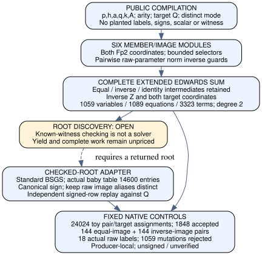

# Public-target composition and signed raw-index rows

16 November 2026. Rust relation interface and fixed development controls.
PCC-20261116-4679b0; signed standing unverified. [pcc:unverified]

The compiler joins signed many-coset members to a public Curve25519 target
using complete extended Edwards addition. Equal points, inverse points and
identity intermediates are retained. Checked roots decode into signed raw
columns(j,t), independently replayed by native Montgomery addition. Public
compilation receives parameters/arity/target/distinct-index mode; no planted
labels, signs, scalar or point witnesses. [pcc:unverified]

|Exported interface|Variables|Equations|Terms|Max degree|
|---|---:|---:|---:|---:|
|One signed nonidentity cofactor image, inherited v1|159|161|483|2|
|Six members, target and distinct raw indices|1059|1089|3323|2|

These count different outputs/arities, not speed or attack work.
PCC-20261116-4679b0. [pcc:unverified]

## Intended conditional semantics

Actual parameters are p=2^255-19,A=486662,a=60824497,q=213156431,k=20633
and the earlier norm-one generator h of order a*q. Raw columns are
1<=j<=k,0<=t<q, cardinality4398056640823 under that exact-order contract.
Their canonical points use the smaller raw v root, followed by 8P. Image
aliases stay separate columns. Identity-image columns have log zero and
are omitted from this retained-leaf interface.

External contracts: prime field, nonsquare2, exact order, prior membership/map
law, nonsingular Montgomery curve, square minus one, nonsquare Edwards d,
and odd-order cofactor image subgroup. Numerical conversion/nonsquare
conditions are checked, not primality, exact order or point count. The RFC
instance gives the group parameters; a formal type/instance bridge and full
compiler soundness/completeness proof remain open.

Member equations are copied with explicit variable offsets and semantic
roles. In distinct mode each named Norm(z_i-z_j) has an inverse witness.
Nonsquare2 makes this exclude equal parameters while retaining point aliases.
Separate general mode allows repeated parameters for group-law controls;
it does not replace distinct tuples or establish useful yield.

For nonidentity odd-order images convert

    x=C*u/v, y=(u-1)/(u+1), C²=-(A+2), d=-(A-2)/(A+2).

The chart guards v and u+1, which cannot vanish in the specified retained
subgroup. Start with(X,Y,Z,T)=(x,y,1,xy), use exactly RFC8032 section5.1.4's
complete eight-product additions, and retain every defining equation,
XY=ZT,-X²+Y²=Z²+d*T² and inverse Z. Match both target coordinates,
X=x_Q*Z,Y=y_Q*Z; identity is(0,1). Nonzero-query and one-retained-row
selection remain separate controller requirements. These are intended
conditional semantics, not a compiler theorem inferred from finite tests.

## Implemented raw-index side phase

Decode j,z through semantic roles; recover t from z/h^j=(h^a)^t by standard
HAC Algorithm3.56 baby-step giant-step. Bound t<q, verify the power and
reconstruct z. Actual q needs 14600 baby entries; hard cap 2^20. Independently
recompute each canonical image/sign, combine only equal raw labels and replay
the row against Q. This computes no elliptic scalar log. Correlated column
logs need not be independent in the earlier conditional scalar-kernel model.

For O(B) successful fixed-arity rows, standard BSGS contributes
soft-O(B*sqrt(q)) work and O(sqrt(q)) table space. Even q-step scans cost
O(B*q)<=O(B²), since q<=B. Charge this side phase; root discovery, failed
attempts, yield and complete attack work remain unpriced.

## Fixed observations and failures

|Requirement|Observed coverage/status|
|---|---|
|Actual cancellation/doubling/identity intermediates|Five aggregate cases accepted and row-replayed|
|Actual raw-index/sign recovery|All 18 frozen v1 signed leaves recover original labels|
|Six distinct actual members|Every equation holds and signed row independently replays|
|Adversarial checks|All 1059 variable increments reject; wrong target, repeated parameter, malformed shapes and memory/arity caps reject|
|Toy curve/image population|All 101² affine pairs checked;104 total points,13 eightfold images|
|Toy raw columns|All 24 inspected; two identity-image columns excluded,44 signed leaves retained|
|Toy target coverage|1848 ordered distinct-raw pairs against13 targets:24024 canonical assignments,1848 accepted, zero disagreement|
|Toy point-image aliases|144 equal-image and144 inverse-image pairs;144 identity sums|
|Formal compiler/group bridge|Open; no new Lean endpoint|
|Root discovery/cost/yield|Not implemented here|

PCC-20261116-4679b0. These are producer-local finite observations.
[pcc:unverified]

Toy parameters:p101,A95,C2,d99,h=(17,12),a17/q3/k8; native checks
h^51=1,h^3!=1,h^17!=1. Excluded raw columns are(j1,t2),(j8,t2), retained
explicitly in the [record](../../target-circuit-v2/native-v2/controls.json).
The record gives every retained leaf/image and full byte-trace ordering.
Coverage concerns canonical gate assignments, not arbitrary auxiliaries.

First build failed on an unused private Clone derive and an extra Poly
borrow; exact source/log retained. After these type corrections, two release
tests, fmt and strict all-target Clippy pass. The output binary wrote its
qualifier before controls and exited0. No criterion/fixture changed.
[Reproduction notes](../../target-circuit-v2/REPRODUCE.md) bind43 inputs,
55368-byte source archive, ten compiled-in hashes, retained binary and full
compressed system/first witness/trace. Earlier v1 archives/direct Lean
bindings retain bytes. This is not signed execution. [pcc:unverified]

## Next discriminating step

Discover original roots from public inputs under a separately frozen bounded
solver protocol; charge setup, failures, successful-root indexing and all
remaining phases. Apply the unchanged [route criteria and next gates](../../target-circuit-v2/NEXT.md).
Quadratic degree/sparsity supplies no gamma or useful-yield theorem.
The scaling objective remains open; the relation interface is the completed
component. Independent signed standing remains unverified.

Curve25519 is user-requested. Fp101 is an arithmetic correctness fixture,
not a substitute performance panel. No sampling, benchmark, paid job, new
solver campaign, full actual-base enumeration or broad root-library rerun
occurred. Canonical graph surfaces docs/index-calculus-scoreboard.html and
docs/ic/progress-timeline.json remain unchanged: no admitted performance or
attack-cost datum was produced.

Sources checked(KB runtime unavailable):
[RFC8032 section5.1.4](https://www.rfc-editor.org/rfc/rfc8032#section-5.1.4),
[RFC7748 section4.1](https://www.rfc-editor.org/rfc/rfc7748#section-4.1),
[HAC section3.6.2, Algorithm3.56](https://cacr.uwaterloo.ca/hac/about/chap3.pdf),
frozen coset/member/reduction records and existing Rust curve/Fp2 APIs.
Edwards-revisited's download was unavailable; the RFC states its formulas
and completeness conditions. No novelty is claimed for established methods.
