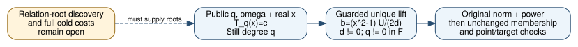
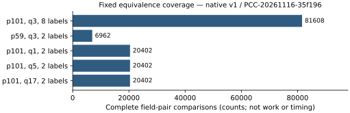

# Guarded trace elimination with original-coordinate replay

The new Rust adapter reconstructs the original imaginary torus coordinate
from a real Chebyshev root and public label, on the nonramified chart.
All149776 fixed field-pair comparisons agree with the original norm/power
equations; all24 original toy members also replay through the unchanged
membership circuit. Native PCC-20261116-35f196; unsigned/unverified.
[pcc:unverified]

Let z=x+b*sqrt(2), omega=c+d*sqrt(2), norm(omega)=1 and d!=0. Classical
Chebyshev/Pell identities imply that T_q(x)=c has the unique lift
b=(x^2-1)U_(q-1)(x)/(2d). The implementation computes U=T'_q/q by binary
automatic differentiation and therefore also requires q nonzero in the
field. The complete residual derivation is in trace-lift-v1/DERIVATION.md;
native evaluated identities are not formal proofs of this adapter.
[pcc:unverified]

| Fixed domain | Labels | Field-pair comparisons | Original roots |
|---|---:|---:|---:|
| Fp101, q3, original core | 8 | 81608 | 24 |
| Fp59, q3, original core | 2 | 6962 | 6 |
| Fp101, q1, algebraic control | 2 | 20402 | 2 |
| Fp101, q5, algebraic control | 2 | 20402 | 2 |
| Fp101, q17, algebraic control | 2 | 20402 | 34 |

These are complete finite algebraic checks, not timings, yield estimates or
relation-root searches. The q5 example emphasizes that polynomial degree
does not imply that all roots lie in the coefficient field. Original
splitting claims require the original exact-order/divisibility hypotheses.
[pcc:unverified]

Eighteen actual-field chart cases replay norm and qth power: nine earlier
j/t parameters and their nine conjugates. The conjugate uses omega^-1,
outside the original positive-j label set; it is a separate algebraic
control. Imaginary-coordinate mutations and six malformed/chart/characteristic
inputs reject. The excluded Fp101 q3 x50 omega1 case has T=1,U=0, so d0
must remain excluded. [pcc:unverified]

The scalar equation retains degree q=213156431. Three narrowly scoped
Lean endpoints apply the existing Mathlib trace/U degree and derivative
laws at that fixed exponent. They do not prove native AD, coordinate
elimination, splitting, a curve/group/compiler instance or solving costs.
The focused gate audits3 named theorems and zero trusted-native exceptions;
PCC-20261116-03a7ff pins the final source/configuration and declaration
bindings. All standing remains unsigned/unverified. [pcc:unverified]

The projected equation is a solver interface. Full coordinate-algebra
construction, relation-root discovery, failures, useful yield, indexing,
selection, kernel, scalar replay and memory still need accounting. No
performance ratio or changed exponent follows from removing a coordinate.
The next action compares original and projected direct elimination on
identical public targets, with original-root lifting and frozen costs.

Evidence: trace-lift-v1/{PROTOCOL.md,DERIVATION.md,FROZEN.md,REPRODUCE.md,
SOURCES.sha256,SOURCE_QUALIFICATION.json,native-v1/}. Source snapshot reuses
unchanged43-input v2 plus new six-input7452-byte delta; retained binary
dfbfcda19fde51588a3fc762e2dc68f1844472cc017da231154ee53a857e7fd3. Initial
Rust API error and Lean call/cast/materialization failures remain retained.
Release test, fmt and strict Clippy pass; standing remains unverified.
[pcc:unverified]

Sources checked (KB unavailable): historical/current Rust Chebyshev code;
[DLMF18.5.E1/E2](https://dlmf.nist.gov/18.5) and
[DLMF18.9.T1](https://dlmf.nist.gov/18.9);
[pinned Mathlib source](https://github.com/leanprover-community/mathlib4/blob/cfc55fc58714a59dc06e6e79edc6d1d95140d3c2/Mathlib/RingTheory/Polynomial/Chebyshev.lean),
especially natDegree_T, natDegree_U_natCast and T_derivative_eq_U.
Chebyshev recognition and these laws are established methods, not a new
coordinate or theorem claim. The new artifact here is their guarded native
adapter and bounded original-coordinate correspondence evidence.

Graphs checked and unchanged: docs/index-calculus-scoreboard.html and
docs/ic/progress-timeline.json. No admitted performance/attack-cost datum
was added. Old report/criteria/direct Lean/source/claim bytes remain frozen.
