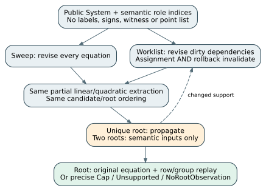
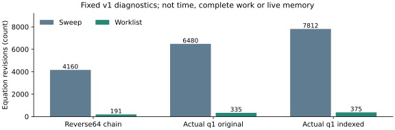

# Public-equation discovery with indexed dependency propagation

16 November 2026. Native evidence PCC-20261116-fb7763; producer standing
unsigned/unverified. Fixed development controls, no timing experiment.

The Rust solver consumes only public equations, declared semantic branching
indices and limits. The new indexed worklist arm returns original-checked
and independently signed-row/group-replayed roots for all 13 declared Fp101
arity 2 targets. Both original equations and the appended index/range/borrow/
constant-product constraints are retained. [pcc:unverified]

|Representation / schedule|Root|Unsupported|Modeled-reservation cap|
|---|---:|---:|---:|
|Original / sweep|0|0|13|
|Original / worklist|0|13|0|
|Indexed / sweep|5|0|8|
|Indexed / worklist|13|0|0|

All 52 toy arm outcomes are retained. Unsupported is this extractor's limit;
the64MiB cumulative modeled-reservation cap is neither an RSS limit nor
an absence result. No arm was rerun with raised caps. The13 targets are the
complete fixed image group, not a useful-yield or growing-family sample.
[pcc:unverified]

The toy is p101/A95/h(17,12)/a17/q3/k8, arity 2 with distinct raw parameters.
Raw aliases remain distinct. The previous compiler's two identity columns
stay excluded. The solver receives neither point-list nor witness nor known
labels/signs. It is partial univariate linear/quadratic substitution and
branching, with no Buchberger/F4 fallback. Derived auxiliaries do not branch.
Prime-field validity is external. [pcc:unverified]

The distinct actual-field control uses p=2^255−19/A486662,
h_new=h_old^213156431/a60824497/q1/k2, arity 2. Its original71-variable/
81-equation system has243 terms. All four arms return a root and replay
+column(1,0)+column(2,0); completed schedule pairs have the same root and
full decision trace. This is TWO columns, not the original huge q213156431
base or its six-member discovery problem. [pcc:unverified]

Equation revision counts, n=one fixed control per pair; no timing/uncertainty
model is claimed. Reverse 64 chain:4160 sweep versus191 worklist revisions,
but BOTH scan4160 cached statuses. Actual q1 original: 6480/335;
indexed: 7812/375. These counters do not price compilation, parsing,
containers, BigUint arithmetic internals, replay, serialization or live memory.
Do not interpret these ratios as speed or total-work ratios. [pcc:unverified]

The forced-backtracking control keeps a failed branch, contradiction and undo;
both schedules return the same successful trace. Triangular, inconsistent,
nonsquare, cubic Unsupported, missing-branch-role, eight forced-cap and five
malformed controls are retained. The 1100-variable fixture constrains only ONE
variable. Root controls mutate the first constrained coordinate and truncate
the assignment; they do not exhaust arbitrary auxiliary mutations.
[pcc:unverified]

The first native unit control failed because it loaded membership input data
instead of the v2 public-target fixture. Failed source/log remain unchanged;
only the binding and unused import were corrected, without changing fixtures,
caps or acceptance rules. Final release test/fmt/strict all-target Clippy pass
locally. Native source did not change after qualification. [pcc:unverified]

Source context:55 inputs=unchanged 43-input v2 +unchanged six-input indexed
delta +six-input worklist delta. The new delta is12952 bytes; no monolithic
55-input archive is claimed. The separate1470000-byte retained executable,
six compiled-in source/fixture hashes and pre-call qualifier are recorded in
worklist-solver-v1/FROZEN.md and SOURCE_QUALIFICATION.json. The entire raw tree
is one10992-byte archive per AGENTS section 13a with original member hashes, including
the1782635-byte controls.json. This is producer evidence, not signed execution
or a formal compiler/solver correctness theorem. [pcc:unverified]

Prior art: Mackworth 1977 pp104–107, AC1/AC3 dependency queue/deduplication,
https://www.cs.ubc.ca/~mack/Publications/AI77.pdf; HAC chapter 3 section 3.5.1,
Algorithms 3.34–3.37, https://cacr.uwaterloo.ca/hac/about/chap3.pdf.
The algorithm is classical scheduling applied to these public polynomial
systems, not full AC3 domain consistency or a new generic solver theorem.
KB unavailable in this runtime; repository/primary fallback, no novelty audit
is inferred from missing KB tools.

Requirement status: public-input fixed discovery implemented with producer
replay evidence; complete cold accounting partial; formal/independent signed
validation open; original actual huge-base discovery and admitted matched
performance comparison not attempted. No paid job/campaign is running.
The next step is the complete accounting and independent boundary check in
worklist-solver-v1/NEXT.md. Canonical IC/exponent/cost charts and benchmarks
are unchanged: this report adds no admitted performance datum.
