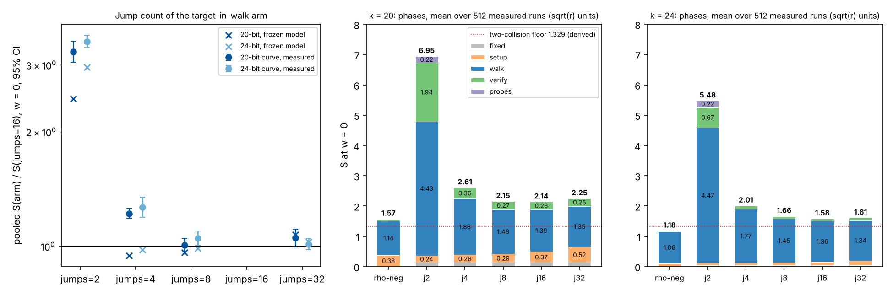

# Jump count of the F = 1 target-in-walk arm, single-target ecbench (2026-11-08)

**Class.** Measured, single-target ecbench sessions under a protocol frozen before data
([PROTOCOL.md](PROTOCOL.md); hashes in `data/frozen.sha256`, freeze commit `a1ce0db2f9`).
Counted units only (ecbench GAE, S = cost/sqrt(r)); every comparison at w = 0, 0.1 and 1, under
both band readings: the pre-2026-11-08 reading (table inserts unpriced; this README's earlier
"committed band") and the priced reading (`ecbench band --price-table-work`; the default since the
owner ruling of 2026-11-08, landing in PR #3726). Public synthetic
Curve25519-family miniatures; no security claim. No pcc claim has been filed; every number is an
unverified assertion until it is reviewed [pcc:unverified]. No code change: the existing `jumps`
option of the `wwalk` oracle on the `tw=1,cj=1` arm, binary `/home/user/ctarget-f1/release/ecbench`
(SHA-256 `d23fab99...` in `data/binary-k{20,24}.sha256`).

**Question.** The current best single-target arm (`twcj`, 16 jumps) spends 17 % of its k = 20 cost on
building jumps. Its jump indices are drawn independently of the point, so the frozen model predicted
that 4 or 8 jumps save that set-up with no walk penalty, and that 2 jumps fail.

**Answer.** The set-up saving is real but the walk penalty is not zero, and the frozen primary
prediction failed. With 4 jumps the arm costs 1.220x [1.186, 1.256] the 16-jump arm at k = 20 and
1.268x [1.193, 1.348] at k = 24 (w = 0), because the walk lengthens from 1.39 to 1.86 sqrt(r) and
needs 2.93 collisions instead of 2.08 for two independent rows [pcc:unverified]. With 8 jumps the
ratio is 1.008 [0.967, 1.051] at k = 20 and 1.050 [1.005, 1.097] at k = 24 [pcc:unverified]. With
32 jumps it is 1.051 [0.996, 1.110] and 1.014 [0.978, 1.051]: the walk is 2.5 % and 1.5 % shorter,
the set-up 54 and 61 GAE dearer [pcc:unverified]. Two jumps fail as predicted: 3.25x and 3.46x, with
the walk reaching its cap below rank 2 in 94 % and 98 % of runs [pcc:unverified]. Sixteen jumps is
not beaten by any tested count: 8 and 32 jumps are indistinguishable from it at k = 20 and k = 24
respectively, 2 and 4 are worse [pcc:unverified]. The only direction left is more jumps at larger
k, where the set-up vanishes (measured in `research/curve25519_tw_scaling_20261108`)
[pcc:unverified]. Rho-neg, per reading: at w = 0 it is ahead, the 16-jump arm being 1.36x
[1.23, 1.50] rho-neg at k = 20 and 1.34x [1.22, 1.48] at k = 24; under the pre-2026-11-08 reading
(inserts unpriced) the verdict is unresolved and the order flips at w = 1 (j16 / rho-neg 0.804 at
k = 20, 0.712 at k = 24); with inserts priced rho-neg is ahead at every weight, by 1.32x to 1.35x
[pcc:unverified]. "Rho-neg remains ahead at every weight" holds under the priced reading only
[pcc:unverified].

## 1. Design (as frozen)

8 sessions per size, `targets_per_curve = 1`, 64 measured rounds plus 1 warm-up per arm,
`order = alternate`; arms `rho-neg`, `twcj-j16` (baseline), `twcj-j2`, `twcj-j4` (primary),
`twcj-j8`, `twcj-j32`, all pipeline arms on `prime-projected-abscissa:size=1,scan_cap=32` with
`targets=stride-generator` and `wwalk:x=1.5,g=1,grow=2,tw=1,cj=1,jumps=J,seed=run`. Audit:
`ecbench verify --replay 1` per session. Pooling: `scripts/pooled_compare.py` (unchanged copy of
the earlier study's, warm-up records skipped), ratio of per-session sums, linearised t interval,
df = 7. Runtime: 90 s of sessions at k = 20 and 2 min at k = 24 (`data/run-*.log`).

## 2. Results (measured)

All 16 sessions completed with 390 of 390 records verified each, and every audit reproduced its
replay with 0 problems (`data/verify-k*-s*.txt`) [pcc:unverified]. Pooled figures use the 3,072
measured records per size (`data/pooled_measured.json`).

Mean S per arm (pre-2026-11-08 reading, inserts unpriced; the last two columns price the inserts):

| k | arm | S w=0 | S w=0.1 (unpriced) | S w=1 (unpriced) | w=0.1, inserts priced | w=1, inserts priced |
|--:|:--|--:|--:|--:|--:|--:|
| 20 | rho-neg | 1.573 | 1.686 | 2.711 | 1.686 | 2.711 |
| 20 | twcj-j16 | 2.136 | 2.140 | 2.181 | 2.279 | 3.567 |
| 20 | twcj-j2 | 6.946 | 6.976 | 7.246 | 7.419 | 11.676 |
| 20 | twcj-j4 | 2.606 | 2.611 | 2.658 | 2.797 | 4.518 |
| 20 | twcj-j8 | 2.153 | 2.158 | 2.199 | 2.304 | 3.662 |
| 20 | twcj-j32 | 2.245 | 2.250 | 2.290 | 2.385 | 3.642 |
| 24 | rho-neg | 1.179 | 1.285 | 2.240 | 1.285 | 2.240 |
| 24 | twcj-j16 | 1.583 | 1.584 | 1.595 | 1.720 | 2.950 |
| 24 | twcj-j2 | 5.475 | 5.498 | 5.705 | 5.946 | 10.180 |
| 24 | twcj-j4 | 2.008 | 2.010 | 2.022 | 2.187 | 3.797 |
| 24 | twcj-j8 | 1.663 | 1.664 | 1.674 | 1.809 | 3.124 |
| 24 | twcj-j32 | 1.606 | 1.607 | 1.617 | 1.740 | 2.952 |

Pooled ratios with 95 % intervals over 8 single-target sessions (pre-2026-11-08 reading, inserts unpriced):

| k | ratio | w = 0 | w = 0.1 | w = 1 |
|--:|:--|:--|:--|:--|
| 20 | j4 / j16 | **1.220** [1.186, 1.256] | 1.220 [1.186, 1.255] | 1.219 [1.186, 1.253] |
| 20 | j8 / j16 | 1.008 [0.967, 1.051] | 1.008 [0.967, 1.051] | 1.008 [0.968, 1.050] |
| 20 | j32 / j16 | 1.051 [0.996, 1.110] | 1.051 [0.996, 1.110] | 1.050 [0.996, 1.108] |
| 20 | j2 / j16 | 3.252 [3.055, 3.463] | 3.259 [3.061, 3.471] | 3.323 [3.120, 3.539] |
| 20 | j16 / rho-neg | 1.358 [1.232, 1.497] | 1.269 [1.149, 1.401] | 0.804 [0.722, 0.896] * |
| 20 | j4 / rho-neg | 1.657 [1.522, 1.805] | 1.548 [1.419, 1.690] | 0.981 [0.890, 1.081] * |
| 24 | j4 / j16 | **1.268** [1.193, 1.348] | 1.268 [1.193, 1.348] | 1.268 [1.192, 1.349] |
| 24 | j8 / j16 | 1.050 [1.005, 1.097] | 1.050 [1.005, 1.097] | 1.050 [1.005, 1.097] |
| 24 | j32 / j16 | 1.014 [0.978, 1.051] | 1.014 [0.978, 1.051] | 1.014 [0.978, 1.051] |
| 24 | j2 / j16 | 3.458 [3.331, 3.590] | 3.470 [3.342, 3.603] | 3.578 [3.445, 3.717] |
| 24 | j16 / rho-neg | 1.343 [1.219, 1.479] | 1.233 [1.118, 1.359] | 0.712 [0.643, 0.787] * |
| 24 | j4 / rho-neg | 1.703 [1.566, 1.852] | 1.564 [1.437, 1.701] | 0.903 [0.827, 0.985] * |

\* The pre-2026-11-08 reading prices rho-neg's per-step canonicalisation and not the walk arms' per-step
table inserts (the asymmetry found in `research/curve25519_f1_targetwalk_20261108` section 5).
With `--price-table-work` (the priced reading, PR #3700's opt-in and the default after the ruling of 2026-11-08; `data/band-tw-*.txt`, and
`ratios_table_work_priced` in `data/pooled_measured.json`) j16 / rho-neg is 1.358 / 1.351 / 1.316
at k = 20 and 1.343 / 1.338 / 1.317 at k = 24 at w = 0 / 0.1 / 1, and j4 / rho-neg is
1.657 / 1.659 / 1.667 and 1.703 / 1.702 / 1.695, so rho-neg is ahead at every weight under that
reading [pcc:unverified]. ecbench's own verdict under the pre-2026-11-08 reading
(`data/band-k*.txt`) for rho-neg against twcj-j16, j8 and j32 is "unresolved inside the band" in all
16 sessions; against j4 in 11 of 16 (k = 20: 5 of 8, k = 24: 6 of 8); against j2 in none (rho-neg is
ahead in 16 of 16) [pcc:unverified]. Where the verdict is unresolved no rank is admitted under that
reading; under the priced reading (`data/band-tw-*.txt`) rho-neg is ahead of all five twcj arms in
16 of 16 sessions [pcc:unverified].

### Phases and walk diagnostics (mean over 512 measured runs per arm, units of sqrt(r))

| k | arm | fixed | set-up | walk | collision verify | probes | total | walk steps / sqrt(r) (sd) | collisions per run | cap reached below rank 2 |
|--:|:--|--:|--:|--:|--:|--:|--:|:--|--:|--:|
| 20 | twcj-j2 | 0.125 | 0.237 | 4.430 | 1.936 | 0.218 | 6.946 | 4.43 (0.36) | 15.19 | 93.6 % |
| 20 | twcj-j4 | 0.125 | 0.256 | 1.860 | 0.365 | 0.000 | 2.606 | 1.86 (0.66) | 2.93 | 0.2 % |
| 20 | twcj-j8 | 0.125 | 0.293 | 1.464 | 0.271 | 0.000 | 2.153 | 1.46 (0.52) | 2.19 | 0 |
| 20 | twcj-j16 | 0.125 | 0.368 | 1.386 | 0.256 | 0.000 | 2.136 | 1.39 (0.49) | 2.08 | 0 |
| 20 | twcj-j32 | 0.125 | 0.518 | 1.352 | 0.250 | 0.000 | 2.245 | 1.35 (0.49) | 2.03 | 0 |
| 24 | twcj-j2 | 0.040 | 0.073 | 4.474 | 0.673 | 0.216 | 5.475 | 4.47 (0.21) | 17.00 | 98.1 % |
| 24 | twcj-j4 | 0.040 | 0.078 | 1.775 | 0.114 | 0.001 | 2.008 | 1.77 (0.70) | 2.97 | 0.4 % |
| 24 | twcj-j8 | 0.040 | 0.089 | 1.450 | 0.085 | 0.000 | 1.663 | 1.45 (0.51) | 2.19 | 0 |
| 24 | twcj-j16 | 0.040 | 0.110 | 1.355 | 0.079 | 0.000 | 1.583 | 1.36 (0.47) | 2.05 | 0 |
| 24 | twcj-j32 | 0.040 | 0.152 | 1.335 | 0.079 | 0.000 | 1.606 | 1.34 (0.47) | 2.03 | 0 |

The set-up follows the frozen model (`data/model.json`) to within 9 %, 0.024 sqrt(r): at k = 20
the model gives 79 / 86 / 100 / 128 / 184 GAE against measured 85.8 / 92.6 / 106.2 / 133.4 / 187.8
for 2 / 4 / 8 / 16 / 32 jumps (+8.6 / +7.7 / +6.2 / +4.2 / +2.1 %), at k = 24 97 / 105 / 121 / 153 /
217 against 105.7 / 113.4 / 128.6 / 159.2 / 220.2 (+9.0 / +8.0 / +6.3 / +4.1 / +1.5 %); it is within
5 % only for 16 and 32 jumps, and the model's fixed part is 8 to 9 GAE low (72 against about 80 at
k = 20); the slope is about 3.5 GAE per jump [pcc:unverified].
The walk does not: every reduction in jumps lengthens it, and every collision beyond the second is
a dependent row [pcc:unverified].

## 3. Predictions (PROTOCOL.md section 5)

| id | prediction | outcome | status |
|:--|:--|:--|:--|
| P1 (primary) | k=20 j4/j16 upper end < 1 at w = 0, 0.1, 1 | 1.256, 1.255, 1.253 | **failed** [pcc:unverified] |
| P1b | k=20 j4/j16 point in [0.92, 0.98] | 1.220 | **failed** [pcc:unverified] |
| P2 | k=20 j8/j16 point in [0.93, 0.99] | 1.008 | **failed** [pcc:unverified] |
| P3 | j4, j8 walk steps within 3 % of j16, both sizes | j4 +34 % / +31 %, j8 +5.6 % / +7.0 % | **failed** [pcc:unverified] |
| P4 | k=20 j32/j16 lower end > 1 | 0.996 | **failed** (by 0.004) [pcc:unverified] |
| P5 | j2/j16 lower end > 1.5 and cap below rank 2 in >= 90 % of runs, both sizes | 3.055 / 3.331; 93.6 % / 98.1 % | **held** [pcc:unverified] |
| P6 | k=24 j4/j16 point in [0.96, 1.00] | 1.268 | **failed** [pcc:unverified] |
| P7 | j4/rho-neg lower end > 1 at w = 0 and, inserts priced, at w = 0, 0.1, 1, both sizes | 1.522, 1.520, 1.512; 1.566, 1.564, 1.552 | **held** [pcc:unverified] |
| P7b | k=20 j4/rho-neg point in [1.25, 1.40] | 1.657 | **failed** [pcc:unverified] |

Two of nine held. The failed predictions stay failed; nothing was re-scored.

Note (validator erratum E6): the k = 24 "model total S" values for j4 / j8 / j32 in PROTOCOL.md
section 4 (1.594 / 1.604 / 1.662) are mistyped; `data/model.json`, hashed in the same freeze, gives
1.5899 / 1.6009 / 1.6672 and is authoritative. The frozen file is not edited, and no prediction uses
these totals [pcc:unverified].

## 4. Why the model failed (exploratory, derived from the counters, not frozen)

The model assumed that with m >= 4 jumps the collision count stays n^2/r and that every collision
is an independent row. The counters show two effects it missed [pcc:unverified]:

- **Dependent re-collisions.** After a collision E_t = E_s the walk continues from a point it has
  already stored, and because the jump index is drawn independently of the point, the next steps
  from E_t repeat the stored path from E_s whenever the two short jump sequences have the same
  count vector. With m jumps that happens with probability about 1/m per step for a one-step
  repeat (and more for longer matches), and every such re-collision is the earlier row again, so
  rank 2 needs a third, fourth, ... collision. Measured collisions per run: 2.93 (m = 4), 2.19
  (m = 8), 2.08 (m = 16), 2.03 (m = 32), against the two that rank 2 needs
  [pcc:unverified].
- **A slower approach to uniformity.** Even the first independent row arrives later with fewer
  jumps (the per-collision rate falls below 2/r because the difference vectors of nearby
  positions repeat); the walk-step means 1.86 / 1.46 / 1.39 / 1.35 sqrt(r) for 4 / 8 / 16 / 32
  jumps at k = 20 fall monotonically toward the 1.329 floor [pcc:unverified].

Both effects favour more jumps. At these sizes each jump costs about 3.5 GAE of set-up, which
cancels the gain already at 32 jumps (walk 0.034 sqrt(r) shorter, set-up 0.150 sqrt(r) dearer at
k = 20). At k = 28 and 32 the set-up is 0.01 sqrt(r) or less, which is the follow-on measured in
`research/curve25519_tw_scaling_20261108` [pcc:unverified].

## 5. Distance to matched rho (rho-neg, same sessions)

| k | arm | w = 0 | w = 0.1 (pre-2026-11-08 / inserts priced) | w = 1 (pre-2026-11-08 / inserts priced) |
|--:|:--|--:|:--|:--|
| 20 | twcj-j16 (current best) | 1.36x [1.23, 1.50] | 1.27x / 1.35x | 0.80x (artifact) / 1.32x |
| 20 | twcj-j32 | 1.43x | 1.33x / 1.41x | 0.85x (artifact) / 1.34x |
| 24 | twcj-j16 | 1.34x [1.22, 1.48] | 1.23x / 1.34x | 0.71x (artifact) / 1.32x |
| 24 | twcj-j32 | 1.36x | 1.25x / 1.35x | 0.72x (artifact) / 1.32x |

No arm of this study moves the distance remaining; the 16-jump arm stays the best, at 1.34x to
1.36x rho-neg at w = 0, with the earlier studies' 1.40x and 1.41x inside these intervals
[pcc:unverified]. The order of rho-neg and twcj-j16 changes with w under the pre-2026-11-08 reading
and ecbench calls it unresolved in 16 of 16 sessions, so that reading ranks neither side; under the
priced reading rho-neg is ahead at every weight (j16 lower ends 1.223 / 1.175 at w = 0.1 / 1 for
k = 20, 1.214 / 1.189 for k = 24) [pcc:unverified]. Rho-neg's own set-up (0.376 sqrt(r) at k = 20, 0.098 at k = 24) is part of the
reference, as in the earlier studies.

### Unpriced counters per arm (AGENTS.md section 5a listing)

Mean per measured run, in units of sqrt(r), k = 20 / k = 24 (validator's recomputation from the
records) [pcc:unverified]. U is the sum of the counters in `cost.unpriced`; the last column is
`work_native.table_insert_attempts`, counted but priced only by the priced reading.

| arm | U (cost.unpriced) | components | table inserts (counted, priced only in the priced reading) |
|:--|:--|:--|:--|
| rho-neg | 1.138 / 1.061 | `canonicalisations_uncharged` only | none |
| twcj-j2 | 0.300 / 0.230 | lookups 0.136 / 0.185, row_ops 0.148 / 0.041, projected-base and Legendre items 0.015 / 0.005 | 4.430 / 4.474 |
| twcj-j4 | 0.052 / 0.014 | row_ops, sqrt_solves, legendre_symbols, projected_base_* items | 1.860 / 1.775 |
| twcj-j8 | 0.046 / 0.011 | as j4 | 1.464 / 1.450 |
| twcj-j16 | 0.045 / 0.011 | as j4 | 1.386 / 1.355 |
| twcj-j32 | 0.044 / 0.011 | row_ops 0.028 / 0.007 plus the items above | 1.352 / 1.335 |

Each of these is priced at 0, 0.1 and 1 GAE per operation in the band files, and two arms are
ranked only where the order holds across that band [pcc:unverified].

## 6. Scope and limits

- The F = 1 target-in-walk arm is one unknown away from rho: with P1 := G it is a random walk on
  [c]G + [b]Q whose first collision gives log Q (rho with a stored walk). It does no decomposition
  work and is not decomposition-based index calculus; no leaderboard or `benchmarks/README.md`
  row is proposed, and none could be added without the validation gate (no VALIDATION.json, no
  replay certificate; a validator report now exists, `validator-report.json`) [pcc:unverified].
- Single target only; the walk is built from the target.
- Local L0 counted units on a shared host; deterministic and replayed; no wall-clock claim.
- No A/A arm (ecbench seeds runs by workload and round; an A/A arm replicates rho-neg exactly,
  as the earlier studies found). Noise is carried by the between-session t intervals.
- research-kb and ecdb were not reachable from this machine; no novelty claim is made.

## Validation (independent validator, 2026-11-08; status pass_with_errata)

Source: `validator-report.json` in this directory (not edited). Each erratum and how it was applied
here [pcc:unverified]:

- **E1** (Answer wording, 5a ranking): the Answer and section 5 now state the three readings
  separately (w = 0 ahead; pre-2026-11-08 reading unresolved with the order flipping at w = 1;
  priced reading ahead at every weight, 1.32x to 1.35x), and "committed band" is relabelled "the
  pre-2026-11-08 reading" throughout [pcc:unverified].
- **E2** (band-verdict footnote): replaced by the tally j16, j8, j32 unresolved in 16 of 16; j4 in
  11 of 16; j2 in none (rho-neg ahead in 16 of 16) [pcc:unverified].
- **E3** (5a listing): the table of every arm's unpriced counters per run was added to section 5
  [pcc:unverified].
- **E4** (set-up model): "within 5 %" replaced by "within 9 % (0.024 sqrt(r)), model fixed part 8 to
  9 GAE low", with the per-jump-count deviations [pcc:unverified].
- **E5** (overclaim): "optimum" replaced by "16 jumps is not beaten by any tested count; 8 and 32 are
  indistinguishable at k = 20 and k = 24 respectively; 2 and 4 are worse" [pcc:unverified].
- **E6** (PROTOCOL.md k = 24 totals): noted in section 3; the frozen file is untouched
  [pcc:unverified].
- **E7** (record hygiene): disclosed below; closed records are not edited, and the raw archives are
  not uploaded by this commit [pcc:unverified].

Disclosures [pcc:unverified]:

- The measuring binary `d23fab99...` (`/home/user/ctarget-f1/release/ecbench`) was rebuilt on disk at
  2026-11-08T21:08:01Z during validation (now `fcb16d9c...`). The validator's replays used
  `fcb16d9c` and reproduced every count in all 16 sessions (`audit OK: 390 records, 384 replays
  reproduced, 0 problems`), so the replays establish behavioural identity only, not byte identity of
  source or binary [pcc:unverified].
- The benchrec records `20261108T2045Z` and `T2047Z` store 4-decimal metric values that differ from
  the validator's recomputation by at most 0.07 % (the 3-decimal README values agree), for example
  k = 20 j16 S 2.1364 against 2.13575 and j16 / rho-neg 1.3581 against 1.35801; the difference comes
  from rounding in the producer's pipeline and is not explained by warm-ups. All 18 raw entries per
  record have `uploaded: false` (raw archives not uploaded to S3), and `session.json` `git_commit`
  and `git_dirty` are null, so the sessions are bound to the binary hash only [pcc:unverified].
- For its replays the validator exported `CHECKPOINT_SKIP` as well as `BENCHREC_SKIP`; no ledger
  bypass entry resulted [pcc:unverified].
- Validation gate: validator report only; records have `validation: null` and no `VALIDATION.json`
  exists, so no leaderboard or `benchmarks/README.md` row follows [pcc:unverified].

## Files

`PROTOCOL.md`, `specs/`, `data/frozen.sha256`, `data/frozen-at.txt`, `scripts/` (`model.py`,
`make_specs.py`, `run_sessions.sh`, `pooled_compare.py`, `analyse.py`, `make_figure.py`,
`render_pdf.py`), `sessions/k*-s*/{session,spec,plan,host}.json` (the `records.jsonl` files are in
`data/sessions-k{20,24}-records.tar.gz`, hashed in the benchmark records), `data/` (model, plans,
run logs, both band readings, verify reports, `pooled_measured.json`, binary hashes),
`figures/jumps.{svg,png}`, `REPORT.pdf`. Benchmark records:
`benchmarks/records/20261108T2045Z-curve25519-tw-jumps-k20.json`,
`benchmarks/records/20261108T2047Z-curve25519-tw-jumps-k24.json`; figure and report copies in
`benchmarks/20261108-curve25519-tw-jumps/`.
