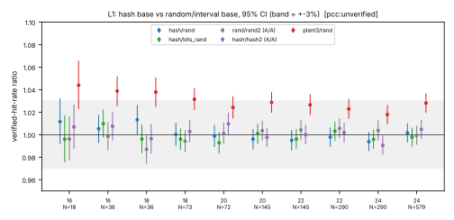

# L1: keyed-hash factor-base membership in C = 2 table-and-probe search (2026-11-22)

**Class:** a mechanism measurement with exact counts and verified hits on Curve25519-family miniatures. It is a null result about relation yield plus a cost statement. It is not a leaderboard row, and it does not change the order against the generic baseline or rho. [pcc:unverified]

**Every number and table in this file is [pcc:unverified].**

Protocol: [PROTOCOL.md](PROTOCOL.md), frozen before any data (`FREEZE.sha256`). Brief: [../BRIEF.md](../BRIEF.md). PDF: [REPORT.pdf](REPORT.pdf). Protocol and code frozen at `91f2f2bcde` (`FREEZE.sha256`); the run was launched from it at 2026-11-22T03:10:04Z (run.log line 1); outputs and the frozen analysis were committed at `e783d12a5b`; write-up `190daab375`.

## Question

Does a factor base defined by a keyed hash of the x-coordinate (SHA-256, fixed published key, membership H(u) < theta, theta chosen so that |V| = N exactly) yield relations at the same rate as the interval ("bits") base, a uniformly random base of the same size, and the projected base, when a relation is a random order-r target R = ±P_i ± P_j with P_i, P_j in the base? [pcc:unverified]

## Answer

**Disclosure (erratum E2): "frozen before any data" is not literally true for the two k = 16 cells.** The seed rule takes neither B nor a smoke role, so the pre-freeze smoke draws (committed 03:09:10Z, before the freeze at 03:10:00Z) are byte-identical to bases 0 to 299 (B = 300 runs) and 0 to 39 (B = 40 run) of the 512 bases in both k = 16 data cells, and were seen before the freeze. The validator's held-out result with bases 0 to 299 of both k = 16 cells dropped: all P1 to P8 still hold, hash/rand pooled 1.0026 [0.9982, 1.0071], and P1 is then exactly at its threshold (8 of 10 cell CIs contain 1). [pcc:unverified]

1. **No departure was found.** The pooled hash/random verified-hit-rate ratio is 1.0013 with 95 % CI [0.9978, 1.0048] over 10 cells (5 curves, k = 16 to 24, two sizes each). The CI lies inside the preregistered +-3 % band, and the exact-coverage ratio agrees (1.0026). [pcc:unverified]
2. **The detector can see 3 %.** A planted 3 % size effect is recovered as 1.0299 [1.0263, 1.0337] against a design value of 1.0309, and a planted 5 % effect as 1.0486 against 1.0506. The T0 key (x + 1/x) gives 1.9767 (CI [1.9733, 1.9803]), the roughly 2x of the earlier T0 study. [pcc:unverified]
3. **The hash is not a lever in generic search and cannot be used algebraically.** It has no polynomial membership, so the F4 decomposition cannot use it. In generic search it behaves as a random base: hash/bits 0.9984, hash/hash2 (A/A) 1.0018, projected hash/projected random 1.0006. The projected base sits at 0.856 to 0.966 of the ceiling 2N^2/(r-1) and is 7.25x the unprojected rate, so the ceiling, not the membership rule, bounds the yield. [pcc:unverified]
4. **The hash adds cost and nothing else.** Enumerating the hash set needs p hash evaluations (1,818 to 57,852 per column here), against about two Legendre or square-root tests per column for the bits and random bases. At equal yield the priced total is equal at w = 0 and larger at w = 0.1 and w = 1, so no strict ranking is claimed. [pcc:unverified]

## Pooled over the 10 cells (geometric mean; MC = verified hits)

| comparison | MC ratio | 95 % CI | exact ratio |
|:--|--:|:-:|--:|
| hash/rand | 1.0013 | [0.9978, 1.0048] | 1.0026 |
| hash/bits_rand | 0.9984 | [0.9948, 1.0019] | 0.9997 |
| bits_rand/rand | 1.0029 | [0.9992, 1.0064] | 1.0029 |
| hash_proj/rand_proj | 1.0006 | [0.9980, 1.0031] | 0.9998 |
| rand_proj/rand | 7.2494 | [7.2257, 7.2717] | 7.2533 |
| rand/rand2 (A/A) | 0.9993 | [0.9958, 1.0029] | 0.9993 |
| hash/hash2 (A/A) | 1.0018 | [0.9981, 1.0053] | 1.0023 |
| plant3/rand | 1.0299 | [1.0263, 1.0337] | 1.0310 |
| plant5/rand | 1.0486 | [1.0448, 1.0522] | 1.0496 |
| T0/blind | 1.9767 | [1.9733, 1.9803] | 1.9763 |

## Per cell (MC ratio and 95 % CI, B = 512 bases per arm)

| k | N | hash/rand | hash/bits_rand | bits_rand/rand | hash_proj/rand_proj | hash/hash2 (A/A) | rand/rand2 (A/A) |
|--:|--:|:-:|:-:|:-:|:-:|:-:|:-:|
| 16 | 18 | 1.0115 [0.9917, 1.0322] | 0.9959 [0.9755, 1.0171] | 1.0157 [0.9953, 1.0363] | 0.9982 [0.9898, 1.0068] | 1.0069 [0.9875, 1.0268] | 0.9962 [0.9774, 1.0164] |
| 16 | 36 | 1.0052 [0.9926, 1.0174] | 1.0097 [0.9975, 1.0224] | 0.9955 [0.9833, 1.0079] | 0.9894 [0.9815, 0.9973] | 1.0075 [0.9947, 1.0201] | 0.9983 [0.9862, 1.0110] |
| 18 | 36 | 1.0133 [1.0004, 1.0263] | 0.9961 [0.9836, 1.0088] | 1.0173 [1.0045, 1.0298] | 1.0055 [0.9968, 1.0141] | 0.9964 [0.9831, 1.0095] | 0.9869 [0.9744, 0.9996] |
| 18 | 73 | 1.0002 [0.9903, 1.0105] | 0.9960 [0.9864, 1.0056] | 1.0042 [0.9944, 1.0141] | 1.0043 [0.9963, 1.0123] | 1.0027 [0.9931, 1.0129] | 0.9942 [0.9847, 1.0041] |
| 20 | 72 | 0.9989 [0.9890, 1.0085] | 0.9928 [0.9829, 1.0024] | 1.0062 [0.9963, 1.0159] | 1.0025 [0.9945, 1.0113] | 1.0097 [0.9999, 1.0195] | 1.0010 [0.9919, 1.0108] |
| 20 | 145 | 0.9960 [0.9870, 1.0049] | 1.0010 [0.9918, 1.0096] | 0.9950 [0.9855, 1.0038] | 1.0018 [0.9937, 1.0099] | 0.9976 [0.9893, 1.0063] | 1.0035 [0.9948, 1.0123] |
| 22 | 145 | 0.9950 [0.9858, 1.0043] | 0.9961 [0.9876, 1.0048] | 0.9989 [0.9898, 1.0078] | 1.0029 [0.9948, 1.0112] | 1.0000 [0.9915, 1.0088] | 1.0041 [0.9951, 1.0131] |
| 22 | 290 | 0.9978 [0.9893, 1.0064] | 1.0032 [0.9945, 1.0116] | 0.9947 [0.9859, 1.0033] | 1.0013 [0.9936, 1.0090] | 1.0018 [0.9932, 1.0108] | 1.0056 [0.9969, 1.0144] |
| 24 | 290 | 0.9938 [0.9855, 1.0025] | 0.9958 [0.9872, 1.0046] | 0.9979 [0.9894, 1.0062] | 0.9938 [0.9855, 1.0023] | 0.9904 [0.9823, 0.9991] | 1.0037 [0.9948, 1.0126] |
| 24 | 579 | 1.0016 [0.9931, 1.0100] | 0.9978 [0.9893, 1.0064] | 1.0038 [0.9949, 1.0128] | 1.0061 [0.9982, 1.0138] | 1.0047 [0.9963, 1.0132] | 0.9993 [0.9911, 1.0078] |

| k | N | rand_proj/rand (MC) | T0/blind (MC) | plant3/rand | plant5/rand |
|--:|--:|:-:|:-:|:-:|:-:|
| 16 | 18 | 7.394 | 2.0032 | 1.0439 | 1.0528 |
| 16 | 36 | 6.911 | 1.9589 | 1.0387 | 1.0443 |
| 18 | 36 | 7.576 | 1.9990 | 1.0378 | 1.0579 |
| 18 | 73 | 6.908 | 1.9595 | 1.0314 | 1.0484 |
| 20 | 72 | 7.594 | 1.9914 | 1.0241 | 1.0499 |
| 20 | 145 | 6.917 | 1.9599 | 1.0286 | 1.0493 |
| 22 | 145 | 7.660 | 1.9920 | 1.0265 | 1.0471 |
| 22 | 290 | 6.929 | 1.9561 | 1.0228 | 1.0445 |
| 24 | 290 | 7.713 | 1.9872 | 1.0179 | 1.0437 |
| 24 | 579 | 6.972 | 1.9610 | 1.0281 | 1.0483 |



## Predictions (thresholds frozen in PROTOCOL.md section 6)

- **P1 HELD.** hash/rand pooled 1.0013 [0.9978, 1.0048] inside [0.98, 1.02] and [0.97, 1.03]; 9 of 10 cell CIs contain 1 (needed 8). [pcc:unverified]
- **P1p HELD.** CI half-widths 0.0203, 0.0124, 0.0130, 0.0101, 0.0098, 0.0089, 0.0092, 0.0086, 0.0085, 0.0085, all at or below 0.03 (needed 8 of 10). [pcc:unverified]
- **P2 HELD.** hash/bits_rand 0.9984 [0.9948, 1.0019] and bits_rand/rand 1.0029 [0.9992, 1.0064]. [pcc:unverified]
- **P2b HELD.** The bits lo = 0 base sits at percentiles 53, 6.6, 3.6, 43, 39, 32, 55, 48, 40, 29 of the offset distribution, and the literal-theta hash base at 76, 11, 51, 59, 88, 56, 86, 67, 85, 39; all inside 1 to 99. [pcc:unverified]
- **P3 HELD.** No unprojected base exceeds 2N^2/(r-1). Projected arms are at 0.856 to 0.966 of it (needed 0.78 to 1.0). rand_proj/rand exact 6.87 to 7.70 (MC 6.91 to 7.71) in every cell (needed 6.0 to 8.4). hash_proj/rand_proj pooled 1.0006 [0.9980, 1.0031]. [pcc:unverified]
- **P4 HELD.** T0/blind exact ratio 1.956 to 2.004 in all 10 cells (needed 1.80 to 2.20); the MC CI excludes 1 in 10 of 10. [pcc:unverified]
- **P5 HELD.** plant5/rand pooled 1.0486, design 1.0506, CI excludes 1 in 10 of 10 cells; plant3/rand pooled 1.0299, design 1.0309, CI [1.0263, 1.0337] excludes 1, 10 of 10 cell CIs exclude 1. [pcc:unverified]
- **P6 HELD.** rand/rand2 0.9993 [0.9958, 1.0029] and hash/hash2 1.0018 [0.9981, 1.0053]; 9 of 10 cell CIs contain 1 for each. [pcc:unverified]
- **P7 HELD.** 0 verification failures, every counted hit verified, 0 instrument-check failures, worst MC-vs-exact z = -2.54 (k = 24, N = 290, plant3). [pcc:unverified]
- **P8 HELD (derived, holds by construction: N^2 + w p >= N^2; not a measurement).** The hash arm's priced total is at least the random arm's in every cell at w = 0, 0.1 and 1. [pcc:unverified]

## Membership cost, priced separately (GAE band 0 / 0.1 / 1)

A hash evaluation is not a group operation. The table costs N^2 group additions; a probe is a lookup (no hash evaluation in table mode; a mode that membership-tests every probe candidate would cost N hash evaluations per target). The ratio below is (N^2 + w p) / N^2 for the hash base against the random base at equal yield, with shared native work excluded in the first three ratio columns, so those are upper bounds (erratum E5). The last two columns price the per-base native count of 2N Legendre or square-root tests on both arms at w each, ratio (N^2 + 2Nw + wp)/(N^2 + 2Nw); the T0 extra inversions belong to the T0 arm only and are not priced. [pcc:unverified]

| k | N | table group ops (N^2) | hash evals to build base (p) | hash evals per column | hash/rand priced total, w = 0 | w = 0.1 | w = 1 | w = 0.1, 2N native priced | w = 1, 2N native priced |
|--:|--:|--:|--:|--:|--:|--:|--:|--:|--:|
| 16 | 18 | 324 | 65437 | 3635 | 1.00 | 21.20 | 202.97 | 20.97 | 182.77 |
| 16 | 36 | 1296 | 65437 | 1818 | 1.00 | 6.05 | 51.49 | 6.02 | 48.83 |
| 18 | 36 | 1296 | 262133 | 7281 | 1.00 | 21.23 | 203.26 | 21.11 | 192.62 |
| 18 | 73 | 5329 | 262133 | 3591 | 1.00 | 5.92 | 50.19 | 5.91 | 48.88 |
| 20 | 72 | 5184 | 1048573 | 14564 | 1.00 | 21.23 | 203.27 | 21.17 | 197.80 |
| 20 | 145 | 21025 | 1048573 | 7232 | 1.00 | 5.99 | 50.87 | 5.98 | 50.19 |
| 22 | 145 | 21025 | 4194301 | 28926 | 1.00 | 20.95 | 200.49 | 20.92 | 197.78 |
| 22 | 290 | 84100 | 4194301 | 14463 | 1.00 | 5.99 | 50.87 | 5.98 | 50.53 |
| 24 | 290 | 84100 | 16777141 | 57852 | 1.00 | 20.95 | 200.49 | 20.94 | 199.12 |
| 24 | 579 | 335241 | 16777141 | 28976 | 1.00 | 6.00 | 51.05 | 6.00 | 50.87 |

Hash and random tie at w = 0 and the hash base is larger at w = 0.1 and w = 1, so the order does not hold across the band and no strict ranking of the two arms is claimed. Skipping non-residues first would change p hash evaluations into about p/2 hashes plus p Legendre symbols, a factor of at most two. [pcc:unverified]

## Mechanism

- A hash base has no polynomial membership, so the Semaev/F4 decomposition cannot use it; it can enter only generic table-and-probe search. [pcc:unverified]
- In generic search the frame-search ceiling applies: P(R = ±P_i ± P_j) <= (number of signed pair sums)/(r-1) = 2N^2/(r-1). An unprojected base reaches about 1/8 of it because cofactor cosets must cancel, and the projected base reaches it up to collisions. A hash of u is independent of the group law, so it cannot bias the cosets. [pcc:unverified]
- The earlier coordinate-oracle toy (lead_sweep_20261110) found a random-base/coordinate-base addition-count ratio of 0.998 at 2^20 (per size 0.97 to 1.75, 9 to 101 relations); that is a cost ratio, not a yield ratio. This run has about 100,000 verified hits per arm and cell and bootstrap over 512 bases. [pcc:unverified]

## Measured versus derived

- **Measured:** verified hits per probed target for every arm and cell (real affine arithmetic re-checks each hit); exact covered points per base from the log model; CVs; instrument checks. [pcc:unverified]
- **Derived:** the ceiling 2N^2/(r-1); the planted design ratios mean(N'^2)/N^2; the cost table (N^2 group operations, p hash evaluations, w in 0, 0.1, 1), which counts operations and measures no time. [pcc:unverified]
- **Imported, not computed here:** distance to rho. The generic baseline is 7.8x rho at k = 20 and the algebraic arms are 2.6x to 1.4e5x behind the generic baseline (curve25519_frame_search_20261103 README, curve25519_algebraic_ecbench_20261102 as cited there). This lead changes neither. [pcc:unverified]

## Disclosures

- No Conductor task, no EKS/Iso Lab route, no S3 resume checkpoint (the upload token expired), no `benchrec` record and no pcc claim were made. The run was local, on a shared host with other wave-7 runs, one core. No timing is reported. [pcc:unverified]
- research-kb and the lead atlas were unreachable, so no KB receipt exists. [pcc:unverified]
- k = 24 is the brief's faithful member p = 16777141, A = 7842 (#E = 8·2098009, twist 4·4192553, both cofactors prime), not the smooth-family member p = 16777213, A = 318 used in the frame-search study. k = 16 to 22 follow the family rule with the erratum values A = 78 and A = 43186. [pcc:unverified]
- Hash and hash2 replicates are disjoint rank windows of one key (random-oracle assumption), tested by the A/A arm and P2b; hash_proj windows overlap the next window when a projected image collides (24 of 512 bases at k = 16 N = 18, 69 of 512 at N = 36, 0 to 6 of the validator's 16 or 32 checked bases elsewhere), a negligible effect on hash_proj/rand_proj. Bases exclude points of E[8]. The hash is taken on the Montgomery u. [pcc:unverified]
- PROTOCOL.md section 9 quotes "3,600 to 29,000" hash evaluations per column; the computed range over the cells is 1,818 to 57,852 (table above). The same paragraph's design ratios "w = 0.1: 6.0 to 21.2; w = 1: 50 to 203" differ from the computed 5.92 to 21.23 and 50.19 to 203.27. The frozen text was not edited. [pcc:unverified]
- No validation-gate evidence (replay certificate, validator report, matched rho band) exists, so no leaderboard or `benchmarks/` row follows. [pcc:unverified]
- Binary `out/*.npz` files are mirrored losslessly as `out_json/*.json` (`export_json.py`, which also checks the reload); `out/SHA256SUMS` and `out_json/SHA256SUMS` list the hashes. Nine of the ten npz are tracked in Git (committed during the run, 27 to 30 KB each, below the 64 KiB threshold); `out/cell_k24_N579.npz` exists only on the run host and is bound by its sha256 in `out/SHA256SUMS` and by its JSON mirror. [pcc:unverified]
- Sources checked (repository files read): BRIEF.md; curve25519_frame_search_20261103 README.md, PROTOCOL.md, scripts/frame_census.py, scripts/run_confirm_rulefix.sh; lead_sweep_20261110 LEAD-EXO-coordinate-revealing-oracles/RESULT.md and LEAD-EXO-hashed-factor-base-tensor-ecdl/RESULT.md; curve25519_t0_symmetry_20261102 README.md; engine output of curve25519_family-5abc70ba `family k` for k = 16 to 24. [pcc:unverified]

## Reproduce

```bash
python3 l1lib.py                                  # curve facts
python3 run_l1.py --out out                       # frozen run, one core
python3 analyse_l1.py --in out --out analysis     # frozen analysis
python3 export_json.py                            # JSON mirrors, hashes, reload check
python3 figure.py                                 # l1_ratios.svg / .png
```

## Errata

Validator errata E1 to E9 (`validator-report.json`, verdict pass_with_errata; no erratum changes a count, a ratio or a verdict). [pcc:unverified]

- **E1.** The header labelled the run `e783d12a5b`. Protocol and code were frozen at `91f2f2bcde`, the run launched from it at 2026-11-22T03:10:04Z, outputs and analysis committed at `e783d12a5b`, write-up `190daab375`. Fixed in the header. [pcc:unverified]
- **E2.** The smoke runs used the same seed rule, so smoke draws are byte-identical to bases 0 to 299 (and 0 to 39) of the 512 in both k = 16 data cells and were seen before the freeze. Held-out result with bases 0 to 299 of both k = 16 cells dropped: all P1 to P8 hold, hash/rand pooled 1.0026 [0.9982, 1.0071], P1 exactly at its threshold (8 of 10 cell CIs contain 1). Disclosed in the Answer section. [pcc:unverified]
- **E3.** The lead_sweep citation was inverted and mislabelled; it is now a random-base/coordinate-base addition-count ratio of 0.998 (per size 0.97 to 1.75). The frozen PROTOCOL section 2 carries the old wording and was not edited. [pcc:unverified]
- **E4.** The P3 range was the exact ratio and the per-cell table the MC ratio under one name; both are now labelled (exact 6.87 to 7.70, MC 6.91 to 7.71). [pcc:unverified]
- **E5.** Shared native work (2N Legendre or square-root tests per base on both arms) was excluded from the cost band. The table now also prices it, giving the repriced w = 1 ratios 182.77 (k = 16 N = 18), 48.83 (k = 16 N = 36), 192.62 (k = 18 N = 36); the unrepriced ratios are upper bounds. P8 is labelled derived, holding by construction. Order and the no-strict-ranking statement are unchanged. [pcc:unverified]
- **E6.** Nine of ten npz are tracked in Git; `cell_k24_N579.npz` exists only on the run host, bound by sha256 and its JSON mirror. [pcc:unverified]
- **E7.** hash_proj windows overlap the next window when a projected image collides; hash and hash2 windows are disjoint. [pcc:unverified]
- **E8.** The PROTOCOL section 9 disclosure now also covers the design-ratio range. [pcc:unverified]
- **E9.** A file-level line states that every number and table is [pcc:unverified]. [pcc:unverified]
